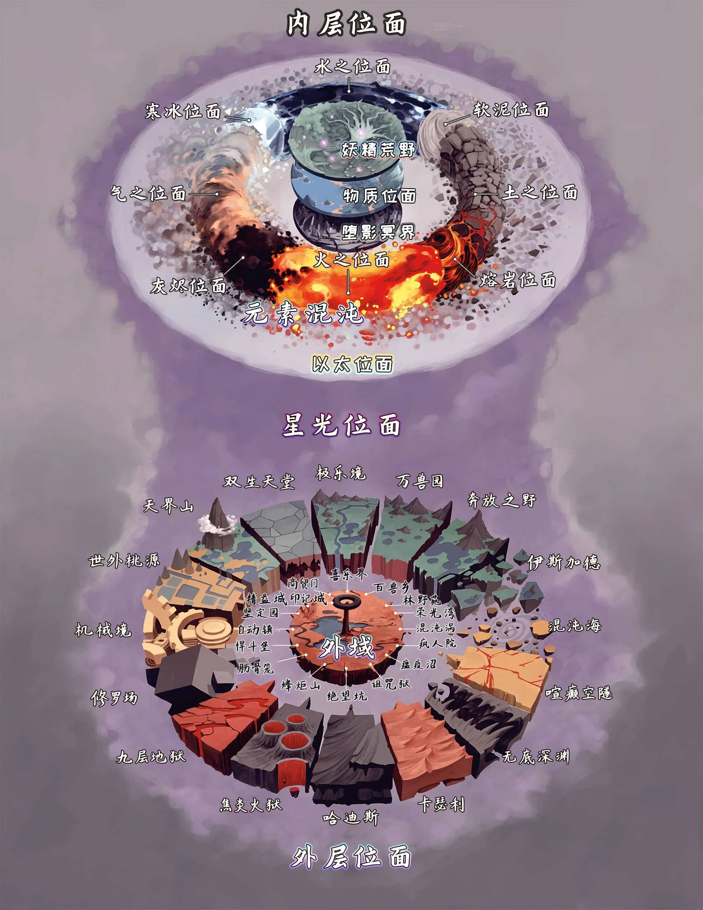

# 多元宇宙索引 (Multiverse Index)

> 圖示中的文字沿用不可變原始資料；正文術語仍以本 Wiki 詞彙表為準。

- [[物質領域|物質領域 (The Material Realms)]]
- [[內層位面|內層位面 (The Inner Planes)]]
- [[外層位面|外層位面 (The Outer Planes)]]
- [[過渡位面|過渡位面 (Transitive Planes)]]

## 城主指南2024：第六章 宇宙學

### 總覽與旅行

- [[戰役設定/多元宇宙/宇宙學|宇宙學]]
- [[戰役設定/多元宇宙/諸位面|諸位面]]
- [[戰役設定/多元宇宙/多元宇宙之旅|多元宇宙之旅]]
- [[戰役設定/多元宇宙/位面旅行|位面旅行]]
- [[戰役設定/多元宇宙/位面冒險|位面冒險]]

### 物質界域與中轉位面

- [[戰役設定/多元宇宙/位面-物質位面|物質位面]]
- [[戰役設定/多元宇宙/位面-妖精荒野|妖精荒野]]
- [[戰役設定/多元宇宙/位面-墮影冥界|墮影冥界]]
- [[戰役設定/多元宇宙/位面-以太位面|以太位面]]
- [[戰役設定/多元宇宙/位面-星光位面|星光位面]]
- [[戰役設定/多元宇宙/位面-半位面|半位面]]
- [[戰役設定/多元宇宙/位面-遙遠國度|遙遠國度]]
- [[戰役設定/多元宇宙/位面-眾門之城印記城|眾門之城印記城]]

### 內層與生命能量位面

- [[戰役設定/多元宇宙/位面-氣元素位面|氣元素位面]]
- [[戰役設定/多元宇宙/位面-土元素位面|土元素位面]]
- [[戰役設定/多元宇宙/位面-火元素位面|火元素位面]]
- [[戰役設定/多元宇宙/位面-水元素位面|水元素位面]]
- [[戰役設定/多元宇宙/位面-次生元素位面|次生元素位面]]
- [[戰役設定/多元宇宙/位面-正位面|正位面]]
- [[戰役設定/多元宇宙/位面-負位面|負位面]]

### 外層位面

- [[戰役設定/多元宇宙/位面-九層地獄|九層地獄]]、[[戰役設定/多元宇宙/位面-無底深淵|無底深淵]]、[[戰役設定/多元宇宙/位面-修羅場|修羅場]]、[[戰役設定/多元宇宙/位面-卡瑟利|卡瑟利]]、[[戰役設定/多元宇宙/位面-哈迪斯|哈迪斯]]、[[戰役設定/多元宇宙/位面-喧癲空隧|喧癲空隧]]、[[戰役設定/多元宇宙/位面-焦炎火獄|焦炎火獄]]、[[戰役設定/多元宇宙/位面-混沌海|混沌海]]
- [[戰役設定/多元宇宙/位面-天堂山|天堂山]]、[[戰役設定/多元宇宙/位面-世外桃源|世外桃源]]、[[戰役設定/多元宇宙/位面-奔放之野|奔放之野]]、[[戰役設定/多元宇宙/位面-極樂境|極樂境]]、[[戰役設定/多元宇宙/位面-萬獸園|萬獸園]]、[[戰役設定/多元宇宙/位面-約瑟園|約瑟園]]、[[戰役設定/多元宇宙/位面-雙生天堂|雙生天堂]]
- [[戰役設定/多元宇宙/位面-機械境|機械境]]、[[戰役設定/多元宇宙/位面-外域|外域]]

## 🔗 相關連結

- [[索引|D&D 5.5e Wiki 索引]]
