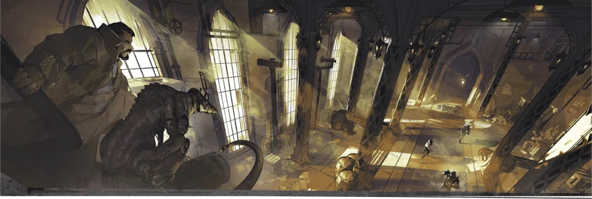

# 薩恩探事員索引

**冒險題材：**黑色電影
**流行文化：**菲利普·馬洛（譯註：雷蒙德·錢德勒著系列長篇偵探小說中塑造的核心角色與敘述者，是硬漢派偵探文學的標誌性人物。）、薩姆·斯派多（譯註：達希爾·哈米特著偵探小說《馬耳他之鷹》及同名電影的男主角。）、邁克·哈默（譯註：米基·斯皮蘭著偵探小說及相關電影的男主角，首次出現於小說《審判者》。）、迪克·崔西（譯註：連環畫《迪克·崔西》及同名電影的男主角。）

薩恩的探事員是一類極具特色的冒險者：他們既像私家調查員，又像警探，還帶點間諜色彩。對他們而言，冒險意味著調查罪案並確保歹徒罪有應得。探事員們查辦謀殺、尋覓失蹤人口、制止勒索，並搗毀走私團伙。而且，他們的調查對象並不侷限於這些凡俗瑣事——他們可能會揭穿一名偽裝成市議員的羅剎，尋回一面強迫教授犯下慘案的附身古面具，或是解除讓貴族後嗣陷入昏迷長眠的魔咒。
如果你想在奇幻背景下效仿菲利普·馬洛、薩姆·斯派多、邁克·哈默或迪克·崔西等名偵探的"黑色電影"式冒險，那麼開啟一場薩恩探事員戰役是個絕佳選擇。若你決定主持此類戰役，最好先與玩家探討遊戲預期的嚴肅程度。扮演原型與惡搞原型之間僅有一線之隔；由於"硬漢偵探"這一黑色電影原型被惡搞得太過頻繁，以此為基礎的戰役很容易滑向喜劇風。請及早並經常與玩家溝通你追求的基調，以及他們對戰役的期望。

## 探事機構

探事機構可作為隊伍的團隊贊助者，提供任務與獎勵；隊伍可掛靠既有公會，或自立獨立機構。選址會影響案件型態：下薩恩偏向貧困客戶與暴力案件，中薩恩偏向商業競爭，上薩恩則偏向隱藏在體面表象下的祕密。（來源：《艾伯倫：奇械鍛爐》，p. 53）

## 條目

- [[戰役設定/艾伯倫/組織與派系/波羅馬氏族|波羅馬氏族]]
- [[戰役設定/艾伯倫/事件/冒險框架/探事員冒險|探事員冒險]]
- [[戰役設定/艾伯倫/組織與派系/黑暗夢境|黑暗夢境]]
- [[戰役設定/艾伯倫/組織與派系/達斯克|達斯克]]
- [[戰役設定/艾伯倫/事件/冒險框架/薩恩探事員衝突|薩恩探事員衝突]]
- [[戰役設定/艾伯倫/地理/城市與聚居地/薩恩/薩恩街區|薩恩街區]]

## 🔗 相關連結

- [[戰役設定/艾伯倫/地理/城市與聚居地/薩恩/薩恩索引|薩恩索引 (Sharn Index)]]
- [[戰役設定/艾伯倫/艾伯倫索引|艾伯倫索引 (Eberron Index)]]
