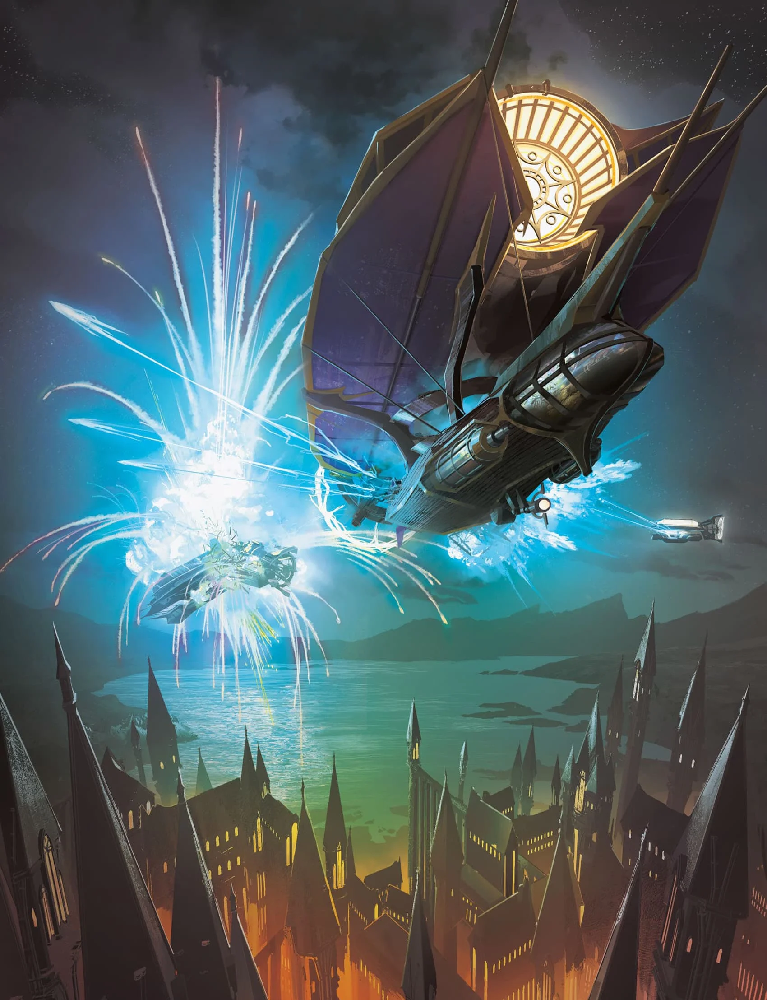
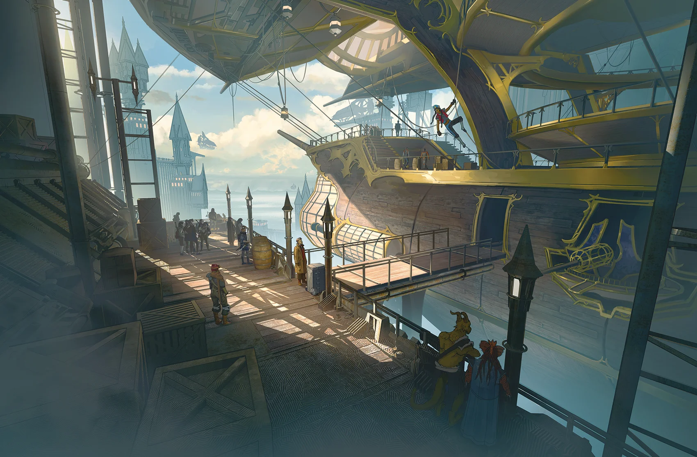

# 元素飛艇索引

在終末戰爭期間，以及戰爭結束之後，遍佈整個科瓦雷的奇械師們在魔法與機械領域取得了許多的進步——但沒有任何成果能與元素飛艇相提並論。元素飛艇有著用翔空木精工雕琢的翔空木船身以及獨特的元素環，是科瓦雷上最為先進的元素動力載具。
第一批元素飛艇的出現也只是近幾年的事情，它們是卡尼斯家族的工坊、黎蘭達家族的龍紋後裔以及吉拉哥的元素誓縛者攜力合作的產物。只有帶有暴風龍紋的龍紋後裔才能輕鬆地使用飛艇的魔法舵臺來控制被束縛在船上的元素生物，並駕駛整艘船。因此黎蘭達家族始終壟斷著飛艇的旅行及服務業務。不過，一些狡猾的發明家也在試圖開發能夠打破黎蘭達家族壟斷現狀的方法，但無論如何，對當下的冒險者而言，黎蘭達飛艇就是在跨越大陸的旅行中的首選交通工具

## 條目

- [[wiki/戰役設定/艾伯倫/文化與族群/交通與生活/升級飛艇|升級飛艇]]
- [[wiki/戰役設定/艾伯倫/文化與族群/交通與生活/天空旅行|天空旅行]]
- [[wiki/戰役設定/艾伯倫/文化與族群/交通與生活/挺進者飛艇|挺進者飛艇]]
- [[wiki/戰役設定/艾伯倫/文化與族群/交通與生活/黎蘭達天梭|黎蘭達天梭]]
- [[wiki/戰役設定/艾伯倫/文化與族群/交通與生活/黎蘭達巡天艦|黎蘭達巡天艦]]
- [[wiki/戰役設定/艾伯倫/文化與族群/交通與生活/戰鬥中的飛艇|戰鬥中的飛艇]]
- [[wiki/戰役設定/艾伯倫/文化與族群/交通與生活/操縱飛艇|操縱飛艇]]

## 🔗 相關連結

- [[戰役設定/艾伯倫/艾伯倫索引|艾伯倫索引 (Eberron Index)]]
- [[wiki/戰役設定/艾伯倫/文化與族群/文化與族群索引|文化與族群索引]]
