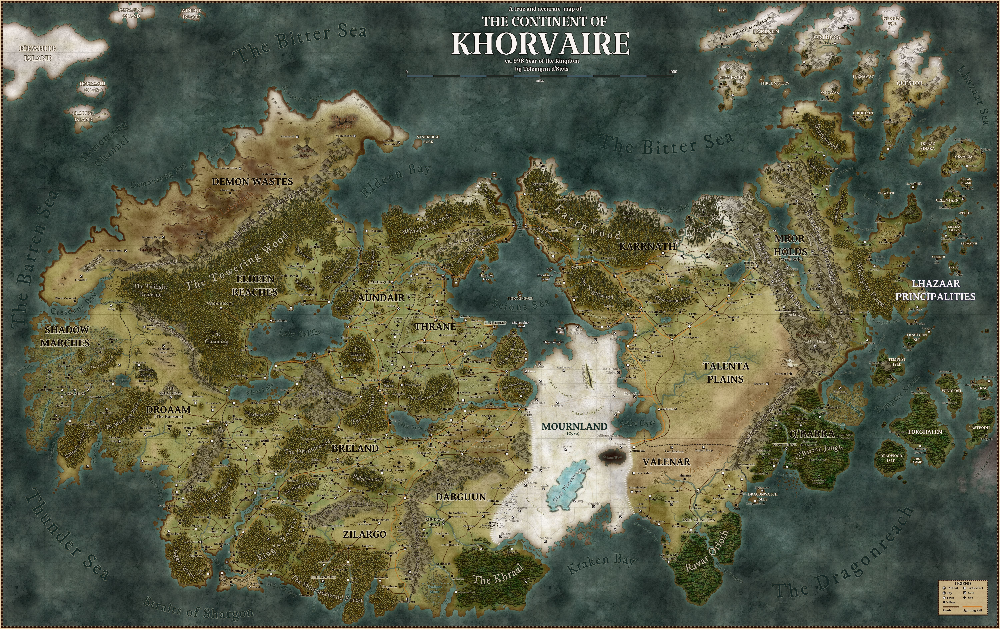

# 科瓦雷 (Khorvaire)

## 導覽與背景

科瓦雷是終末戰爭後多個國家並立的主要大陸；本索引聚焦角色最常接觸的國度、旅行方式與政治張力。

### 使用指引

科瓦雷中部有道路網；歐瑞恩家族的閃電列車連接主要城市，黎蘭達家族的飛艇則更快但更昂貴。各地對終末戰爭與《王座堡條約》的理解不同，適合先決定角色的家鄉、旅行方式與戰爭經歷。

### 科瓦雷地理志 Khorvaire Gazetteer

> [!QUOTE]- 利裡安·達斯，莫格雷夫歷史學家
>
> 就在一個世紀前，伽利法王國的版圖幾乎橫跨整個科瓦雷。誠然，我們從未真正馴服過灰牆山脈以外的土地，也未曾牢牢掌控過東方的叢林。儘管如此，這屬於人類的偉大王國仍令人歎為觀止。
> 如今，我只得帶著一絲絕望凝視科瓦雷的地圖。伽利法支離破碎，五國破鏡難圓。無數新興國度宣告主權——精靈的王國，地精的王國，還有那個被稱作卓姆的怪物之國又是什麼東西？這種分裂會持續下去嗎？抑或另一場戰爭終將讓我們進一步分崩離析？當哀傷或許會直接吞噬我們所有人時，思慮這些事情又是否是杞人憂天？天哪，我該如何面對未來啊。

大多數玩家角色的冒險都始於科瓦雷大陸，如本書所附的海報地圖與地圖。儘管在在科瓦雷諸國的人口中，人類佔據多數，但這片大陸仍是無數民族與文化的家園。曾經，它幾乎完全統一於伽利法王國治下；而今，科瓦雷已被分割為眾多國度——有的歷史悠久，有的則剛從戰爭的烈火中新生。本章將概覽科瓦雷，展現其外的世界，並介紹艾伯倫的主要信仰。

## 科瓦雷地圖

地圖來源：原始資料／艾伯倫：從終末戰爭中崛起／第二章／khorvaire.jpg；已複製為本索引的附屬資產。

## 條目導覽

- [[卓姆|卓姆 (Droaam)]]
- [[卡納斯|卡納斯 (Karrnath)]]
- [[吉拉哥|吉拉哥 (Zilargo)]]
- [[埃爾丁原野|埃爾丁原野 (The Eldeen Reaches)]]
- [[塔倫塔平原|塔倫塔平原 (The Talenta Plains)]]
- [[安黛爾|安黛爾 (Aundair)]]
- [[布蕾蘭|布蕾蘭 (Breland)]]
- [[惡魔荒原|惡魔荒原 (The Demon Wastes)]]
- [[拉扎爾公國|拉扎爾公國 (The Lhazaar Principalities)]]
- [[摩洛領|摩洛領 (The Mror Holds)]]
- [[王座堡|王座堡 (Thronehold)]]
- [[瑟雷恩|瑟雷恩 (Thrane)]]
- [[瓦倫納|瓦倫納 (Valenar)]]
- [[誇巴拉|誇巴拉 (Q'barra)]]
- [[賽爾（哀傷故地）|賽爾（哀傷故地） (Cyre (The Mournland))]]
- [[達袞|達袞 (Darguun)]]
- [[陰影邊地|陰影邊地 (The Shadow Marches)]]

## 🔗 相關連結

- [[戰役設定/艾伯倫/艾伯倫索引|艾伯倫索引 (Eberron Index)]]
