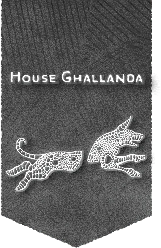

# 伽蘭達家族

## 概覽

悠倫·德伽蘭達已經將家族的產業遠遠擴展到塔倫塔平原的祖地和在歡聚堡的總部之外。每一家伽蘭達家族直營的客棧都是一小塊伽蘭達家族管理的飛地，不受任何地方政府的管制——而這樣專營的客棧遍佈科瓦雷，甚至遠至惡魔荒原邊緣和誇巴拉沼澤這樣的偏遠地區——每一家都是家族主管的小型飛地，不受任何地方政府的控制。即便某個村落沒有伽蘭達家族直營的客棧，它也可能有一傢俱有伽蘭達家族經營許可的的旅店，向顧客們保證了具有相當舒適、清潔和安全的標準。有傳言說，家族最近的擴張源自悠倫男爵最近才表現出來的對巨龍預言的興趣，那是他的女兒切維娜一直在研究的方向。

## 歷史與現況

- 伽蘭達家族聲望額外獎勵 House Ghallanda Renown Perks 當你向所屬家族提出請求時，可以獲得以下形式之一的獎勵： 家族青睞（聲望3+）。你可和你的隊伍可以食宿全免地在伽蘭達家族的客棧住宿30天。 家族認可（聲望10+）。當你進行據點回合時，你可以將伽蘭達家族視作你據點之中的植物園（菜園）設施對其發出收穫指令。如果你的級別在13級及以上，你還可以將伽蘭達家族視作酒館設施對其發出調查指令。

## 重要關係

無。

## 來源差異與不確定性

無。

## 🔗 相關連結

- [[戰役設定/艾伯倫/組織與派系/組織與派系索引]]
- [[戰役設定/艾伯倫/艾伯倫索引]]
- [[戰役設定/艾伯倫/組織與派系/龍紋家族索引]]
