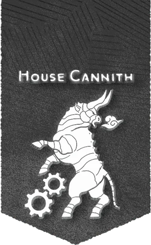

# 坎尼斯家族

## 概覽

自從坎尼斯家族的總部和賽爾一同於終末戰爭中被摧毀後，這個家族一分為三，作為三個不同的組織運作，而三位坎尼斯家族的男爵相互爭奪著家族的主導權。

## 歷史與現況

- 東坎尼斯 Cannith East 東坎尼斯總部在寇斯（位於卡納斯），由佐爾蘭·德坎尼斯領導，和卡納斯政府以及沃爾之血的信仰有著密切聯繫。家族的這一分支專門從事工程武器和防禦裝置的研究，但其最前沿的實驗中探索了創造構裝亡靈生物——這是一種戰俑和喪屍的混合體。除了卡納斯外，東坎尼斯還在摩洛領和拉扎爾公國有飛地。
- 南坎尼斯 Cannith South 在梅里克斯·德坎尼斯的領導下，位於薩恩的南坎尼斯已經發展成與舊總部白爐相當的創造之所。布蕾蘭、吉拉哥、達貢甚至暴風臨城（在希恩德瑞克）的小組都在執行梅里克斯的計劃，併產出發明來填補家族的金庫。有傳言稱，薩恩的飛地隱藏了最後一個能夠生產戰俑的熔爐——而梅里克斯計劃在《王座堡條約》鞭長莫及的暴風臨城建造另一座熔爐。

## 重要關係

無。

## 來源差異與不確定性

無。

## 🔗 相關連結

- [[戰役設定/艾伯倫/組織與派系/組織與派系索引]]
- [[戰役設定/艾伯倫/艾伯倫索引]]
- [[戰役設定/艾伯倫/組織與派系/龍紋家族索引]]
