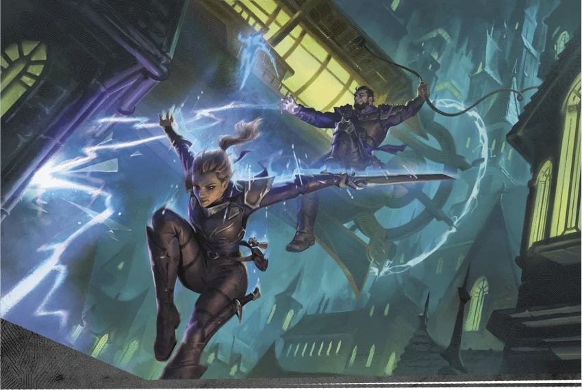

# 塔卡南家族

## 概覽

塔卡南家族是一個位於薩恩的犯罪團伙。其起源可追溯至一支由索拉·塔溫集結起的布魯蘭間諜敢死隊倖存者——這些間諜均帶有異種龍紋。索拉採用了哈拉斯·塔卡南勳爵的姓氏——這位勳爵曾在龍紋戰爭期間，憑藉自己的異種龍紋薩恩肆意破壞。索拉將這群盜賊與刺客捏合成一個組織，刻意模仿正規龍紋家族的架構，實則是對它們的嘲諷。然而，這個犯罪團伙並不具備真正龍紋家族所享有的認可度、權力與資源。

## 歷史與現況

- 塔卡南家族是一個盤踞在薩恩的盜賊刺客團伙，不過其名稱暗示了創始人將該團伙發展壯大的願景。大多數成員並無志向，僅滿足於利用異種龍紋從犯罪活動中謀取利益。
- 冒險者與塔卡南家族之間的衝突或許會以以下脈絡展開。 1-4級。

## 重要關係

無。

## 來源差異與不確定性

- 無。

## 🔗 相關連結

- [[戰役設定/艾伯倫/組織與派系/組織與派系索引]]
- [[戰役設定/艾伯倫/艾伯倫索引]]
- [[戰役設定/艾伯倫/組織與派系/龍紋家族索引]]
