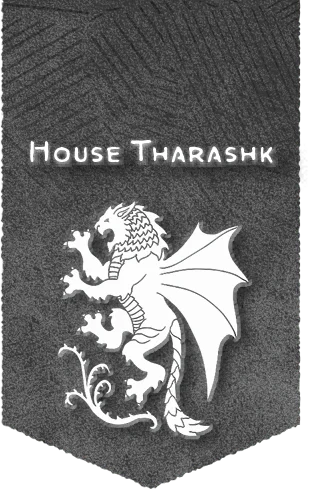

# 撒剌釋克家族

## 概覽

薩拉釋刻家族是由三個家系（以及相關的小氏族）組成的聯盟，每個家族由不同的起源和目的。這一聯盟的強大程度取決於三個家系頭領之間的聯繫是否緊密。這三位領導人被稱為"三頭同盟"，他們在陰影邊地共同管理撒剌釋克家族。

## 歷史與現況

- 阿釋塔 Aashta 阿釋塔及其盟友與至少兩個黃泉巨龍邪教和凱伯的力量有著古老的聯繫。往好了說，人們會把阿釋塔的領導人（包括他們的頭領坎達亞釋塔）描述為"機會主義者"，他們會抓住一切機會爭取自己和家族的利益——無論誰擋在面前。
- 托恩 Torrn 托恩和他們的同盟家族延續了護門者的傳統——這是一個致力於保護世界免遭異怪和其他非自然生物侵害的德魯伊教派。這讓托恩一族的成員們和亞釋塔一族中最虔誠的黃泉巨龍信徒產生了分歧。馬格瑞姆·托恩頭領暗中支持一些家族成員將家族資源用於護門者的傳統使命。

## 重要關係

無。

## 來源差異與不確定性

無。

## 🔗 相關連結

- [[戰役設定/艾伯倫/組織與派系/組織與派系索引]]
- [[戰役設定/艾伯倫/艾伯倫索引]]
- [[戰役設定/艾伯倫/組織與派系/龍紋家族索引]]
