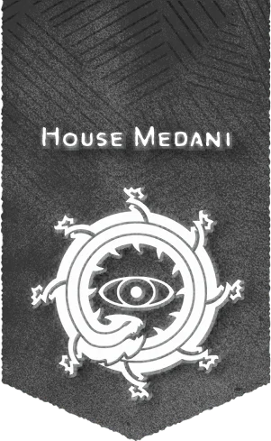

# 梅丹尼家族

## 概覽

梅丹尼家族的力量來自其特工的敏銳洞察力和根據證據預測他人行為的能力。基於這一力量，梅丹尼家族不從事情報收集（這是費亞蘭家族和蘇蘭尼家族的職能範圍），而是從事反情報工作。梅丹尼家族不洩露秘密，而是幫助保守它們。家族的總部位於羅特，而崔利布·德梅丹尼男爵於羅特所在的布蕾蘭的國王關係密切廣為人知。在男爵的領導下，梅丹尼特工們偵查並破壞關於貨物與機密的盜竊行為。

## 歷史與現況

- 梅丹尼家族聲望額外獎勵 House Medani Renown Perks 當你向所屬家族提出請求時，可以獲得以下形式之一的獎勵： 家族青睞（聲望3+）。你可以讓自己和隊伍在梅丹尼安全屋過夜，在魔法的保護下，你幾乎不可能被非魔法手段找到。 家族認可（聲望10+）。當你進行據點回合時，你可以將梅丹尼家族視作你據點內的植圖書館設施對其發出研究指令。如果你的級別在13級及以上，你還可以將梅丹尼家族視作你據點內的酒館設施對其發出研究指令。

## 重要關係

無。

## 來源差異與不確定性

無。

## 🔗 相關連結

- [[戰役設定/艾伯倫/組織與派系/組織與派系索引]]
- [[戰役設定/艾伯倫/艾伯倫索引]]
- [[戰役設定/艾伯倫/組織與派系/龍紋家族索引]]
