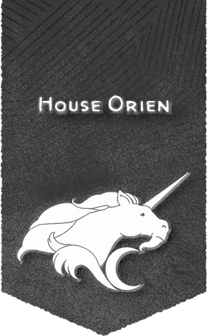

# 歐瑞恩家族

## 概覽

歐瑞恩家族的車隊是抵達偏遠地區和小型聚居地最便宜和最常使用的方式，也是從港口運走貨物最可靠的方式。安全運送人員和貨物穿越數千裡的後勤挑戰耗光了歐瑞恩家族的注意力，使其幾乎沒有策劃陰謀的餘地。在終末戰爭之後，寬提·德歐瑞恩男爵專注於重建穿越哀傷之地的陸上通道，並應對來自新貴黎蘭達家族及其飛艇的競爭。該家族的總部在安黛爾的通行城，但其飛地遍佈科瓦雷。甚至許多閃電列車也都充當了家族中重要成員的移動飛地。

## 歷史與現況

- 歐瑞恩家族聲望額外獎勵 House Orien Renown Perks 當你向所屬家族提出請求時，可以獲得以下形式之一的獎勵： 家族青睞（聲望3+）。你可以讓自己和隊伍半價搭乘歐瑞恩家族能提供的任意形式的交通工具（車隊、閃電列車或傳送）。 家族認可（聲望10+）。當你進行據點回合時，你可以將歐瑞恩家族視作你據點內的倉庫設施對其發出貿易指令，使用你的級別來決定能夠購買的物品的最大價值和你出售商品獲得的酬金。如果你的等級在9級及以上，你還可以將歐瑞恩家族視作你據點內的傳送法陣發出招募指令。

## 重要關係

無。

## 來源差異與不確定性

無。

## 🔗 相關連結

- [[戰役設定/艾伯倫/組織與派系/組織與派系索引]]
- [[戰役設定/艾伯倫/艾伯倫索引]]
- [[戰役設定/艾伯倫/組織與派系/龍紋家族索引]]
