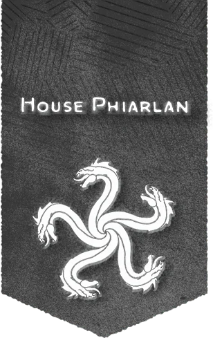

# 費亞蘭家族

## 概覽

費亞蘭家族的五處領地分別致力於不同的藝術傳統： 記憶領地（位於安黛爾的安淑城）囊括了書面文字，其中包括散文、詩歌和宣傳。 運動領地（位於布蕾蘭的羅特）專注於身體藝術，包括舞蹈、體操、摔跤、雜技和按摩。

## 歷史與現況

- 費亞蘭家族聲望額外獎勵 House Phiarlan Renown Perks 當你向所屬家族提出請求時，可以獲得以下形式之一的獎勵： 家族青睞（聲望3+）。你能夠以半價購買一劑毒藥（任意種類）或其他非法物品（比如偷來的貨物）。 家族認可（聲望10+）。當你進行據點回合時，你可以將費亞蘭家族視作你據點內的工坊設施對其發出製造指令。如果你的等級在9級及以上，你還可以將費亞蘭家族視作你據點內的劇院設施對其發出增強指令。如果你的等級在13級及以上，你還可以將費亞蘭家族視作你據點內的酒館設施對其發出研究指令。

## 重要關係

無。

## 來源差異與不確定性

無。

## 🔗 相關連結

- [[戰役設定/艾伯倫/組織與派系/組織與派系索引]]
- [[戰役設定/艾伯倫/艾伯倫索引]]
- [[戰役設定/艾伯倫/組織與派系/龍紋家族索引]]
