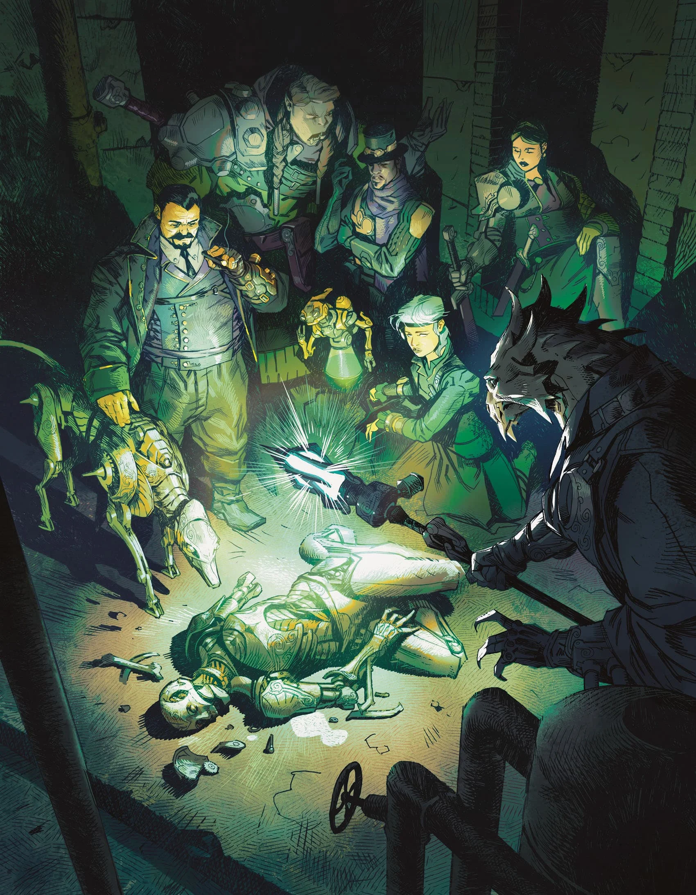
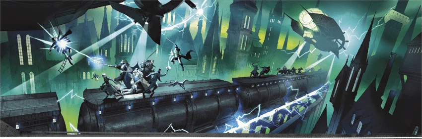

# 龍紋家族索引

**冒險要素：**文藝復興陰謀和鬥爭
**流行文化：** 《黑道家族》《繼承之戰》

科瓦雷的繁榮建立在魔法之上，而龍紋家族則是魔法經濟運轉的基石。科瓦雷的各個支柱產業——通信、交通、金融、畜牧、安保等——均由龍紋家族經營和掌控。
在科瓦雷歷史的大部分時間裡，伽利法王國強大的中央君主制權威制衡著這些龍紋家族的勢力。然而，終末戰爭打破了這種平衡，如今科瓦雷眾多國家紛爭不休的領袖們，根本無力遏制龍紋家族不斷擴張的勢力版圖。許多人私下議論著，倘若科瓦雷各國再度統一，統治者將不再是某位國王，而會是某位龍紋家族後裔。
若你想模仿文藝復興時期那種陰謀詭計與權力爭鬥——比如商賈家族崛起，其影響力足以與王室分庭抗禮——或是像《黑道家族 The Sopranos》或《繼承之戰 Succession》那樣展現家族權力博弈的故事，不妨以龍紋家族為背景，開啟一場充滿權謀的戰役。

本書的龍紋 NPC 段落將家族後裔的呈現導向既有數據卡；本索引僅提供其設定與導覽，不另建立沒有專屬規則正文的空白人物頁。（來源：《艾伯倫：奇械鍛爐》，p. 67）

## 條目

- [[戰役設定/艾伯倫/組織與派系/瓦達利斯家族|瓦達利斯家族]]
- [[戰役設定/艾伯倫/組織與派系/西維斯家族|西維斯家族]]
- [[戰役設定/艾伯倫/組織與派系/伽蘭達家族|伽蘭達家族]]
- [[戰役設定/艾伯倫/組織與派系/坎尼斯家族|坎尼斯家族]]
- [[戰役設定/艾伯倫/組織與派系/昆達拉克家族|昆達拉克家族]]
- [[戰役設定/艾伯倫/事件/冒險框架/家族衝突|家族衝突]]
- [[戰役設定/艾伯倫/組織與派系/密閣|密閣]]
- [[戰役設定/艾伯倫/組織與派系/梅丹尼家族|梅丹尼家族]]
- [[戰役設定/艾伯倫/組織與派系/喬拉斯科家族|喬拉斯科家族]]
- [[戰役設定/艾伯倫/組織與派系/費亞蘭家族|費亞蘭家族]]
- [[戰役設定/艾伯倫/組織與派系/塔卡南家族|塔卡南家族]]
- [[戰役設定/艾伯倫/組織與派系/撒剌釋克家族|撒剌釋克家族]]
- [[戰役設定/艾伯倫/組織與派系/歐瑞恩家族|歐瑞恩家族]]
- [[戰役設定/艾伯倫/組織與派系/鄧內斯家族|鄧內斯家族]]
- [[戰役設定/艾伯倫/組織與派系/黎蘭達家族|黎蘭達家族]]
- [[戰役設定/艾伯倫/組織與派系/龍紋家族|龍紋家族]]
- [[戰役設定/艾伯倫/事件/冒險框架/龍紋陰謀冒險|龍紋陰謀冒險]]
- [[戰役設定/艾伯倫/事件/冒險框架/龍紋衝突|龍紋衝突]]
- [[戰役設定/艾伯倫/組織與派系/蘇蘭尼家族|蘇蘭尼家族]]

## 🔗 相關連結

- [[戰役設定/艾伯倫/艾伯倫索引|艾伯倫索引 (Eberron Index)]]
