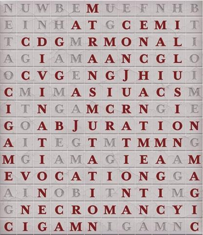

# 冒失步伐

> [!WARNING] 本頁整理《塔莎的萬事坩堝》的 2014 DM 工具；屬 DM 指引或可選規則時，須由 DM 決定是否採用。

## ⚙️ 規則條文 (Rule Text)

**冒失步伐 Reckless Steps**
**_難度：簡單_**

此謎題特性是在地磚上搜尋單詞，可在各種情景中呈現探索障礙。為了安全透過，角色們必須先揭開他們要搜尋的單詞，然後在地磚上找到它們。

你們進入了一間充斥蛛網的房間，對面牆壁上的火把提供了光照。五呎見方的地磚覆蓋排列，地板上的灰塵聚集在溝槽裡。在對面牆壁上，一道孤立拱門從房間裡通向這裡。一面牆上寫著以下文字：

_那八者已然顯現於你的眼下，_
而其依然偽裝於學究氣派下。
儘量避開此房間中所有魔法，
以免厄運確立於那冒失步伐。_

每塊覆蓋於此房間地板的地磚上都書寫著一個通用語字母，使此房間形成一道巨型字詞搜尋陣。許多地磚下面都有陷阱，威脅著那些無視隱藏文字而在房間中移動的人們。

**謎題特性**
這間 60×70 呎房間的地板是由五呎見方石磚鋪成的。如本章末尾的謎題資料 1 所示，每塊地磚上都刻有一個字母。將本謎題資料的副本擺在桌上，讓玩家用小模型來演示他們的角色如何在房間中穿行。
為了安全地走過房間，角色必須踩在正確地磚上。踩到錯誤地磚會觸發一道陷阱。

**陷阱**
**某些地磚 (正如該陷阱“解謎”一節中所示) 設定了陷阱。當一塊陷阱地磚承載超過 20 磅重量時，就會觸發啟用其下的壓力板，使毒氣從磚縫中噴出。陷阱地磚或其相鄰地磚之一上面的任何生物必須進行 DC15 體質豁免，若豁免失敗則受到 11 (2d10) 毒素傷害，若豁免成功則受到半額傷害。**
作為一個動作，一個角色可以使用盜賊工具透過 DC15 敏捷檢定來解除一個陷阱。如果角色未能解除陷阱，則該地磚的陷阱不再能被解除。
角色可以嘗試使用《玩家手冊》中的跳躍規則來跳過陷阱地磚。

**解謎**
角色可以踏上的僅有安全瓷磚即是圖片 4.1 中帶有淡黑字母的瓷磚。紅色字母拼出“魔法（MAGIC）”或魔法學派之一：防護、咒法、預言、惑控、塑能、幻術、死靈和變化。如前所述，踏上其中一塊地磚會觸發毒素陷阱。

**提示檢定**
任何角色都可選擇進行這些屬性檢定來接收提示：
**智力（奧秘）DC 10：** 角色看到地板上一個魔法學派例項。
**智力（調查）DC 10：** 角色解讀出牆上詩句中的線索：此處有八大魔法學派。
**感知（察覺）DC 10：** 每位成功的角色都會在地板上看到一個“魔法（MAGIC）”單詞例項。

**定製謎題**
考慮使用此謎題結構來建立任何數量的隱藏致命陷阱的專題詞搜尋。一旦你建立了一個建議尋找何種型別單詞的提示，建立自己的隱藏單詞網格就是輕而易舉的了。
提升難度
你可以透過將單詞搜尋陣的字母更替為其他字母表——例如《玩家手冊》中的字母表——來提升此謎題的難度。
或者，你也可以建立一套全新程式碼來替換字母，要求角色找到一組密碼來揭示地磚的含義後才能攻克謎題並安全地穿過房間。
你也可以透過引入陷阱變體來增加難度，如下所述。

**陷阱變體**
與其在每個陷阱地磚上設定相同的毒氣陷阱，不如使每個單詞都有不同陷阱與之關聯，如下所述：

**魔法（Magic）：**該陷阱會正常觸發，如本謎題的“陷阱”部分所述。

**防護（Abjuration）：**陷阱對房間內每個生物施放解除魔法，使用九環法術位。

**咒法（Conjuration）：**陷阱將觸發陷阱的生物傳送回房間入口。該生物還必須進行一次 DC 15 體質豁免，若豁免失敗則受到 11(2d10) 力場傷害，若豁免成功則半額傷害。

**預言（Divination）：**觸發陷阱的生物必須透過一次 DC 15 智力豁免，否則無法透過視覺或觸覺感知地磚上的任何字母。任何終結詛咒的魔法都會結束該角色的此效應。受此陷阱影響的角色在該效應終結之前，其玩家不應被允許參考附錄的玩家資料。

**惑控（Enchantment）：**陷阱對觸發陷阱的生物施放暗示術（豁免 DC 15）。若豁免失敗，一個只有該生物能聽到的溫柔聲音會告訴它向一個隨機方向移動 5 呎。此次移動可能會使它觸發另一個陷阱。

**塑能（Evocation）：**魔法火焰從陷阱地磚中噴出。觸發此陷阱的生物必須透過一次 DC15 敏捷豁免，若豁免失敗則受到 11(2d10) 火焰傷害，若豁免成功則受到半額傷害。

**幻術（Illusion）：**一套活化鎧甲出現在觸發此陷阱的生物 5 呎內的未佔據空間。這套盔甲只攻擊召喚它的生物並且不能離開房間。它不會觸發房間內任何陷阱，如果受到任何傷害就會消失。否則，它將持續 1 分鐘。

**死靈（Necromancy）：**任何觸發此陷阱的生物都會在腦海中聽到報喪妖哀嚎。除非該生物是構裝或亡靈生物，否則它必須透過一次 DC 13 體質豁免。若豁免失敗，該生物 HP 降至 0。若豁免成功，它受到 10(3d6) 心靈傷害。

**變化（Transmutation）：**陷阱對觸發陷阱的生物施放變形術（豁免 DC 15）。若豁免失敗，該生物會變成一隻巨蛙。

* * *

> [!NOTE] 圖像資料未隨來源提供：125-04-036.jpg

* * *

**【譯者註釋】**
顯然，本節中的例題無法使用中文解謎。但是，參照“自定義謎題”中的建議來替換字母表即可輕鬆轉換謎題語言。

## 🔗 相關連結

- [[規則索引|規則索引 (Rules Index)]]
