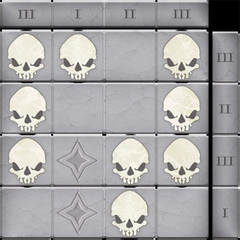

# 四乘四

> [!WARNING] 本頁整理《塔莎的萬事坩堝》的 2014 DM 工具；屬 DM 指引或可選規則時，須由 DM 決定是否採用。

## ⚙️ 規則條文 (Rule Text)

**四乘四 Four by Four**
**_難度：中等_**

此謎題能輕易放置於地下城、塵封陵墓或廢棄神社中。

你進入一個昏暗的房間。九個矮人頭骨放在地板上的一組四呎見方的瓷磚附近，而近旁的一個石壇上刻著如下銘文：
　　_英勇戰士適逢消亡預兆。_
　　　彼眾秘密行將昭然若揭。
　　神龕之上歸位王族冠冕。
　　　天界床榻適宜九中四者_

解開此道謎題後，祭壇上的一個秘密隔間就會開啟，露出藏在其中的寶藏。這個隔間不能以其他方式開啟。

**謎題特性**
如謎題資料 3（見本章末尾）所示，九顆矮人頭骨放在一個 1 呎見方瓷磚網格附近。網格中的列和行都標有 I、II 或 III 的標記。

**解謎**

每行與每列的數字都代表了頭骨數量。角色必須將頭骨放置得符合行與列上的正確數量，同時還要覆蓋四顆星星。此謎題有多種可能解法，其中一種解法如圖 4.2 所示。

**提示檢定**
矮人角色在此房間中獲取提示的屬性檢定上有優勢。任何角色都可以選擇進行這些能力檢查來獲得提示：
**智力（調查）DC 15：** 這節經文暗示了這個角色，其中四個頭骨需要放在刻有星星的瓷磚上。
**感知（洞悉）DC 15：** 網格邊緣周圍的 I，II 和 III 標記可能表示必須在這些行和列中放置多少個頭骨。

**定製謎題**
**如果其中一個角色是個矮人，這可能是引入家族劇情的最佳時機。這些是他們失散多年的家族的頭骨嗎？其中某個頭骨是否屬於他們一直在尋找的親人？而九個頭骨中只有四個歸於了“天界床榻”，他們認為此道謎題在暗示什麼？**

* * *

## 🔗 相關連結

- [[塔莎謎題索引|塔莎謎題索引 (TCE 2014 Legacy)]]
- [[規則索引|規則索引 (Rules Index)]]
