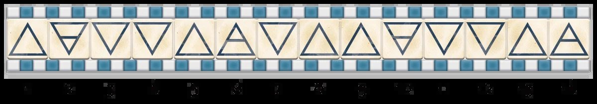

# 四元素

> [!WARNING] 本頁整理《塔莎的萬事坩堝》的 2014 DM 工具；屬 DM 指引或可選規則時，須由 DM 決定是否採用。

## ⚙️ 規則條文 (Rule Text)

**四元素 Four Elements**
**_難度：困難_**

此道謎題可能會出現在任何有土、氣、火、水元素作為守衛的地方。如果此道謎題沒有被正確解開，一個或多個這些守衛元素會從雕像中魔法變身並攻擊角色們。

當你進入這間六邊形房間時，門在你身後猛然關上。四面牆壁上佈滿了馬賽克，每一幅都描繪了四種元素之一的破壞力。四座九呎高元素石像排列在緊閉門扉遠對面的牆壁上。雕像上方是一排畫著三角符號的方形瓷磚。其中有四塊瓷磚已經脫落、散落到地上，上面寫著以下字樣：
_四大元素受困陷入石中，_
元素秩序將其鎖進家中。
偶數圖案對應全部奇數，
瓷磚放錯喚醒對應神靈。
恰當序列安全封住四者，
或是每類最佳開啟門扉。_

角色進入此房間後，身後的門就會關上。只有完成此道謎題才能開啟，並且沒有其他出口。
**謎題特性**
下面對馬賽克、雕像、瓷磚進行詳細介紹。

**馬賽克**
四面牆的馬賽克描繪了以下內容：
一個水元素乘著巨浪撞破城牆。在畫面中央是一個指向下方的三角形。
一個土元素逼近威脅一群戰士。在其胸前刻有一個指向下方的三角形，有一條水平線穿過它。
一個火元素燃燒森林小鎮之上。在火焰中心是一個指向上方的三角形。
一個氣元素疾馳於暴風雨天空。在雲層中心是一個指向上方的三角形，有一條水平線穿過它。

**雕像**
這些雕像是被魔法捆綁在石頭上的真正元素。將這些元素變成雕像的魔法正在慢慢瓦解，因為捆綁它們的瓷磚圖案已經崩壞。

**瓷磚**
如果角色們沒有按照正確順序替換掉四塊脫落瓷磚，四座雕像就會同時恢復真身並攻擊角色們。此事件具體時間由你決定，但應給角色們足夠時間破解謎題。角色們也可以透過將瓷磚放錯順序或方向來單獨釋放元素。
謎題資料 6 （見本章末尾）說明在雕像上方的牆上設定的一排瓷磚。在沒有檢定的情況下，角色們意識到當門在他們身後關上時有四塊瓷磚掉了下來。透過 DC 15 智力（奧秘）檢定，角色可以確定這些瓷磚是讓元素被封印的東西。
如果瓷磚在橫排中放錯，對應元素就會從石牢中解脫出來並進行攻擊。每種元素只出現一個：
如果放錯的瓷磚有一個指向下方的開放三角形，則水元素被釋放。
如果放錯的瓷磚有一個指向上方的開放三角形，則火元素被釋放。
如果放錯的瓷磚有一個指向上方的三角形、有一條水平線穿過它，則氣元素被釋放。
如果放錯的瓷磚有一個指向上方的三角形、有一條水平線穿過它，則土元素被釋放。

**解謎**
正確完整圖案在此展示：

奇數瓷磚形成了一個交替向上和向下的開放三角形迴圈圖案。瓷磚 1、5、9 和 13 是向上的三角形，而 3、7 和 11 是向下的三角形。

偶數瓷磚則顯示出不同模式。瓷磚 2 和 4 向下，但其中第一塊有一條線穿過三角形。瓷磚 6 和 8 遵循相同模式，但三角形指向上。然後模式重複，瓷磚 10 和 12 與瓷磚 2 和 4 相同，瓷磚 14 與瓷磚 6 相同。
解開謎題或擊敗所有四個元素會使房門晃開。

**提示檢定**
任何角色都可選擇進行這些屬性檢定來接收提示：
**智力（調查）DC 15：** 角色注意到房間地板上的詩句中的“偶數”和“奇數”兩個詞，並認為它們對丟失瓷磚有一定意義。
**感知（察覺）DC 10：**該角色可以推斷出哪些瓷磚對應哪些元素。

**定製謎題**
將多個圖案模式交織在一起很容易偽裝。將此銘記在心，你可以使用任何一組符號來建立一系列精心設計的圖案模式，然後挑戰玩家們來填補缺失部分。雖然此道謎題中的符號指的是四元素，但你可以使用聖徽、顏色、架子上的玩偶或任何其他重複設計來呈現你的謎題。
當一個元素被擊敗時，它可能會留下一個貴重寶石、一個地圖碎片、一個其他謎題的線索，或者類似的事物。

**提升難度**
為了增加此道謎題的難度，可以強制執行一個時間因素：也許在每 5 分鐘現實時間結束時，就會有一個元素掙脫出來，直到謎題被解開。
你也可以透過讓雕像描繪巨靈而不是元素來提高難度。在這種情況下，將四個元素替換為一個土巨靈、一個氣巨靈、一個火巨靈和一個水巨靈。這些巨靈是被迫攻擊角色的，無法與之講理。

* * *

## 🔗 相關連結

- [[塔莎謎題索引|塔莎謎題索引 (TCE 2014 Legacy)]]
- [[規則索引|規則索引 (Rules Index)]]
