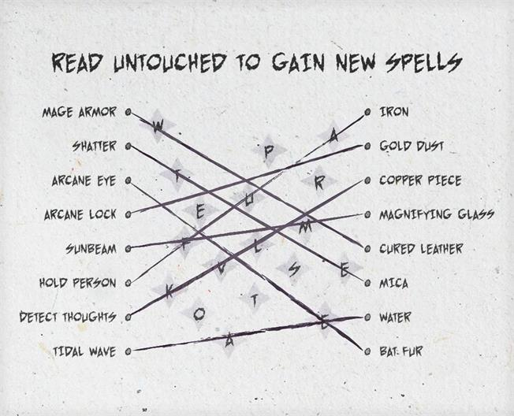

# 材料成分

> [!WARNING] 本頁整理《塔莎的萬事坩堝》的 2014 DM 工具；屬 DM 指引或可選規則時，須由 DM 決定是否採用。

## ⚙️ 規則條文 (Rule Text)

**材料成分 Material Components**
**_難度：中等_**

這一謎題也許會出現在法師的作坊裡，或是他們的書房或法術書內。而謎題的答案將帶來一條與新法術或是稀有的法術（比如第三章種提及的那些）的密碼。或者，這一密碼可以被以別的適配你的故事的方式利用。

你們找到了一張老舊的紙張，上面記載了一系列的法術與成分。而一些看似隨機的字母被放置在兩列法術之間。而這一頁頂部的訊息如此寫到：“閱讀那無及之處，顯現以嶄新法術。”

**謎題特性**
這名法師的書房裡擺滿了法術材料、書籍、藥水、以及各種各樣雜七雜八的東西。這些東西也許可以幫助玩家解開謎題，但玩家只需要這張羊皮紙便能完成謎題。如果謎題對他們來說過於困難，他們可以帶走這張羊皮紙以尋找可以解決它的人。

**書櫃**
這名法師的書房幾乎全都是書架與其上方的書籍、卷軸、還有其他道具。若角色成功透過一次 DC12的智力（奧秘）檢定將發現給出列表中的法術，其無價值的材料成分（像是一片雲母，一點蝙蝠毛皮之類的）。

**列表**
羊皮紙有一列法術列表，以及一列等量的材料成分列表。然而，同一行的法術與成分並不相匹配。羊皮紙本身不具有任何魔法能力，但它揭露出的那個單詞可能會有。

法師或其他施法者可以輕鬆辨認並配對任何他們已知的法術與其施法所需的材料成分。但那些他們不熟知的法術，就只能透過下方的成功的“提示檢定”來想起這些成分配對——畢竟他們不熟悉。

**解謎**
如圖 4.4 所示，從法術到其匹配的材料成分之間畫一條線。當所有法術都被連線到了匹配的材料上時，這些線未觸及的字母將拼寫出“presto”，而手持這張羊皮紙念出這個詞後，一張或多張法術卷軸（或者別的什麼寶藏，由你決定）將魔法性的顯現出來。

**提示檢定**
**任何角色都可選擇進行這些屬性檢定來接收提示：**
**智力（奧秘）DC 15：**該角色回想起了至多3個他未知法術的材料成分為何物。
**感知（洞悉）DC 15：**該角色懷疑中間擺放的這些雜亂無章的字母——或者其中一部分字母——能拼成一個命令語、一條口令、或是類似的重要線索。
**感知（察覺）DC 10：**角色注意到可以在法術與材料成分之間畫直線，而這些直線會穿過一些中間的字母。

**定製謎題**
當然，法術與材料成分的組合很容易讓人聯想到進行連線，不過你可以考慮建立一個獨屬於你版本的本謎題。比如使用怪物與生物型別、存在位面與其原住民、世界設定中的著名人物與他們的故鄉、以此類推，來構建你的謎題。

**降低難度**
如果你的隊伍中沒有具備豐富魔法知識的角色，你可以考慮在房間的方筆或是裝飾書籍的封面上提供法術與材料成分聯絡的線索。當然，你也可以直接降低謎題的提示檢定的 DC 值。

**提高難度**
你可以選擇不使用那些角色們也許非常熟悉的咒語，你可以改為使用失傳的咒語或是某些角色無法只曉得先史遺咒來讓謎題變得更具挑戰性。只有去諮詢那些法術專家、進行研究、或是進一步的冒險，玩家才有可能得知這兩個列表之間的聯絡。

* * *

## 🔗 相關連結

- [[塔莎謎題索引|塔莎謎題索引 (TCE 2014 Legacy)]]
- [[規則索引|規則索引 (Rules Index)]]
