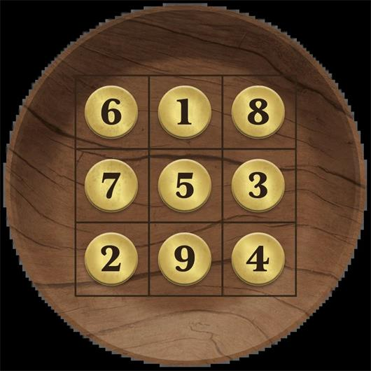

# 確切零錢

> [!WARNING] 本頁整理《塔莎的萬事坩堝》的 2014 DM 工具；屬 DM 指引或可選規則時，須由 DM 決定是否採用。

## ⚙️ 規則條文 (Rule Text)

**確切零錢** **Exact Change**_難度：困難_

此道謎題提供了一個基於硬幣的精巧鎖頭，可以鎖住任何型別的門、金庫或其他障礙。
引用

這裡的門扉緊鎖，沒有把手。取而代之的是，門上有一個槽位，上面刻著“於此處投入確切零錢。”附近木桌上放著一個裝著硬幣的木碗。
桌面上刻著九個方格，呈現為三乘三的網格。桌腿上釘著的一張羊皮紙上寫著如下說明：
_每列十五，每行十五；_
對角線上，也是如此。
懇請警告仔細數；
各處有著不同數。
中心硬幣喂入門扉，必須數目正好；
確切零錢暢通無阻，否則麻煩不少。_

**謎題特性**
桌上碗裡有四十五枚金幣。謎題要求將確切數量的金幣送入到門上槽位中。如果存入錯誤金額，就會觸發警報或你選擇的陷阱。

**解謎**
圖 4.5 展示瞭如何劃分四十五枚硬幣，使每個方格的數量不同，每行每列加起來是十五個。詩句解釋說，這扇門需要中心方格所示的硬幣數量。插入確切五枚硬幣後，鎖住的門扉就會開啟。

**提示檢定**
任何角色都可選擇進行這些屬性檢定來接收提示：
**智力（調查）DC 15：** 該角色意識到如果對角線加起來是十，那麼剩餘格子的填寫就容易多了。
**感知（洞悉）DC 15：** 該角色計算出中心數以外的兩個數字的位置。

## 🔗 相關連結

- [[塔莎謎題索引|塔莎謎題索引 (TCE 2014 Legacy)]]
- [[規則索引|規則索引 (Rules Index)]]
