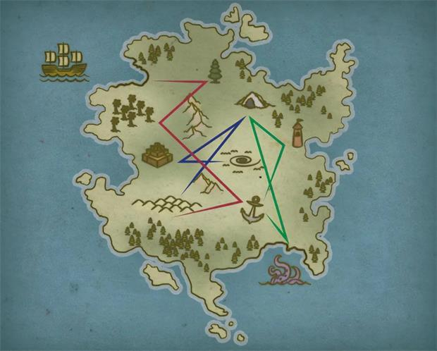

# 虛幻島

> [!WARNING] 本頁整理《塔莎的萬事坩堝》的 2014 DM 工具；屬 DM 指引或可選規則時，須由 DM 決定是否採用。

## ⚙️ 規則條文 (Rule Text)

**虛幻島 Illusive Island**
**_難度：中等_**

三個數字表盤封住一個盒子、門扉或其他上鎖物件。找出正確組合是這道謎題的目標，由於沒有明顯鎖頭可撬。

**謎題特性**
錶盤原本設定的數字並不重要。如果玩家問起，可以任意選擇三位數字。
一個軟木管裡有兩條線索：一張島嶼地圖和一組方向。

**地圖**
給玩家一份謎題資料 4（見本章末）。這張地圖描繪了一個陌生島嶼，上面有各種地標，但沒有金鑰。

**方向**
方向寫在一張羊皮紙上，講述了一夥人的尋寶路線。

**_第一日：_**我們對失落寶藏的搜尋開始於西北入海口，風杖灣。卸下必需品後，我們向東到孤松，再向西南經過北嶺到棕櫚綠洲。傍晚時分，我們繼續往東南方向前往錨點，然後在大沙丘露營。

**_第二日：_**早上，我們從沙丘起身前往死者洞窟。發現那裡空無一物後，我們的隊伍繼續前往金字塔。朝著正東方向，我們在漩渦沙地紮營。

**_第三日：_**經過怪異的一夜睡眠，我們在回到錨點的第三天醒來時，沒有任何記憶或旅行蹤跡。漩渦沙地一定是在晚上把我們帶走了！我們繞過漩渦沙地到達紅塔，但還是沒能找到寶藏。料想或許是在洞裡漏掉了什麼，於是我們又往回走。從那裡出發，我們前往南岸看看寶藏是否在克拉肯點。一無所獲地，我們回到了錨點。在那裡等待我們的事物與我們預想的寶藏全然不同。

**解謎**
角色按照指示在地圖上追尋自己的路徑，會發現三個數字。3、4 和 8（見圖 4.3）。按照相同順序將撥盤轉到這些數字上，就可以開啟上鎖物件。

**提示檢定**
任何角色都可選擇進行這些屬性檢定來接收提示：
**智力（調查）DC 10：** 第三日條目中的「蹤跡」一詞很重要，說明地圖是用於繪製的。
**感知（洞悉）DC 15：** 地圖上沒有標籤，這意味著地標名稱並不重要。重要的是它們彼此間的相對位置。
**感知（察覺）DC 10：** 既然有三個撥盤，考察歷時三天的事實很關鍵。
**感知（求生）DC 15：**角色知道方向並不代表搜尋某區域的有效方式，並推斷出方向一定是在呈現某種資訊。

**定製謎題**
考慮建立你自己的地圖與一系列方向來定製此道謎題。透過製作適合你遊戲背景中位置的方向，你可以使用角色可能已經擁有的地圖來建立一個整合到你的冒險情節中的謎題。你的謎題版本可以新增你認為合適的數字和方向，也可以顯示字母、符號或短詞，這取決於你設計的複雜程度。

**提升難度**
你可以透過將地圖分成需要分別發現的碎片來增加此道謎題的難度，或者角色可能需要向親身探索島嶼的人學習方向。只要位置順序不改變，密碼依然正確。

* * *

## 🔗 相關連結

- [[塔莎謎題索引|塔莎謎題索引 (TCE 2014 Legacy)]]
- [[規則索引|規則索引 (Rules Index)]]
