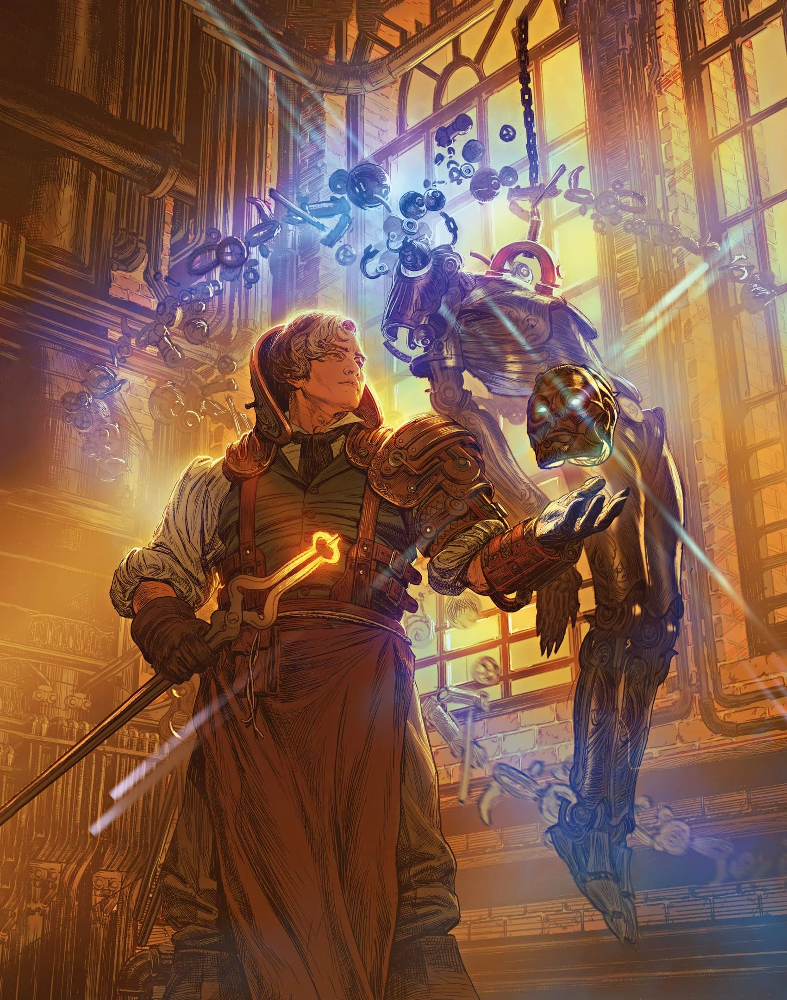

# Chapter 01: The Artificer

> 英文原文鏡像；對應《Chapter 01: The Artificer》p. 7。來源提供者：5e.tools。

# Chapter 01: The Artificer

{@i A Magical Crafter and an Inventor of Wonders}

## Artificer

## Artificer Subclasses

An Artificer subclass is a specialization that grants you features at certain Artificer levels, as specified in the subclass. This section presents the {@subclass Alchemist|Artificer|EFA|EFA}, {@subclass Armorer|Artificer|EFA|EFA}, {@subclass Artillerist|Artificer|EFA|EFA}, {@subclass Battle Smith|Artificer|EFA|EFA}, and {@subclass Cartographer|Artificer|EFA|EFA}.

### Alchemist

### Armorer

### Artillerist

### Battle Smith

### Cartographer

## Spell

This new spell appears on the Artificer's spell list.

### Homunculus Servant
