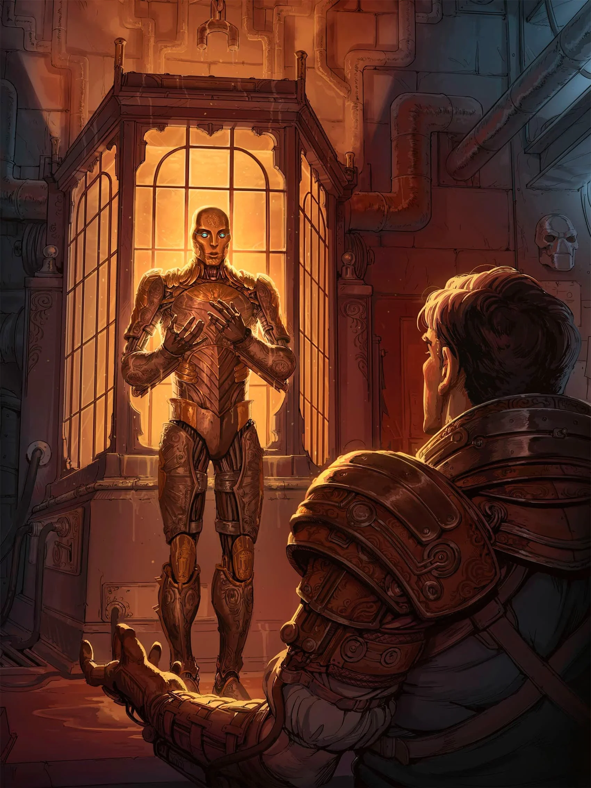
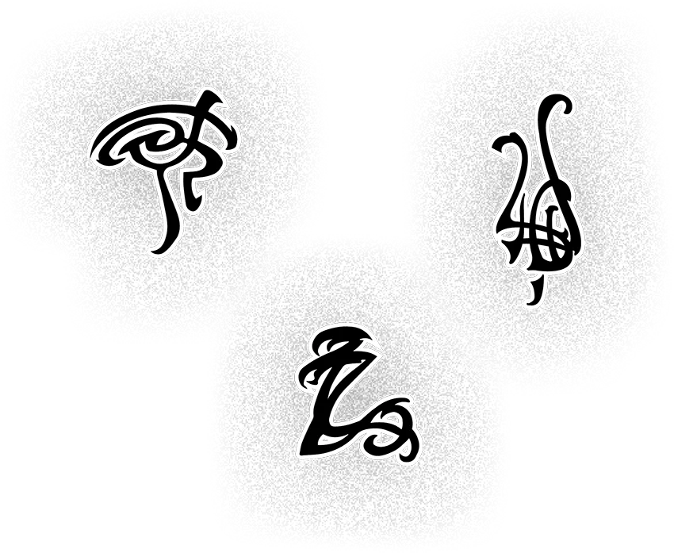
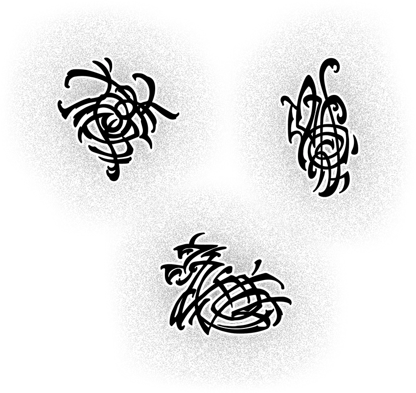
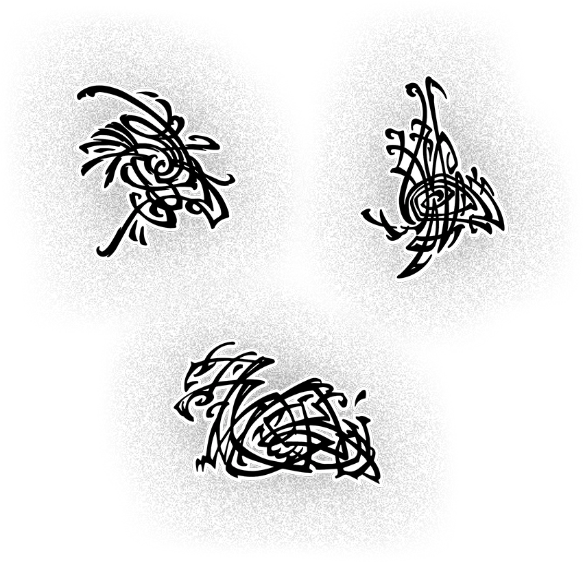

# Chapter 02: Character Options

> 英文原文鏡像；對應《Chapter 02: Character Options》p. 23。來源提供者：5e.tools。

# Chapter 02: Character Options

This chapter offers new backgrounds, species, and feats. The {@race Khoravar|EFA} species in this chapter is a new game option, representing Eberron folk who are sometimes called half-elves. The {@race Changeling|EFA}, {@race Kalashtar|EFA}, {@race Shifter|EFA}, and {@race Warforged|EFA} species are new versions of species that have appeared in other books; in consultation with your DM, choose the version you prefer! The {@area Dragonmark feats|0ca|x} in this chapter offer a new way to join the dragonmarked houses.

## Dragonmarks

Dragonmarks are mysterious and magical symbols that appear on the skin of some people across Khorvaire. The twelve established dragonmarks are tied to specific family lines, and the scions of those families work hard at consolidating the power of the marks in order to maximize the profit and influence they gain from them. The {@feat Mark of Healing|EFA}, for example, has given the halflings of House Jorasco an edge in providing medical care; the house has exploited that edge to the point where it remains virtually the only provider of healing services. Anyone outside the house who manifests the Mark of Healing is quickly pressured to join, regardless of their family line or species.

### Greater Dragonmarks

Most dragonmarks are small—no more than the size of the bearer's palm—and grant limited magical power. And even these minor marks are rather rare. But rarer and more powerful marks appear on some individuals, both within and outside the dragonmarked houses. Greater dragonmarks manifest only on people who already possess an ordinary mark. When a greater dragonmark manifests, it grows from an ordinary mark and expands outward to two or three times the original mark's size.

The dragonmarked houses view greater marks as more significant than ordinary marks in every way—more important to the livelihood of the house, more essential to keep under the house's control, and potentially more significant in terms of fulfilling the Draconic Prophecy that some believe is written in the marks.

### Siberys Dragonmarks

While the people of Khorvaire have a limited understanding of dragonmarks, Siberys dragonmarks remain a complete mystery to them. The magic of these powerful marks clearly relates—visually and thematically—to the other marks in one's house. But a dragonmarked heir may spend years perfecting and mastering the powers of a mark without ever manifesting a Siberys mark. Meanwhile, an unmarked scion of a dragonmarked house might suddenly display one against all expectations.

Siberys marks are mighty, unpredictable, and rare, and the dragonmarked houses keep a careful eye on anyone who manifests one. If its power can serve the house, fine—but an heir of Siberys who doesn't conceal the dragonmark's ability or remain firmly aligned with the dragonmarked house is likely to become the target of assassins.

The {@feat Boon of Siberys|EFA}, described in the "{@area Feats|0c9|x}" section later in this chapter, can reflect either a Siberys mark or a powerful aberrant mark. Alternatively, at a player's discretion and with the DM's approval, a character's acquisition of a different Epic Boon feat can represent the manifestation of a Siberys mark. A character with ties to House Lyrandar, for example, might choose the Boon of Energy Resistance, gaining Resistance to Lightning and Thunder damage, and manifest the Siberys mark of Storm. A character with ties to House Phiarlan or House Thuranni might represent the Siberys mark of Shadow by choosing the Boon of the Night Spirit.

#### What's New with Dragonmarks?

Compared to the rules in {@book Eberron: Rising from the Last War|ERLW}, here's what's different about dragonmarks in this chapter:

- The benefits of each dragonmark now derive from feats rather than species options. These feats belong to a special category, Dragonmark feats.

- Dragonmark magic works a little differently than before: now you can use any spell slots you have to cast the spells your dragonmark grants you. In a few cases, this change called for adjustments to the Spells of the Mark feature of a dragonmark; see the "{@area Dragonmark Feats|0ca|x}" section of this chapter.

- In addition to the Dragonmark feats, thirteen new General feats represent greater dragonmarks, and one more increases a mark's potency. And one new entry in the Epic Boon category, the Boon of Siberys, can represent either a powerful aberrant dragonmark or a Siberys mark.

- A character of any species can take a Dragonmark feat and manifest a dragonmark.

- In the {@book Player's Handbook (2024)|XPHB}, anyone who has a Ritual spell prepared can cast that spell as a Ritual. This rule means the Ritual spells granted by Dragonmark feats can now be cast as Rituals by anyone who has those feats.

### Marks of Mystery

Centuries of manipulation and consolidation have caused the established dragonmarks to manifest primarily in members of certain family lines. However, exceptions have always existed, and they've grown increasingly common in recent years.

In {@book Eberron: Rising from the Last War|ERLW}, only a character of a particular species could have each dragonmark. Those rules reflected the common perception that dragonmarks run only in family lines. This book instead allows a character of any species to manifest any dragonmark.

If you choose a dragonmark for your character, consider these four options for its origin.

#### Dragonmarked Heir

You are a member of a dragonmarked house and its family line—for example, if you bear the {@feat Mark of Healing|EFA}, you could be a Halfling member of House Jorasco and related to the other dragonmarked heirs of the house. In this case, you have much in common with the NPC heirs of your house. The actions of your house influence you, although you and your DM can determine to what extent you become drawn into house politics.

Taking the background associated with your house (such as {@background House Jorasco Heir|EFA}) is the best way to build your character as a dragonmarked heir. Alternatively, you can take the {@background House Agent|EFA} background, or some other background reflecting your character's history, and choose a Dragonmark feat later in your career.

Since dragonmarks typically appear for the first time in situations of stress or peril where the power of the mark could prove useful, heirs of the dragonmarked houses undergo a rite of passage called the Test of Siberys in adolescence. Each house's test is different, but they all involve some danger designed to evoke the power of the house's mark. Usually, a dragonmark appears during the test, if it ever manifests at all, but heirs sometimes manifest their marks years after failing the Test of Siberys.

#### Distant Offshoot

You are a distant offshoot of a dragonmarked family line, sharing the species that most commonly manifests the mark but unencumbered by ties to its house. For example, you could be a Halfling with the {@feat Mark of Healing|EFA} but with no ties to House Jorasco. You're an anomaly; if House Jorasco became aware of you, it would try to bring you and your family line into the house. To build this kind of character, choose a Dragonmark feat at level 4 or later.

#### Mark of Prophecy

You might bear a mark unrelated to your species. For example, you can choose to bear the {@feat Mark of Healing|EFA} even if you're not a Halfling. Your dragonmark has nothing to do with the house's family line. It might be a direct mark of the Draconic Prophecy, or it could be an aberrant mark that happens to duplicate an established one. You'll probably never meet an NPC in the world like you, and House Jorasco might not claim you.

To build a character with a mark like this, choose a Dragonmark feat at level 4 or later or select a house background (or the Aberrant Heir background). With your DM's permission, you can alter some of the background's proficiencies to better reflect your character's origin.

#### Aberrant Mark

You bear an aberrant dragonmark. These rare marks appear on members of all species. Aberrant dragonmarks disturb the houses—you would be wise to avoid their attention. The {@background Aberrant Heir|efa} background is the best way to build a character with an aberrant mark. Alternatively, choose another background and take the Aberrant Dragonmark feat at level 4 or later.

## Backgrounds

This section presents seventeen backgrounds using the same format as those in the {@book Player's Handbook|XPHB}. The fourteen that represent dragonmarked heirs offer Dragonmark feats rather than Origin feats; the Dragonmark feats appear at the end of the chapter. Choosing one of these backgrounds is the only way to acquire a Dragonmark feat at level 1; characters who select a different background can choose Dragonmark feats anytime they have an unrestricted feat choice. The {@background House Agent|EFA} background grants house affiliation without a dragonmark.

In addition to the backgrounds connected to dragonmarks and their houses, the {@background Archaeologist|EFA} and {@background Inquisitive|EFA} backgrounds support the campaigns presented in this book (see chapters {@book 4|EFA|4} and {@book 6|EFA|6}).

- {@background Aberrant Heir|EFA}

- {@background Archaeologist|EFA}

- {@background House Agent|EFA}

- {@background House Cannith Heir|EFA}

- {@background House Deneith Heir|EFA}

- {@background House Ghallanda Heir|EFA}

- {@background House Jorasco Heir|EFA}

- {@background House Kundarak Heir|EFA}

- {@background House Lyrandar Heir|EFA}

- {@background House Medani Heir|EFA}

- {@background House Orien Heir|EFA}

- {@background House Phiarlan Heir|EFA}

- {@background House Sivis Heir|EFA}

- {@background House Tharashk Heir|EFA}

- {@background House Thuranni Heir|EFA}

- {@background House Vadalis Heir|EFA}

- {@background Inquisitive|EFA}

### Aberrant Heir

### Archaeologist

### House Agent

### House Cannith Heir

### House Deneith Heir

### House Ghallanda Heir

### House Jorasco Heir

### House Kundarak Heir

### House Lyrandar Heir

### House Medani Heir

### House Orien Heir

### House Phiarlan Heir

### House Sivis Heir

### House Tharashk Heir

### House Thuranni Heir

### House Vadalis Heir

### Inquisitive

## Species Descriptions

This section presents new versions of the four species introduced in {@book Eberron: Rising from the Last War|ERLW}, as well as the Khoravar species. All these species have been revised to align with the species in the {@book Player's Handbook (2024)|XPHB}.

- {@race Changeling|EFA}

- {@race Kalashtar|EFA}

- {@race Khoravar|EFA}

- {@race Shifter|EFA}

- {@race Warforged|EFA}

### Changeling

### Kalashtar

### Khoravar

### Shifter

### Warforged

## Feats

This section presents twenty-eight new feats by category.

### Dragonmark Feats

These feats belong to the Dragonmark category.

- {@feat Aberrant Dragonmark|EFA}

- {@feat Mark of Detection|EFA}

- {@feat Mark of Finding|EFA}

- {@feat Mark of Handling|EFA}

- {@feat Mark of Healing|EFA}

- {@feat Mark of Hospitality|EFA}

- {@feat Mark of Making|EFA}

- {@feat Mark of Passage|EFA}

- {@feat Mark of Scribing|EFA}

- {@feat Mark of Sentinel|EFA}

- {@feat Mark of Shadow|EFA}

- {@feat Mark of Storm|EFA}

- {@feat Mark of Warding|EFA}

#### Aberrant Dragonmark

#### Mark of Detection

#### Mark of Finding

#### Mark of Handling

#### Mark of Healing

#### Mark of Hospitality

#### Mark of Making

#### Mark of Passage

#### Mark of Scribing

#### Mark of Sentinel

#### Mark of Shadow

#### Mark of Storm

#### Mark of Warding

### General Feats

These feats belong to the General category.

- {@feat Greater Aberrant Mark|EFA}

- {@feat Greater Mark of Detection|EFA}

- {@feat Greater Mark of Finding|EFA}

- {@feat Greater Mark of Handling|EFA}

- {@feat Greater Mark of Healing|EFA}

- {@feat Greater Mark of Hospitality|EFA}

- {@feat Greater Mark of Making|EFA}

- {@feat Greater Mark of Passage|EFA}

- {@feat Greater Mark of Scribing|EFA}

- {@feat Greater Mark of Sentinel|EFA}

- {@feat Greater Mark of Shadow|EFA}

- {@feat Greater Mark of Storm|EFA}

- {@feat Greater Mark of Warding|EFA}

- {@feat Potent Dragonmark|EFA}

#### Greater Aberrant Mark

#### Greater Mark of Detection

#### Greater Mark of Finding

#### Greater Mark of Handling

#### Greater Mark of Healing

#### Greater Mark of Hospitality

#### Greater Mark of Making

#### Greater Mark of Passage

#### Greater Mark of Scribing

#### Greater Mark of Sentinel

#### Greater Mark of Shadow

#### Greater Mark of Storm

#### Greater Mark of Warding

#### Potent Dragonmark

### Epic Boon Feat

This feat, discussed earlier in the "{@area Siberys Dragonmarks|092|x}" section, belongs to the Epic Boon category.

- {@feat Boon of Siberys|EFA}

#### Boon of Siberys
