# Dragons in Play

> 英文原文鏡像；對應《Dragons in Play》p. 31。來源提供者：5e.tools。

# Dragons in Play

This chapter is intended for the Dungeon Master. The ideas and tables herein can help inspire you as you prepare to use dragons in your D&D game, whether you're building a single climactic encounter or planning a whole campaign around these marvelous creatures. The material here builds on what's in the {@book Dungeon Master's Guide|DMG} and the "Dragons" section of the {@book Monster Manual|MM}. It's divided into five main sections:

{@book "Roleplaying Dragons"|FTD|3|Roleplaying Dragons} presents tips and tricks for building a dragon character as complex and distinctive as any other villain, ally, or mysterious figure in your campaign. It includes tables to help you craft dragon personalities, as well as discussions of dragon aging, reproduction, and death; dragons' relationship to undeath and religion; and draconic shape-shifting and organizations.

{@book "Followers"|FTD|3|Followers} explores the relationships between dragons and the various creatures that might serve their interests.

{@book "Dragon Encounters"|FTD|3|Dragon Encounters} offers suggestions for building encounters that feature dragons, whether you want such an encounter to be the climax of an adventure or an obstacle in a larger narrative.

{@book "Dragon Adventures"|FTD|3|Dragon Adventures} looks at the different roles a dragon can play in an adventure's story.

{@book "Dragon Campaigns"|FTD|3|Dragon Campaigns} talks about building worlds and campaign story arcs that put dragons at the forefront of history and at the center of the characters' lives and adventuring ambitions.

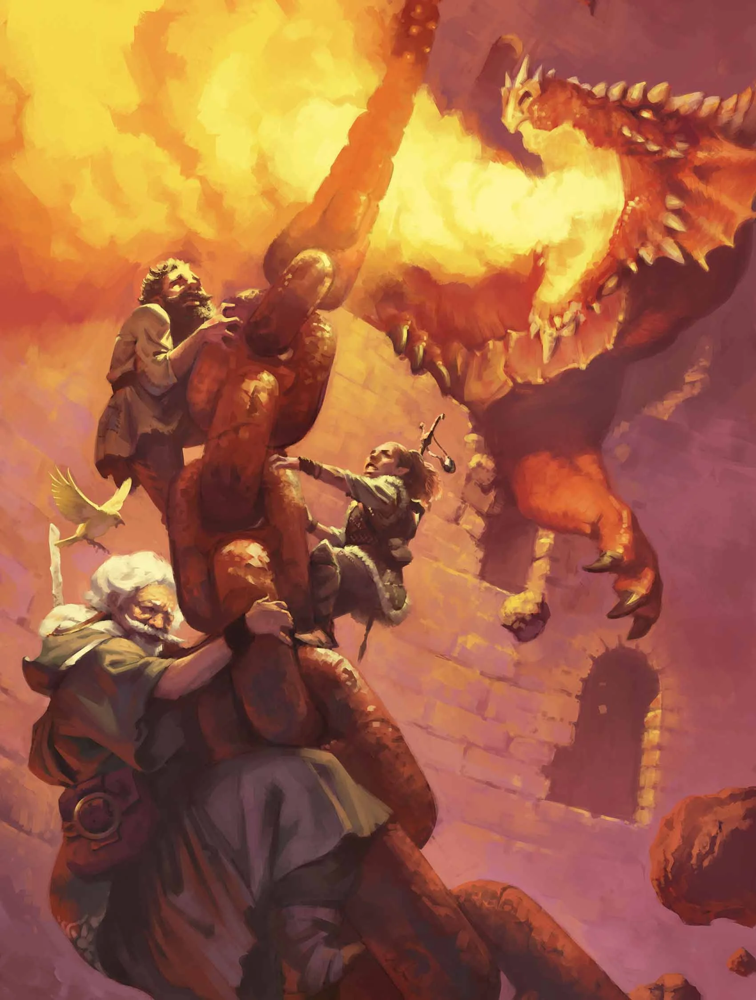

## Roleplaying Dragons

To portray a convincing human, one must embody greed, selfishness, and vigilance. To portray a convincing dragon, one must relax.

Dragons are complex creatures with varied personalities, goals, priorities, and mannerisms. In that respect, they're much like mortal folk—but dragons are also shaped by their specifically draconic characteristics, including incredibly long life spans, fundamentally magical biology, and the sheer enormity of their power.

### Dragon Characters

The {@book Dungeon Master's Guide|DMG} includes a series of {@book tables and guidelines|DMG|4} designed to help you craft NPCs. This section presents alternatives to those tables, helping you transform a dragon from a stat block and a basic description into a full-fledged character in your campaign.

In {@book chapter 5|FTD|5} of this book, you'll find additional tables of personality traits and ideals that are customized to various kinds of dragons.

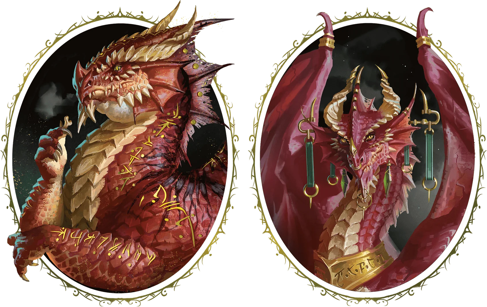

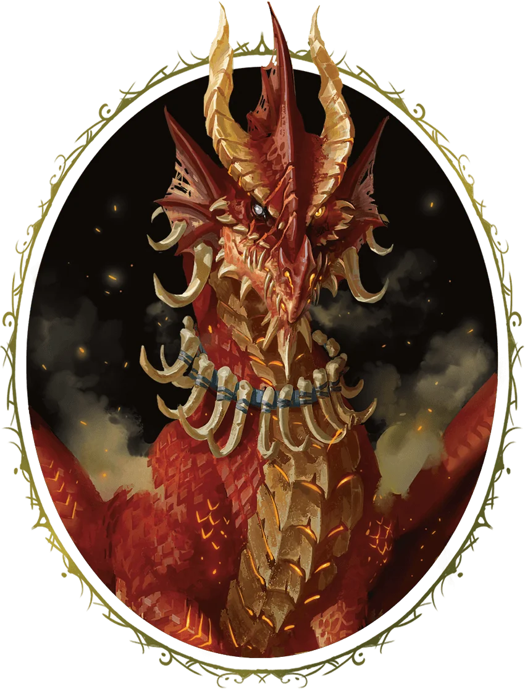

#### How to Name Your Dragon

Many Common phrases have origins in Draconic names. "Great googly-moogly," "goody goody gumdrops," and "gadzooks" all have their origins in the name of my capricious friend Galgalothmogalthas, whose dragon breath also produced a boppy, trumpet-y tune.

Some dragons' names resonate with power and inspire terror: Ashardalon, Dragotha, Klauth, Khellendros, Malystryx, Vaskar. Others are intricate and obscure, reflecting the grandeur of dragons' ancient language: Ingeloakastimizilian, Imvaernarhro, K'rshinthintl, Claugiyliamatar.

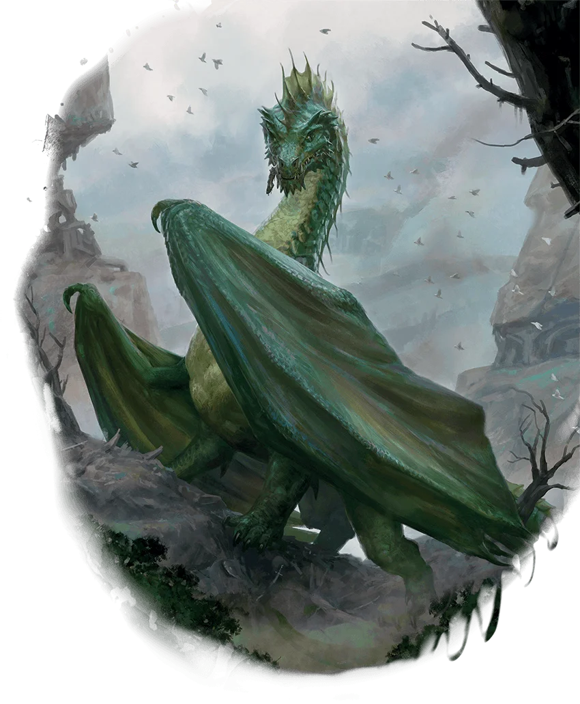

Many dragons are better known by nicknames and epithets. Klauth is commonly called Old Snarl, and Khellendros is remembered as Skie and the Storm over Krynn. Ingeloakastimizilian is Icingdeath, Imvaernarhro is Inferno, and K'rshinthintl and Claugiyliamatar are called Cyan Bloodbane and Old Gnawbones, respectively.

When naming a dragon, take whatever approach appeals to you. But bear in mind that dragons need memorable names, and if you or your players have trouble pronouncing a name, it's likely to be quickly forgotten—or jokingly abbreviated.

The Dragon Name Elements table provides Draconic morphemes that appear in dragon names. You can combine these elements to form a dragon name. For each element, roll a {@dice d20}, then choose one of the four possible results from the table, or roll a {@dice d4} to determine which column to choose from. If you like, you can rearrange these elements and add or drop letters to create a smoother flow or a more dramatic sound. For nicknames, look for inspiration in the dragon's abilities, mannerisms, or most famous acts.

#### Customizing Dragons

As discussed in the {@book Dungeon Master's Guide|DMG}, you can customize any dragon's stat block to reflect the dragon's unique character. Minor changes such as those below are easy to make and have no impact on a dragon's challenge rating.

##### Languages

Most dragons prefer to speak Draconic but learn Common for dealing with allies and minions. But given their high Intelligence and long life span, dragons can easily learn additional languages. You can add languages to a dragon's stat block.

##### Skills

Most dragons are proficient in the {@skill Perception} and {@skill Stealth} skills, and many dragons have additional skill proficiencies. As with languages, you can customize a dragon's skill list (even doubling their proficiency bonus with certain skills) to reflect particular interests and activities. You can also give a dragon tool proficiencies, particularly if the dragon spends time in Humanoid form.

##### Spells

The {@book Monster Manual|MM}'s variant rule about making dragons innate spellcasters is an easy way to add variety to dragons without impacting their challenge rating. {@book Chapter 5|FTD|5} offers suggested spell lists for different kinds of dragons, but you can also choose spells to reflect the dragon's character. A dragon who innately casts druid spells feels different from one who casts warlock spells. You can also give a dragon spells of a higher level than the variant rule allows, but such a tweak might increase the dragon's challenge rating—especially if those spells deal damage or impose conditions on targets.

##### Other Traits and Actions

You can borrow traits and actions from other monsters to add unique flavor to a dragon. Consider these examples:

- Change Shape

- Damage Absorption

- Flyby

- Mimicry

- Rejuvenation

- Special Senses

- Tunneler

### Life Span

Try not to be offended when a dragon dismisses you as irrelevant. Remember, you might be dealing with an individual who hatched into the world three civilizations ago, and not every dragon has the wisdom to see how lone heroes can change the course of history.

Some dragons can live for over a thousand years, outlasting the rise and fall of nations—or even whole civilizations. A dragon's perspective on the passage of time is naturally quite different from that of more short-lived folk. But just as characters expand their priorities and perspectives as they advance in level, so do dragons as they age.

The tables in this section suggest possible goals that reflect the priorities of dragons at different ages. Of course, a dragon's goals are shaped by many additional factors, including alignment, ideals, bonds, and flaws. So use these tables as a starting point, but flesh out each dragon's goals as you develop a complete picture of the dragon's personality.

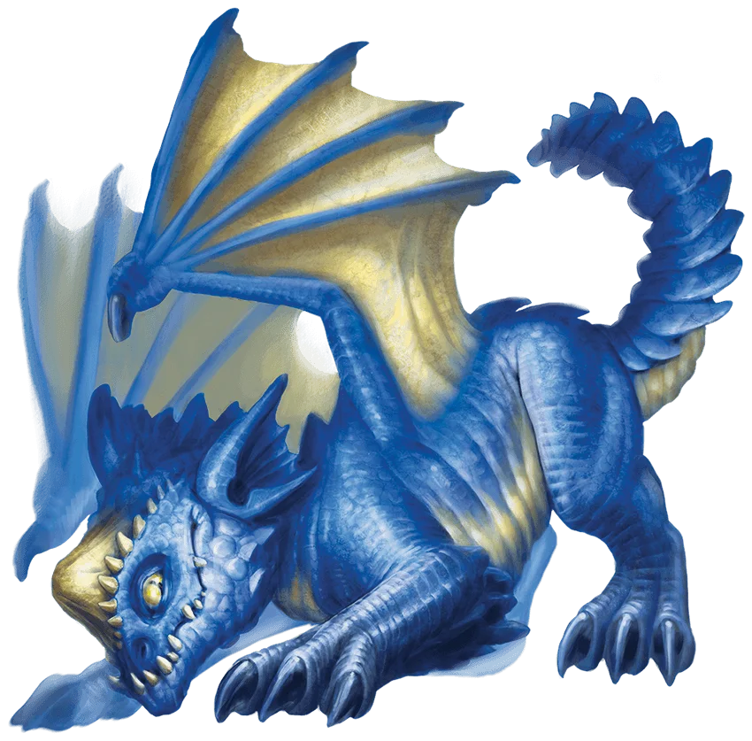

#### Wyrmlings

Much like adventurers in the first tier of play (levels 1 to 4), dragons in their first five years of life are still figuring out their capabilities and their place in the world. Thus, wyrmlings often rely on adult dragons or other companion creatures for safety.

Wyrmlings most often think on a local scale—an area no larger than might be covered by a few farmsteads or villages. If adult dragons are rearing a clutch of wyrmlings, the younger dragons often divide the adults' territory among them. A single wyrmling might thus hunt an area covering only a few square miles, but the presence of one wyrmling indicates that more might be nearby. On the other hand, wyrmlings without adult dragons in their lives might become allies or as captives of other kinds of creatures. Such wyrmlings are more likely to be scattered from their nest mates.

#### Young Dragons

Young dragons in their first century of life are similar in many ways to adventurers in the second tier of play (levels 5 to 10), as they're beginning to come into their own among the most powerful creatures of the Material Plane.

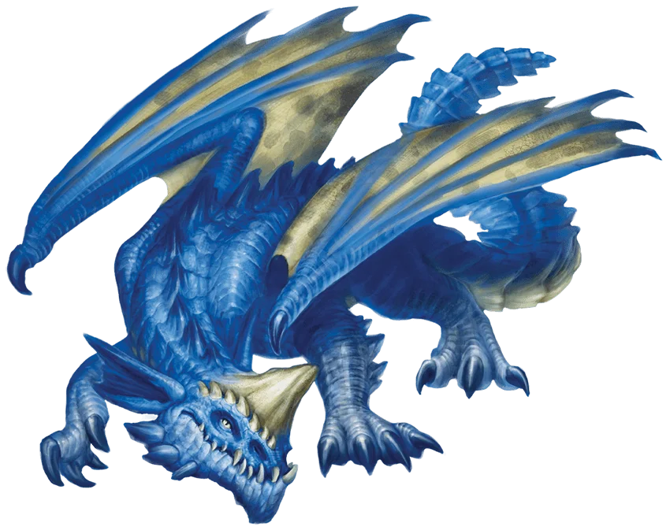

This stage is when most dragons first establish their own territory and lair. A young dragon's territory covers an area about 50 miles across. This is also when dragons start to form the magical ties that bind them to both their hoards and the regions around their lairs.

Hunting dragons typically fly on a more-or-less circular path out to one edge of their territory and back in a day, traveling about 75 miles in total. Young dragons also use their hunting flights to keep tabs on happenings within their territory and are keenly aware of other creatures whose territory neighbors or overlaps their own. A young dragon can become a significant threat to a city or kingdom, either through overt violence or subtle manipulation.

#### Adult Dragons

After their first century of life, adult dragons are mighty beings, akin to characters in the third tier of play (levels 11 to 16). An adult dragon's influence can extend across a whole region or continent.

Most adult dragons establish additional lairs to expand their territory. These lairs are usually set 50 to 75 miles apart, so the dragon can fly from one to the next in a single day's travel. An adult dragon typically hunts the area around one lair for a month or more, then moves on to another lair. The dragon's magical connection to a lair can transform the surrounding region, as represented by regional effects.

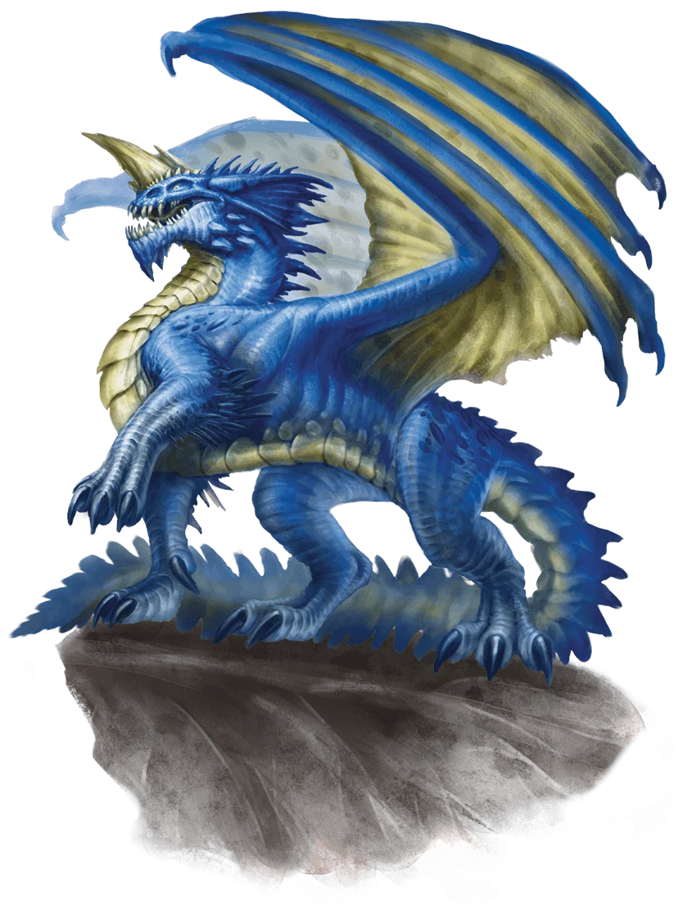

##### Dragons and Territory

As dragons age, their sense of territory expands, and many establish multiple lairs across the region they call home. The larger a dragon's territory is, the more likely it is to edge up against or overlap the territory of another dragon. The territory of an adult or ancient dragon often encompasses the territories of younger dragons, as long as the older dragon doesn't feel threatened by the younger ones.

Considering the regions of a campaign world, an area about 50 miles across, such as a barony or a small forest, might include the territory of a single dragon who's young or older.

An area about 300 miles across—a kingdom or a large geographical region—can contain the territories of two to three dozen dragons, as long as most of them are young. Only three or four adult or ancient dragons are likely to occupy such a region. A single adult dragon might range over a region that includes the territories of up to six or eight young dragons (which might include the adult's offspring), but adults typically share territory with other adults only as mates or as members of a special alliance or organization.

A whole continent, about 3,000 miles across, might include the territories of hundreds of young dragons and dozens of adults, but rarely more than a handful of ancient dragons.

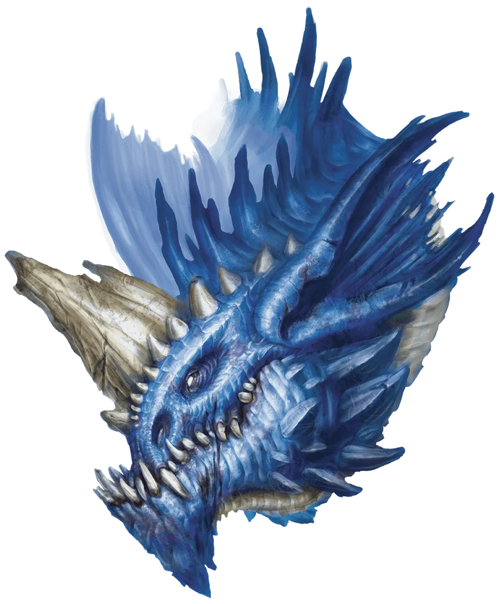

#### Ancient Dragons

Dragons are considered ancient once they reach eight hundred years of life, and many live for centuries more. Ancient dragons are among the mightiest creatures in the multiverse, and like characters in the fourth tier of play (levels 17 to 20), they are powerful enough to alter the fate of the world and upset the balance of power across the planes of existence.

An ancient dragon typically has several lairs, each one suffused with powerful magic. The regional effects surrounding each of an ancient dragon's lairs can combine to make that dragon's influence felt in the natural world for hundreds of miles. In addition to these magical effects, the dragon's ongoing presence can have a profound impact on the region's ecosystems, populations, and politics.

##### Greatwyrms

The oldest ancient dragons sometimes transform into mythic creatures of godlike power. These greatwyrms, described in {@book chapter 6|FTD|6}, are nearly perfect avatars of draconic nature and are so suffused with the magic of the Material Plane that they are all but immortal. Many result from ancient dragons ritually combining multiple echoes of themselves into a single corporeal form, as Ashardalon and Chronepsis are said to have done. Most greatwyrms are at least twelve centuries old and have hoards worth millions of gold pieces, but they are otherwise similar to other ancient dragons in their goals and perspectives.

### Reproduction

Dragons are like lizards. They existed before humanoids and will exist long after them, they can manipulate reality's fabric, and they transcend natural laws! Wait... not like lizards. Ah! Like magic.

Dragon reproduction varies from world to world in the Material Plane and can vary further depending on the family, kind, or individual nature of the dragons involved. Humanoids observing dragons have long assumed that their reproductive cycle resembles that of mundane reptiles—that two dragons of different sexes mate and produce a clutch of eggs. Sometimes, on some worlds, this is true, but dragon reproduction covers a wide range of other possibilities. You can use the Origin of Dragon Eggs table to choose a method of reproduction that holds true for all dragons on your world, to determine the origin of a specific clutch of eggs, or for anything in between.

Once an egg comes into being, it must mature before it is ready to hatch into a wyrmling. Typically, an egg thrives only in an environment appropriate for a dragon of its kind—nestled in a pool of lava for a red or gold dragon, in ice for a white or silver dragon, in rotting vegetation for a black or green dragon, in sun-heated sand for a brass or blue dragon, or in a storm-wracked sea cave or inhospitable moorland for a bronze or copper dragon. Gem dragon eggs generally incubate encased in rock or in small caves. The incubation period for any egg might range from 6 months to several decades or longer.

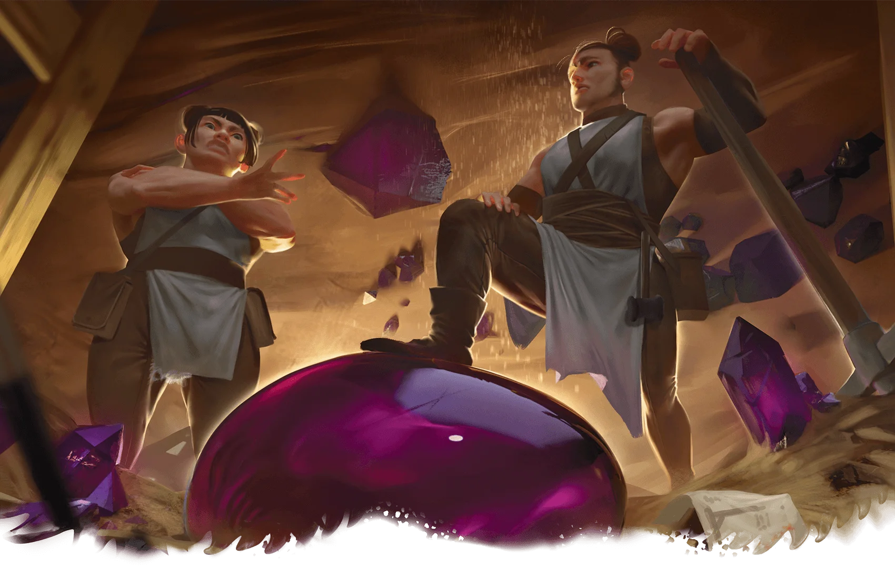

#### Half-Dragons

Just as dragon reproduction is not necessarily a straightforward biological process, half-dragons come into being through a variety of means. The Half-Dragon Origin table below offers examples.

Dragons create half-dragon progeny for a wide range of reasons. Some dragons create half-dragons to secure reliable minions. Others seed half-dragons around their lairs to make the area more dangerous to interlopers. And on many occasions, half-dragons simply appear spontaneously or are an accidental consequence of a dragon's magical power and influence.

In some worlds, these same phenomena might explain the origins of dragonborn, kobolds, and perhaps the draconic gifts described in {@book chapter 2|FTD|2|Draconic Gifts}.

### Death of a Dragon

When I go, I dream of passing my spirit into that with which I have had the most profound experiences. The first thing that comes to mind is a caramel treacle from the Foxy Duck Tavern. Yum!

Dragons are intimately bound up with the fabric of magic that undergirds the Material Plane. As a result, the death of any dragon is an event of tremendous significance—and those who bring about a dragon's death are often changed forever.

Some sages describe dragons as being akin to knots in the fabric of magic—concentrations of power in material form. When a dragon dies, that knot is undone, sometimes resulting in a surge of magical energy. You can use the Dragon Death Throes table to help you decide what happens when a dragon dies. Characters who slay a dragon are often on their last legs when the dragon finally succumbs, so if an effect is likely to kill a character, roll again or choose a less dangerous result.

#### Regional Reversal

As described in the {@book Monster Manual|MM} and discussed in more detail in {@book chapter 4|FTD|4|Regional Effects}, a dragon's presence alters the region around the dragon's lair. When the dragon dies, those effects typically end immediately or fade away over the course of several days. But a traumatic death sometimes extends negative effects throughout the region. These can include instantaneous effects as well as lingering magic that persists for {@dice 1d10} days, as in the following examples:

- Fouled Water

- Restless Sleep

- Trembling Earth

- Wildlife Changes

- Winds of Change

- Withering Burst

#### Passing the Mantle

When a dragon dies, the power enfleshed in the dragon doesn't just disappear from the world. Over time, it disperses, but in the moments immediately surrounding the dragon's death, it can be passed on to others—or claimed. Sometimes (as discussed in "{@book Reproduction|FTD|3|Reproduction}" above) a dragon's death gives rise to an egg, transferring the dragon's power directly to a new generation. In other cases, a dragon at the brink of death invests power into another creature—usually a dragon, but sometimes a sovereign, a sage, or an adventurer. Moreover, those who slay a dragon could seize the dragon's power.

The benefit conferred by this transfer of power is up to you. It might include one of the draconic gifts described in {@book chapter 2|FTD|2|Draconic Gifts} of this book, or a charm or blessing from the {@book Dungeon Master's Guide|DMG}. You can also use the supernatural gifts in {@book Mythic Odysseys of Theros|MOT} or the Dark Gifts in {@book Van Richten's Guide to Ravenloft|VRGR} as benefits (with definite drawbacks, in the case of Dark Gifts).

##### Investiture

A dying dragon might willingly pass on power in different ways. The most common process is for the recipient to inhale the dragon's dying breath—which often involves being subjected to at least a diminished form of the dragon's breath weapon. A gem dragon might psionically implant a gemstone in the recipient's body that carries the dragon's power. A dragon might instead lay a claw on the recipient or bequeath a piece of treasure as an embodiment of the transferred power.

##### Body and Blood

When a dragon dies a violent death, the dragon's power might linger in the corpse for a short time. Drinking or bathing in the dragon's blood; sleeping entombed in the carcass; or consuming the dragon's heart, brain, eyes, breath-producing organ, or muscle can be an effective way of claiming the fallen creature's magical might. Using a dragon's corpse this way might be a trial in itself, as the lingering energies in the body can cause serious injury even after the dragon's death.

##### Automatic Transfer

It's also possible for a dragon's power to transfer immediately and automatically to creatures that participate in the dragon's death or that are present when the dragon dies. A burst of power might emanate from the dragon at the moment of death, affecting each creature within 300 feet of the body. Or a fragment of power might enter every creature that has dealt damage to the dragon over the course of the dragon's life.

### Undeath

I've never met a creature I didn't love. But I have met a few I didn't want alive.

Despite their incredible life spans, some dragons pursue undeath to extend their existences. Others stumble into undeath unwillingly or unwittingly. Either way, an Undead dragon is a force to be reckoned with.

Dracoliches are created by cultists or necromancers who either persuade or trick a dragon into undergoing a foul ritual. In the world of the Forgotten Realms, this ritual originated with the Cult of the Dragon, whose teachings (based on a mistranslated fragment of ancient prophecy) maintain that "dead dragons will rule the world entire." The cult thus creates dracoliches as a step toward achieving that particular vision of a future paradise. Similar rites exist on other worlds, whether spread by cultists from Faerûn, invented independently, or discovered by dragons who have dracolich echoes on Faerûn.

{@book Chapter 6|FTD|6} details three additional kinds of draconic Undead. A {@creature hollow dragon|FTD} comes into being when a metallic dragon gives up mortal life so a fragment of life essence can linger as an eternal guardian of a precious treasure or knowledge. {@creature Draconic Shard|FTD|Draconic shards} are lingering psychic projections of psionic gem dragons. And dragons can also linger after death as {@creature Ghost Dragon|FTD|ghost dragons}.

Whatever form an Undead dragon takes, the creature's transformation ripples throughout the Material Plane. Every dragon has echoes on other worlds, and when one dragon violates the natural cycle of life and death, that dragon's echoes are often affected—particularly in the case of dracoliches. A dracolich's echoes suffer a wasting affliction that spreads out from the dracolich like a contagion. Afflicted dragons grow increasingly violent and cruel, and the physical deterioration they experience from aging accelerates. This wasting can even drive an affected dragon to seek out undeath.

The Undead Dragon Adventure Hooks table translates some of these ideas into inspiration for adventures revolving around Undead dragons.

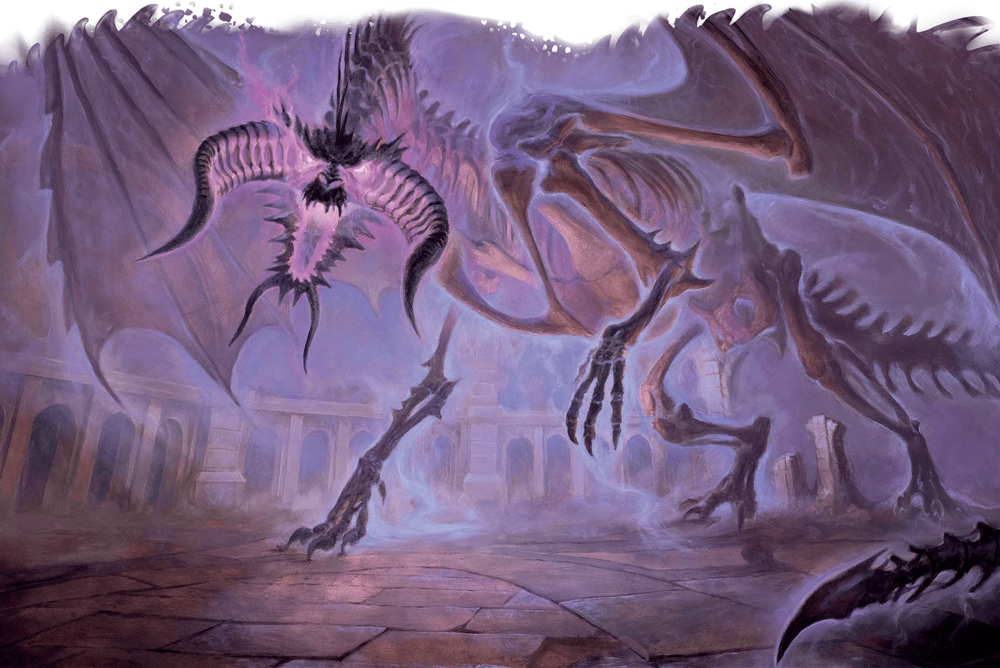

### Echoes across the Worlds

It takes no additional work to be infinite. As a spider sees through all its eyes, dragons simply are, once and many times.

Dragons' unique connection to the magic of the Material Plane and the history of the First World gives them a mysterious link to other dragons across the myriad worlds of the Material Plane. In theory, every chromatic, metallic, and gem dragon that has ever lived has had a unique echo on every world of the Material Plane. Some of those echoes are very similar to each other, but others are more radically different.

You can use the Dragon Echo Characteristics table to help you decide what aspects of a dragon's echo are similar to the dragon you know and which are different. You can then use the other tables in this chapter (including the {@book Dragon Appearance|FTD|3|Dragon Appearance}, {@book Dragon Mannerisms|FTD|3|Dragon Mannerisms}, {@book Dragon Bonds|FTD|3|Dragon Bonds}, and {@book Dragon Flaws and Secrets|FTD|3|Dragon Flaws and Secrets} tables), as well as the tables of personality traits and ideals in {@book chapter 5|FTD|5}, to help you elaborate the differences between one dragon and the dragon's echo.

### Gods and Religion

Most dragons aren't what you'd call pious. To really embrace religion, one must believe one needs help.

Bahamut and Tiamat, the primordial dragons and the purported creators of the First World, are the closest things to gods among dragonkind. Since they share the same fundamental connection to the Material Plane as their dragon offspring, Bahamut and Tiamat are ontologically distinct from the gods that hail from the Outer Planes. But for practical purposes, they are divine—worshiped by mortal creatures, able to grant cleric spells to their followers, and both ageless and immortal. Since the destruction of the First World, both primordial dragons now dwell in the Outer Planes—Bahamut on Mount Celestia and Tiamat in the Nine Hells.

On many worlds, Humanoids worship Bahamut and Tiamat as gods. On Krynn, they are the greatest among the gods, though they are known there as Paladine and Takhisis and are not always pictured as dragons. In the {@table A Sample Pantheon; Dawn War Deities|DMG|Dawn War pantheon} described in the {@book Dungeon Master's Guide|DMG}, Bahamut is revered as a god of justice and nobility, favored by paladins, while Tiamat is known as a god of greed, wealth, and vengeance.

Dragons view the primordial dragons differently. To metallic dragons, Bahamut is more like a king than a god. Individual dragons might owe Bahamut allegiance, respect him, pay tribute to him, and strive to emulate him. Similarly, chromatic dragons might fear, respect, envy, and appease Tiamat as a sovereign. But none of those attitudes and behaviors bear any resemblance in a dragon's mind to the worship that mortals offer to their gods.

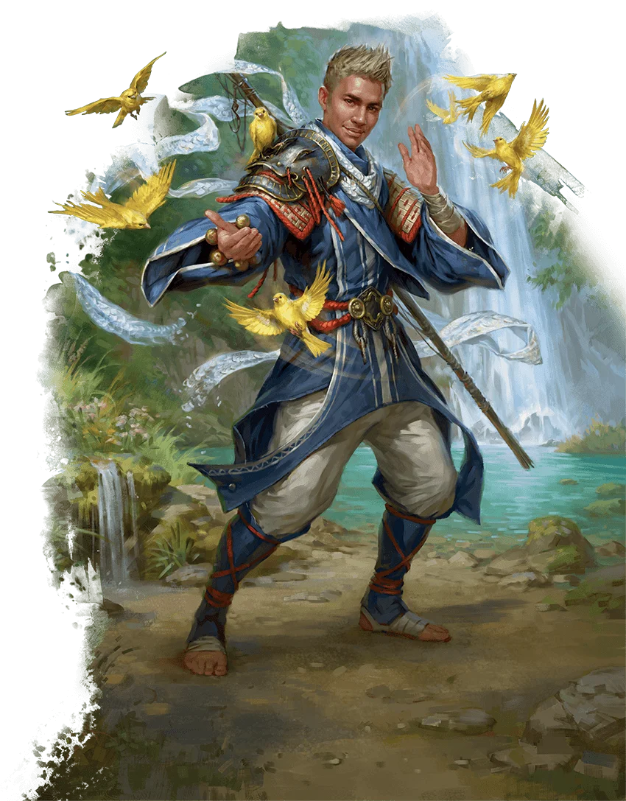

A few other dragons also command reverence from their kin. These are often greatwyrms who have undergone a sort of apotheosis, joining multiple echoes of themselves into a single powerful form. A few are ancient dragons who have cultivated their dragonsight to such a degree that they can coordinate the actions of their echoes across the Material Plane, influencing events on multiple worlds at once. Humanoids might consider these dragons gods, but as with Bahamut and Tiamat, dragons respect these figures for their wisdom, their might, their magic, and their wealth; they don't worship them. Such enlightened dragons include Aasterinian (a brass dragon who serves as a messenger for Bahamut and is sometimes identified as a god of invention), Chronepsis (a black dragon who now resides in the Outlands, sometimes imagined as a god of fate), and Tamara (a silver dragon of transcendent beneficence, described as a god of life). A number of such dragons of legend are discussed in more detail in sidebars in {@book chapters 5|FTD|5} and {@book 6|FTD|6}.

Dragons are not religious by nature. They can grow to become some of the most formidable creatures in the multiverse without relying on any external power, and they learn self-sufficiency and self-interest from the moment of their hatching. They do not appeal to divine powers for aid, nor do they beseech them for mercy. That said, some dragons could be described as spiritual. A dragon might cultivate an awareness of the interconnectedness of all that exists and strive to nurture the health of the whole or to exploit that connection. But even the most spiritual dragons have a keen sense of their own importance.

### Shape-Shifting

The time a dragon spends in a humanoid form is not directly related to our opinion of said form. In fact, dragons generally disagree with mortals about visual taste.

Most of you are extremely misguided. Looking glasses have not helped.

Most metallic and gem dragons can change shape to take on a Humanoid or Beast form by the time they reach adulthood or ancient age. A few other Dragon varieties possess similar abilities (including deep dragons, described in {@book chapter 6|FTD|6|Deep Dragons}), and you can give any dragon the Change Shape action of an adult or ancient dragon without affecting the dragon's challenge rating (as noted under "{@book Customizing Dragons|FTD|3|Customizing Dragons}" earlier in this chapter). Likewise, if you use the {@book Monster Manual|MM} variant rule to make dragons innate spellcasters, you could give any adult or older dragon the {@spell polymorph} spell to take on an alternate form.

Dragons typically use their shape-shifting ability to move about in the world without drawing attention to themselves. Dragons like to know as much as they can about the lands around their lairs and the inhabitants of those lands, and posing as a more innocuous creature is an easy way to gather such information. Many metallic dragons also believe they are following the example of Bahamut, who is known to wander the worlds of the Material Plane in Humanoid guise, appearing sometimes as an elderly sage or wizard, other times as a young fisher or monk. In any of these forms, he is often accompanied by seven gold dragons in the form of brilliant yellow songbirds.

Famously, Bahamut traveled the world of Krynn in the guise of a human wizard named Fizban, guiding the peoples of that world as they prepared for war against the evil forces of Tiamat. In the same way, some metallic dragons use their Humanoid forms to influence people. Since they can remain in Humanoid form indefinitely, metallic dragons often create false identities and mundane lives for themselves. Thanks to their keen intellects and strong personalities, shape-shifted dragons can easily end up in positions of leadership—either overtly as mayors, high priests, the heads of knightly orders, or crime bosses or behind the scenes as advisors, activists, or the spouses of rulers.

#### Dragons of Song and Steel

The propensity of some metallic dragons to spend long periods of time in Humanoid form has led to numerous bits of folklore, including tales in which these shape-shifters are sometimes erroneously identified as unique varieties of metallic dragons.

In the world of the Forgotten Realms, stories speak of "weredragons" or "song dragons," which are variously described as "beautiful humans transformed into dragons" or as a distinct variety of metallic dragon. The world of Greyhawk has legends of similar dragons, called either Greyhawk dragons or steel dragons, which are said to favor life among Humanoids in the hustle and bustle of great cities.

The creatures featured in these legends are almost certainly copper, silver, or other metallic dragons who simply favored that particular form. Some dragons even seem to prefer Humanoid form to their own and delight in surrounding themselves with companions who can answer their endless questions about Humanoid art, culture, history, and politics.

Of course, years of careful scheming can be quickly unraveled if a shape-shifted dragon's true nature is discovered. As a result, such dragons are careful to avoid being seen in their true forms. They show great caution in dealing with adventurers or anyone else who might have the magical ability to expose their nature. And dragons who need to revert to their true form are careful to do so out of sight—or to leave no surviving witnesses.

Some metallic dragons believe that if they remain in a shape-shifted form for too long, they'll lose the ability to revert to their true form. This is probably just superstition, but many dragons claim to know of others of their kind condemned to spend the rest of a very long life trapped in Humanoid or Beast form. Because of this belief, dragons who spend prolonged periods in the guise of other creatures often find periodic excuses to venture into the wilderness, letting them stretch their wings away from prying eyes.

### Dragon Organizations

The only thing better than getting a dragon involved...is getting five dragons involved!

Most dragons are solitary, living alone or keeping company with only a single dragon companion or a tight family group. Occasionally, though, dragons form associations with other dragons in pursuit of a common purpose. These associations are more common among lawful dragons and center around goals broader than a single dragon's territory or concerns. This section discusses several organizations whose plots can unfold across small regions, whole worlds, or even multiple worlds.

#### Cult of the Dragon

Founded in Faerûn, the Cult of the Dragon was based on a mistranslated prophecy that "dead dragons shall rule the world entire." For most of its history, the cult has focused on creating dracoliches to fulfill this prophecy. Its members have been responsible for creating more dracoliches than any other force on the Material Plane. And thanks to the corruption that spreads between worlds whenever a dragon embraces undeath (see "{@book Undeath|FTD|3|Undeath}" earlier in this chapter), the cult's influence has been tremendous.

In recent years, Tiamat has worked through a young member of the Cult of the Dragon to alter the cult's foundational beliefs. The Dragon Queen steered this prophet, named Severin, to the correct translation of the cult's foundational prophecy: "...naught will be left save shattered thrones, with no rulers but the dead. Dragons shall rule the world entire..." Guided by this new vision, Severin has worked tirelessly to bring about the ascendance to power of living dragons, even attempting to bring an avatar of Tiamat into the world to wreak havoc (and nearly succeeding).

##### Dissent in the Ranks

Since the failure of Severin's effort to bring Tiamat into the world, the Cult of the Dragon has been sharply divided. Some of its members pursue Severin's new vision for the cult, keeping their focus on his reinterpretation of the prophecy. Others still support the prophecy's old interpretation, continuing their efforts to create dracoliches.

##### Adventure Hooks

The Tyranny of Dragons adventure details the cult's efforts to bring Tiamat's avatar into the world. Beyond that plot, the Cult of the Dragon Adventure Hooks table offers suggestions for how adventurers might encounter this sinister cult.

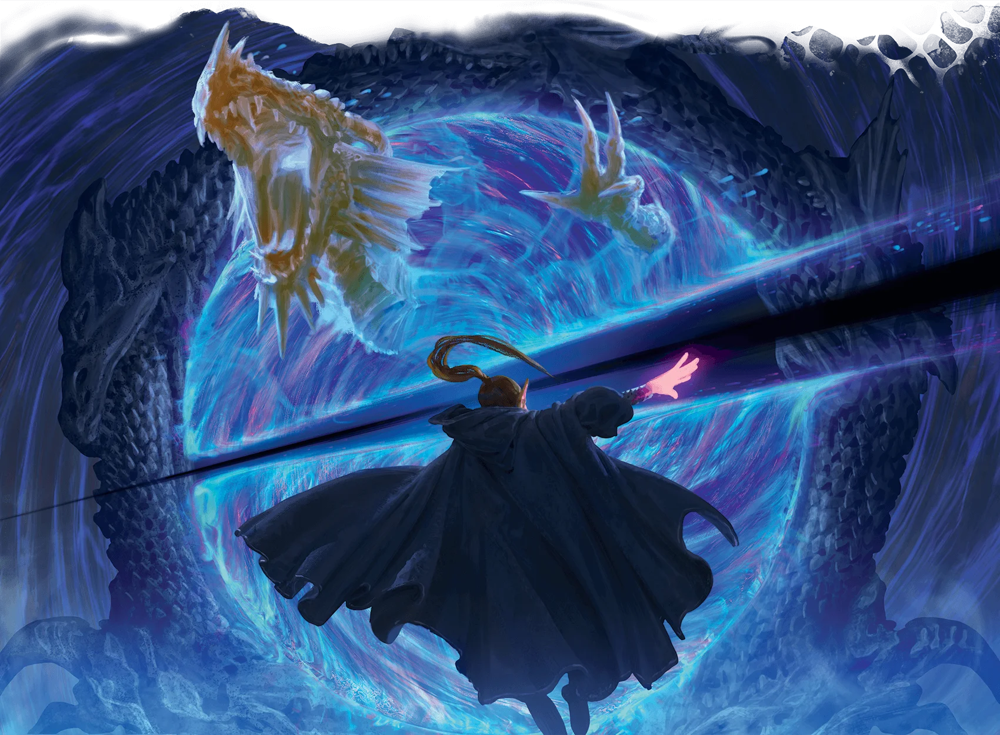

#### The Chamber

A cabal of dragons called the Chamber keeps tabs on events unfolding across the world of Eberron, monitoring and manipulating the fulfillment of the ancient Draconic Prophecy. Most other creatures are merely pawns in the dragons' centuries-long schemes, their needs and lives relevant only insofar as they intersect with the Prophecy.

The Draconic Prophecy is not a single collection of oracular sayings, nor is it any kind of organized prediction of future events. Rather, the Prophecy is a map of possible futures—an outline of the complex relationships of cause and effect. Dragons of the Chamber study it not to know what the future holds, but so they can comprehend the possible consequences of any action they or others might take—consequences that might unfold over the course of centuries. From the perspective of the dragons of the Chamber, the tumultuous events of national histories are but tiny waves in a vast ocean, but those waves are often warnings of the mightier forces of the tides.

As described in {@book Eberron: Rising from the Last War|ERLW}, the dragons of the Chamber primarily act as observers, gathering information about new aspects of the Prophecy. They are also charged with stopping any creatures attempting to use the Prophecy for their own ends, including agents of the ancient Fiends known as the Lords of Dust. That said, some members of the Chamber try to take the fulfillment of the Prophecy into their own talons, directing the future toward outcomes they desire.

##### Marks of Prophecy

The dragons of the Chamber recognize the dragonmarks that appear on the skin of certain Humanoids on Eberron as manifestations of the Prophecy. These marks reveal nuances of the Prophecy to those who can understand them and lend symbolic weight to the actions of those who bear them—for example, a person with the Mark of Storm might fulfill the role of "a mighty storm" in the Prophecy. For this reason, agents of the Chamber are interested in the activities of dragonmarked families and heirs.

##### Prophetic Dragonsight

Most agents of the Chamber assume the Draconic Prophecy is concerned only with the unfolding of possible futures on Eberron. A few of the organization's most ancient members, though, have developed their dragonsight enough to explore the ramifications of the Prophecy across other worlds of the Material Plane. Dragons on multiple worlds might thus act as agents of the Chamber, manipulating history on their own worlds to see whether that affects the unfolding of the Prophecy on Eberron. These elders reason that if dragons can connect their echoes across worlds, then all worlds must exist in a sort of entanglement of causality. This makes the map of possible futures infinitely more complex and tantalizing—and subject to careful manipulation.

##### Adventure Hooks

{@book Eberron: Rising from the Last War|ERLW} contains abundant ideas for adventures related to the Chamber's activities on Eberron. The Chamber Adventure Hooks table here suggests additional ways characters on other worlds might become entangled in the schemes and experiments of the Chamber, by way of agents whose awareness extends beyond Eberron.

#### Hidecarved Dragons

On worlds across the Material Plane, dragons gather in small communities of three to five called lauths. These dragons share a common territory and hoard, live under a strict code of discipline, and devote themselves to a common goal. Their most notable feature, though, is their practice of carving arcane sigils of protection into their scales.

##### Common Purpose

Dragons most often form a lauth when they identify a shared goal whose completion requires the sustained effort of a diverse group of dragons. The Lauth Goals table offers a few examples.

##### Diverse Dragons

The hidecarved dragons of a lauth share a goal but often have little else in common. By design, each member of a lauth is usually a different kind of dragon, bringing particular abilities and perspective to bear on the group's goal. Likewise, a lauth's dragons cover a range of ages, ensuring that the lauth's traditions outlive its oldest members.

##### Engraved Wards

The arcane markings carved into hidecarved dragons' scales are magical protections, intended to make the dragons more resilient against the threats they might face in carrying out the lauth's purpose. The longer dragons stay with a lauth, the more wards they receive. Most hidecarved dragons have one of these wards plus an additional ward for each age category above wyrmling. You can roll for these effects on the Hidecarved Wards table or choose effects as you wish.

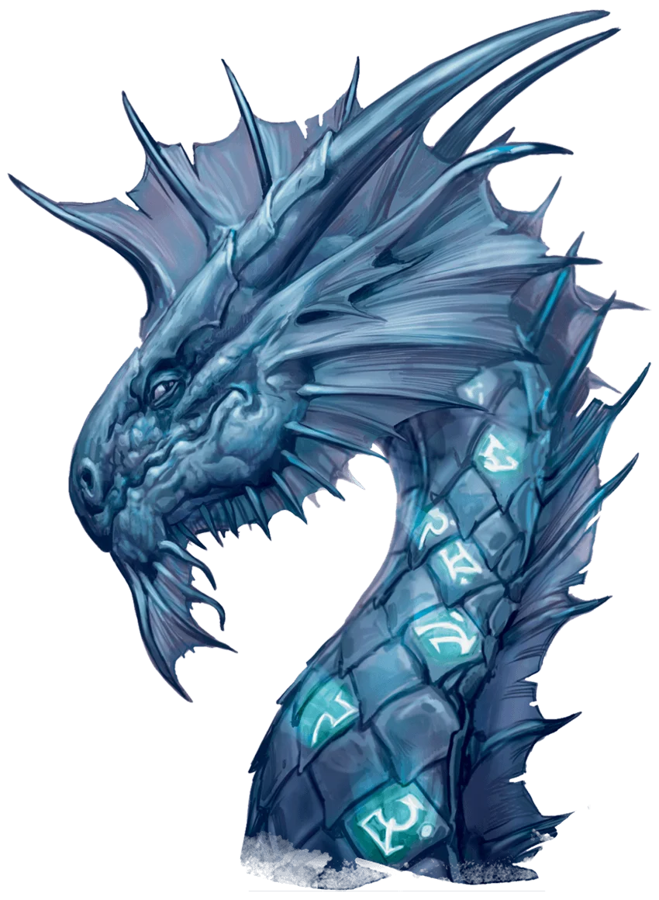

##### Mystic Markings

The sigils engraved in the scales of a hidecarved dragon echo across the Material Plane similarly to how a dragon becoming Undead does. When a dragon joins a lauth, the dragon's echoes on other worlds gain a measure of the magical protection from the dragon's engraved markings. Some of those echoes accept this inexplicable boon without questioning it. Others investigate the mystery and might end up awakening their dragonsight and discovering the nature of the lauths affecting them—perhaps eventually founding their own lauths with other dragons in a similar situation.

##### Adventure Hooks

The Hidecarved Dragons Adventure Hooks table offers suggestions for how this order of dragons might get caught up in the affairs of adventurers.

#### Inheritors of the First World

"Breathe, dragons: you are inheritors, / ruling the wreck of the First World's destruction." To some dragons, this closing couplet of "Elegy for the First World" is not merely an exhortation to dominate the Material Plane, but a call to recreate the original world of the dragon gods. The draconic members of an apocalyptic sect called the Inheritors of the First World believe the cataclysm that destroyed the original creation and brought the myriad worlds of the Material Plane into being can be undone. In fact, they teach that the Material Plane's worlds must be destroyed and recombined so the creation can be brought to its final, glorious purpose.

The goal of the Inheritors of the First World might seem unattainable; at the very least, achieving it would almost certainly require the intervention of both Bahamut and Tiamat. But they would be opposed by the countless gods who are deeply invested in the Material Plane as it is, and the two primordial dragons have not coordinated their efforts toward a common purpose since before the destruction of the First World. Still, the Inheritors of the First World are extremely knowledgeable about the multiple worlds of the Material Plane, the connections between them, and means of traveling from one world to another.

##### Awakening Dragonsight

The work of the Inheritors of the First World consists largely of developing dragonsight, which is latent in all dragons. Leaders within the group have perfected multiple techniques—from alchemical brews to elaborate rites—to help spark the first flickering awareness of a dragon's echoes on other worlds. They freely perform these techniques on any dragons who yearn for this birthright, believing that empowering dragonsight even in dragons with no intention of joining the order ultimately helps advance their cause. A dragon who decides to be initiated into the sect develops a basic awareness of multiple echoes and begins to communicate directly with them in a process akin to lucid dreaming by the time they undergo initiation.

Any dragons with well-developed dragonsight, but especially members of the Inheritors of the First World, can have the following trait, representing the ability to call on the knowledge of their echoes across the Material Plane:

###### Dragonsight Revelation

The dragon can add half its proficiency bonus, rounded down, to any ability check it makes that uses a skill with which it lacks proficiency.

##### Reverence for Sardior

A central tenet of the Inheritors of the First World is that a reborn Sardior will ultimately inspire Bahamut and Tiamat to join forces once again and return to the task of creation. Many members of the sect are gem dragons, who believe Sardior's fractured consciousness is embedded in their own minds, and who work to cultivate dragonsight in other gem dragons. However, even chromatic and metallic members of the group revere the long-dead Ruby Dragon. Sardior is their once and future sovereign—a leader who has departed for a time, but who will return to bring enlightenment, comfort, and salvation to dragonkind.

##### Adventure Hooks

The Inheritors of the First World Adventure Hooks table offers suggestions for how characters might become involved with this apocalyptic sect.

## Followers

Certain dragons act like they're in danger of forgetting their own grandeur unless they're surrounded with beings they can demean. I've found, on the contrary, that those scorned by others often have the most to teach us.

Dragons often take on followers to help them acquire treasure and protect their hoards and lairs. Assigning such subordinates to a dragon is a matter of encounter and adventure design. As you craft an encounter, an adventure, or an entire campaign around a dragon, you can decide how many creatures are in the dragon's service.

### Dragon Relationships

Some dragons rule sprawling criminal organizations devoted to plundering the surrounding region and swelling the dragons' hoards. Others govern peaceful and prosperous towns where taxes and tariffs provide them a steady stream of income. Still others set themselves up as warlords, emperors, or gods.

The sections that follow present a variety of relationships dragons could have to their followers (whether the followers are aware their leader is a dragon or not). Each style of relationship suggests a variety of adventure possibilities, as shown on the {@book Relationships and Adventures|FTD|3|Relationships and Adventures} table at the end of this section.

#### Business Owner

A dragon might invest wealth into a business to multiply the investment. The dragon's followers are employees, who might be exploited because of their weakness relative to the dragon or treated fairly because of the dragon's kindness. Employees who don't perform up to the dragon's standards are released from service—whether that means being sent off to find other jobs or becoming the dragon's next meal. Depending on the size of the commercial enterprise, the dragon might have subordinates who are responsible for certain aspects of the business. These subordinates might be related to the dragon (younger dragons or perhaps half-dragons), or simply employees who have proven trustworthy and resourceful.

#### Companion

Dragons sometimes interact with mortal folk as if they were equals—particularly dragons who enjoy taking on Humanoid form. They might create a fellowship or collegial society and treat their companions with kindness and respect. These allies are often unaware that their activities are oriented around the dragon's purposes, becoming unwitting pawns in the dragon's plans. Deep attachments might form between the dragon and these companions, who can become disillusioned when the dragon's true nature is revealed.

#### Crime Boss

A dragon takes charge of a criminal enterprise, accumulating wealth through illegal activities that might range from theft and racketeering to smuggling and illegal gambling. Like any other gang leader, the dragon has little tolerance for rivals and none at all for disloyalty among minions. Various lieutenants—which might include younger dragons or half-dragons related to the boss—might hold responsibility over particular segments of the criminal enterprise.

#### Emperor

Rather than existing on the shadowy fringes of society, a dragon might rule a nation as an absolute monarch. The dragon's word is law—but depending on the dragon, this might be the law of a benevolent autocrat with a cadre of wise advisors or of a dictatorial tyrant who governs based on whim. Taxes might be funneled into the dragon's hoard, but some dragons in this position regard the collective wealth of their empire as part of their hoard and feel no need to consolidate it in specific locations.

A dragon emperor might accept fealty from lesser sovereigns and nobles who govern parts of the realm in the dragon's name, or the dragon might install dragon or half-dragon offspring in the highest echelons of government. Depending on the size of the domain, the dragon might have thousands or even millions of loyal subjects.

An emperor might rule openly in dragon form, which discourages aggressive neighbors from provoking the dragon's wrath. Often, though, dragons adopt a Humanoid guise to rule, constructing elaborate ruses (posing as their own children and grandchildren, for example) that allow them to reign across multiple generations.

The size of a dragon's territory is irrelevant to the "emperor" role. A dragon who acts as a mayor for a small frontier town has the same kind of relationship with the populace as one who rules a continent-spanning nation.

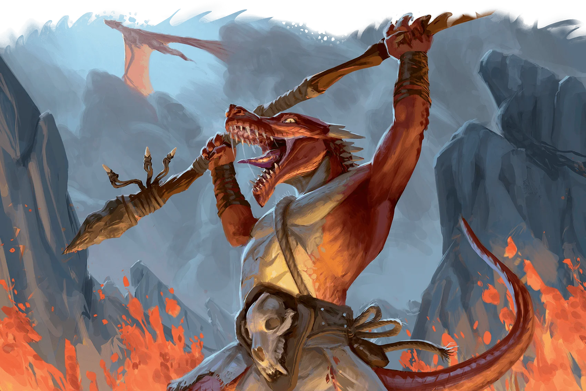

#### God

Some dragons demand not just service but worship from their minions. Among Humanoid creatures, kobolds are most likely to treat their dragon patrons as deities, since they typically see dragons as idealized versions of themselves. They bring sacrifices of food and treasure to their dragon gods, indulge in various forms of worship (including groveling when evil dragons are involved), and create tales and hymns to stoke their deities' egos. But other Humanoids might also feel (or at least feign) religious devotion to a dragon, sometimes even manifesting magical power as a result of their piety. (The {@creature dragon blessed|FTD} follower is an example of a Humanoid manifesting such power.)

Dragons can be benevolent patrons who genuinely care for those who worship them, scheming manipulators who view devotion as a means of domination and control, or something in between. All dragon gods, however, have devoted minions who are difficult to sway from their service. One key to this devotion is the fact that a dragon's power is more concrete than the power of most gods; the supernatural fear inspired by a dragon's presence readily translates into reverence among the followers.

#### Noble

Some dragons aspire to a life of luxury, surrounded by minions whose primary purpose is to ensure their every need is met immediately. A dragon living in Humanoid form might actually claim a noble title and hobnob with other members of the aristocracy. However, dragons in this category often prefer to avoid the hassles of secrets and disguises, focusing instead on extravagance—and demanding treasure as tribute from nearby settlements. Their minions are menial servants, responsible for bringing them food, keeping them comfortable, tending to their lairs, and warding off intruders. One or more of these servitors might have the responsibility of managing the rest of a dragon noble's staff on the dragon's behalf, but even such a steward has little autonomy and must cater to the dragon's every whim.

#### Parental Figure

Some dragons treat their followers and minions like their children. These followers might be a dragon's devoted dragon or half-dragon offspring, but it's more likely that these minions are a family the dragon has adopted out of generosity, compassion, or manipulation.

Unlike most other relationships between dragons and followers, this one is primarily about the well-being and advancement of the followers, not the dragon. Dragons are notoriously egotistical even when they're benevolent, but some make sacrifices for weaker creatures they see as family, regardless of their exact relationship to the creatures.

To outsiders, dragons in this sort of relationship might be mistaken for pets or servitors. But dragons never forget their own power and importance, even when helping other creatures, and dragons' "children" might face serious consequences if they forget who's in charge.

#### Patron

Dragons might take on the role of patron, using a fraction of their tremendous wealth to support the arts, groups of freelance adventurers, or important causes. Such dragons' minions might include artists painting frescoes in their lairs, musicians composing chorales for the dragons to enjoy, poets writing odes in praise of their draconic lieges, and adventurers seeking priceless treasures to add to the dragons' hoards. Dragons who spend a lot of time in Humanoid form are often drawn to this role, and their minions might have no idea that their generous patrons are actually dragons.

If you want to have a dragon act as a patron for a group of adventurers, look to the "{@book Group Patrons|TCE|2}" chapter of {@book Tasha's Cauldron of Everything|TCE}. You can use the information there to create a dragon filling this role in your campaign. Dragons naturally fall into the category of "{@book ancient being|TCE|2|Ancient Being}," as described in that chapter, but depending on their roles and personalities, they might act more like another kind of patron.

#### Teacher

The oldest dragons are deep wellsprings of knowledge, drawing on vast experience that might extend beyond a single world of the Material Plane to encompass multiple realities. Though some dragons hoard their knowledge like treasure, others enjoy passing their knowledge on to other creatures. Such dragons might establish schools or monasteries, take on individual students or groups of disciples, or pose as Humanoid scholars to teach in universities. These dragons might believe that educating lesser creatures is the responsibility of the great. Others want a higher class of minion and believe education is the best way to achieve that. Still others simply enjoy teaching or believe the world is improved by having an educated populace.

Monks who follow the {@class monk|phb|Way of the Ascendant Dragon|Ascendant Dragon|FTD} might follow a dragon teacher or could train in monasteries established by dragons in past generations.

#### Warlord

The combination of ego and intellect can lead a dragon to become a military leader. Minions help keep the dragon's territory in an iron grip, bringing the spoils of conquest and the tribute of conquered peoples to swell the dragon's hoard. Those minions might be Humanoids, violent monsters, or a mix of both, forming an alliance under the dragon's rule.

Depending on the dragon's age and the power and number of minions involved, a dragon warlord might be a local menace or an imperial conqueror.

### Dragons' Minions

The magic that suffuses a dragon and the dragon's lair can sometimes extend to encompass the dragon's minions as well. To reflect a minion's relationship to its draconic master, add one or more of these traits to the minion's stat block.

#### Explosive Minion

When the minion dies, it releases a burst of energy in a 5-foot-radius sphere. Each creature in that area takes {@dice 1d8} damage of the same type its master's breath weapon deals.

#### Minion's Mind

The minion can't be compelled to act in a way contrary to its master's instructions.

#### Sacrificial Minion

When the minion dies, its master regains hit points equal to four times the minion's challenge rating, as long as the master is within 60 feet of it.

#### Selfless Bodyguard

When an attack hits its master and the minion is within 5 feet of its master, the minion can use its reaction to make the attack hit itself instead.

#### Telepathic Minion

The minion and its master can communicate telepathically with each other, as long as they are on the same plane of existence.

## Dragon Encounters

Often, a dragon who is merely hungry is perceived as angry. The outcome for the observing creatures is the same, but I think it's important to clarify motives.

Whether you're crafting a whole adventure around a dragon or just want to throw a dragon with an interesting personality into the party's path, how do you put a dragon to best use in an encounter? Start by answering these four questions:

- Is the encounter a goal or an obstacle?

- What's the goal of the encounter?

- Is the encounter in the dragon's lair?

- Is the dragon alone or accompanied by minions?

With these four questions in mind, you can look to the Dragon Encounter Complications table for suggestions of quirks, special effects, and unusual situations that can make any dragon encounter more interesting and exciting.

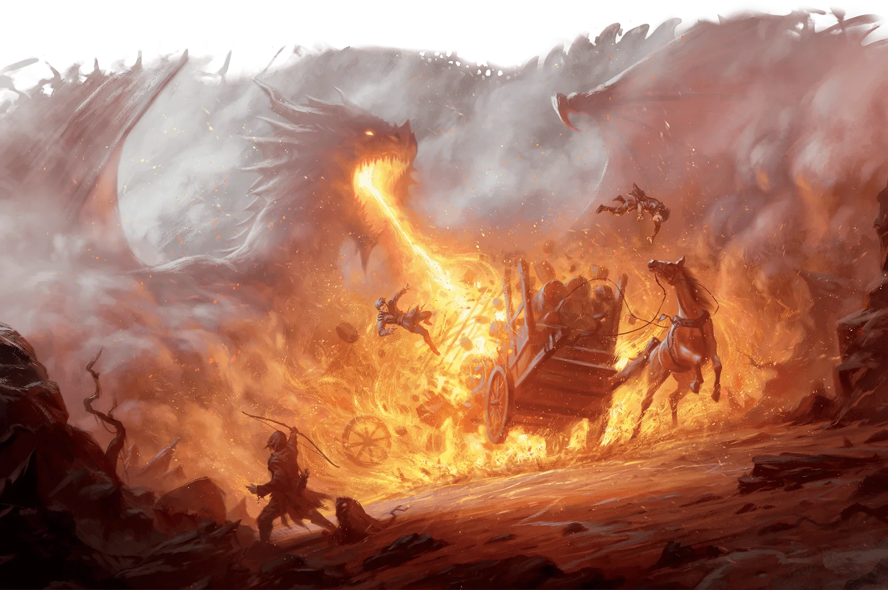

## Dragon Adventures

Dragons are not in your world. You are in theirs.

When you want a dragon encounter to be the goal or focal point of an entire adventure, how do you craft that adventure to highlight the dragon's importance, grandeur, and terrifying power? When you're using the adventure hooks in this book, dragons will fall broadly into three roles: monster, schemer, or power. Think about those categories as you consider the role you want a dragon to play in your adventure.

### Dragon as Monster

For all their vast power, great intellect, and range of possible motivations, dragons are often simple creatures at heart. They want food, a secure lair, and treasure. Many tropes of the fantasy genre revolve around dealing with a dragon who has become too monstrous and putting an end to the danger the dragon poses to peoples and civilizations.

Three basic goals can provide the framework for a monstrous dragon adventure:

- Stop the Attacks

- Reclaim the Dragon's Lair

- Acquire the Dragon's Treasure

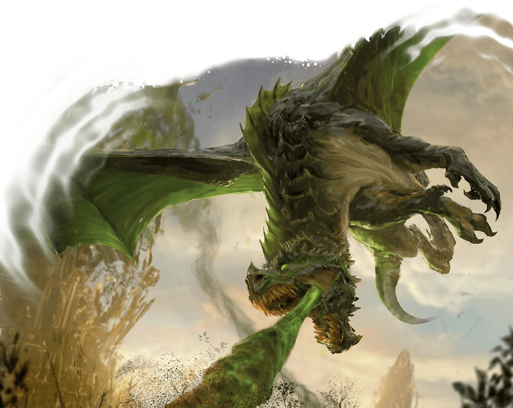

An adventure featuring a dragon in a monster's role lends itself to a location-based structure. That location is likely the dragon's lair, since it's difficult to pin a dragon down for an all-out fight in most other sites. You can use one of the lair maps in {@book chapter 5|FTD|5} of this book as the key location for such an adventure, fleshing the site out with features and inhabitants using the {@book guidelines|DMG|5|Dungeons} in the {@book Dungeon Master's Guide|DMG}.

### Dragon as Schemer

Most of the adventure hooks in this book involve the schemes a dragon might put into motion over the course of a long life, potentially using followers as agents in the world. In practice, many of a schemer dragon's goals might be the same as a monstrous dragon's: acquiring food, securing a lair, and adding to a hoard. But other plots might revolve around acquiring minions, advancing the cause of a draconic faction, building the dragon's prestige, working for the well-being of dragonkind as a whole, or altering the nature of the world and its magic.

A dragon's schemes become the basis for an adventure when they intersect with the characters' lives. Most directly, the characters might be asked to aid the dragon's schemes or to oppose them. The Cross Purposes table provides inspiration to help you turn dragon-related adventure hooks into adventures that impact the characters in your game.

An adventure featuring a dragon's schemes often works best as an {@book event-based adventure|DMG|3|Event Based Adventures}, as described in the {@book Dungeon Master's Guide|DMG}. Whether the dragon is the villain, a patron, or an interested bystander, flesh out the dragon's personality, goals, and other traits using the tables and suggestions in this chapter and {@book chapter 5|FTD|5}. The dragon's lair might be a key location for the adventure (perhaps using a map from chapter 5), but the dragon's schemes could lead the characters anywhere—even to other worlds and planes of existence.

### Dragon as Power

In some places, dragons are more than monsters or masterminds. They are movers and shakers whose desires shape the course of history. A powerful dragon's schemes impact the characters because those schemes impact the world as a whole, not because the dragon is interested in the characters individually—at least not initially. As the characters become powers in their own right, dragons are more likely to take personal notice of them.

The "{@book Dragon Campaigns|FTD|3|Dragon Campaigns}" section that follows discusses the world-ranging implications of putting dragons in positions of power and central story importance in your game. When crafting individual adventures in the context of such a campaign, take standard adventure hooks (in this book or elsewhere) and dial them up—amplifying the scale and significance of a dragon's schemes to make those plots fit the dragon's stature in the world. Imagine the dragon's hoard on the scale of a national treasury. Think of the dragon's minions as the entire nation or religion that owes the dragon allegiance.

Adventures at this scale might involve dragons as villains or as patrons, and they might well involve multiple dragons in conflict with each other. The characters might loyally serve one dragon in opposition to another, or they might attempt to play multiple dragons against one another—perhaps earning the ire of them all.

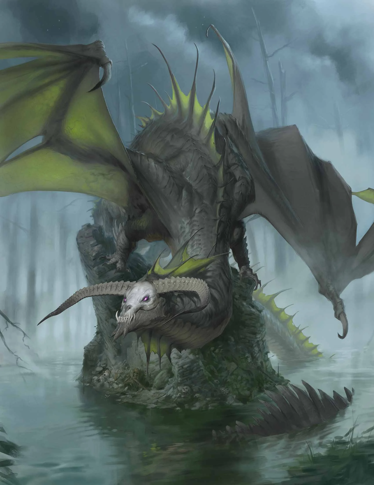

## Dragon Campaigns

Dragons occupy a prominent place in most D&D worlds, but in some realms, they are central to a world's story. Consider these three examples.

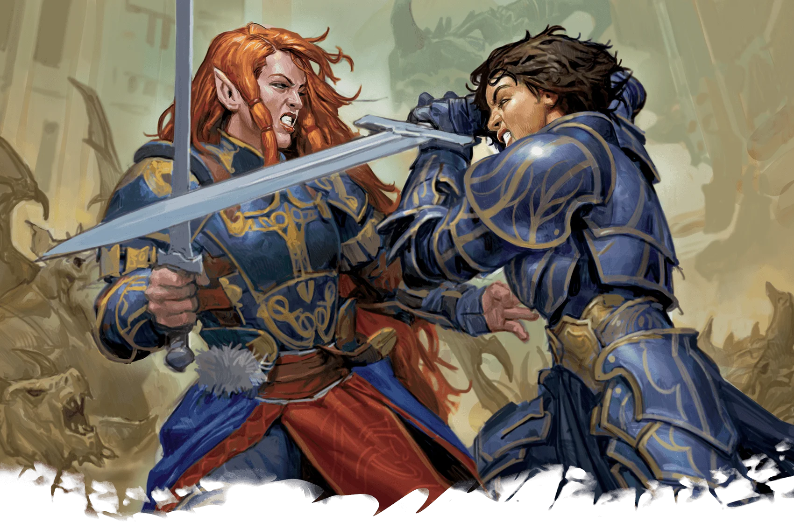

- Krynn

- Council of Wyrms

- Tarkir

If you want to build a campaign that puts dragons in a similarly prominent role, consider any of the following options.

### Campaign Events

The {@book Dungeon Master's Guide|DMG} includes a discussion of {@book world-shaking events|DMG|1|World-Shaking Events} that might define turning points at the start, middle, or end of a campaign. One way to give dragons a prominent role in your campaign is to apply a draconic twist to any of these events.

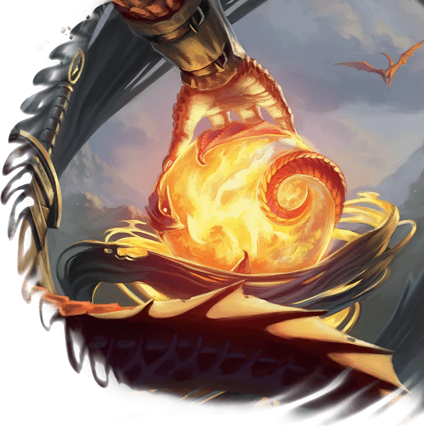

- Rise or Fall of a Leader or an Era

- Cataclysmic Disaster

- Assault or Invasion

- Rebellion, Revolution, Overthrow

- Extinction or Depletion

- New Organization

- Discovery, Expansion, Invention

- Prediction, Omen, Prophecy

### Dragon Factions

Draconic factions and the conflicts between them can provide a useful framework to organize your entire campaign around. Characters might swear their allegiance to a dragon or trade their services to dragons in exchange for membership in a draconic faction. By joining one dragon's faction, characters might end up locked in bitter strife with a different faction—and characters who join different dragon factions might have to carefully balance the needs of those factions against the goals of their party.

The different ways dragons can be categorized suggest numerous approaches to organizing dragon factions in your world.

#### The Metallic Orders

Perhaps the chromatic dragons in your world are a force of chaos, with five factions of metallic dragons shouldering the responsibility for organizing Humanoid forces to battle their chromatic kin. These factions are devoted to common goals—constraining the rampages of the chromatic dragons and limiting Tiamat's influence in the world—but they have different methods, adhere to different ideals, and attract different kinds of members. The Silver Order might be a chivalric order that attracts paladins and fighters, holds its members to the highest standards of behavior, and wields cold magic. The Brass Order could be a loose affiliation of good-hearted scoundrels, including rogues and bards, who favor fire magic and trickery.

An adventuring party might include members of any or all of the five Metallic Orders, each concerned with advancing the cause of their own order while cooperating in pursuit of common goals.

#### The Scaled Circles

Alternatively, each family of dragons—chromatic, metallic, and gem—could be represented by a single faction. Each draconic faction has a particular set of goals that doesn't necessarily put it in direct conflict with the other two factions, but that doesn't always inspire cooperation. For example, the Chromatic Circle might focus on self-aggrandizement, as each member of the faction tries to amass as much wealth and power as possible. The Gem Circle, by contrast, might be dedicated to the pursuit of knowledge, while the Metallic Circle is more altruistic, working to further the advancement of entire societies and civilizations.

Some groups of characters might all affiliate with a single circle, while others might include members of different circles. Different affiliations don't necessarily create conflict within a party, though. Rather, those affiliations create a potentially interesting tension between individual goals and the goals of the party as a whole.

#### Dragon Overlords

Your world might have numerous dragon overlords—one for each kind of metallic, chromatic, and gem dragon, and possibly for deep dragons, dragon turtles, faerie dragons, moonstone dragons, and shadow dragons. These overlords are the oldest and most powerful of their kinds, and all other dragons of the same kind owe allegiance to them. In addition, Humanoids who know what's good for them give their allegiance to a dragon overlord in exchange for the dragon's protection. The result might be a feudal society, where dragons fill the highest ranks of the aristocracy.

In such a setting, characters need to decide how they fit into this system of fealty. Some characters might swear allegiance to a dragon overlord and end up as important agents enforcing that dragon's will in the world—perhaps even to the point of joining a war against a different overlord. Or they could remain independent, traveling from one dragon's domain to another and dealing with the complex and sometimes violent political conflicts among overlords. If different characters owe allegiance to different dragons, they might cooperate smoothly for a while but then find themselves in conflict when tensions erupt between the overlords. Such characters might then be put in the position of trying to make peace between the dragons—before they're commanded to go to war against each other!

#### Other Organizing Principles

Dragon factions can be based on many other aspects of dragon identity in addition to those above. The five dragon-ruled clans of Tarkir, for example, each identify with one aspect of draconic nature—the scale, the fang, the claw, the wing, and the eye, representing endurance, ruthlessness, savagery, speed, and cunning, respectively. You could also create factions based around the damage types dealt by different dragons' breath weapons, so a fire-based faction would include red, gold, and brass dragons, while green dragons would have a poison-based faction all to themselves. The gem dragons would also be unique in this system.

Alternatively, you could build draconic factions around ideals and goals that aren't specifically draconic, perhaps applying a dragon overlay to the ten guilds of Ravnica or Humanoid factions active in Faerûn—such the Harpers, the Order of the Gauntlet, the Emerald Enclave, the Lords' Alliance, and the Zhentarim, all of which have appeared in a number of D&D adventures.

### Dragon Gods

Moving from the realm of temporal power to the spiritual domain, dragons can also fill the role of gods in a campaign world, elevated to a central role in the beliefs and myths of your setting. The two most important gods in the Dragonlance setting—Paladine and Takhisis—are identified with Bahamut and Tiamat, though they are not always worshiped in dragon form. Similarly, the gods of the Sovereign Host and the Dark Six in Eberron are sometimes described as dragons and might be dragons who ascended to godhood.

If the gods are distant from their mortal worshipers in your campaign, making those gods dragons is largely an aesthetic choice that reinforces the importance of dragons. Perhaps the high priests of the gods are also dragons, or they could be draconians (described in {@book chapter 6|FTD|6|Draconians}), dragonborn, or half-dragons. Anyone with draconic ancestry or magic might be viewed as carrying a divine blessing in such a setting, and actual dragons would be regarded with reverential awe.

On the other hand, the dragon gods of your campaign might be ever present in the world and fully involved in the lives of their worshipers. You could reimagine the gods of Theros (detailed in {@book Mythic Odysseys of Theros|MOT}) as dragons, so shining Heliod becomes a gold dragon, Erebos becomes a black dracolich, Thassa is a dragon turtle, and so on. These dragon gods might grant supernatural gifts to their followers in exchange for devotion, potentially even transforming their favored ones into dragonborn. You could draw on the supernatural gifts described in {@book chapter 2|FTD|2|Draconic Gifts} as well as the {@book piety benefits|MOT|2|Benefits of Piety} detailed in {@book Mythic Odysseys of Theros|MOT} for inspiration.

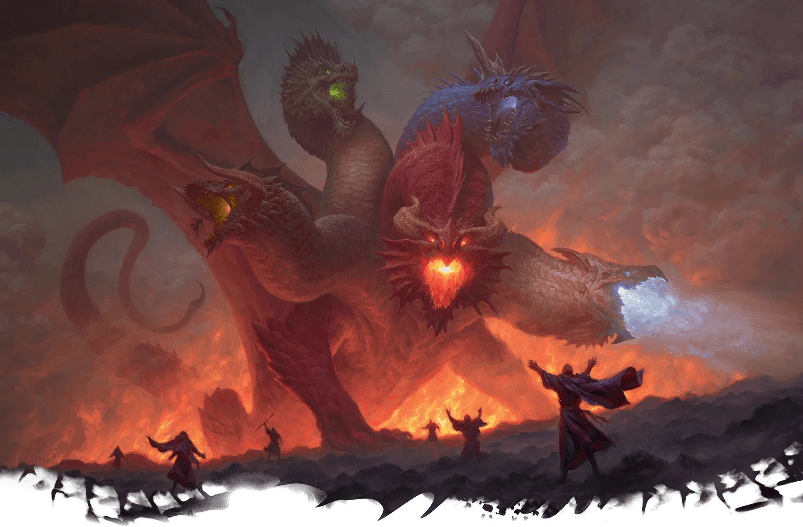

#### Dragons of Myth

Even if you don't elevate dragons to the status of gods in your campaign, these creatures might still have a mythic role to play in the world, granting them a supernatural significance. Consider these examples:

- Artifact of Law

- Cult of a Dead God

- Dungeons of Dragons

- Pillars of Creation

- Stirrings of Rebirth
