# Draconomicon

> 英文原文鏡像；對應《Draconomicon》p. 75。來源提供者：5e.tools。

# Draconomicon

How do the mindsets of red dragons and gold dragons differ? Where do they prefer to build their lairs, and what allies do they favor? This chapter, intended for the Dungeon Master, explores the answers to many such questions. It explores in depth twenty kinds of dragons, organized alphabetically:

- {@book Amethyst dragon|FTD|5|Amethyst Dragons}*

- {@book Black dragon|FTD|5|Black Dragons}

- {@book Blue dragon|FTD|5|Blue Dragons}

- {@book Brass dragon|FTD|5|Brass Dragons}

- {@book Bronze dragon|FTD|5|Bronze Dragons}

- {@book Copper dragon|FTD|5|Copper Dragons}

- {@book Crystal dragon|FTD|5|Crystal Dragons}*

- {@book Deep dragon|FTD|5|Deep Dragons}*

- {@book Dragon turtle|FTD|5|Dragon Turtles}

- {@book Emerald dragon|FTD|5|Emerald Dragons}*

- {@book Faerie dragon|FTD|5|Faerie Dragons}

- {@book Gold dragon|FTD|5|Gold Dragons}

- {@book Green dragon|FTD|5|Green Dragons}

- {@book Moonstone dragon|FTD|5|Moonstone Dragons}*

- {@book Red dragon|FTD|5|Red Dragons}

- {@book Sapphire dragon|FTD|5|Sapphire Dragons}*

- {@book Shadow dragon|FTD|5|Shadow Dragons}

- {@book Silver dragon|FTD|5|Silver Dragons}

- {@book Topaz dragon|FTD|5|Topaz Dragons}*

- {@book White dragon|FTD|5|White Dragons}

*This dragon is introduced in {@book chapter 6|FTD|6}.

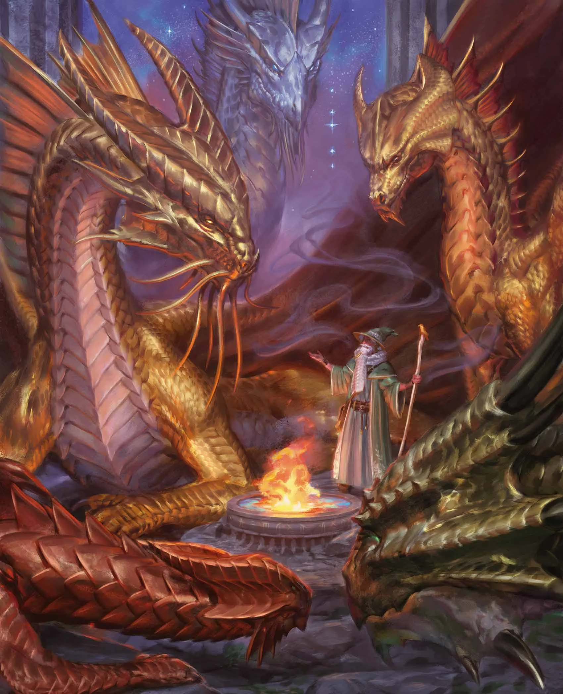

## Using the Entries

For each dragon's entry in this chapter, you'll find information about crafting personalities, inspiration for building adventures, details about lairs, and ideas about the kinds of treasures that dragon favors. Scattered throughout are maps of dragon lairs you can plunder for your adventures.

### Creating a Dragon

Use the tables in this section in conjunction with "{@book Roleplaying Dragons|FTD|3|Roleplaying Dragons}" in {@book chapter 3|FTD|3} to craft distinctive dragon characters. Most of the personality traits and ideals align with the general nature of the dragons, but the tables also include examples of atypical dragons.

For dragons who do not have spellcasting ability, this section also includes suggested spells to give a dragon if you want it to be a spellcaster. A table shows the spells a typical dragon knows, along with the spell save DC for those spells. The dragon can cast each listed spell once per day, requiring no material components and using Charisma as the spellcasting ability.

### Dragon Adventures

Building on "{@book Dragon Adventures|FTD|3|Dragon Adventures}" in {@book chapter 3|FTD|3}, this section starts with a collection of adventure hooks that might bring characters into contact with a dragon of a particular kind, whether in conflict or as an ally or patron. Then, additional tables explore the relationships each kind of dragon has to other creatures of a similar challenge rating in their preferred environment. Use these tables to inspire adventures that feature dragons dwelling alongside other creatures, either as enemies or as allies.

### Dragon Lairs

This section expands on "{@book Dragon Lairs|FTD|4|Dragon Lairs}" in {@book chapter 4|FTD|4}. If there is a map of a sample lair for a dragon of that kind, it is accompanied by discussion of the lair's important features. Many of these sections also describe additional lair actions a dragon can use to exploit the lair's features, as well as additional regional effects that might alter the landscape surrounding the lair.

You can adjust the scale on the lair maps to suit the needs of the dragon lairing there. If you use these maps for a wyrmling's lair, you might set the scale to 5 feet per square, but for an ancient dragon or a greatwyrm, you might need to go as high as 20 feet per square to give the dragon room to move.

### Dragon Treasures

Each entry ends with a discussion of the kinds of treasures the dragon favors, including a table of art objects you can use to expand on the information in "{@book What's in a Hoard?|FTD|4|What's in a Hoard?}" in {@book chapter 4|FTD|4}. The items shown on these tables can represent art objects of any value, depending on their materials, quality, and history. For example, a small bronze bust might be worth 25 gp, while a large bust crafted from platinum and emeralds could be worth 7,500 gp.

### Dragons of Legend

Sidebars throughout this chapter highlight famous dragons of different kinds. Many of these legendary dragons are almost godlike in stature, known and respected on multiple worlds across the Material Plane.

## Amethyst Dragons

I once sought life advice from an amethyst dragon who specialized in that sort of thing. I told her all my flaws and unwanted behaviors, and she prescribed the best elixir: "Stop doing those things!" I still think back on that visit in trying times.

Use the tables, map, and other information in this section to craft unique encounters with amethyst dragons. Amethyst dragon stat blocks appear in {@book chapter 6|FTD|6|Amethyst Dragons}.

### Creating an Amethyst Dragon

Use the Amethyst Dragon Personality Traits and Amethyst Dragon Ideals tables to inspire your portrayal of distinctive amethyst dragon characters.

### Amethyst Dragon Adventures

The Amethyst Dragon Adventure Hooks table offers suggestions for stories and adventures involving amethyst dragons.

#### Connected Creatures

Amethyst dragons are generally aloof creatures, dwelling in isolation for long periods of time and rarely cultivating connections with other creatures. When they do connect with others, it is most often for intellectual and philosophical pursuits or to fulfill some arcane purpose involving the dragons' echoes across the worlds.

##### Eldenser the Lurker

Contradictory tales told throughout the Forgotten Realms are unclear about whether or not the ancient amethyst dragon Eldenser still lives, largely because of the behavior that earned him the epithets "the Lurker" and "the Worm Who Hides in Blades." Obsessed with observing the world and its creatures, Eldenser developed magic that allows his mind to inhabit the blade of a weapon after his death. He exists now as a {@creature draconic shard|FTD} (described in {@book chapter 6|FTD|6|Draconic Shard}).

Eldenser prefers the role of silent observer to doing anything that might give away his presence. In this fashion, he has inhabited countless weapons over long years, including many belonging to famous adventurers whose exploits the dragon has seen firsthand.

### Amethyst Dragon Lairs

Amethyst dragons prefer lairs near water, ideally mountain lakes, where they take advantage of existing caves and tunnels. A lair behind a cascading waterfall is ideal, and often part of that lair is submerged, allowing the dragon to rest in the water and cultivate the fish that are their preferred food.

Amethyst dragon lairs frequently exhibit or develop large and beautiful clusters of amethyst crystals, including massive cathedral geodes split open to show their contents and clusters of crystal points more than a foot in diameter that extend six to ten feet from the interior stone surfaces of the lair. These crystals resonate with the dragon's presence, and glow with a soft inner light. The older the dragon, the deeper the purple color of the crystals.

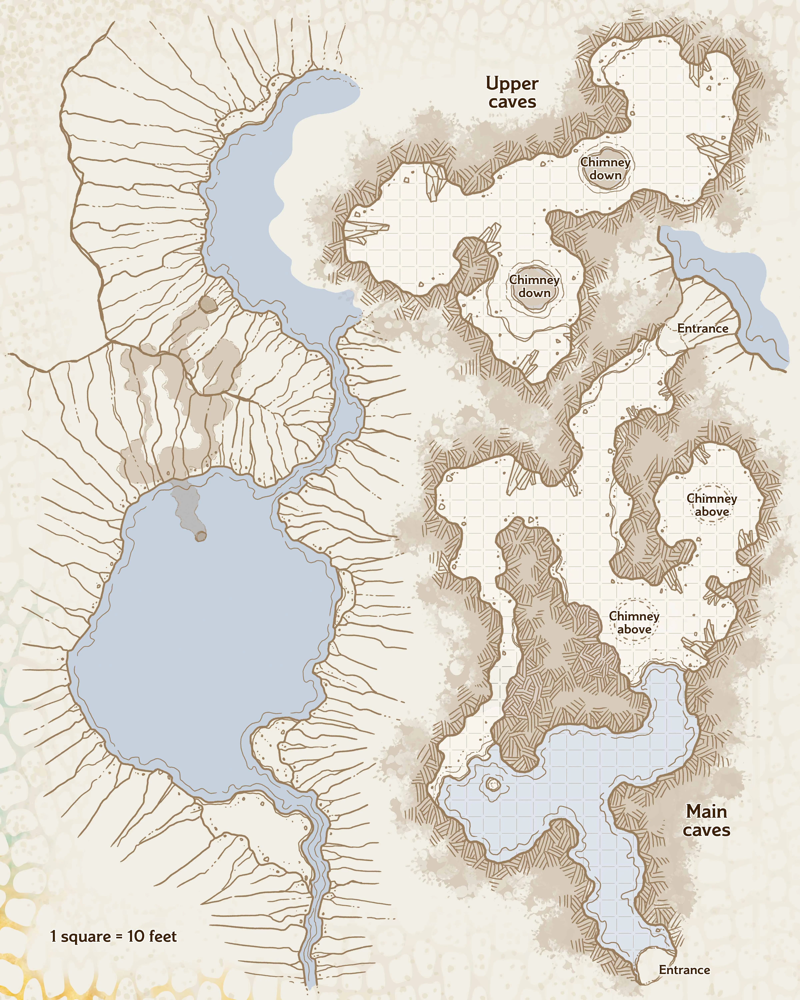

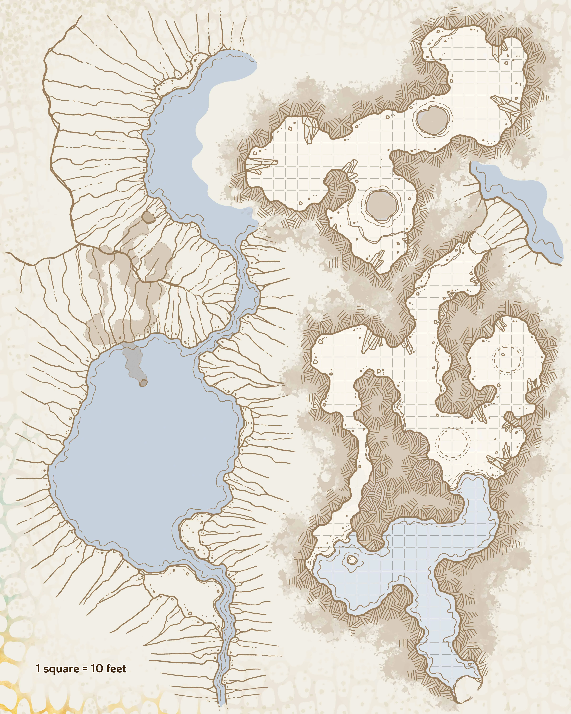

#### Amethyst Dragon Lair Features

The amethyst dragon lair shown in map 5.1 is set beneath a mountain ridge between two deep tarns, with streams flowing down toward the lowlands. The lair has the following features:

- Entrances

- Main Caves

- Glowing Crystals

- Chimneys

- Upper Caves

### Amethyst Dragon Treasures

Amethyst dragons often collect crystals and gems, particularly their namesake stones, in raw, polished, or cut forms. They have less interest in coins and precious metals, although many have a fascination with metal items that have a silvery finish.

Amethyst dragons favor treasures with particular scholarly or philosophical value as a part of their hoard, including fine books, scrolls, or carved tablets; tapestries or woven "tomes" of embroidered cloth; complex scientific instruments; and religious icons or objects. They are fond of unique and unusual art objects, especially those connected to far-off or long-lost cultures, other planes of existence, or other worlds—and of magic items that allow movement between those planes or worlds. The odd spatial nature of an amethyst dragon's lair can sometimes cause items to transpose between one dragon's hoard and the hoards of the dragon's echoes, allowing for treasures with a surprising range of origins.

## Black Dragons

Tiamat spent the most time crafting her black dragon. I was flabbergasted at her final product and suggested oh so many adjustments, but at some point, a project is simply due.

Use the tables, map, and other information in this section to craft unique encounters with black dragons.

### Creating a Black Dragon

Use the Black Dragon Personality Traits and Black Dragon Ideals tables to inspire your portrayal of distinctive black dragon characters, and use the Black Dragon Spellcasting table to help select spells for a spellcasting dragon.

### Black Dragon Adventures

The Black Dragon Adventure Hooks table offers suggestions for stories and adventures involving black dragons.

#### Connected Creatures

Black dragons prefer the company of creatures that are easy to control and present little threat of betrayal. Mindless Undead, shambling mounds, carnivorous flora, Oozes, and Constructs make appealing servants, especially working in concert with a black dragon's fiendishly clever traps. A black dragon's intelligent followers tend to worship draconic majesty and typically include kobolds, troglodytes, lizard folk, and (more rarely) yuan-ti.

### Black Dragon Lairs

Black dragons prefer to lair in swamps and jungles—the more dismal and fetid, the better. Within those environs, they favor ruins for their defensibility and dreary aesthetic.

When choosing their lairs, black dragons are fond of locations that are naturally constraining and confounding. Whether adventurers seeking the dragon must wind their way through the roots of an ancient mangrove swamp or brave a trap-filled boggy ruin, the experience promises to be a deadly affair.

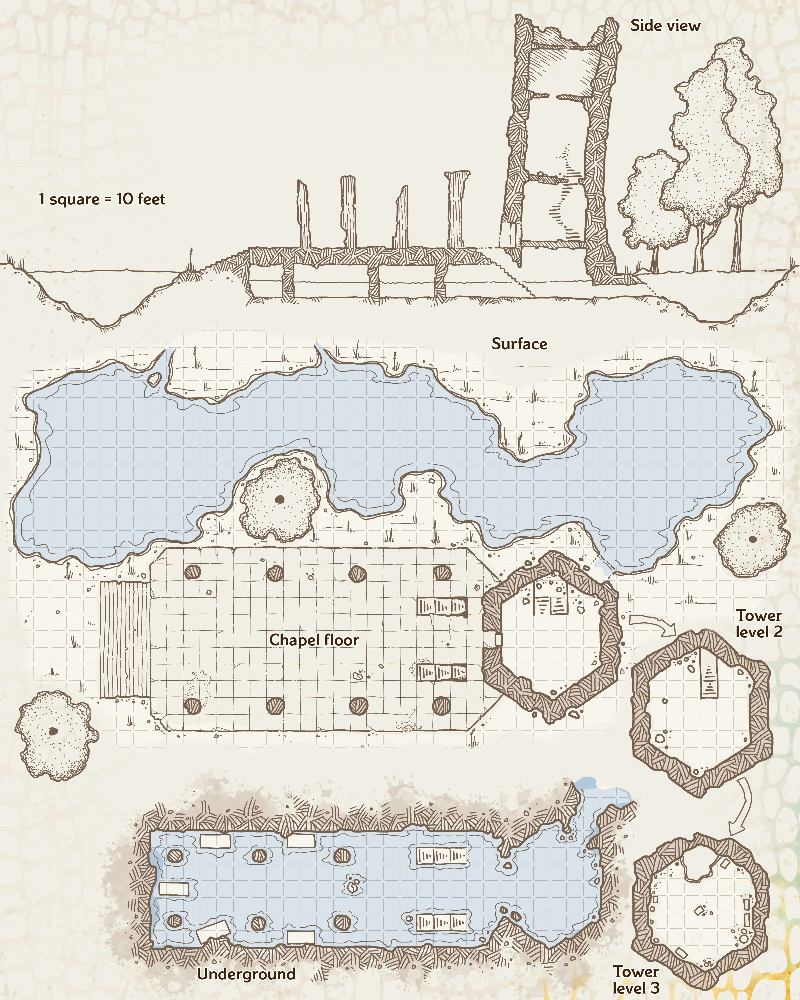

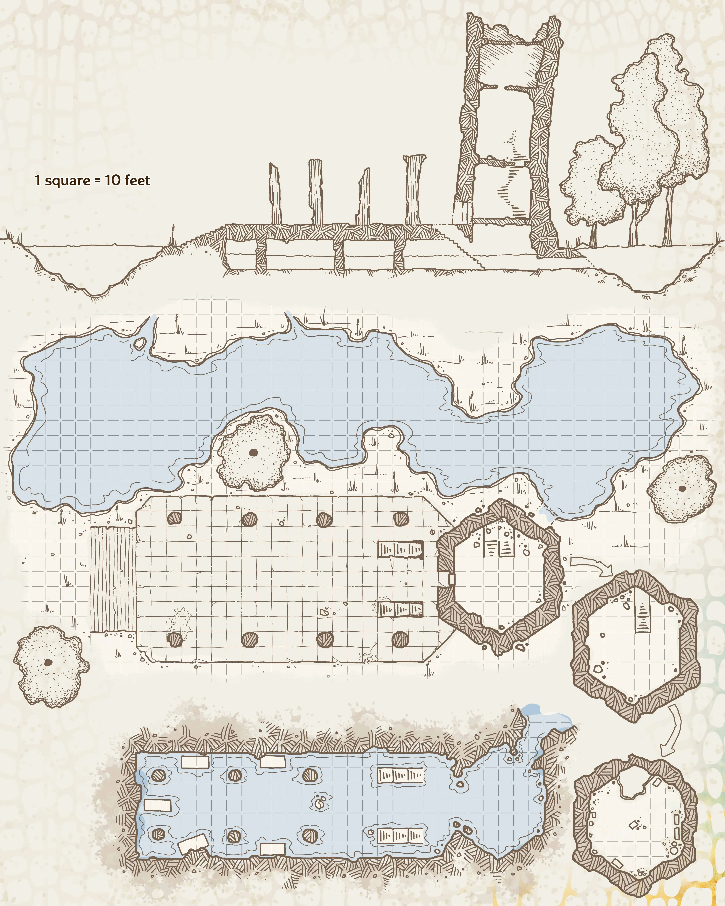

#### Black Dragon Lair Features

The black dragon lair shown in map 5.2 is a derelict chapel, lost to time in a gloomy fen. The building's wooden framing rotted away long ago, leaving a looming skeleton of lichen-covered stone and a lone tower. The lair has the following features:

- Swampy Lake

- Chapel Floor

- Underground

- Chapel Tower

- Tower Top

##### Rhashaak

Guardian of the cursed city of Haka'torvhak, the {@creature black greatwyrm|FTD} Rhashaak lives deep in the jungles of Q'barra on the world of Eberron, where he is worshiped as the incarnation of a god by numerous kobolds, dragonborn, and lizardfolk. Rhashaak has existed for millennia as the primary guardian of the imprisoned Fiend Masvirik, who once held dominion over reptilian creatures.

Over time, Rhashaak has been tainted by the corruption he guards and has slowly succumbed to its evil. Powerful wards keep Rhashaak bound to his fallen city, but his legions would pose a significant threat if Rhashaak were ever roused by settlers or explorers searching his ruins.

#### Additional Lair Actions

At your discretion, a legendary ({@creature Adult Black Dragon||adult} or {@creature Ancient Black Dragon||ancient}) black dragon can use one or more of the following additional lair actions while in its lair:

- Filth Burst

- Grasping Muck

- Noxious Gas

#### Regional Effects

Any of these effects might appear in the area around a black dragon's lair, in addition to or instead of the effects described in the {@book Monster Manual|MM}:

- Ennui

- Grating Spies

- Rotting Domain

### Black Dragon Treasures

Black dragons appreciate objects of cultural, magical, or scientific significance that originated from lost cultures. Knowing a relic they possess is coveted by others because it presents a link to a lost past is what gives that relic its value. Black dragons also love conventional treasures such as gems (particularly opals), precious metals that don't corrode easily, and stone sculptures.

Because their lairs are inevitably slimy and dank, if not outright flooded, black dragons rarely have cloth, wood, or paper items unless such items are stored in watertight containers. Black dragons versed in magic often record notes and rituals on bones, shells, and metal plates instead of paper or parchment. These unusual works are art in their own right, each featuring rows of graceful Draconic script etched with the dragon's own acid.

Most black dragons keep their treasure well hidden and have a private viewing room for particularly prized possessions. Knowing that interloping inferiors were able to so much as see their hoard can drive a black dragon to a state of rage.

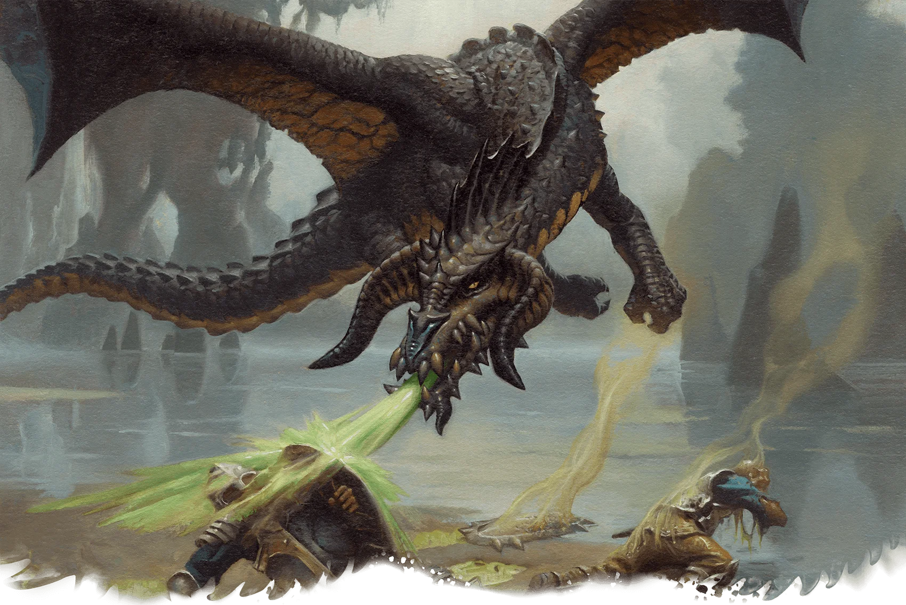

## Blue Dragons

If I weren't so platinum, I'd be blue. Not as in sad or down. Quite the opposite. I'd be delighted to be a blue dragon... if I weren't a platinum one.

Use the tables, map, and other information in this section to craft unique encounters with blue dragons.

### Creating a Blue Dragon

Use the Blue Dragon Personality Traits and Blue Dragon Ideals tables to inspire your portrayal of distinctive blue dragon characters, and use the Blue Dragon Spellcasting table to help select spells for a spellcasting dragon.

### Blue Dragon Adventures

The Blue Dragon Adventure Hooks table offers suggestions for stories and adventures involving blue dragons.

#### Connected Creatures

In contrast to most chromatic dragons, blue dragons see value in relationships with other creatures, even if the power balance in those relationships is always weighted in the dragon's favor. Though territorial, they are willing to allow creatures they consider their servants to live peacefully within their domains. Blue dragons are also more family oriented than many other dragons, and it's not unusual to find a multigenerational extended family of blue dragons sharing a territory. Other creatures need to tread carefully in such a place, for any injury or insult to one of the dragons is considered a strike against the whole family.

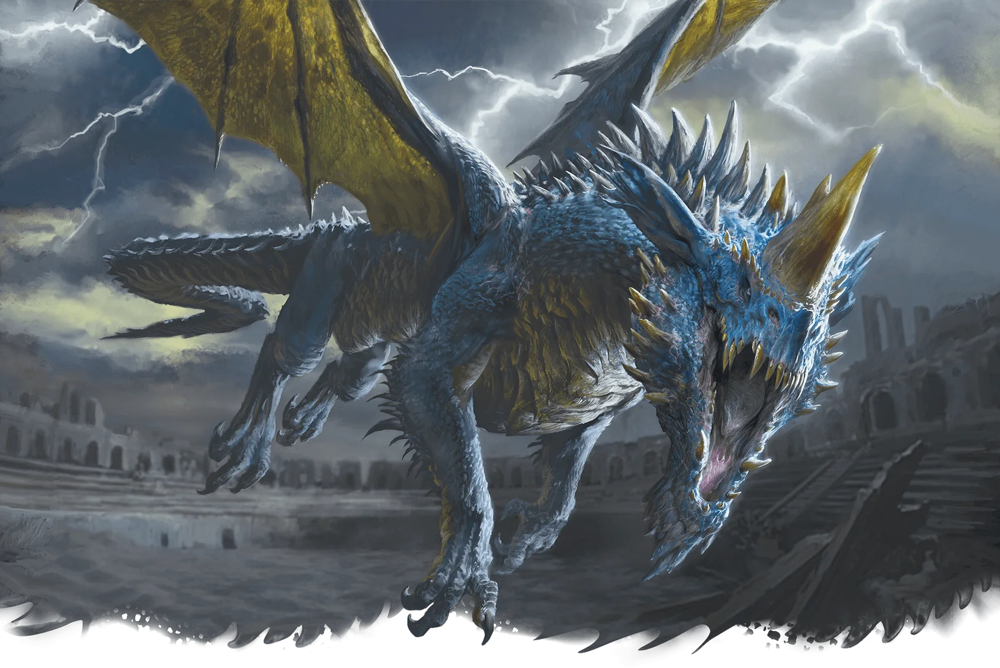

### Blue Dragon Lairs

Blue dragons make their lairs in deserts and other arid landscapes. They prefer warm climates, but if an otherwise ideal potential lair presents itself in a cold environment, they find ways to adapt. Instead of seeking out lofty domiciles, blue dragons build their lairs underground, burrowing beneath sand or using magic to hew rock into an intricate warren of rooms and tunnels that can be expanded to accommodate a growing family. Still, they appreciate the tactical advantages of height and usually create their lairs near a spire or cliff from which they can keep watch over their territory.

Though most blue dragons would be loath to the use the term themselves, their lairs are often surprisingly homey. They favor lairs that balance beauty and comfort and adorn them in soothing shades of blue, purple, and green.

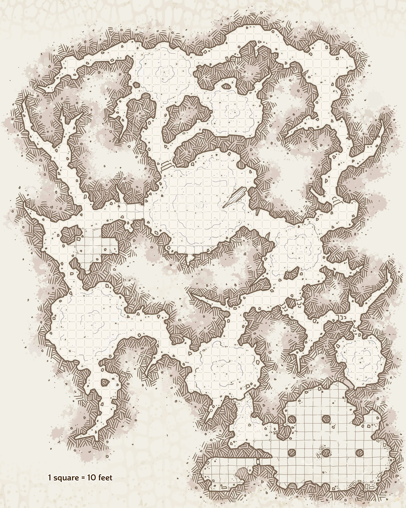

#### Blue Dragon Lair Features

The blue dragon lair shown in map 5.3 is built in the ruins of an ancient city swallowed by desert sands. Some of the lair's chambers still contain the remnants of temples and other structures. The traces of this metropolis suggest that it was of significant size, but very little of it remains accessible in the area of the lair, since the dragon has collapsed the lair on intruders multiple times, rebuilding in a nearby portion of the ruins each time.

The walls of the lair are crystallized glass formed by the dragon's lightning breath. Most of its floors are loosely packed sand, with patches of rough stone showing through in some areas. The dragon has constructed a system of mirrors to bring in sunlight from chambers open to the sky, a system that not only brightly lights the interior but also heats the sand to a comfortable basking temperature.

The lair has the following features:

- Entrance Chamber

- Hoard Display

- Dragon's Den

- Private Entrance

- Treasury

#### Additional Lair Actions

At your discretion, a legendary ({@creature Adult Blue Dragon||adult} or {@creature Ancient Blue Dragon||ancient}) blue dragon can use one or both of the following additional lair actions while in its lair:

- Misleading Mirage

- Sudden Sinkhole

#### Regional Effects

Any of these effects might appear in the area around a blue dragon's lair, in addition to or instead of the effects described in the {@book Monster Manual|MM}:

- Blue Luster

- Mirage Terrain

- Sandstorm

#### Iymrith

Known as the Dragon of the Statues and the Doom of the Desert, the ancient blue dragon {@creature Iymrith|SKT} commands an army of {@creature Gargoyle||gargoyles} and has studied magic for centuries in the hope of transcending her physical form and becoming a god.

Iymrith often appears as a {@creature storm giant} using her special Change Shape trait. In this guise, she infiltrates storm giant settlements and insinuates herself into the affections of the rulers' heirs, becoming a mentor to them—and turning them against their parents. She demands great accomplishments from her own offspring, but she is more than willing to support and aid them with her considerable resources.

Ferocious in her youth, Iymrith has grown more philosophical and even whimsical as she ages, but she has not lost sight of her quest for transcendence.

### Blue Dragon Treasures

Blue dragons have strict standards for what treasures they allow into their hoards and reject valuable objects that don't meet those standards. One blue dragon might keep only treasure that coordinates visually with the other items in the hoard, while another might focus on artwork from a particular period or seek out jewelry made for rulers in a certain region. Blue dragons' hoards are an enormous source of pride, and these dragons are insulted by offerings that don't meet their standards.

Blue dragons favor blue, purple, and green gemstones; art depicting oases and fountains; and fine textiles in cool colors. They also love scents that evoke storms and rain, and magic items that produce weather effects.

## Brass Dragons

Bards sometimes seek out brass dragon lairs in hopes that the dragons' whimsy will enhance their creativity, like a muse. The more experienced bards know not to overstay their welcome, lest they awaken cradling a skunk cabbage.

Use the tables, map, and other information in this section to craft unique encounters with brass dragons.

### Creating a Brass Dragon

Use the Brass Dragon Personality Traits and Brass Dragon Ideals tables to inspire your portrayal of distinctive brass dragon characters, and use the Brass Dragon Spellcasting table to help select spells for a spellcasting dragon.

### Brass Dragon Adventures

The Brass Dragon Adventure Hooks table offers suggestions for stories and adventures involving brass dragons.

#### Connected Creatures

Brass dragons seek out the company of other creatures that can carry on an intelligent conversation. They favor the company of such creatures over all others, often to the point of not bothering to gather minions to do their bidding and ignoring worshipers who fawn over them.

### Brass Dragon Lairs

Brass dragons prefer to make their lairs in hot, dry, rocky areas—desert canyons, caves beneath arid mesas, or ancient stone ruins. Brass dragons often compete with blue dragons for lair sites, but are more likely to make a lair among rocks than to burrow under the sands.

Brass dragons like their lairs to be spacious and well lit; many lairs feature windows or skylights to let sunlight in. They respect skillfully wrought stonework and often take over canyon fortresses and similar structures when they're abandoned by their original non-dragon builders. Brass dragons are also capable of fine stonework themselves, and many meticulously carve out grand halls and galleries in which to store and display their hoards.

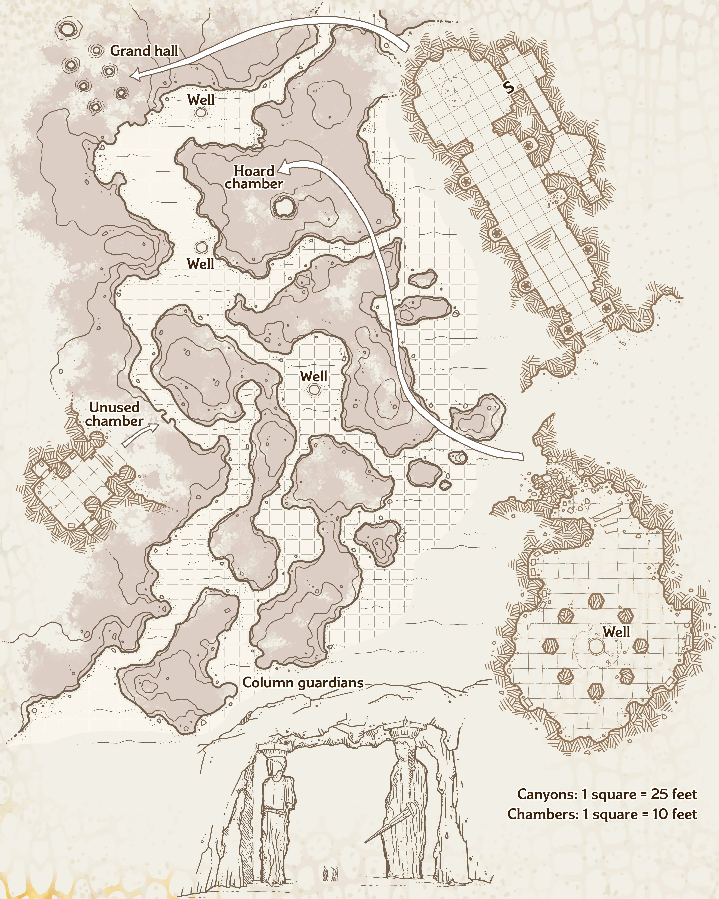

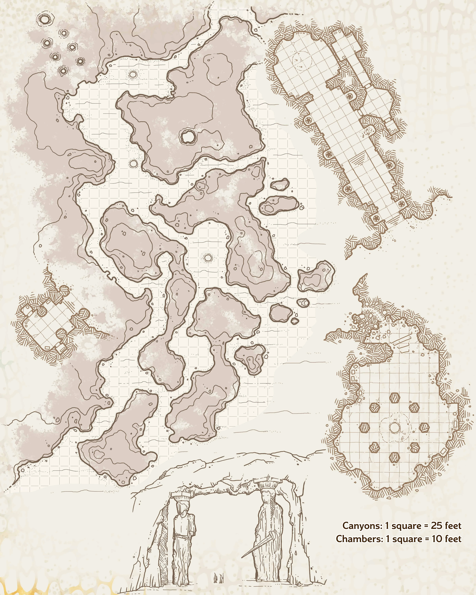

#### Brass Dragon Lair Features

The brass dragon lair shown in map 5.4 is an ancient ruin located within rough, stony canyons in a desert environment. The lair has the following features:

- Column Guardians

- Grand Hall

- Hoard Chamber

##### Aasterinian

Like many greatwyrm dragons, Aasterinian is sometimes seen as a god. In fact, she is a cheeky and quick-witted brass dragon who often serves as a messenger for Bahamut. Her heightened dragonsight allows her to transmit messages easily between worlds, so all her incarnations know nearly everything any other one is aware of.

Aasterinian encourages all dragons to think for themselves rather than relying on the ideas or opinions of others. She cherishes learning and invention and often takes on Humanoid guise to offer patronage to mortal scholars and artificers.

- Unused Chamber

- Wells

#### Additional Lair Actions

At your discretion, a legendary ({@creature Adult Brass Dragon||adult} or {@creature Ancient Brass Dragon||ancient}) brass dragon can use one or more of the following additional lair actions while in its lair:

- Animate Statues

- Blast of Wind

- Obscuring Sand

#### Regional Effects

Any of these effects might appear in the area around a brass dragon's lair, in addition to or instead of the effects described in the {@book Monster Manual|MM}:

- Cloud Companion

- Talkative Denizens

### Brass Dragon Treasures

Brass dragons prefer yellow, orange, and brown gemstones that coordinate with their own scales, and they favor precious art objects fashioned from brass, including items such as pitchers, braziers, and bells. They also cherish organic treasures, from finely crafted wood to textiles.

Brass dragons often invest items in their hoards with imagined personality. A wyrmling might have a favorite marble bust or onyx cameo to converse with, while an ancient dragon might have lively dialogues with an entire gallery of paintings, statues, and tapestries. A brass dragon who divides a hoard into separate caches often imagines those caches as individuals (or even groups of people) with independent personalities, and the dragon might spend time in different lairs to socialize with different "friends."

## Bronze Dragons

Use the tables, map, and other information in this section to craft unique encounters with bronze dragons.

### Creating a Bronze Dragon

Bronze dragons are the absolute worst at transforming themselves into human form. They always embellish with extra hair in all sorts of places. I applaud ingenuity, but in this matter, simpler is better!

Use the Bronze Dragon Personality Traits and Bronze Dragon Ideals tables to inspire your portrayal of distinctive bronze dragon characters, and use the Bronze Dragon Spellcasting table to help select spells for a spellcasting dragon.

### Bronze Dragon Adventures

The Bronze Dragon Adventure Hooks table offers suggestions for stories and adventures involving bronze dragons.

#### Connected Creatures

Bronze dragons admire high-minded ambition and military prowess, seeking out those beings willing to risk their lives in the fight for justice. Though they are as proud as any dragons, bronze dragons would rather serve alongside heroes than rule over cowards and quislings.

### Bronze Dragon Lairs

Bronze dragons typically dwell along rocky and inaccessible coastlines. Some make dry homes atop lonely sea stacks, while others favor completely submerged lairs in sunken ruins. Many seek out strongholds straddling land and sea, with both dry and flooded chambers.

When it comes to lairs, bronze dragons value function over form, and they study potential sites with a military commander's eye for defense. They appreciate the solidity of cliff-side caves or stone fortresses, often reinforcing existing defenses with clever traps and bulwarks. At the same time, bronze dragons understand that they are their own best defense in a siege, so they are careful to maximize their mobility with multiple ways in and out of their lairs.

#### Bronze Dragon Lair Features

The bronze dragon lair shown on map 5.5 is a set of sea caves that once served as a dwarven military outpost. The lair has the following features:

- Sentinel Statue

- Campaign Chamber

- Lofty Alcove

- Island Larder

- Watery Caves

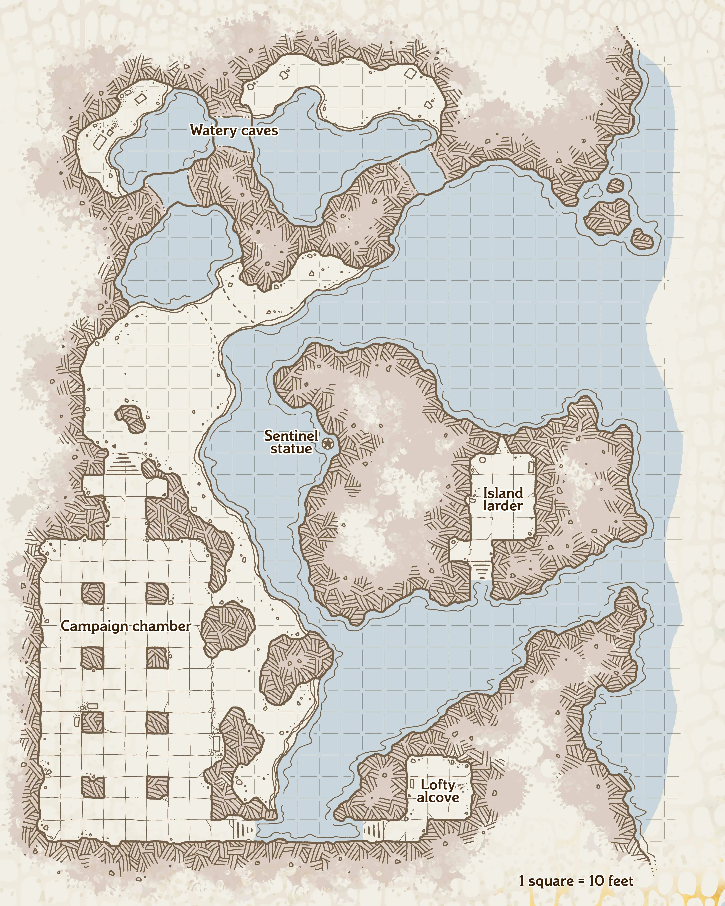

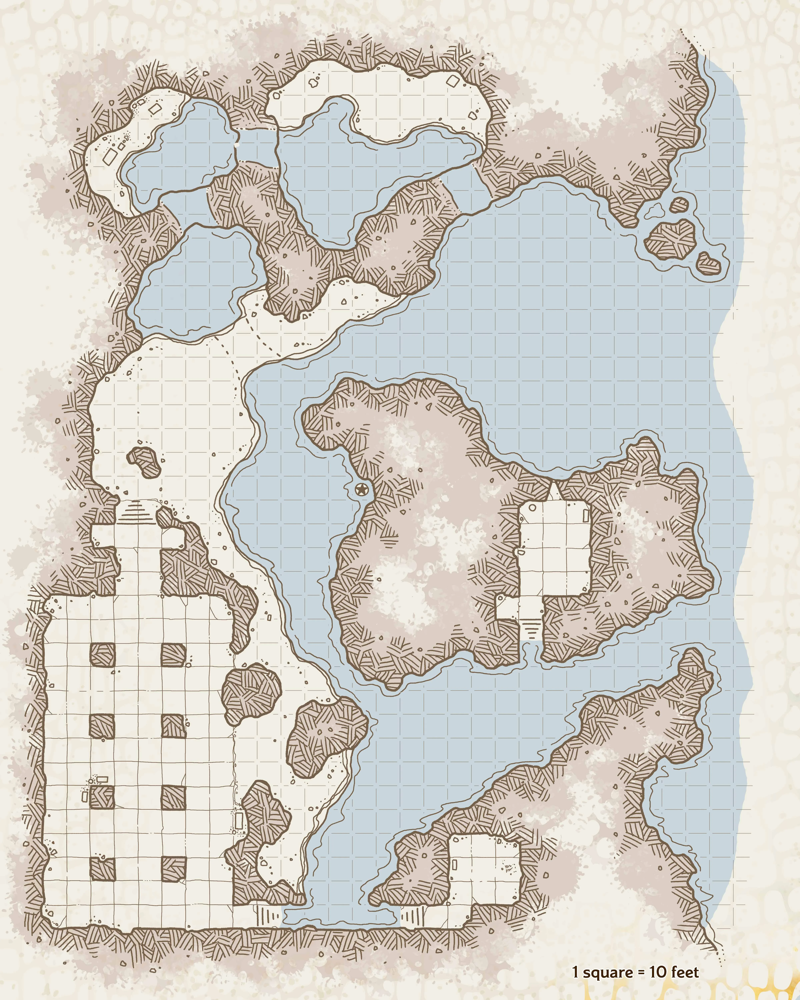

#### Additional Lair Actions

At your discretion, a legendary ({@creature Adult Bronze Dragon||adult} or {@creature Ancient Bronze Dragon||ancient}) bronze dragon can use one or more of the following additional lair actions while in its lair:

- Ocean's Call

- Salt Burst

- Whelming Water

#### Regional Effects

Any of these effects might appear in the area around a bronze dragon's lair, in addition to or instead of the effects described in the {@book Monster Manual|MM}:

- Phantom Escort

- Underwater Pursuit

- Unfailing Faithfulness

#### Fireflash

Also known as Khirsah, Fireflash is a gregarious and inquisitive bronze dragon with a keen interest in other species, especially dwarves and elves. During the War of the Lance, he was one of the first to answer the call of Silvara—the elf identity of the silver dragon D'argent—for the metallic dragons to join the conflict. During the Vingaard Campaign, Fireflash teamed up with a dwarf named Flint Fireforge and a kender named Tasslehoff Burrfoot to capture Highmaster Bakaris. Later, in the Blue Lady's War, Tasslehoff foresaw Fireflash's demise at the hands of the death knight Lord Soth—and was thus able to avert the dragon's grim fate.

After the wars, Fireflash faded from public view, but rumor holds that he continues his lifelong fight against evil, using his legendary skill in aerial combat to assist the Knights of Solamnia.

### Bronze Dragon Treasures

A bronze dragon's hoard is a history of the dragon's deeds, with trophies from fallen foes and payment from grateful petitioners resting alongside more mundane spoils of war and loot salvaged from shipwrecks and the seabed. Though these dragons rarely steal outright, a several-ton bronze dragon landing near—or even on—a merchant ship asking to trade often obtains extremely one-sided bargains from unnerved sailors.

Bronze dragons have a romantic view of their role as guardians of justice and prefer treasures that tie into their heroic narrative. Their hoards teem with weapons, armor, and magic items built for the battlefield—the more unique, the better. Stories matter to a bronze dragon, who would rather have the humble spear that felled a tyrant than a jeweled blade that's never seen combat. They love collecting and studying histories that can give them tactical insight or inspiration, as well as safeguarding artifacts they deem too dangerous to entrust to anyone else.

## Copper Dragons

I knew a copper dragon who loved coining words. We have her to thank for words like "organize," "pillow," "cognizant," "burgeon," and "job," to name just a few. It would make her laugh to know how often people make these ridiculous combinations of sounds!

Use the tables, map, and other information in this section to craft unique encounters with copper dragons.

### Creating a Copper Dragon

Use the Copper Dragon Personality Traits and Copper Dragon Ideals tables to inspire your portrayal of distinctive copper dragon characters, and use the Copper Dragon Spellcasting table to help select spells for a spellcasting dragon.

### Copper Dragon Adventures

The Copper Dragon Adventure Hooks table offers suggestions for stories and adventures involving copper dragons.

#### Connected Creatures

Copper dragons are most interested in creatures they find entertaining or amusing, whether for their artistic abilities or because they are fun to trick and tease.

##### Galadaeros the Sunset Flame

The copper dragon Galadaeros claims the islands known as the Purple Rocks in the Trackless Sea of Faerûn as his territory. For centuries, Galadaeros was content in his isolated home. Then the adventurer Ranressa Shiard was shipwrecked on the isles. Galadaeros befriended her after she made several failed attempts to slay him, and he eventually became mentor and ally to an adventuring company she named in his honor. The dragon provided the adventurers with a safe haven and received a share in their hauls in return.

The kindly copper dragon has grown fond of the companionship of Humanoids, although he does not know if he will ever grow accustomed to the brief nature of their lives. His last association with the Galadran Company was well over a century ago, and it has been some time since any other outsiders have disturbed the solitude of the dragon's isles.

### Copper Dragon Lairs

Copper dragons prefer dry uplands, hilltops, or mountainous foothills, where they build their lairs in caves, crags, or tunnels. Although sometimes natural, the passages and caverns of a copper dragon's lair might be carved out or expanded by the dragon's powerful acid breath.

Copper dragon burrows are often sinuous and winding, featuring twists, turns, and dead ends. Blank walls in the lair can conceal cunning hidden passages or might be stone or clay thin enough for the dragon to burst through them. The narrowest tunnels in a copper dragon's lair are just barely wide enough to accommodate the dragon's body, and they typically loop around and reconnect with themselves so the dragon can double back without having to reverse direction.

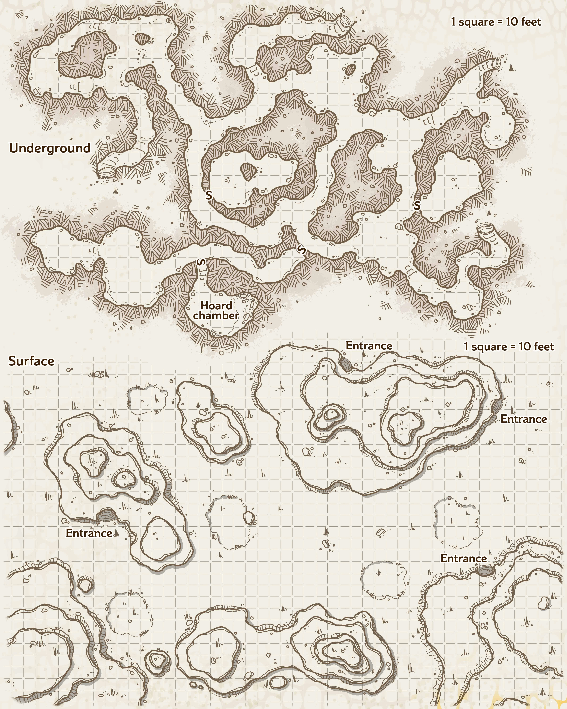

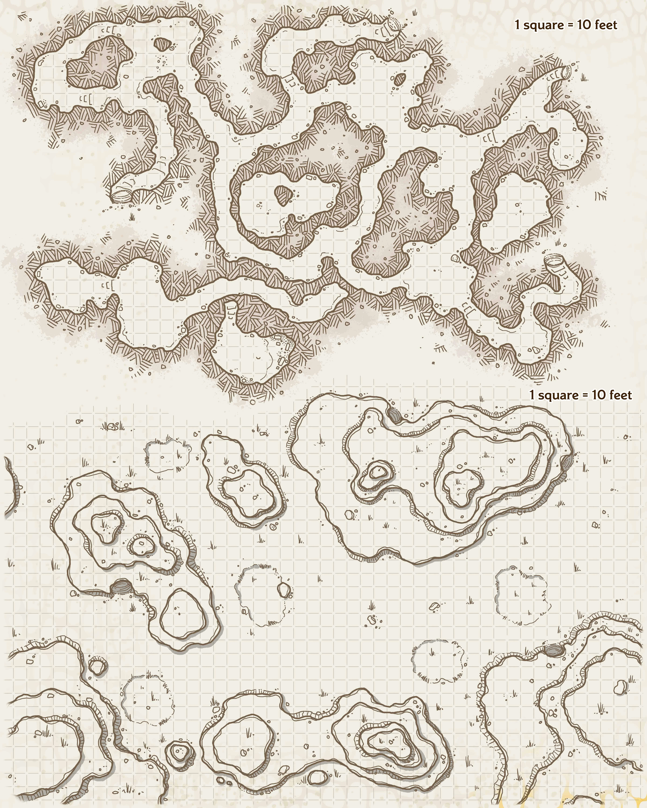

#### Copper Dragon Lair Features

The copper dragon lair shown in map 5.6 is a network of tunnels and large chambers dug beneath dry, rocky hills. The dragon's acid breath has left the surface of the stone here with a smooth, melted appearance.

The lair has the following features:

- Concealed Entrances

- Secret Doors

- Hoard Chamber

#### Additional Lair Actions

At your discretion, a legendary ({@creature Adult Copper Dragon||adult} or {@creature Ancient Copper Dragon||ancient}) copper dragon can use one or both of the following additional lair actions while in its lair:

- Laughing Gas

- Torpid Energy

#### Regional Effects

Either of these effects might appear in the area around a copper dragon's lair, in addition to or instead of the effects described in the {@book Monster Manual|MM}:

- Distant Melodies

- Starlit Stones

### Copper Dragon Treasures

Copper dragons love burnished metals, particularly those with red and yellow tones, along with gleaming gemstones of all kinds and colors. They also like fine art objects, ranging from tapestries and woven rugs to paintings, sculptures, and ornate carvings.

Copper dragons also collect trophies and keepsakes of their best tricks and triumphs. These range from the crowns, armor, and weapons of long-dead foes to portraits, personal items, and oddities such as a single ancient coin or an arcane clockwork.

## Crystal Dragons

Starlight is measured in emotions rather than quantifiable units. Although crystal dragons would argue that emotions actually are quantifiable units, so I don't really know what my point is.

Use the tables, map, and other information in this section to craft unique encounters with crystal dragons. Crystal dragon stat blocks appear in {@book chapter 6|FTD|6|Crystal Dragons}.

### Creating a Crystal Dragon

Use the Crystal Dragon Personality Traits and Crystal Dragon Ideals tables to inspire your portrayal of distinctive crystal dragon characters.

### Crystal Dragon Adventures

The Crystal Dragon Adventure Hooks table offers suggestions for stories and adventures involving crystal dragons.

#### Saryndalaghlothtor

The {@creature adult crystal dragon|FTD} Saryndalaghlothtor is known as "Lady Gemcloak" and sometimes "the Axemother," thanks to her association with a dwarf clan dwelling in the northern part of Faerûn. She lives closer to civilization than crystal dragons typically do, which delights her because of the close friendships she has formed, but also annoys her as she is forced to deal with hostile fools who mistake her for an evil white dragon.

Having earned the enmity of the ancient red dragon {@creature Klauth|SKT}, Lady Gemcloak is exploring the possibility of establishing close ties between her dwarf allies and a group of {@creature Azer||azers} on the Elemental Plane of Fire. In the meantime, she's trying to protect her dwarf allies from the schemes of a hostile mining cartel.

#### Connected Creatures

Crystal dragons are among the most social and hospitable of dragons. They are equal parts mysterious, contemplative, and mischievous, making it difficult to know what to expect of them.

### Crystal Dragon Lairs

Crystal dragons seek out frigid, picturesque locations with clear views of the sky above to build their lairs. Then, like gem cutters seeking the perfect diamond, they spend much of their lives refining, polishing, and enhancing the beauty of their lairs.

Crystal dragons' lairs are often found in polar expanses, dizzying mountain peaks, and glacial floes. Some resemble icy palaces, with numerous balconies offering plentiful opportunities for sky gazing. Though ice and snow are the most common materials they use in the construction of a lair, crystal and other precious minerals feature prominently in certain areas. In this way, crystal dragons' hoards literally become the fabric of their homes.

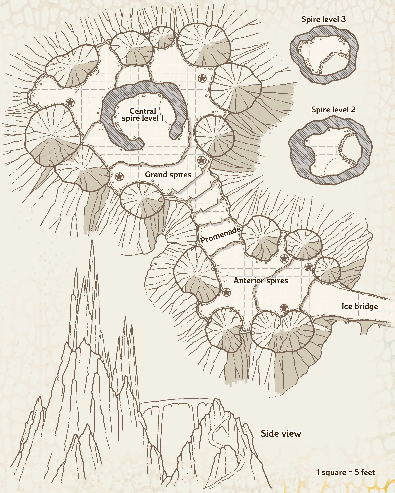

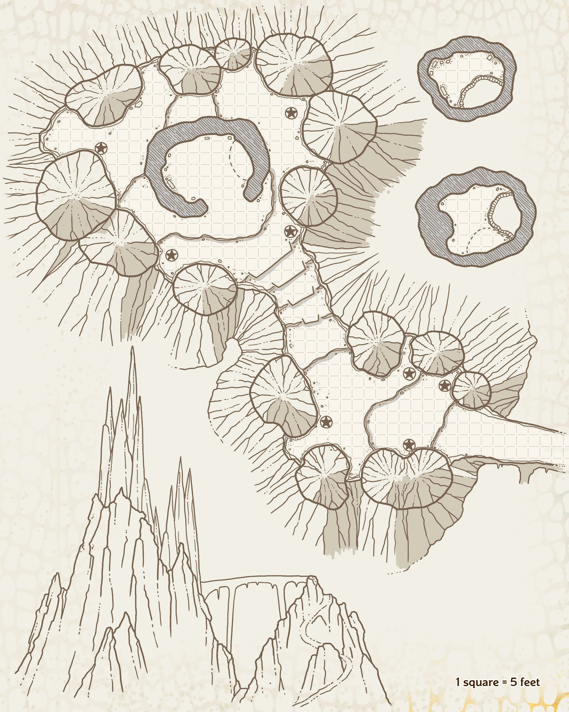

#### Crystal Dragon Lair Features

The crystal dragon lair shown in map 5.7 is the home of a dragon who has spent considerable time shaping the pinnacle of the tallest mountain in a local range, transforming it into a series of gleaming spires. Though visitors are rare, the dragon has built a roadway that ascends the mountain to encourage travel to and from the lair.

The lair has the following features:

- Ice Bridge

- Anterior Spires

- Ice Sculptures

- Promenade

- Grand Spires

- Central Spire

### Crystal Dragon Treasures

Crystal dragons covet bright, opulent objects; baubles and trinkets that remind them of the stars, sky, sun, or heavens; and relics that aid in the divinatory arts. They prioritize beauty over value, so while they adore gemstones of all kinds, they prize fine quartz as highly as cut diamonds.

Crystal dragons enhance the natural beauty of their lairs with the treasures they collect, always trying to display those items they consider most precious in a tasteful and interesting way and recounting their elaborate histories to visitors whenever possible. Indeed, crystal dragons also see amassing such wonderful hoards as a way to attract new friends to the remote locations they inhabit.

## Deep Dragons

There is a deep dragon saying that translates roughly to "Thorough is as thorough does," but more literally, "Uncover every last stone!" Every last stone?! Sounds exhausting.

Use the tables and other information in this section to craft unique encounters with deep dragons. Deep dragon stat blocks appear in {@book chapter 6|FTD|6|Deep Dragons}.

### Creating a Deep Dragon

Use the Deep Dragon Personality Traits and Deep Dragon Ideals tables to inspire your portrayal of distinctive deep dragon characters, and use the Deep Dragon Spellcasting table to help select spells for a spellcasting dragon.

### Deep Dragon Adventures

The Deep Dragon Adventure Hooks table offers suggestions for stories and adventures involving deep dragons.

#### Connected Creatures

Deep dragons appreciate the company of other dragons. Although they view most other species as inferior to dragonkind, having worth only as servants or tools, the rare individuals who impress them can sometimes earn respect as partners—albeit junior ones.

### Deep Dragon Lairs

Deep dragons make their lairs in the recesses of the Underdark, often near the settlements of people with whom they have alliances or enmities. Their lairs are highly individual. Some are woven from networks of living fungus. Others are built upon the ruins of ancient cities or carved into caves near underground lakes.

Deep dragons' lairs serve as bases for the dragons' explorations, as well as providing safe storage for their hoards. When these curious creatures are away from home searching out new environments and seeing new vistas, they usually leave their lairs protected by servitors, allies, magic, traps, or some combination of these protections.

#### Deep Dragon Lair Features

A deep dragon lair might share the same basic structure as the sapphire dragon lair shown on {@book map 5.12|FTD|5|Map 5.12: sapphire dragon lair}, but instead of being formed from stone, it might consist of chambers hollowed out within a fungus network growing near an underground river. Whatever the setup, a deep dragon festoons the narrow, twisting passages between the lair's fungal walls with magical and mundane traps. A typical lair has the following features:

- Connecting Passages

- Reception Hall

- Hoard Chamber

- Underground River

- Guest Suite

### Deep Dragon Treasures

Deep dragons adore goods from distant lands, especially if those goods are unique. They hoard mementos of memorable hunts or exploring expeditions. They love gemstones in deep, dark colors, as well as those with an iridescent sheen, and they favor keeping their treasures in frames and on stands made of precious woods and set with even more gems.

It is rare to find a deep dragon hoard that is simply a pile of gems and treasures, for these creatures take great pride in organizing and displaying their possessions. They can easily spend multiple days guiding visitors from prize to prize, telling stories about favorite keepsakes—and when deep dragons visit each other, these tours can stretch out for days.

## Dragon Turtles

I know I didn't make dragon turtles, and Tiamat swears she didn't, so where did they come from? More importantly, why?

Use the tables and other information in this section to craft unique encounters with dragon turtles. {@book Chapter 6|FTD|6|Dragon Turtles} features stat blocks for {@creature Dragon Turtle Wyrmling|FTD|dragon turtle wyrmlings}, {@creature Young Dragon Turtle|FTD|young dragon turtles}, and {@creature Ancient Dragon Turtle|FTD|ancient dragon turtles}. The {@creature dragon turtle} in the {@book Monster Manual|MM} is an adult.

### Creating a Dragon Turtle

Use the Dragon Turtle Personality Traits and Dragon Turtle Ideals tables to inspire your portrayal of distinctive dragon turtle characters, and use the Dragon Turtle Spellcasting table to help select spells for a spellcasting dragon. (Though the {@book Monster Manual|MM} doesn't explicitly include dragon turtles in the variant rules for making a dragon a spellcaster, you can apply those rules to these aquatic dragons.)

### Dragon Turtle Adventures

The Dragon Turtle Adventure Hooks table offers suggestions for stories and adventures involving dragon turtles.

#### Connected Creatures

Dragon turtles are stolid and slow to anger. This temperament, combined with their disinterest in moral quandaries, allows them to get along with—or at least abide—most creatures they encounter. They frequently enter symbiotic relationships with other sea creatures that can bring them food or treasure, and they sometimes agree to work for creatures who ply them with generous sums of wealth.

### Dragon Turtle Lairs

Dragon turtles make their lairs in underwater caves and coral reefs. Most such lairs are situated deep beneath the waves near the ocean's floor, though some dragon turtles prefer coastal lairs with easier access to settlements they can trade with—or prey upon. Particularly reclusive dragon turtles seek lairs in even more remote locales, including deep-sea trenches or underwater volcanoes.

Dragon turtles are largely unconcerned with the design of their lairs and seldom work to improve them. A dragon turtle's primary concern when selecting a lair is ensuring that the site is large enough to accommodate the creature's prodigious size as the centuries wear on. After that, proximity to shipping lanes and freedom from irksome neighbors take precedence.

#### Dragon Turtle Lair Features

The underwater caves inhabited by dragon turtles are structurally similar to the seaside caverns where bronze and topaz dragons lair. When constructing a dragon turtle's lair, you can simply take a coastal map and translate it to an underwater environment or use the map as-is if the dragon turtle is content to lair near the surface.

As an example, {@book map 5.14|FTD|5|Map 5.14: topaz dragon lair} depicts a topaz dragon's lair in a seaside cavern, but it could be reimagined as a grotto in the side of a coral reef rising from a shelf on the ocean floor, with the following features:

- Shelf Floor

- Coral Reef

- Reef Hollow

- Coral Shelf

#### Lair Actions

As they are presented in the {@book Monster Manual|MM}, dragon turtles don't have access to lair actions while in their lairs. At your discretion, you can give an {@creature Dragon Turtle||adult} or {@creature ancient dragon turtle|FTD} access to lair actions, increasing its challenge rating by 1. On initiative count 20 (losing initiative ties), the dragon turtle can take one of the following lair actions; the dragon turtle can't take the same lair action two rounds in a row:

- Blasting Current

- Entangling Kelp

- Steam Eruption

#### Regional Effects

The region containing a dragon turtle's lair can be transformed by its presence, creating one or more of the following effects:

- Diverting Currents

- Elemental Portals

- Hot Water

If the dragon turtle dies, these effects fade over the course of {@dice 1d10} days.

##### Aremag

Aremag is an {@creature Dragon Turtle||adult dragon turtle} who lays claim to the southern reaches of the Sea of Swords in Faerûn, extracting tribute from all who enter or leave the Bay of Chult. Traders often carry chests of treasure on board expressly for this purpose—pirates are more likely to offer captives, launched out in a skiff to feed the dragon turtle's voracious appetite.

Aremag's predation has occasionally provoked reprisal from Chult's inhabitants, as attested to by his milky-white left eye and missing patch of shell. However, rather than humbling the great dragon turtle, these injuries have made him more irascible. Those who meet the dragon turtle are advised to pay whatever price he asks, and to treat him with the deference he believes he deserves.

### Dragon Turtle Treasures

Dragon turtle hoards frequently contain quantities of coral and pearls received as tribute from aquatic peoples, as well as chests full of coins, gems, and trade bars looted from shipwrecks. However, a dragon turtle's most prized possessions are treasures from the surface realm. Such objects are likely to be fashioned of metal or stone, as wood, cloth, and paper keep poorly in a dragon turtle's watery lair.

More so than for most dragons, a dragon turtle's hoard is likely to contain a motley assortment of treasures from disparate locales. Although many dragon turtles simply lump the elements of their hoard together into a nest, more inquisitive individuals take an interest in specific treasures, sometimes seeking out surface-world folk to inquire about an object's function or provenance.

## Emerald Dragons

Although emerald dragons are wise beyond telling, they usually answer questions with some vague jibber jabber like, "The answer lies within you." Frustrating!

Use the tables, map, and other information in this section to craft unique encounters with emerald dragons. Emerald dragon stat blocks appear in {@book chapter 6|FTD|6|Emerald Dragons}.

### Creating an Emerald Dragon

Use the Emerald Dragon Personality Traits and Emerald Dragon Ideals tables to inspire your portrayal of distinctive emerald dragon characters.

### Emerald Dragon Adventures

The Emerald Dragon Adventure Hooks table offers suggestions for stories and adventures involving emerald dragons.

#### Connected Creatures

Emerald dragons generally go out of their way to avoid interacting with other intelligent creatures. However, their interest in history and culture occasionally gets the better of them, prompting them to seek some engagement with the folk of the world.

##### Raulothim

Raulothim is an {@creature ancient emerald dragon|FTD} who dwells in an extinct volcano known as the Pit of Stars, on the northernmost isle of Ruathym off the Sword Coast of Faerûn. Though most emerald dragons are paranoid by nature, Raulothim became especially so after having witnessed the arrival of planar travelers in Faerûn. Fearing that an invasion of his world by interplanar armies was inevitable, he has spent the past century collecting magic items that he hopes will enable him to survive the coming conflict.

Raulothim's drive to amass magic and his innate mistrust of anyone powerful enough to potentially threaten him make the dragon a dangerous adversary. However, he knows the surest way of safeguarding Faerûn against planar invaders is to keep a careful watch on all planar portals—and that to do so, he must rely on allies. Raulothim is therefore open to negotiating with adventurers willing to aid in that task—but only those he is sure he can trust. On more than one occasion, doubt has gnawed at Raulothim's mind, prompting him to preemptively strike against a previously trusted ally.

### Emerald Dragon Lairs

Emerald dragons make their lairs in caves and subterranean ruins, favoring locations that have been abandoned—and ideally forgotten—by other creatures. They are most comfortable in extreme heat, so they frequently choose lair sites in the sides of volcanoes or near geothermal vents.

An emerald dragon's lair is a maze of twisting tunnels, interconnected caverns, or crumbling ruins designed to disorient intruders. Circuitous routes within the lair provide the dragon with numerous ways to evade pursuit, while strategically designed choke points allow them to harry enemies with repeated ambushes. Emerald dragons frequently lay traps and alarms at the entrance points to their lairs, with older (and more paranoid) dragons employing several layers of such defenses.

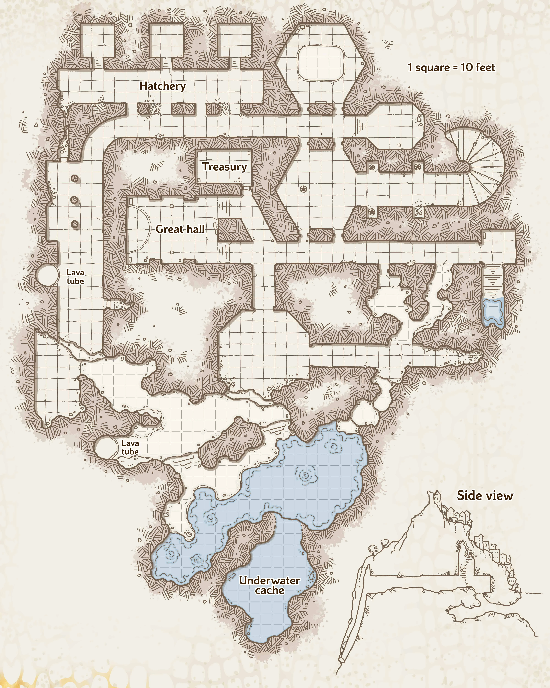

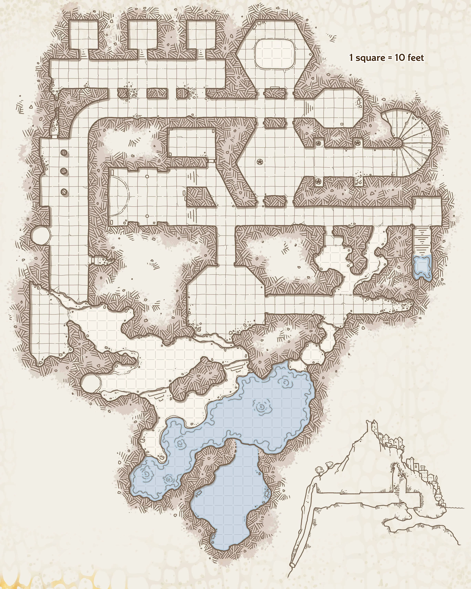

#### Emerald Dragon Lair Features

The emerald dragon lair shown in map 5.8 is a series of ancient vaults situated beneath a city built in the caldera of a dormant volcano. The vaults fell into disuse over a century ago when an upwelling from the lake at the caldera's center collapsed a portion of the vaults and flooded their halls with boiling water and noxious fumes. The stairwell leading up to the city was sealed to prevent the fumes from spilling into the streets above. Decades later, once the volcano's activity had subsided, the dragon moved in.

The lair has the following features:

- Lava Tubes

- Great Hall

- Treasury

- Watery Caves

- Underwater Cache

- Hatchery

- Preserved Vaults

### Emerald Dragon Treasures

Emerald dragons are unusual among gem dragons in their preference for coinage over gemstones when amassing treasure. They are fascinated by the various designs of coinage and often strive to collect rare mintages. Most emerald dragons can precisely enumerate the names, amounts, and denominations of every bit of currency in their hoards.

Emerald dragons also prize cultural artifacts, especially relics with historical significance. They place great importance on an item's provenance, which can make it difficult to gauge how they might value any particular object. Despite remaining unmoved by the loss of a gold scepter deemed to be a replica, an emerald dragon might become enraged at the theft of a clay mug known to have been used by a legendary dwarf warlord while on campaign.

## Faerie Dragons

Say what you will about faerie dragons, but they know their pastries. Eclairs! Macarons! Cuppie cakes! Mmm, now I've gone and made myself hungry.

Use the tables and other information in this section to craft unique encounters with faerie dragons.

### Creating a Faerie Dragon

Use the Faerie Dragon Personality Traits and Faerie Dragon Ideals tables to inspire your portrayal of distinctive faerie dragon characters.

### Faerie Dragon Adventures

The Faerie Dragon Adventure Hooks table offers suggestions for stories and adventures involving faerie dragons.

#### Connected Creatures

As is suggested by their name and nature, faerie dragons tend to prefer the company of Fey, as well as wild animals and any chaotic creatures who can appreciate faerie dragons' madcap sense of humor. At the same time, faerie dragons' limited attention spans often leave them starved for novelty, and nearly any creature can attract their interest—at least temporarily.

### Faerie Dragon Lairs

Faerie dragons go where the fun is. For many, this means dwelling near portals to the Feywild, enjoying that realm's unpredictable magic and boisterous revels. Yet it can just as easily mean residing among other peoples—stealing baubles from shrines, nesting in cluttered attics, or following explorers and other intriguing individuals on their travels. For as much as they love their homes and hoards, faerie dragons abandon both without a second thought if adventure beckons.

Faerie dragon lairs are as varied and eccentric as their owners. Some resemble simple animal nests, hidden away in secret crevices or woven of twigs and trash in the forks of ancient trees. Faerie dragons may also draw on the trappings of civilization, perhaps stealing a child's dollhouse for use as a manor or convincing pixies to construct them a silken bower. The most elaborate faerie dragon lairs are modeled off those of larger dragons, featuring multiple chambers and cunning traps.

#### Faerie Dragon Lair Features

An example complex faerie dragon lair is built around several hollowed-out chambers inside a large dead tree. The tree is decorated with the dragon's lesser treasures, its limbs draped with scrolls and scarves and set with glittering glass. You could use part of the underground portion of the copper dragon's lair ({@book map 5.6|FTD|5|Map 5.6: copper dragon lair}) to represent such a lair, with the scale reduced to 2½ feet per square, the hollow spaces tucked inside a massive tree trunk, and the passages running inside major branches rather than underground. A typical lair has the following features:

- Trapped Entrance

- Audience Chamber

- Hoard and Larder

- Sleeping Chamber

- Escape Tunnel

#### Lair Actions

As they are presented in the {@book Monster Manual|MM}, faerie dragons don't have access to lair actions while in their lairs. At your discretion, a green or {@creature Faerie Dragon (Violet)||older faerie dragon} can take one of the following lair actions on initiative count 20 (losing initiative ties):

- Chaotic Aura

- Grasping Plants

#### Regional Effects

The region containing a faerie dragon's lair can be transformed by its presence, creating one or more of the following effects:

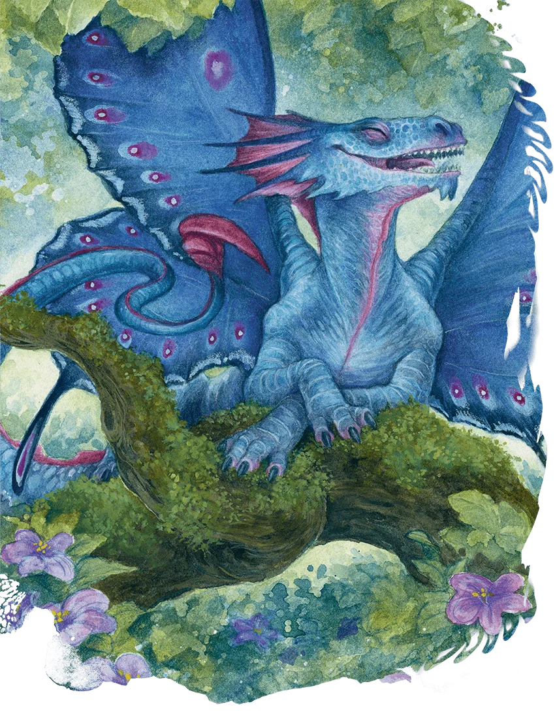

- Compulsory Offering

- Malleable Time

- Mischief Afoot

If the faerie dragon dies, these effects fade over the course of {@dice 1d10} days.

### Faerie Dragon Treasures

Faerie dragons covet treasure as much as their larger draconic kin, but they are significantly less discerning. Faerie dragons' hoards are thus often a mix of genuine wealth and intriguing trash, with the dragons paying more attention to the wild stories they concoct around each item than the items' actual monetary value. These tiny egomaniacs can often be bribed with cheap but sufficiently respectful tributes of food and shiny trinkets, though their tendency to "borrow" any random object that catches their eye means a faerie dragon nest might also contain items of surprising value—often without the dragon realizing it.

#### Nathair Sgiathach

Sometimes incorrectly assumed to be a god by non-dragons, Nathair Sgiathach (pronounced "nah-HAIR skee-HOKH") is the most famous of faerie dragon folk heroes. Like other faerie dragons, Nathair adores jokes—even those made at the dragon's expense—which makes Nathair particularly popular among their pixie, sprite, and other Fey associates. Though Nathair's magical powers are far greater than those of most faerie dragons (thanks in part to highly developed dragonsight), Nathair still prefers to resolve conflict with harmless pranks and absurdities, such as making an enemy's buttocks glow red and appear to sing folk tunes. When necessary, however, Nathair doesn't shy away from fighting to defend their beloved faerie folk. As such, some Fey teach their children to call Nathair Sgiathach's name in times of trouble, on the chance that the faerie dragon might be lurking invisibly nearby, as well as to put out ceremonial offerings of the faerie dragon's favorite food: apple pie.

## Gold Dragons

Modrons have an inexplicable habit of mistaking gold dragons for their leader, Primus. The dragons don't mind, and the modrons don't seem to mind. So why do I find this so offensive?

Use the tables, map, and other information in this section to craft unique encounters with gold dragons.

### Creating a Gold Dragon

Use the Gold Dragon Personality Traits and Gold Dragon Ideals tables to inspire your portrayal of distinctive gold dragon characters, and use the Gold Dragon Spellcasting table to help select spells for a spellcasting dragon.

### Gold Dragon Adventures

The Gold Dragon Adventure Hooks table offers suggestions for stories and adventures involving gold dragons.

#### Connected Creatures

Gold dragons tend to hold themselves apart from the worlds they watch over, favoring isolation and trusting only a few close allies and guardians. When they do walk among other creatures, they prefer to do so in disguise, relishing the opportunity to see the world through different eyes.

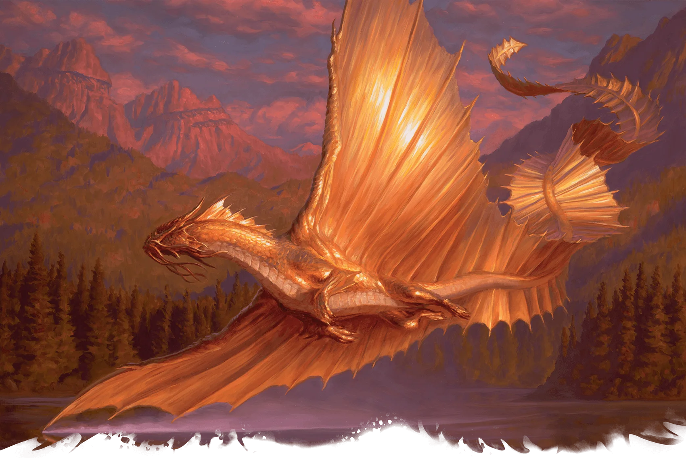

### Gold Dragon Lairs

Despite their affection for people and their diverse cultures, gold dragons typically make their lairs in hidden places far from civilization, where only the most desperate and dedicated can find them. Many live in the ruins of vanished cultures, appreciating the beautiful inevitability of entropy and the reminder of how easily progress can be lost without careful tending. Crumbling shrines, towers reclaimed by the wilderness, and fallen fortresses all appeal to a gold dragon's sense of history—though they can be equally enraptured by picturesque natural settings. A gold dragon lair almost always involves water, be it a river, a lake, or an ocean shore.

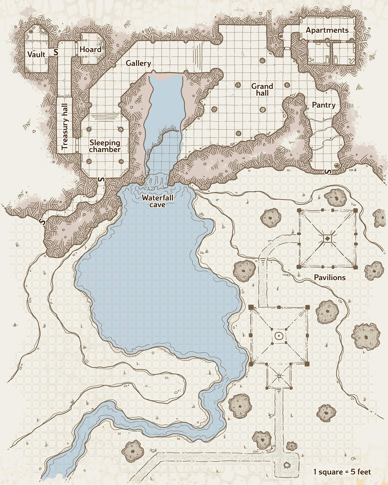

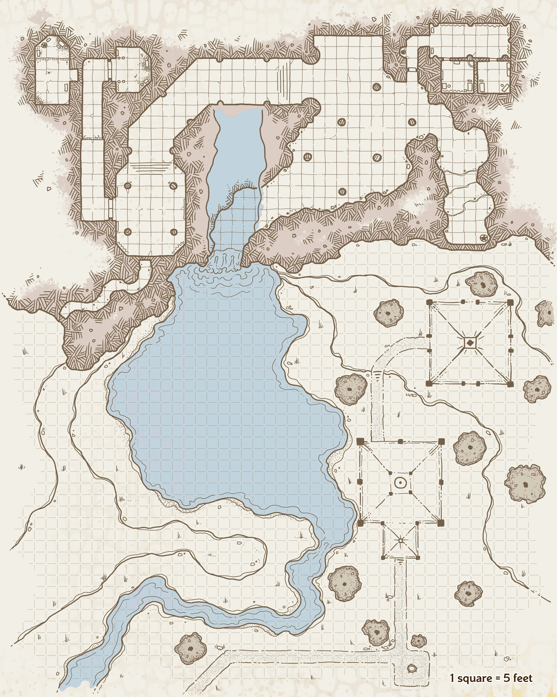

#### Gold Dragon Lair Features

The gold dragon lair shown in map 5.9 occupies a misty river gorge and has the following features:

- Waterfall Cave

- Grand Hall

##### Tamarand

As the King of Justice, Tamarand is the nominal ruler of gold dragons throughout Faerûn. Other gold dragons seek out his wisdom before embarking on their own quests, to ensure they aren't overlooking any hidden consequences.

Tamarand is thoughtful, decisive, and surprisingly friendly toward non-dragons. He has strong bonds with the {@creature Storm Giant||storm giants} of the Galena Mountains and is a dedicated scholar of Humanoid cultures, having seen firsthand just how powerful such creatures can be when properly organized. After narrowly escaping assassination by dragon hunters in his former lair near Bloodstone Pass, Tamarand currently resides in the Vaasan wilderness and keeps his exact location a closely guarded secret.

##### Gallery

A passageway running left from the grand hall is lined with busts of allies and enemies from the dragon's past. This area contains the water mirror, a magical glass case filled by seepage from the river above, which the dragon uses to scry across both distance and time.

- Sleeping Chamber

- Treasury Hall

- Hoard and Vault

- Pantry

- Apartments

- Pavilions

#### Additional Lair Action

At your discretion, a legendary ({@creature Adult Gold Dragon||adult} or {@creature Ancient Gold Dragon||ancient}) gold dragon can use the following additional lair action while in its lair:

- Beguiling Glow

#### Regional Effects

Any of these effects might appear in the area around a gold dragon's lair, in addition to or instead of the effects described in the {@book Monster Manual|MM}:

- Beneficent Trail

- Emanation of Justice

- Liar's Revelation

### Gold Dragon Treasures

Gold dragons consider gems and pearls culinary delicacies, and they often have a section of their hoard that's as much pantry as treasury. Beyond such consumables, they prefer items they can learn from, whether rare historical or metaphysical texts, mysterious relics and curios, or puzzles and prophecies offering hints at the future.

Gold dragons also collect trophies marking important events and successes in their lives. But unlike many other dragons, they are just as likely to prize mementos of their defeats and mistakes, believing that such reminders are inherently instructive. Like bronze dragons, gold dragons often guard particularly dangerous artifacts as a form of public service, and thus prize clever magical or mundane defenses to keep their lairs safe and hidden.

## Green Dragons

In some ways the green dragon is the most "dragon" of dragons. Pity that Tiamat gets credit for them.

Use the tables, map, and other information in this section to craft unique encounters with green dragons.

### Creating a Green Dragon

Use the Green Dragon Personality Traits and Green Dragon Ideals tables to inspire your portrayal of distinctive green dragon characters, and use the Green Dragon Spellcasting table to help select spells for a spellcasting dragon.

### Green Dragon Adventures

The Green Dragon Adventure Hooks table offers suggestions for stories and adventures involving green dragons.

#### Connected Creatures

Green dragons see other living beings as objects to subjugate, torment, or eat. Solitary by nature, they seldom tolerate the presence of other creatures unless their presence serves a purpose.

### Green Dragon Lairs

Green dragons prefer making their lairs in verdant places—jungles, bayous, pine forests, or anywhere with abundant vegetation that they can shape according to their desires. An older green dragon might indulge in horticulture, cultivating the local flora as befits their individual aesthetic. However, most green dragons are content to either excavate beneath trees and nestle among the roots or make lairs inside trees large enough to be hollowed out without compromising their structure.

Green dragons take great interest in woodland settlements when seeking lair sites. Though they are fully capable of modifying forests to their own liking, they find it easier and vastly more entertaining to take something belonging to smaller and weaker beings.

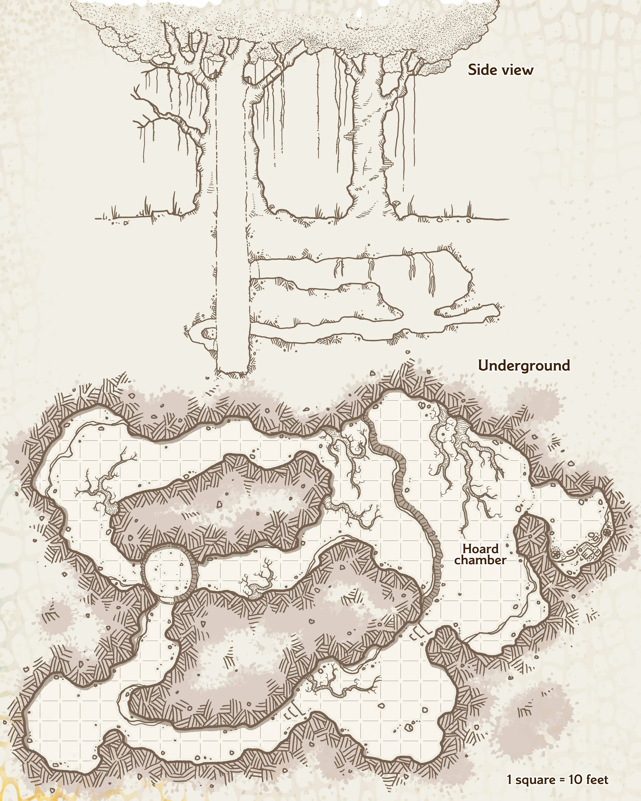

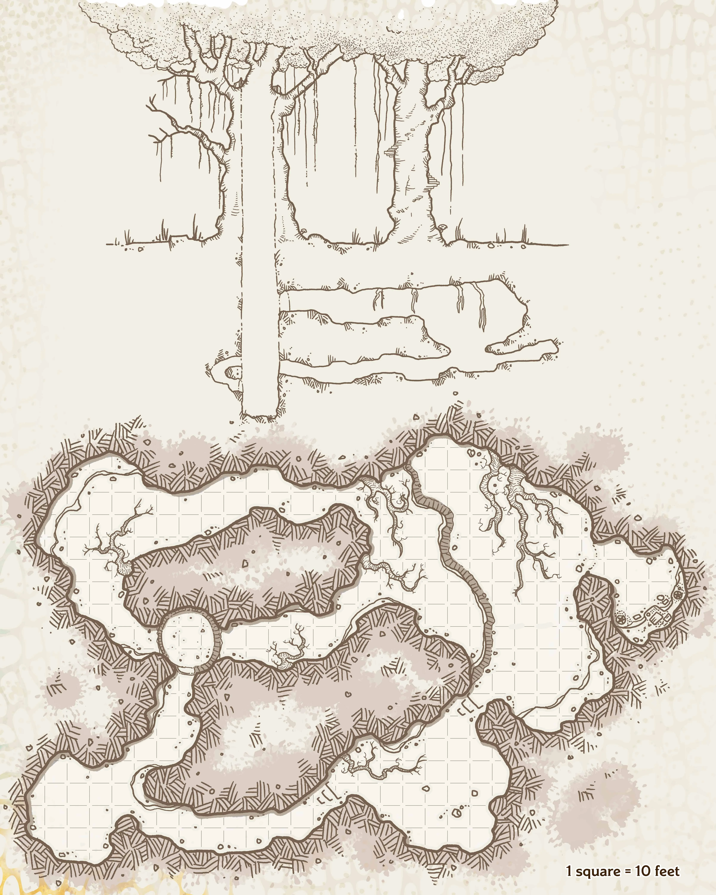

#### Green Dragon Lair Features

The green dragon lair shown in map 5.10 was an enormous banyan tree once sacred to the wood elves who lived around it. The original host tree around which the banyan tree grew is now dead and has rotted away, leaving a large columnar shaft within the trunk of the banyan that the dragon has expanded into a subterranean lair. The banyan continues to grow and to swallow up other nearby trees.

The lair has the following features:

- Canopy

- Underground

- Hoard Chamber

#### Additional Lair Actions

At your discretion, a legendary ({@creature Adult Green Dragon||adult} or {@creature Ancient Green Dragon||ancient}) green dragon can use one or both of the following additional lair actions while in its lair:

- Creeper Vines

- Lashing Root

#### Regional Effects

Either or both of these effects might appear in the area around a green dragon's lair, in addition to or instead of those described in the {@book Monster Manual|MM}:

- Inviting Whispers

- Twisted Messengers

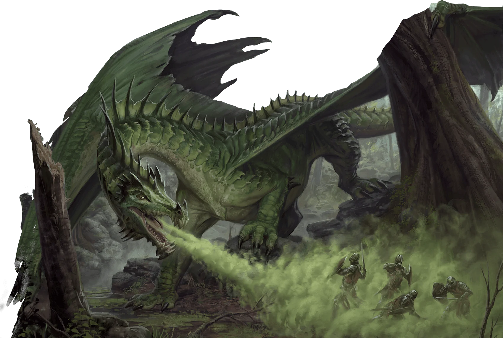

### Green Dragon Treasures

Green dragons relish gems and jewelry whose palettes reflect their chosen forest environments, favoring viridescent colors and bursts of floral brilliance. Many develop vast collections of emeralds and beryls as a result, punctuated by amber, red rubies, tiger's eyes, bismuth, and the like. They likewise covet finely crafted items and works of art depicting unspoiled nature.

Unlike many of their kin, green dragons use the transformative power of nature to turn those valuables into truly unique treasures. By wrapping and threading treasures with rare vegetation and carefully applying their own skill as gardeners, green dragons meld nature and artifice into new masterpieces. This can lead to complications for would-be treasure hunters, as green dragons take enormous pride in their handiwork—so much so that intruders damaging the delicate arrangements of flower and vine that surround a treasure cache might come under attack before even touching any of the hoard's contents.

#### Cyan Bloodbane

K'rshinthintl—commonly known as Cyan Bloodbane—is a deeply cunning {@creature ancient green dragon} with an exacting sense of malice. He is a charismatic creature, but flattery is only one of his many weapons.

During the War of the Lance on the world of Krynn, Cyan Bloodbane used one of the {@item Orb of Dragonkind||Orbs of Dragonkind} to poison the mind of the elf king Lorac, causing the land of Silvanesti to become swallowed up in Lorac's nightmares. The green dragon has no particular loyalty to Tiamat or dedication to her cause; his actions are in his own best interests.

## Moonstone Dragons

One can imagine the most preposterous things around a moonstone dragon... and then look around and realize one was not in fact imagining!

Use the tables and other information in this section to craft unique encounters with moonstone dragons. Moonstone dragon stat blocks appear in {@book chapter 6|FTD|6|Moonstone Dragons}.

### Creating a Moonstone Dragon

Use the Moonstone Dragon Personality Traits and Moonstone Dragon Ideals tables to inspire your portrayal of distinctive moonstone dragon characters.

### Moonstone Dragon Adventures

The Moonstone Dragon Adventure Hooks table offers suggestions for stories and adventures involving moonstone dragons.

#### Connected Creatures

In the Feywild, moonstone dragons interact mostly with {@creature Pixie||pixies}, {@creature Sprite||sprites}, and other Fey creatures who revere and serve the dragon. Outside the Feywild, they often prefer to communicate with other creatures through dreams.

### Moonstone Dragon Lairs

Often, a moonstone dragon's lair is not a single location, but rather a collection of personally significant places spread out across multiple planes of existence and connected through portals under the dragon's control. A lair might include a secluded grove on the Material Plane, a well-protected tower in the Feywild, and even a hidden corner of the Ethereal Plane. Moonstone dragons often use locations in the Feywild as their primary residences, locations on the Material Plane for entertaining guests, and locations on the Ethereal Plane for storage. Occasionally, though, a whimsical moonstone dragon delights in shaking things up, insisting that visitors come to the Border Ethereal for a meeting or sleeping in the middle of a heavily trafficked forest on the Material Plane.

Moonstone dragons navigate their multiplanar lairs by opening portals between planes at will. They sometimes forget to close those portals, allowing the inhabitants of one plane to wander into others.

#### Moonstone Dragon Lair Features

You can look to other maps in this chapter as inspiration for the scattered parts of a moonstone dragon's lair. For example, a well maintained and above-water version of the black dragon lair's tower ({@book map 5.2|FTD|5|Map 5.2: black dragon lair}) makes a great Feywild audience chamber, while a vibrant, living version of the green dragon lair's enormous tree ({@book map 5.10|FTD|5|Map 5.10: green dragon lair}) makes for a very comfortable bedchamber in a grove on the Material Plane. And features such as the cloud bridges of the silver dragon lair ({@book map 5.13|FTD|5|Map 5.13: silver dragon lair}) can be used for the parts of a moonstone dragon's lair that lie in the Border Ethereal.

### Moonstone Dragon Treasures

Moonstone dragons prefer silver, platinum, and mithral to copper and gold, and white or silvery gems to more colorful ones. Some are simply uninterested in treasures made of what they consider inferior metals, but others actively dislike copper and gold creations and consider them aesthetically offensive. People who mistakenly offer these metals to the wrong moonstone dragon sometimes wake to find all their silver—and memory of the past few days—missing.

In addition to their strong preference for certain metals, many moonstone dragons seek out artworks and relics with unique, whimsical, or absurd designs. The more fanciful an item's form is, the better.

## Red Dragons

You might think a red dragon's fire would burn away any hygienic improprieties and leave the dragon's breath smelling fresh as spring flowers. But you'd be wrong.

Use the tables, map, and other information in this section to craft unique encounters with red dragons.

### Creating a Red Dragon

Use the Red Dragon Personality Traits and Red Dragon Ideals tables to inspire your portrayal of distinctive red dragon characters, and use the Red Dragon Spellcasting table to help select spells for a spellcasting dragon.

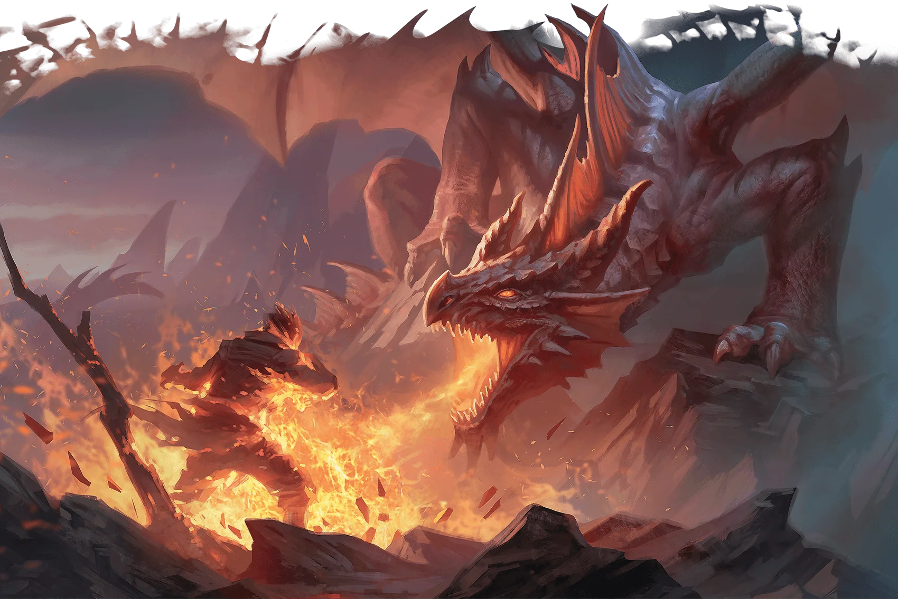

### Red Dragon Adventures

The Red Dragon Adventure Hooks table offers suggestions for stories and adventures involving red dragons.

#### Connected Creatures

Red dragons treat other creatures as potential servants or pawns, valuable only as long as they fulfill the dragon's needs. Many red dragons terrorize creatures into serving them—and sometimes into worshiping them as well. Others build up shadowy networks of manipulation and control, so many of their servants have no idea who the true ruler is.

### Red Dragon Lairs

Red dragons lair in mountain badlands and high, isolated peaks and hills, preferring warm caverns in the rocky depths beneath those landscapes. Lairs with natural geothermal or lava vents are highly sought after, as these features create an environment ideally suited to the dragons' taste.

Minions often attend red dragons in their lairs. These servants keep the place swept clean of refuse and watch out for intruders, while providing the imperious dragon with subjects to bully and command. Some minions worship the dragon and serve willingly, but others would escape if they could.

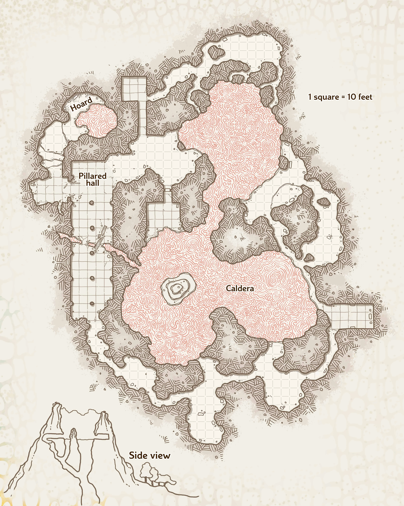

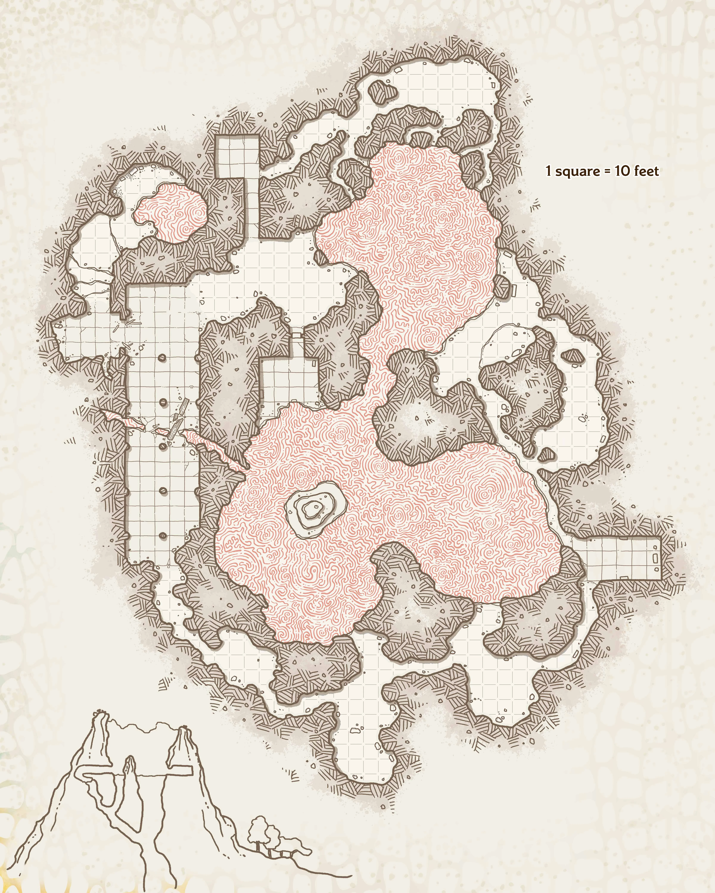

#### Red Dragon Lair Features

The red dragon lair shown in map 5.11 is inside the caldera of an active volcano. {@creature Azer||Azers} dug out and expanded the lava tunnels within the volcano's peak, just above the level of the caldera's lava pools. Although the azers are long since gone, their construction—and much of their lost wealth—now serves the dragon's needs. That construction also provides a network of tunnels too small for the dragon to use, but where other creatures can make their lairs.

The lair has the following features:

- Caldera

- Pillared Hall

- Hoard

#### Additional Lair Actions

At your discretion, a legendary ({@creature Adult Red Dragon||adult} or {@creature Ancient Red Dragon||ancient}) red dragon can use one or both of the following additional lair actions while in its lair:

- Noxious Smoke

- Searing Heat

#### Regional Effects

Any of these effects might appear in the area around a red dragon's lair, in addition to or instead of the effects described in the {@book Monster Manual|MM}:

- Desertification

- Fiery Senses

- Ominous Flames

### Red Dragon Treasures

Red dragons love gold above all other precious metals and are entranced by its gleam, its luster, and the sound of its chime. They amass gold coins and objects to form the bulk of their hoards, along with red and fiery gemstones such as rubies and fire opals. Red dragons favor items made of metal and stone, which can survive the test of time. Many such items in an {@creature Ancient Red Dragon||ancient red dragon's} hoard might be hundreds or thousands of years old. They tend to eschew treasures that burn, such as leather, paper, and cloth items.

For a red dragon, every treasure is a mark of pride and a personal trophy. Like a proud hunter, a red dragon relishes telling the tale of acquiring each individual relic or coin, glorifying the dragon's own deeds.

#### Ashardalon

The terrible red dragon Ashardalon is spoken of in legends across the multiverse for his terrible rampages, which turned lush grasslands into ashen plains and caused mighty citadels to be swallowed up in the earth. As he awakened his dragonsight, he recruited a balor demon named Ammet, the Eater of Souls, to help him drain the power of his echoes on other worlds. When he was struck a mortal blow to the heart, he replaced the injured organ with the balor. This transplant has lent a fiendish cast to his features, and his eyes glow with demonic flame. A secretive cult of Ashardalon's followers and spawn serves him on the Material Plane, furthering the dragon's schemes to attain godhood.

## Sapphire Dragons

A sapphire dragon's flight once inspired a courting dance in a certain kingdom that shall remain nameless. Embarrassingly, it is still performed to this day.

Use the tables, map, and other information in this section to craft unique encounters with sapphire dragons. Sapphire dragon stat blocks appear in {@book chapter 6|FTD|6|Sapphire Dragons}.

### Creating a Sapphire Dragon

Use the Sapphire Dragon Personality Traits and Sapphire Dragon Ideals tables to inspire your portrayal of distinctive sapphire dragon characters.

### Sapphire Dragon Adventures

The Sapphire Dragon Adventure Hooks table offers suggestions for stories and adventures involving sapphire dragons.

#### Connected Creatures

Sapphire dragons are generally solitary creatures. On the rare occasion that one forms nonhostile relationships with other beings, it is almost always to bolster the defenses of the dragon's lair and hoard.

### Sapphire Dragon Lairs

Sapphire dragons make their lairs in enormous caverns and complex tunnel systems. As they grow older, they continually renovate their lairs, using their tunneling abilities and command over stone.

Sapphire dragons eventually create dizzying honeycombs of hidden passages, deceptively thin walls, and secret chambers that allow them to traverse the entire lair without ever being seen by intruders. The best-defended sapphire dragon lairs have no easily accessible entrances or exits at all, and trespassers who do find their way inside must then contend with a maze of corridors, dead ends, and steep inclines.

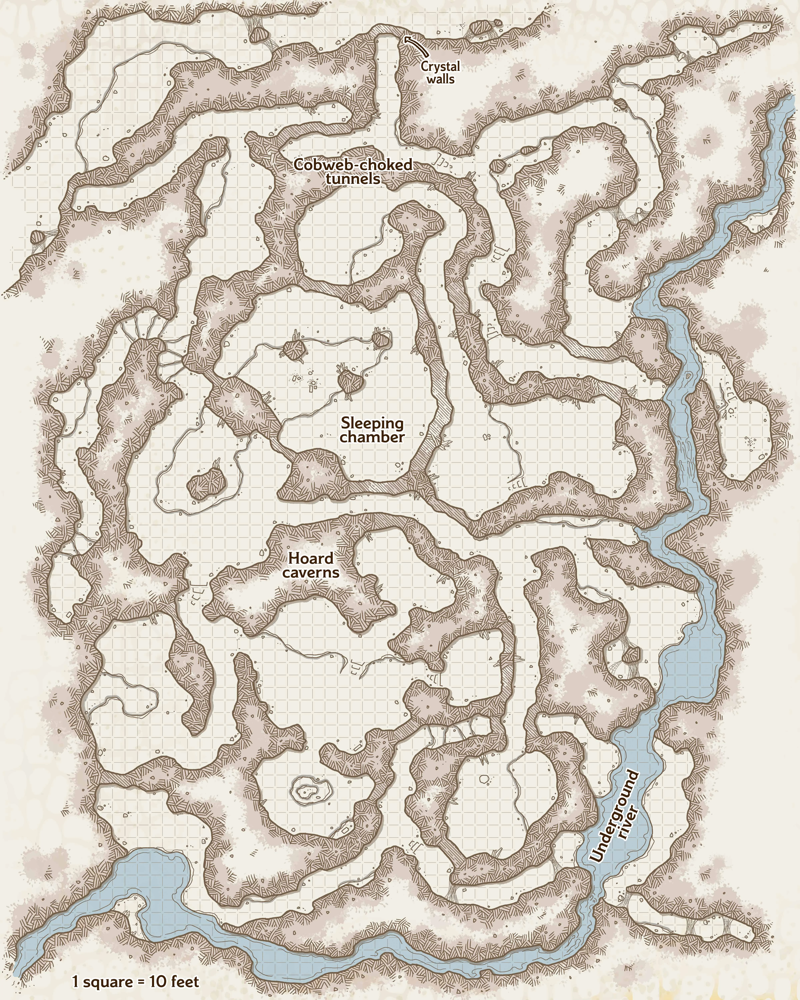

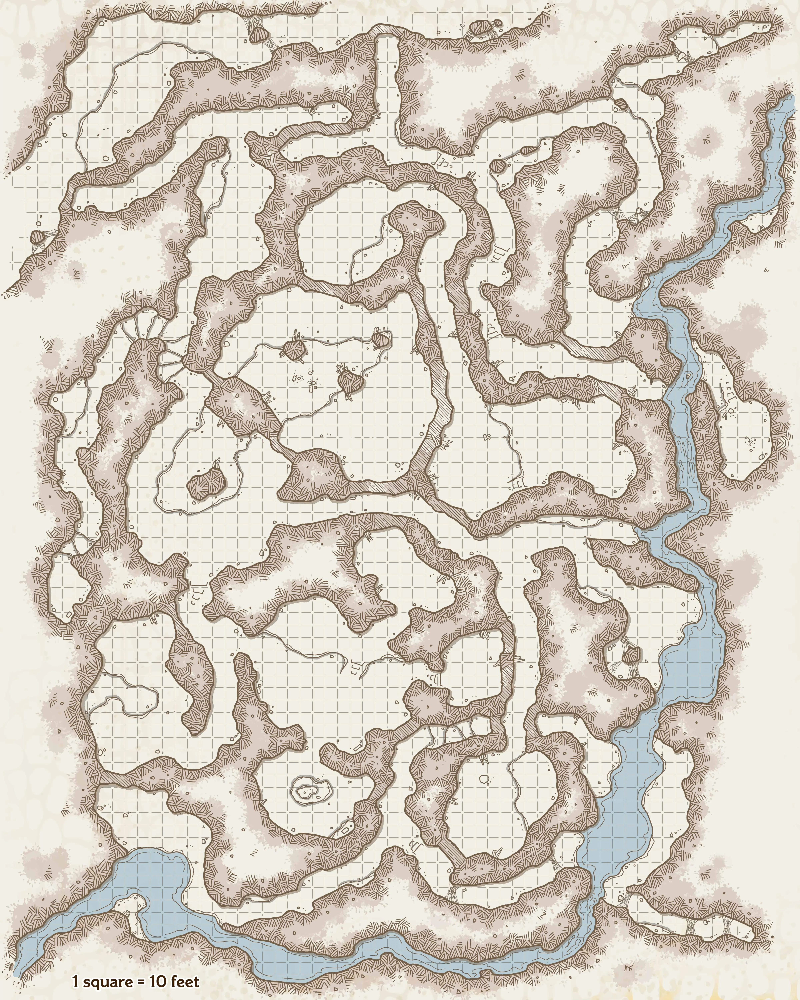

#### Sapphire Dragon Lair Features

The sapphire dragon lair shown in map 5.12 is a series of natural tunnels and chambers the dragon has adapted to serve as a lair. The lair has few natural entrances, so whole sections are inaccessible without excavation or magic, as the dragon can simply open doorways in walls whenever necessary.

The lair has the following features:

- Disguised Entrances

- Cobweb-Choked Tunnels

- Underground River

##### Bleucorundum

Bleucorundum is an {@creature ancient sapphire dragon|FTD} with an equally ancient hatred of {@creature Beholder||beholders} and their kin. After losing both parents to beholder attacks, he fled to the Lake of Steam in southern Faerûn. There, he discovered the resting place of a martial order known as the Knights of the Crescent Moon, who had fought beholders in an ancient war. Bleucorundum found the knights held in stasis, awaiting the day they would be called upon to fight their ancient enemies again, and he vowed to guard them until they awaken. He styles himself the Sapphire Sentinel, self-appointed guardian of the Sleeping Legion. But his vigil is lonely, and his servitor {@creature Gargoyle||gargoyles} provide little companionship.

- Hoard Caverns

- Sleeping Chamber

### Sapphire Dragon Treasures

Sapphire dragons covet items of martial significance above other treasure. Weapons and armor from epic conflicts are usually the centerpieces of a sapphire dragon's hoard, set alongside military histories, treatises on warfare, and battle mementos, as well as trophies from the dragon's own conquests of subterranean foes such as illithids and aboleths.

Sapphire dragons meticulously catalogue their hoards. Each dragon has a unique organizational system; some are straightforward, but some only the dragon can fully comprehend (weapons categorized by which armies they were used against, armor ordered by the ancestry of its last wearer, and so forth). Regardless of the system, a sapphire dragon takes pride in knowing exactly where any given item is and can recite a detailed history of that item while guiding curious guests to (or away from) it.

## Shadow Dragons

In order to see a shadow, one must look in the opposite direction of the light. The same can be said for a shadow dragon.

Use the tables and other information in this section to craft unique encounters with shadow dragons.

### Creating a Shadow Dragon

Use the Shadow Dragon Personality Traits and Shadow Dragon Ideals tables to inspire your portrayal of distinctive shadow dragon characters.

If you use the variant rule in the {@book Monster Manual|MM} for making a dragon a spellcaster, shadow dragons typically have the spellcasting ability of their original forms. Over time, some shadow dragons might replace one or more of their innate spells with spells more appropriate to their tenebrous nature, such as {@spell darkness}, {@spell fog cloud}, {@spell misty step}, or {@spell nondetection}.

### Shadow Dragon Adventures

The Shadow Dragon Adventure Hooks table offers suggestions for stories and adventures involving shadow dragons.

#### Connected Creatures

Shadow dragons often attempt to blunt their despair by dragging others into their gloomy lives with them. These are generally short-lived relationships, though, as most shadow dragons can scarcely bear the bleakness of their own existence.

### Shadow Dragon Lairs

When dragons become aware of the Shadowfell's malign influence seeping into their territories, most scoop up their hoards and abandon any compromised lairs. But some are stubborn, prideful, or bitter enough to stay, even in the face of inevitable corruption. More often, a dragon is unknowingly swept up by the Shadowfell while asleep, awakening after a years-long rest to find that both dragon and lair have changed. In these cases, a shadow dragon's lair undergoes the same transformation as the dragon, becoming a shadowy, melancholic version of the original site.

Shadow dragons that are born on the Shadowfell or seek out new lairs after their transformations establish lairs according to the preferences of their kind, though they find comfort only in the most gloomy and cheerless of places. Reconciling these sometimes-contrasting urges can lead to some very unusual lair choices.

As an example, consider the red dragon lair in {@book map 5.11|FTD|5|Map 5.11: red dragon lair} as the lair of a red shadow dragon. In this case, the once-active volcano has now lapsed into dormancy. Its lava flows have cooled into a blackened, alien landscape. Ash coats the slopes of the caldera, picked up by the weird swirling winds common to this region and drawn into the atmosphere. Clouds of ash periodically cast the surrounding lands into deep shadow, before the fine grit once again falls to the ground in a hazy gray blizzard. The shadow dragon prowls the region during these hazes, rendered all but invisible by the eddies of ash.

In the heart of the lair, even the brightest light is muted, and creatures find their eyes playing tricks on them as details and distance are distorted. The shadow dragon rarely leaves this place except to hunt and is attended by dozens of shadows.

#### Additional Lair Action

Shadow dragons have access to the lair actions usable by untransformed dragons of the same kind. The effects of these actions might be cosmetically altered, seeming darker, gloomier, and more subdued. They might also deal necrotic damage instead of other damage types. At your discretion, a legendary (adult or ancient) shadow dragon can use the following additional lair action while in its lair:

- Banish Light

#### Regional Effects

When a shadow dragon establishes a lair on the Material Plane, the region around the lair takes on some of the characteristics of the Shadowfell, creating one or more of the following effects:

- Brooding Despair

- Dying Light

- Gloomy Portals

### Shadow Dragon Treasures

Shadow dragons retain the preferences of their original form when it comes to treasure. With each passing year, though, the more lustrous objects in their hoards begin to instill a sort of revulsion in the shadow dragons, much as sunlight does. Gleaming coins and shiny baubles sicken and anger them, and they blunt and tarnish these items to make them easier to look on. Ebony, onyx, and similar dark-hued valuables bring shadow dragons no particular joy, but they aren't as inherently repellent as silver, platinum, and diamonds.

Beauty fills shadow dragons with contempt, and that is true of the treasures they collect as well. Though they cannot abandon their hoards, shadow dragons hide them away even from their own sight. The most resplendent items are always the best hidden, and a shadow dragon's lair contains a great many secret caches. An ancient shadow dragon might have a hundred or more such repositories secreted about their territory, making stealing from a shadow dragon both difficult and dangerous.

## Silver Dragons

Silver dragons are the best of the best kinds of dragons. They just get it, you know?

Use the tables, map, and other information in this section to craft unique encounters with silver dragons.

### Creating a Silver Dragon

Use the Silver Dragon Personality Traits and Silver Dragon Ideals tables to inspire your portrayal of distinctive silver dragon characters, and use the Silver Dragon Spellcasting table to help select spells for a spellcasting dragon.

### Silver Dragon Adventures

The Silver Dragon Adventure Hooks table offers suggestions for stories and adventures involving silver dragons.

#### Connected Creatures

Silver dragons enjoy the companionship of intelligent people, particularly when those folk have no idea as to the dragon's true identity. Silver dragons associate with just about any creatures, though, as long as they're confident those creatures have good intentions—or could be convinced to change their ways.

### Silver Dragon Lairs

Silver dragons make their lairs on mountaintops and in the clouds. Often, this has less to do with concerns such as security and privacy, and more to do with meeting or exceeding expectations. If humans, elves, and dwarves expect dragons to be found in such lofty environs, that's what they'll get.

This inclination toward using high-altitude locales as sites for lairs isn't without complications, though. Silver dragons often end up in competition with other dragons, notably red dragons, for control of such places. And even after establishing their lairs, silver dragons often need to fight to protect their dominion.

The lair of a silver dragon is always an impressive sight. Young dragons make their homes in icy cliffs, excavating space for themselves within the mountainside. Older silver dragons sometimes decorate their cliff-side habitats with ruins carefully collected from other places in the world. Depending on the dragon, a lair can be a multi-tiered affair, with its highest levels extending fully into the sky.

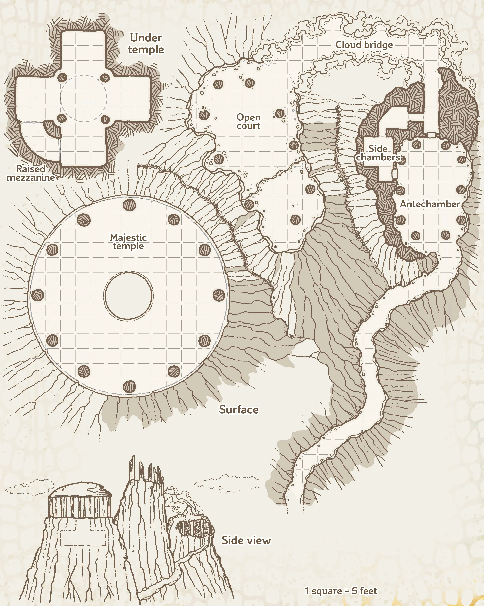

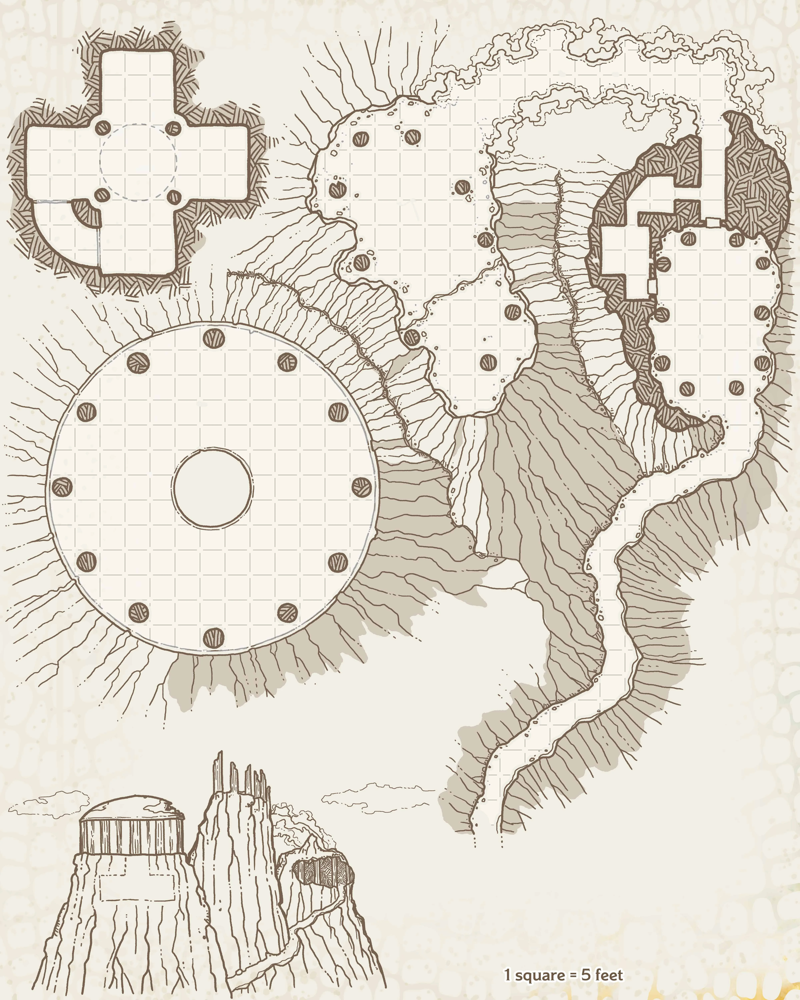

#### Silver Dragon Lair Features

The silver dragon lair shown in map 5.13 is composed of three connected sections—an antechamber, an open court, and a majestic temple. The lair has the following features:

- Antechamber

- Side Chambers

- Cloud Bridge

- Open Court

- Majestic Temple

- Under Temple

#### Additional Lair Action

At your discretion, a legendary ({@creature Adult Silver Dragon||adult} or {@creature Ancient Silver Dragon||ancient}) silver dragon can use the following additional lair action while in its lair:

- Icy Grip

#### D'argent

Like so many silver dragons, D'argent takes considerable interest in the matters of mortals on her home world of Krynn. The {@creature Ancient Silver Dragon||ancient dragon} rarely openly participates in heroics, preferring to help in more surreptitious ways. She has been known to join in the conflicts of mortals in disguise, either as a brave human knight or as a fierce elf healer with gleaming silver hair, named Silvara.

Though she is happy to remain in the background, D'argent's seeming placidity hides a brilliant intellect, and she has exposed the machinations of many chromatic dragons on Krynn. She is a romantic at heart, and it is said that she has fallen deeply for mortals more than once.

### Silver Dragon Treasures

More than anything else, silver dragons covet mementos from the people they interact with. Whether these are sentimental gifts worthless to anyone except their recipient or medals from a grateful monarch, silver dragons want them all. As such, many silver dragons have eclectic hoards brimming with trinkets and equipment from their own travels: from epaulets to hats, weapons to hunting horns, and even entire longships preserved with magic. Many also maintain a collection of portraits they've had commissioned over centuries to chronicle the ongoing changes in the art world. In some cases, these portraits are a dragon's most prized possessions.

Beyond such keepsakes, silver dragons prefer treasures that complement their natural coloration. Diamonds are much coveted, but also turquoise, malachite, and sapphires, all of pelagic hues like something plucked from the deep ocean. Some silver dragons also collect ornamental weapons or ingenious examples of technology.

## Topaz Dragons

A topaz dragon named Blustertail once complained to me that he hated water because it talked too much, whatever that means.

Use the tables, map, and other information in this section to craft unique encounters with topaz dragons. Topaz dragon stat blocks appear in {@book chapter 6|FTD|6|Topaz Dragons}.

### Creating a Topaz Dragon

Use the Topaz Dragon Personality Traits and Topaz Dragon Ideals tables to inspire your portrayal of distinctive topaz dragon characters.

### Topaz Dragon Adventures

The Topaz Dragon Adventure Hooks table offers suggestions for stories and adventures involving topaz dragons.

#### Connected Creatures

Topaz dragons rarely tolerate any company but their own, and they are usually indifferent at best even toward their own kind. Moreover, their unpredictability means that even if a creature proves itself useful to a topaz dragon, it shouldn't count on being safe from the dragon the next time they meet. Topaz dragons rarely go out of their way to fight other creatures, however, with the exception of bronze dragons, for whom they bear an inexplicably intense hatred.

### Topaz Dragon Lairs

Topaz dragons are happiest by the sea. They spend most of their time basking in the sun and have no desire to get wet, beyond enjoying a bit of sea spray in the air. But they love being able to see the water, so they build their lairs on the heights of seaside cliffs or near perfect sunbathing beaches where they can best accomplish this.

Their preference for lair sites frequently brings topaz dragons into conflict with other creatures, since they resent having to share their chosen scenic locations with anything that isn't food. They often abandon lairs to seek new vistas, so the interiors of their lairs often feel less finished than those of other dragons. Topaz dragons decorate their lairs with mirrors to make them look bigger and brighter, as well as fabric and objects in golden shades that complement their scales. They obsessively organize their hoards but almost never show them to anyone else.

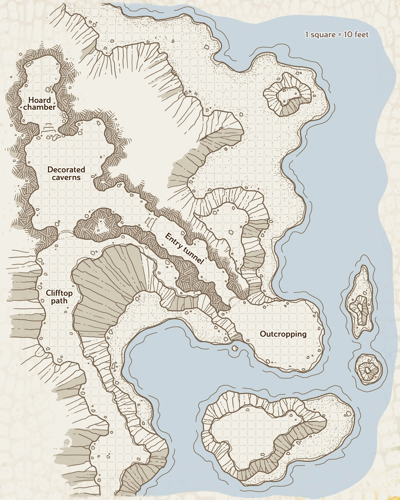

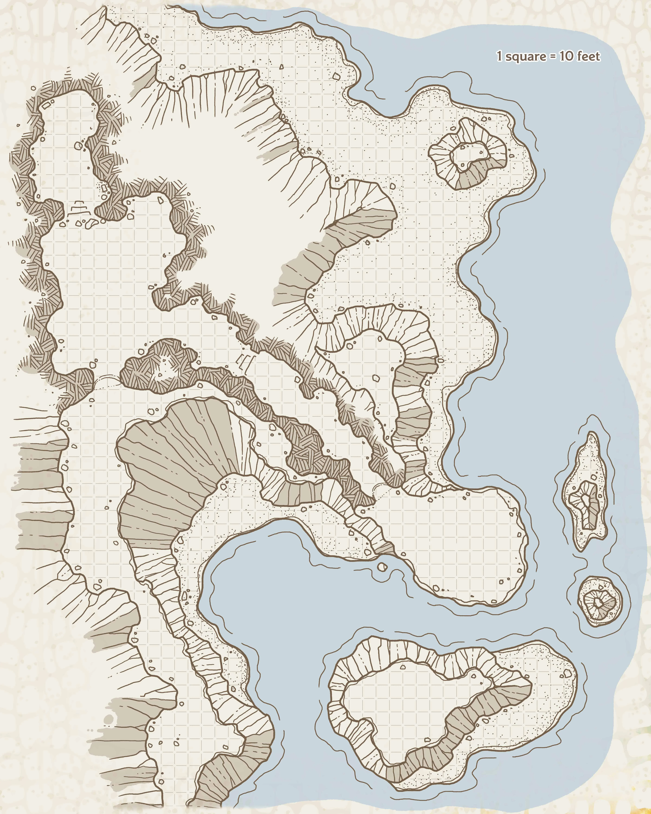

#### Topaz Dragon Lair Features

The topaz dragon lair shown in map 5.14 is situated among the rocky cliffs and beaches of a rugged coastline. The lair is set in a cavern complex near the top of the cliffs, 50 feet above the sandy beaches, outcroppings, and islands below. It has the following features:

- Outcropping

- Entry Tunnel

- Decorated Caverns

- Hoard Chamber

- Clifftop Path

- Islands

##### Astilabor

Like many greatwyrms, the topaz {@creature Topaz Greatwyrm|FTD|Astilabor} is often mistakenly identified as a dragon god—in this case, the god of greed. In many ways, she is an archetype for all dragonkind, embodying the desire to acquire and hoard wealth. Her desire is born not of greed, though, but rather from her study of the Material Plane, its magic, and dragons' interconnection with both. Dragons on many worlds acknowledge Astilabor as they establish new lairs to host their hoards, linking them to the magic of the surrounding region.

### Topaz Dragon Treasures

Topaz dragons despise anything made of bronze but love to hoard gold, as well as yellow and orange gems that coordinate with their scales. They also favor treasures with a nautical theme; images of the sun; and mirrors, which they use to gaze at their own reflections and to redirect sunlight into their caves.

Topaz dragons like to keep their lairs well lit and can spend endless hours watching the play of light upon their treasures. They sometimes obsessively arrange their hoards by minute gradations in color and set up mirrors around a hoard chamber to make the mass of treasure appear bigger. But whatever pride topaz dragons take in their hoard, they have little desire to show it off, so even those rare creatures who maintain cordial relationships with a topaz dragon are unlikely to ever see the dragon's treasures.

## White Dragons

I enjoy an animated debate... just not with a white dragon. Impossible and ignorant, all of them. The air must be different in their arctic latitudes.

Use the tables, map, and other information in this section to craft unique encounters with white dragons.

### Creating a White Dragon

Use the White Dragon Personality Traits and White Dragon Ideals tables to inspire your portrayal of distinctive white dragon characters, and use the White Dragon Spellcasting table to help select spells for a spellcasting dragon.

### White Dragon Adventures

The White Dragon Adventure Hooks table offers suggestions for stories and adventures involving white dragons.

#### Connected Creatures

Savage and territorial by nature, white dragons seldom set out to make alliances, though some come to understand the utility of doing so as they age. More often, white dragons encountered in the company of other creatures have been forced into an uneasy accommodation or a resentful servitude because they lack the power to dominate those companions outright.

### White Dragon Lairs

A white dragon's lair is a place of freezing temperatures and profound solitude. Forgotten mountain holds, inaccessible chasms, and frozen caverns buried deep beneath glacial ice are typical of the places white dragons seek out to make their homes.

White dragons enjoy the mournful sound of the wind and frequently choose lairs with long, winding tunnels down which icy gusts can travel. They seldom work to improve their lairs, but when they do, it is often to channel wind currents to create effects the dragon finds pleasing. The labyrinthine tunnels and the mirror-like icy surfaces in a white dragon's lair confound would-be thieves and might foil their escape.

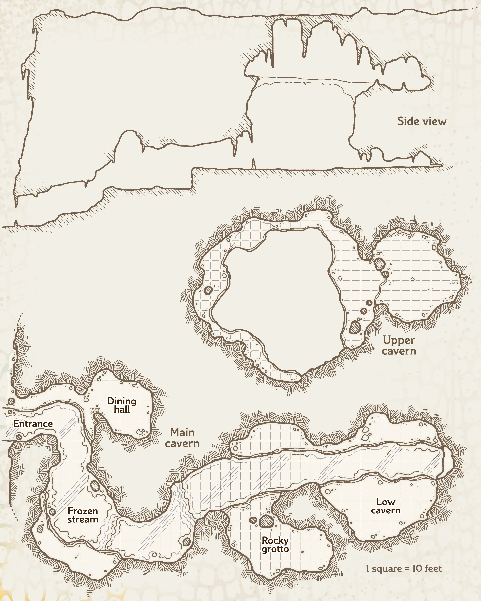

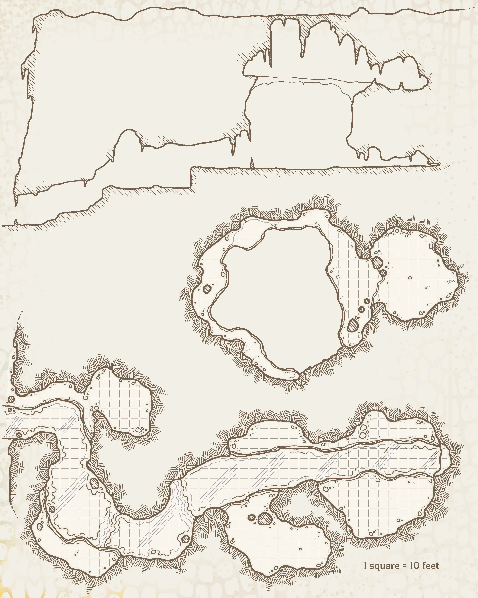

#### White Dragon Lair Features

The white dragon lair shown in map 5.15 is a natural stone grotto set in a cliff side capped by a glacial ice sheet. It has the following features:

- Cave Entrance

- Frozen Stream

- Dining Hall

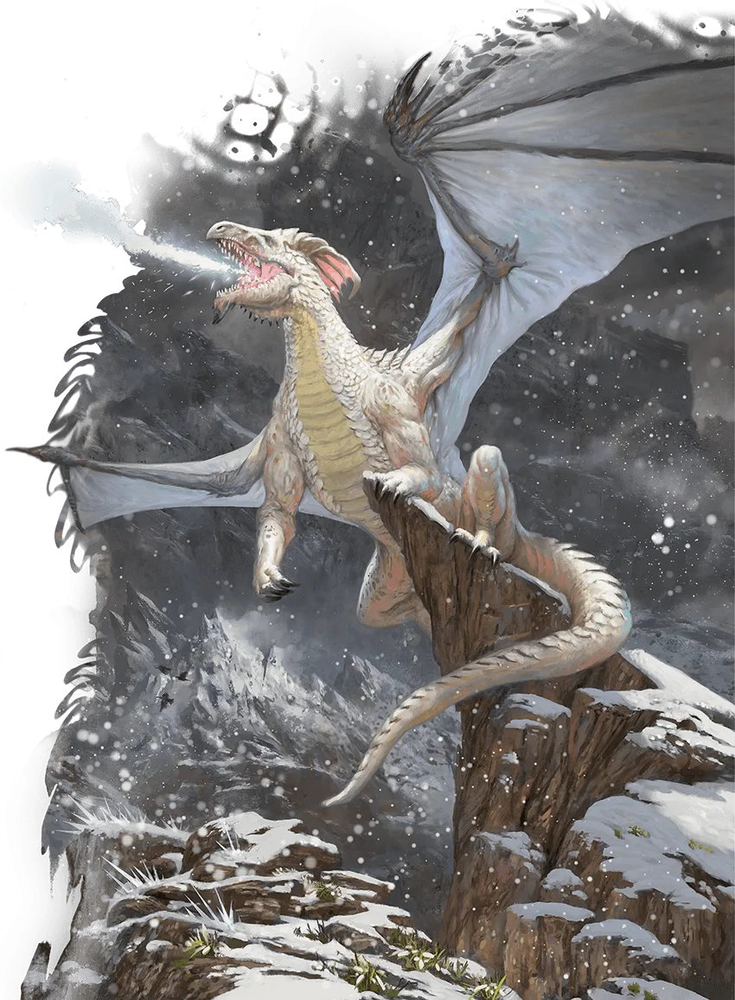

- Rocky Grotto

- Low Cavern

- Upper Cavern

- Icy Dome

#### Additional Lair Actions

At your discretion, a legendary ({@creature Adult White Dragon||adult} or {@creature Ancient White Dragon||ancient}) white dragon can use one or both of the following additional lair actions while in its lair:

- Blinding Sleet

- Whirling Wind

#### Regional Effects

Any of these effects might appear in the area around a white dragon's lair, in addition to or instead of the effects described in the {@book Monster Manual|MM}:

- Biting Chill

- Mirror Ice

### White Dragon Treasures

White dragons favor gems and precious metals that mirror the cold sparkle of ice. The floors of their lairs are often scattered with diamonds, moonstones, and quartz, as well as with silver and platinum coins, creating the impression of a river of stars when light spills across it. Though white dragons still value gold and copper, they usually bury such metals in pits filled with rock or snow to keep their yellow gleam from spoiling the look of their lair.

#### Rime

Rime is a prisoner to her past. This now- {@creature ancient white dragon} was raised in captivity, bred as a mount for an ancient knightly order. Mithral plates were magically fused to her skull and breastbone, bearing an enchantment binding her to the service of her rider. And though that rider and their order have been dead for centuries, the magic of the mithral plates still binds Rime to the place of her rider's demise. Only in the winter, when her powers are at their peak, can she range out from the ruined citadel that has become her lair to terrorize surrounding lands.

Rime's past experience makes her suspicious of all Humanoids, and she frequently vents her wrath on them without provocation. However, she suffers the presence of the cultists who have taken up residence in her lair, since they bring her food during the long months when she cannot hunt. Rime also seeks a way to rid herself of her mithral shackles and will warily engage in conversation with spellcasters who might help her. Failing that, her plan is to continue to amass treasure during her winter raids until she is powerful enough to break her bonds completely.

The greater part of a white dragon's hoard consists of trophies taken from defeated foes. Although these trophies include items such as mighty weapons or ornate regalia that are valuable treasures in their own right, they can just as easily be worthless junk. A white dragon hoards trophies not for their material value, but as testaments to the dragon's dominance. An {@creature Ancient White Dragon||ancient white dragon's} lair is a literal memory palace and a maze of rime-encrusted treasures that recount the story of the dragon's many victories.
