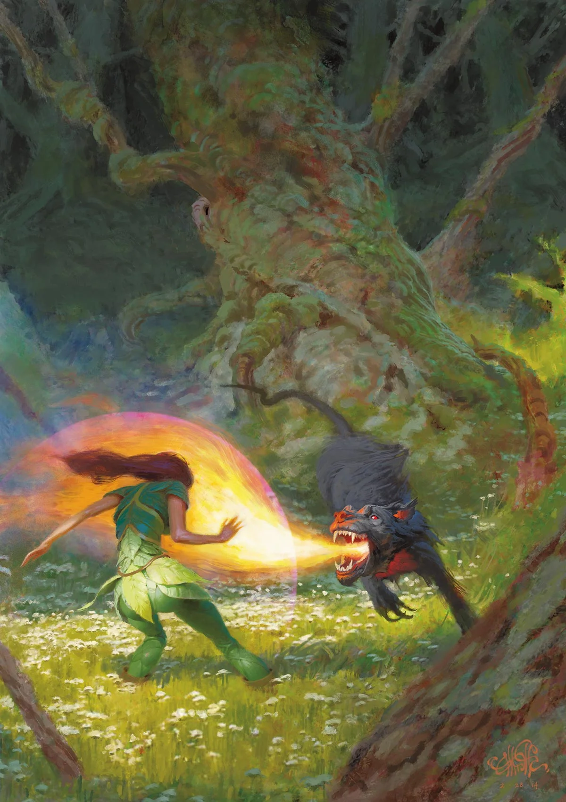

# Spells

> 英文原文鏡像；對應《Spells》p. 207。來源提供者：5e.tools。

# Spells

This chapter describes the most common spells in the worlds of Dungeons & Dragons. The chapter begins with the spell lists of the spellcasting classes. The remainder contains spell descriptions, presented in alphabetical order by the name of the spell.

## Bard Spells

### Cantrips (0 Level)

- {@spell Blade Ward}

- {@spell Dancing Lights}

- {@spell Friends}

- {@spell Light}

- {@spell Mage Hand}

- {@spell Mending}

- {@spell Message}

- {@spell Minor Illusion}

- {@spell Prestidigitation}

- {@spell True Strike}

- {@spell Vicious Mockery}

### 1st Level

- {@spell Animal Friendship}

- {@spell Bane}

- {@spell Charm Person}

- {@spell Comprehend Languages}

- {@spell Cure Wounds}

- {@spell Detect Magic}

- {@spell Disguise Self}

- {@spell Dissonant Whispers}

- {@spell Faerie Fire}

- {@spell Feather Fall}

- {@spell Healing Word}

- {@spell Heroism}

- {@spell Identify}

- {@spell Illusory Script}

- {@spell Longstrider}

- {@spell Silent Image}

- {@spell Sleep}

- {@spell Speak with Animals}

- {@spell Tasha's Hideous Laughter}

- {@spell Thunderwave}

- {@spell Unseen Servant}

### 2nd Level

- {@spell Animal Messenger}

- {@spell Blindness/Deafness}

- {@spell Calm Emotions}

- {@spell Cloud of Daggers}

- {@spell Crown of Madness}

- {@spell Detect Thoughts}

- {@spell Enhance Ability}

- {@spell Enthrall}

- {@spell Heat Metal}

- {@spell Hold Person}

- {@spell Invisibility}

- {@spell Knock}

- {@spell Lesser Restoration}

- {@spell Locate Animals or Plants}

- {@spell Locate Object}

- {@spell Magic Mouth}

- {@spell Phantasmal Force}

- {@spell See Invisibility}

- {@spell Shatter}

- {@spell Silence}

- {@spell Suggestion}

- {@spell Zone of Truth}

### 3rd Level

- {@spell Bestow Curse}

- {@spell Clairvoyance}

- {@spell Dispel Magic}

- {@spell Fear}

- {@spell Feign Death}

- {@spell Glyph of Warding}

- {@spell Hypnotic Pattern}

- {@spell Leomund's Tiny Hut}

- {@spell Major Image}

- {@spell Nondetection}

- {@spell Plant Growth}

- {@spell Sending}

- {@spell Speak with Dead}

- {@spell Speak with Plants}

- {@spell Stinking Cloud}

- {@spell Tongues}

### 4th Level

- {@spell Compulsion}

- {@spell Confusion}

- {@spell Dimension Door}

- {@spell Freedom of Movement}

- {@spell Greater Invisibility}

- {@spell Hallucinatory Terrain}

- {@spell Locate Creature}

- {@spell Polymorph}

### 5th Level

- {@spell Animate Objects}

- {@spell Awaken}

- {@spell Dominate Person}

- {@spell Dream}

- {@spell Geas}

- {@spell Greater Restoration}

- {@spell Hold Monster}

- {@spell Legend Lore}

- {@spell Mass Cure Wounds}

- {@spell Mislead}

- {@spell Modify Memory}

- {@spell Planar Binding}

- {@spell Raise Dead}

- {@spell Scrying}

- {@spell Seeming}

- {@spell Teleportation Circle}

### 6th Level

- {@spell Eyebite}

- {@spell Find the Path}

- {@spell Guards and Wards}

- {@spell Mass Suggestion}

- {@spell Otto's Irresistible Dance}

- {@spell Programmed Illusion}

- {@spell True Seeing}

### 7th Level

- {@spell Etherealness}

- {@spell Forcecage}

- {@spell Mirage Arcane}

- {@spell Mordenkainen's Magnificent Mansion}

- {@spell Mordenkainen's Sword}

- {@spell Project Image}

- {@spell Regenerate}

- {@spell Resurrection}

- {@spell Symbol}

- {@spell Teleport}

### 8th Level

- {@spell Dominate Monster}

- {@spell Feeblemind}

- {@spell Glibness}

- {@spell Mind Blank}

- {@spell Power Word Stun}

### 9th Level

- {@spell Foresight}

- {@spell Power Word Heal}

- {@spell Power Word Kill}

- {@spell True Polymorph}

## Cleric Spells

### Cantrips (0 Level)

- {@spell Guidance}

- {@spell Light}

- {@spell Mending}

- {@spell Resistance}

- {@spell Sacred Flame}

- {@spell Spare the Dying}

- {@spell Thaumaturgy}

### 1st Level

- {@spell Bane}

- {@spell Bless}

- {@spell Command}

- {@spell Create or Destroy Water}

- {@spell Cure Wounds}

- {@spell Detect Evil and Good}

- {@spell Detect Magic}

- {@spell Detect Poison and Disease}

- {@spell Guiding Bolt}

- {@spell Healing Word}

- {@spell Inflict Wounds}

- {@spell Protection from Evil and Good}

- {@spell Purify Food and Drink}

- {@spell Sanctuary}

- {@spell Shield of Faith}

### 2nd Level

- {@spell Aid}

- {@spell Augury}

- {@spell Blindness/Deafness}

- {@spell Calm Emotions}

- {@spell Continual Flame}

- {@spell Enhance Ability}

- {@spell Find Traps}

- {@spell Gentle Repose}

- {@spell Hold Person}

- {@spell Lesser Restoration}

- {@spell Locate Object}

- {@spell Prayer of Healing}

- {@spell Protection from Poison}

- {@spell Silence}

- {@spell Spiritual Weapon}

- {@spell Warding Bond}

- {@spell Zone of Truth}

### 3rd Level

- {@spell Animate Dead}

- {@spell Beacon of Hope}

- {@spell Bestow Curse}

- {@spell Clairvoyance}

- {@spell Create Food and Water}

- {@spell Daylight}

- {@spell Dispel Magic}

- {@spell Feign Death}

- {@spell Glyph of Warding}

- {@spell Magic Circle}

- {@spell Mass Healing Word}

- {@spell Meld into Stone}

- {@spell Protection from Energy}

- {@spell Remove Curse}

- {@spell Revivify}

- {@spell Sending}

- {@spell Speak with Dead}

- {@spell Spirit Guardians}

- {@spell Tongues}

- {@spell Water Walk}

### 4th Level

- {@spell Banishment}

- {@spell Control Water}

- {@spell Death Ward}

- {@spell Divination}

- {@spell Freedom of Movement}

- {@spell Guardian of Faith}

- {@spell Locate Creature}

- {@spell Stone Shape}

### 5th Level

- {@spell Commune}

- {@spell Contagion}

- {@spell Dispel Evil and Good}

- {@spell Flame Strike}

- {@spell Geas}

- {@spell Greater Restoration}

- {@spell Hallow}

- {@spell Insect Plague}

- {@spell Legend Lore}

- {@spell Mass Cure Wounds}

- {@spell Planar Binding}

- {@spell Raise Dead}

- {@spell Scrying}

### 6th Level

- {@spell Blade Barrier}

- {@spell Create Undead}

- {@spell Find the Path}

- {@spell Forbiddance}

- {@spell Harm}

- {@spell Heal}

- {@spell Heroes' Feast}

- {@spell Planar Ally}

- {@spell True Seeing}

- {@spell Word of Recall}

### 7th Level

- {@spell Conjure Celestial}

- {@spell Divine Word}

- {@spell Etherealness}

- {@spell Fire Storm}

- {@spell Plane Shift}

- {@spell Regenerate}

- {@spell Resurrection}

- {@spell Symbol}

### 8th Level

- {@spell Antimagic Field}

- {@spell Control Weather}

- {@spell Earthquake}

- {@spell Holy Aura}

### 9th Level

- {@spell Astral Projection}

- {@spell Gate}

- {@spell Mass Heal}

- {@spell True Resurrection}

## Druid Spells

### Cantrips (0 Level)

- {@spell Druidcraft}

- {@spell Guidance}

- {@spell Mending}

- {@spell Poison Spray}

- {@spell Produce Flame}

- {@spell Resistance}

- {@spell Shillelagh}

- {@spell Thorn Whip}

### 1st Level

- {@spell Animal Friendship}

- {@spell Charm Person}

- {@spell Create or Destroy Water}

- {@spell Cure Wounds}

- {@spell Detect Magic}

- {@spell Detect Poison and Disease}

- {@spell Entangle}

- {@spell Faerie Fire}

- {@spell Fog Cloud}

- {@spell Goodberry}

- {@spell Healing Word}

- {@spell Jump}

- {@spell Longstrider}

- {@spell Purify Food and Drink}

- {@spell Speak with Animals}

- {@spell Thunderwave}

### 2nd Level

- {@spell Animal Messenger}

- {@spell Barkskin}

- {@spell Beast Sense}

- {@spell Darkvision}

- {@spell Enhance Ability}

- {@spell Find Traps}

- {@spell Flame Blade}

- {@spell Flaming Sphere}

- {@spell Gust of Wind}

- {@spell Heat Metal}

- {@spell Hold Person}

- {@spell Lesser Restoration}

- {@spell Locate Animals or Plants}

- {@spell Locate Object}

- {@spell Moonbeam}

- {@spell Pass without Trace}

- {@spell Protection from Poison}

- {@spell Spike Growth}

### 3rd Level

- {@spell Call Lightning}

- {@spell Conjure Animals}

- {@spell Daylight}

- {@spell Dispel Magic}

- {@spell Feign Death}

- {@spell Meld into Stone}

- {@spell Plant Growth}

- {@spell Protection from Energy}

- {@spell Sleet Storm}

- {@spell Speak with Plants}

- {@spell Water Breathing}

- {@spell Water Walk}

- {@spell Wind Wall}

### 4th Level

- {@spell Blight}

- {@spell Confusion}

- {@spell Conjure Minor Elementals}

- {@spell Conjure Woodland Beings}

- {@spell Control Water}

- {@spell Dominate Beast}

- {@spell Freedom of Movement}

- {@spell Giant Insect}

- {@spell Grasping Vine}

- {@spell Hallucinatory Terrain}

- {@spell Ice Storm}

- {@spell Locate Creature}

- {@spell Polymorph}

- {@spell Stone Shape}

- {@spell Stoneskin}

- {@spell Wall of Fire}

### 5th Level

- {@spell Antilife Shell}

- {@spell Awaken}

- {@spell Commune with Nature}

- {@spell Conjure Elemental}

- {@spell Contagion}

- {@spell Geas}

- {@spell Greater Restoration}

- {@spell Insect Plague}

- {@spell Mass Cure Wounds}

- {@spell Planar Binding}

- {@spell Reincarnate}

- {@spell Scrying}

- {@spell Tree Stride}

- {@spell Wall of Stone}

### 6th Level

- {@spell Conjure Fey}

- {@spell Find the Path}

- {@spell Heal}

- {@spell Heroes' Feast}

- {@spell Move Earth}

- {@spell Sunbeam}

- {@spell Transport via Plants}

- {@spell Wall of Thorns}

- {@spell Wind Walk}

### 7th Level

- {@spell Fire Storm}

- {@spell Mirage Arcane}

- {@spell Plane Shift}

- {@spell Regenerate}

- {@spell Reverse Gravity}

### 8th Level

- {@spell Animal Shapes}

- {@spell Antipathy/Sympathy}

- {@spell Control Weather}

- {@spell Earthquake}

- {@spell Feeblemind}

- {@spell Sunburst}

- {@spell Tsunami}

### 9th Level

- {@spell Foresight}

- {@spell Shapechange}

- {@spell Storm of Vengeance}

- {@spell True Resurrection}

## Paladin Spells

### 1st Level

- {@spell Bless}

- {@spell Command}

- {@spell Compelled Duel}

- {@spell Cure Wounds}

- {@spell Detect Evil and Good}

- {@spell Detect Magic}

- {@spell Detect Poison and Disease}

- {@spell Divine Favor}

- {@spell Heroism}

- {@spell Protection from Evil and Good}

- {@spell Purify Food and Drink}

- {@spell Searing Smite}

- {@spell Shield of Faith}

- {@spell Thunderous Smite}

- {@spell Wrathful Smite}

### 2nd Level

- {@spell Aid}

- {@spell Branding Smite}

- {@spell Find Steed}

- {@spell Lesser Restoration}

- {@spell Locate Object}

- {@spell Magic Weapon}

- {@spell Protection from Poison}

- {@spell Zone of Truth}

### 3rd Level

- {@spell Aura of Vitality}

- {@spell Blinding Smite}

- {@spell Create Food and Water}

- {@spell Crusader's Mantle}

- {@spell Daylight}

- {@spell Dispel Magic}

- {@spell Elemental Weapon}

- {@spell Magic Circle}

- {@spell Remove Curse}

- {@spell Revivify}

### 4th Level

- {@spell Aura of Life}

- {@spell Aura of Purity}

- {@spell Banishment}

- {@spell Death Ward}

- {@spell Locate Creature}

- {@spell Staggering Smite}

### 5th Level

- {@spell Banishing Smite}

- {@spell Circle of Power}

- {@spell Destructive Wave}

- {@spell Dispel Evil and Good}

- {@spell Geas}

- {@spell Raise Dead}

## Ranger Spells

### 1st Level

- {@spell Alarm}

- {@spell Animal Friendship}

- {@spell Cure Wounds}

- {@spell Detect Magic}

- {@spell Detect Poison and Disease}

- {@spell Ensnaring Strike}

- {@spell Fog Cloud}

- {@spell Goodberry}

- {@spell Hail of Thorns}

- {@spell Hunter's Mark}

- {@spell Jump}

- {@spell Longstrider}

- {@spell Speak with Animals}

### 2nd Level

- {@spell Animal Messenger}

- {@spell Barkskin}

- {@spell Beast Sense}

- {@spell Cordon of Arrows}

- {@spell Darkvision}

- {@spell Find Traps}

- {@spell Lesser Restoration}

- {@spell Locate Animals or Plants}

- {@spell Locate Object}

- {@spell Pass without Trace}

- {@spell Protection from Poison}

- {@spell Silence}

- {@spell Spike Growth}

### 3rd Level

- {@spell Conjure Animals}

- {@spell Conjure Barrage}

- {@spell Daylight}

- {@spell Lightning Arrow}

- {@spell Nondetection}

- {@spell Plant Growth}

- {@spell Protection from Energy}

- {@spell Speak with Plants}

- {@spell Water Breathing}

- {@spell Water Walk}

- {@spell Wind Wall}

### 4th Level

- {@spell Conjure Woodland Beings}

- {@spell Freedom of Movement}

- {@spell Grasping Vine}

- {@spell Locate Creature}

- {@spell Stoneskin}

### 5th Level

- {@spell Commune with Nature}

- {@spell Conjure Volley}

- {@spell Swift Quiver}

- {@spell Tree Stride}

## Sorcerer Spells

### Cantrips (0 Level)

- {@spell Acid Splash}

- {@spell Blade Ward}

- {@spell Chill Touch}

- {@spell Dancing Lights}

- {@spell Fire Bolt}

- {@spell Friends}

- {@spell Light}

- {@spell Mage Hand}

- {@spell Mending}

- {@spell Message}

- {@spell Minor Illusion}

- {@spell Poison Spray}

- {@spell Prestidigitation}

- {@spell Ray of Frost}

- {@spell Shocking Grasp}

- {@spell True Strike}

### 1st Level

- {@spell Burning Hands}

- {@spell Charm Person}

- {@spell Chromatic Orb}

- {@spell Color Spray}

- {@spell Comprehend Languages}

- {@spell Detect Magic}

- {@spell Disguise Self}

- {@spell Expeditious Retreat}

- {@spell False Life}

- {@spell Feather Fall}

- {@spell Fog Cloud}

- {@spell Jump}

- {@spell Mage Armor}

- {@spell Magic Missile}

- {@spell Ray of Sickness}

- {@spell Shield}

- {@spell Silent Image}

- {@spell Sleep}

- {@spell Thunderwave}

- {@spell Witch Bolt}

### 2nd Level

- {@spell Alter Self}

- {@spell Blindness/Deafness}

- {@spell Blur}

- {@spell Cloud of Daggers}

- {@spell Crown of Madness}

- {@spell Darkness}

- {@spell Darkvision}

- {@spell Detect Thoughts}

- {@spell Enhance Ability}

- {@spell Enlarge/Reduce}

- {@spell Gust of Wind}

- {@spell Hold Person}

- {@spell Invisibility}

- {@spell Knock}

- {@spell Levitate}

- {@spell Mirror Image}

- {@spell Misty Step}

- {@spell Phantasmal Force}

- {@spell Scorching Ray}

- {@spell See Invisibility}

- {@spell Shatter}

- {@spell Spider Climb}

- {@spell Suggestion}

- {@spell Web}

### 3rd Level

- {@spell Blink}

- {@spell Clairvoyance}

- {@spell Counterspell}

- {@spell Daylight}

- {@spell Dispel Magic}

- {@spell Fear}

- {@spell Fireball}

- {@spell Fly}

- {@spell Gaseous Form}

- {@spell Haste}

- {@spell Hypnotic Pattern}

- {@spell Lightning Bolt}

- {@spell Major Image}

- {@spell Protection from Energy}

- {@spell Sleet Storm}

- {@spell Slow}

- {@spell Stinking Cloud}

- {@spell Tongues}

- {@spell Water Breathing}

- {@spell Water Walk}

### 4th Level

- {@spell Banishment}

- {@spell Blight}

- {@spell Confusion}

- {@spell Dimension Door}

- {@spell Dominate Beast}

- {@spell Greater Invisibility}

- {@spell Ice Storm}

- {@spell Polymorph}

- {@spell Stoneskin}

- {@spell Wall of Fire}

### 5th Level

- {@spell Animate Objects}

- {@spell Cloudkill}

- {@spell Cone of Cold}

- {@spell Creation}

- {@spell Dominate Person}

- {@spell Hold Monster}

- {@spell Insect Plague}

- {@spell Seeming}

- {@spell Telekinesis}

- {@spell Teleportation Circle}

- {@spell Wall of Stone}

### 6th Level

- {@spell Arcane Gate}

- {@spell Chain Lightning}

- {@spell Circle of Death}

- {@spell Disintegrate}

- {@spell Eyebite}

- {@spell Globe of Invulnerability}

- {@spell Mass Suggestion}

- {@spell Move Earth}

- {@spell Sunbeam}

- {@spell True Seeing}

### 7th Level

- {@spell Delayed Blast Fireball}

- {@spell Etherealness}

- {@spell Finger of Death}

- {@spell Fire Storm}

- {@spell Plane Shift}

- {@spell Prismatic Spray}

- {@spell Reverse Gravity}

- {@spell Teleport}

### 8th Level

- {@spell Dominate Monster}

- {@spell Earthquake}

- {@spell Incendiary Cloud}

- {@spell Power Word Stun}

- {@spell Sunburst}

### 9th Level

- {@spell Gate}

- {@spell Meteor Swarm}

- {@spell Power Word Kill}

- {@spell Time Stop}

- {@spell Wish}

## Warlock Spells

### Cantrips (0 Level)

- {@spell Blade Ward}

- {@spell Chill Touch}

- {@spell Eldritch Blast}

- {@spell Friends}

- {@spell Mage Hand}

- {@spell Minor Illusion}

- {@spell Poison Spray}

- {@spell Prestidigitation}

- {@spell True Strike}

### 1st Level

- {@spell Armor of Agathys}

- {@spell Arms of Hadar}

- {@spell Charm Person}

- {@spell Comprehend Languages}

- {@spell Expeditious Retreat}

- {@spell Hellish Rebuke}

- {@spell Hex}

- {@spell Illusory Script}

- {@spell Protection from Evil and Good}

- {@spell Unseen Servant}

- {@spell Witch Bolt}

### 2nd Level

- {@spell Cloud of Daggers}

- {@spell Crown of Madness}

- {@spell Darkness}

- {@spell Enthrall}

- {@spell Hold Person}

- {@spell Invisibility}

- {@spell Mirror Image}

- {@spell Misty Step}

- {@spell Ray of Enfeeblement}

- {@spell Shatter}

- {@spell Spider Climb}

- {@spell Suggestion}

### 3rd Level

- {@spell Counterspell}

- {@spell Dispel Magic}

- {@spell Fear}

- {@spell Fly}

- {@spell Gaseous Form}

- {@spell Hunger of Hadar}

- {@spell Hypnotic Pattern}

- {@spell Magic Circle}

- {@spell Major Image}

- {@spell Remove Curse}

- {@spell Tongues}

- {@spell Vampiric Touch}

### 4th Level

- {@spell Banishment}

- {@spell Blight}

- {@spell Dimension Door}

- {@spell Hallucinatory Terrain}

### 5th Level

- {@spell Contact Other Plane}

- {@spell Dream}

- {@spell Hold Monster}

- {@spell Scrying}

### 6th Level

- {@spell Arcane Gate}

- {@spell Circle of Death}

- {@spell Conjure Fey}

- {@spell Create Undead}

- {@spell Eyebite}

- {@spell Flesh to Stone}

- {@spell Mass Suggestion}

- {@spell True Seeing}

### 7th Level

- {@spell Etherealness}

- {@spell Finger of Death}

- {@spell Forcecage}

- {@spell Plane Shift}

### 8th Level

- {@spell Demiplane}

- {@spell Dominate Monster}

- {@spell Feeblemind}

- {@spell Glibness}

- {@spell Power Word Stun}

### 9th Level

- {@spell Astral Projection}

- {@spell Foresight}

- {@spell Imprisonment}

- {@spell Power Word Kill}

- {@spell True Polymorph}

## Wizard Spells

### Cantrips (0 Level)

- {@spell Acid Splash}

- {@spell Blade Ward}

- {@spell Chill Touch}

- {@spell Dancing Lights}

- {@spell Fire Bolt}

- {@spell Friends}

- {@spell Light}

- {@spell Mage Hand}

- {@spell Mending}

- {@spell Message}

- {@spell Minor Illusion}

- {@spell Poison Spray}

- {@spell Prestidigitation}

- {@spell Ray of Frost}

- {@spell Shocking Grasp}

- {@spell True Strike}

### 1st Level

- {@spell Alarm}

- {@spell Burning Hands}

- {@spell Charm Person}

- {@spell Chromatic Orb}

- {@spell Color Spray}

- {@spell Comprehend Languages}

- {@spell Detect Magic}

- {@spell Disguise Self}

- {@spell Expeditious Retreat}

- {@spell False Life}

- {@spell Feather Fall}

- {@spell Find Familiar}

- {@spell Fog Cloud}

- {@spell Grease}

- {@spell Identify}

- {@spell Illusory Script}

- {@spell Jump}

- {@spell Longstrider}

- {@spell Mage Armor}

- {@spell Magic Missile}

- {@spell Protection from Evil and Good}

- {@spell Ray of Sickness}

- {@spell Shield}

- {@spell Silent Image}

- {@spell Sleep}

- {@spell Tasha's Hideous Laughter}

- {@spell Tenser's Floating Disk}

- {@spell Thunderwave}

- {@spell Unseen Servant}

- {@spell Witch Bolt}

### 2nd Level

- {@spell Alter Self}

- {@spell Arcane Lock}

- {@spell Blindness/Deafness}

- {@spell Blur}

- {@spell Cloud of Daggers}

- {@spell Continual Flame}

- {@spell Crown of Madness}

- {@spell Darkness}

- {@spell Darkvision}

- {@spell Detect Thoughts}

- {@spell Enlarge/Reduce}

- {@spell Flaming Sphere}

- {@spell Gentle Repose}

- {@spell Gust of Wind}

- {@spell Hold Person}

- {@spell Invisibility}

- {@spell Knock}

- {@spell Levitate}

- {@spell Locate Object}

- {@spell Magic Mouth}

- {@spell Magic Weapon}

- {@spell Melf's Acid Arrow}

- {@spell Mirror Image}

- {@spell Misty Step}

- {@spell Nystul's Magic Aura}

- {@spell Phantasmal Force}

- {@spell Ray of Enfeeblement}

- {@spell Rope Trick}

- {@spell Scorching Ray}

- {@spell See Invisibility}

- {@spell Shatter}

- {@spell Spider Climb}

- {@spell Suggestion}

- {@spell Web}

### 3rd Level

- {@spell Animate Dead}

- {@spell Bestow Curse}

- {@spell Blink}

- {@spell Clairvoyance}

- {@spell Counterspell}

- {@spell Dispel Magic}

- {@spell Fear}

- {@spell Feign Death}

- {@spell Fireball}

- {@spell Fly}

- {@spell Gaseous Form}

- {@spell Glyph of Warding}

- {@spell Haste}

- {@spell Hypnotic Pattern}

- {@spell Leomund's Tiny Hut}

- {@spell Lightning Bolt}

- {@spell Magic Circle}

- {@spell Major Image}

- {@spell Nondetection}

- {@spell Phantom Steed}

- {@spell Protection from Energy}

- {@spell Remove Curse}

- {@spell Sending}

- {@spell Sleet Storm}

- {@spell Slow}

- {@spell Stinking Cloud}

- {@spell Tongues}

- {@spell Vampiric Touch}

- {@spell Water Breathing}

### 4th Level

- {@spell Arcane Eye}

- {@spell Banishment}

- {@spell Blight}

- {@spell Confusion}

- {@spell Conjure Minor Elementals}

- {@spell Control Water}

- {@spell Dimension Door}

- {@spell Evard's Black Tentacles}

- {@spell Fabricate}

- {@spell Fire Shield}

- {@spell Greater Invisibility}

- {@spell Hallucinatory Terrain}

- {@spell Ice Storm}

- {@spell Leomund's Secret Chest}

- {@spell Locate Creature}

- {@spell Mordenkainen's Faithful Hound}

- {@spell Mordenkainen's Private Sanctum}

- {@spell Otiluke's Resilient Sphere}

- {@spell Phantasmal Killer}

- {@spell Polymorph}

- {@spell Stone Shape}

- {@spell Stoneskin}

- {@spell Wall of Fire}

### 5th Level

- {@spell Animate Objects}

- {@spell Bigby's Hand}

- {@spell Cloudkill}

- {@spell Cone of Cold}

- {@spell Conjure Elemental}

- {@spell Contact Other Plane}

- {@spell Creation}

- {@spell Dominate Person}

- {@spell Dream}

- {@spell Geas}

- {@spell Hold Monster}

- {@spell Legend Lore}

- {@spell Mislead}

- {@spell Modify Memory}

- {@spell Passwall}

- {@spell Planar Binding}

- {@spell Rary's Telepathic Bond}

- {@spell Scrying}

- {@spell Seeming}

- {@spell Telekinesis}

- {@spell Teleportation Circle}

- {@spell Wall of Force}

- {@spell Wall of Stone}

### 6th Level

- {@spell Arcane Gate}

- {@spell Chain Lightning}

- {@spell Circle of Death}

- {@spell Contingency}

- {@spell Create Undead}

- {@spell Disintegrate}

- {@spell Drawmij's Instant Summons}

- {@spell Eyebite}

- {@spell Flesh to Stone}

- {@spell Globe of Invulnerability}

- {@spell Guards and Wards}

- {@spell Magic Jar}

- {@spell Mass Suggestion}

- {@spell Move Earth}

- {@spell Otiluke's Freezing Sphere}

- {@spell Otto's Irresistible Dance}

- {@spell Programmed Illusion}

- {@spell Sunbeam}

- {@spell True Seeing}

- {@spell Wall of Ice}

### 7th Level

- {@spell Delayed Blast Fireball}

- {@spell Etherealness}

- {@spell Finger of Death}

- {@spell Forcecage}

- {@spell Mirage Arcane}

- {@spell Mordenkainen's Magnificent Mansion}

- {@spell Mordenkainen's Sword}

- {@spell Plane Shift}

- {@spell Prismatic Spray}

- {@spell Project Image}

- {@spell Reverse Gravity}

- {@spell Sequester}

- {@spell Simulacrum}

- {@spell Symbol}

- {@spell Teleport}

### 8th Level

- {@spell Antimagic Field}

- {@spell Antipathy/Sympathy}

- {@spell Clone}

- {@spell Control Weather}

- {@spell Demiplane}

- {@spell Dominate Monster}

- {@spell Feeblemind}

- {@spell Incendiary Cloud}

- {@spell Maze}

- {@spell Mind Blank}

- {@spell Power Word Stun}

- {@spell Sunburst}

- {@spell Telepathy}

### 9th Level

- {@spell Astral Projection}

- {@spell Foresight}

- {@spell Gate}

- {@spell Imprisonment}

- {@spell Meteor Swarm}

- {@spell Power Word Kill}

- {@spell Prismatic Wall}

- {@spell Shapechange}

- {@spell Time Stop}

- {@spell True Polymorph}

- {@spell Weird}

- {@spell Wish}

## Spell Descriptions

The spells are presented in alphabetical order.

- {@spell Acid Splash}

- {@spell Aid}

- {@spell Alarm}

- {@spell Alter Self}

- {@spell Animal Friendship}

- {@spell Animal Messenger}

- {@spell Animal Shapes}

- {@spell Animate Dead}

- {@spell Animate Objects}

- {@spell Antilife Shell}

- {@spell Antimagic Field}

- {@spell Antipathy/Sympathy}

- {@spell Arcane Eye}

- {@spell Arcane Gate}

- {@spell Arcane Lock}

- {@spell Armor of Agathys}

- {@spell Arms of Hadar}

- {@spell Astral Projection}

- {@spell Augury}

- {@spell Aura of Life}

- {@spell Aura of Purity}

- {@spell Aura of Vitality}

- {@spell Awaken}

- {@spell Bane}

- {@spell Banishing Smite}

- {@spell Banishment}

- {@spell Barkskin}

- {@spell Beacon of Hope}

- {@spell Beast Sense}

- {@spell Bestow Curse}

- {@spell Bigby's Hand}

- {@spell Blade Barrier}

- {@spell Blade Ward}

- {@spell Bless}

- {@spell Blight}

- {@spell Blinding Smite}

- {@spell Blindness/Deafness}

- {@spell Blink}

- {@spell Blur}

- {@spell Branding Smite}

- {@spell Burning Hands}

- {@spell Call Lightning}

- {@spell Calm Emotions}

- {@spell Chain Lightning}

- {@spell Charm Person}

- {@spell Chill Touch}

- {@spell Chromatic Orb}

- {@spell Circle of Death}

- {@spell Circle of Power}

- {@spell Clairvoyance}

- {@spell Clone}

- {@spell Cloud of Daggers}

- {@spell Cloudkill}

- {@spell Color Spray}

- {@spell Command}

- {@spell Commune}

- {@spell Commune with Nature}

- {@spell Compelled Duel}

- {@spell Comprehend Languages}

- {@spell Compulsion}

- {@spell Cone of Cold}

- {@spell Confusion}

- {@spell Conjure Animals}

- {@spell Conjure Barrage}

- {@spell Conjure Celestial}

- {@spell Conjure Elemental}

- {@spell Conjure Fey}

- {@spell Conjure Minor Elementals}

- {@spell Conjure Volley}

- {@spell Conjure Woodland Beings}

- {@spell Contact Other Plane}

- {@spell Contagion}

- {@spell Contingency}

- {@spell Continual Flame}

- {@spell Control Water}

- {@spell Control Weather}

- {@spell Cordon of Arrows}

- {@spell Counterspell}

- {@spell Create Food and Water}

- {@spell Create or Destroy Water}

- {@spell Create Undead}

- {@spell Creation}

- {@spell Crown of Madness}

- {@spell Crusader's Mantle}

- {@spell Cure Wounds}

- {@spell Dancing Lights}

- {@spell Darkness}

- {@spell Darkvision}

- {@spell Daylight}

- {@spell Death Ward}

- {@spell Delayed Blast Fireball}

- {@spell Demiplane}

- {@spell Destructive Wave}

- {@spell Detect Evil and Good}

- {@spell Detect Magic}

- {@spell Detect Poison and Disease}

- {@spell Detect Thoughts}

- {@spell Dimension Door}

- {@spell Disguise Self}

- {@spell Disintegrate}

- {@spell Dispel Evil and Good}

- {@spell Dispel Magic}

- {@spell Dissonant Whispers}

- {@spell Divination}

- {@spell Divine Favor}

- {@spell Divine Word}

- {@spell Dominate Beast}

- {@spell Dominate Monster}

- {@spell Dominate Person}

- {@spell Drawmij's Instant Summons}

- {@spell Dream}

- {@spell Druidcraft}

- {@spell Earthquake}

- {@spell Eldritch Blast}

- {@spell Elemental Weapon}

- {@spell Enhance Ability}

- {@spell Enlarge/Reduce}

- {@spell Ensnaring Strike}

- {@spell Entangle}

- {@spell Enthrall}

- {@spell Etherealness}

- {@spell Evard's Black Tentacles}

- {@spell Expeditious Retreat}

- {@spell Eyebite}

- {@spell Fabricate}

- {@spell Faerie Fire}

- {@spell False Life}

- {@spell Fear}

- {@spell Feather Fall}

- {@spell Feeblemind}

- {@spell Feign Death}

- {@spell Find Familiar}

- {@spell Find Steed}

- {@spell Find the Path}

- {@spell Find Traps}

- {@spell Finger of Death}

- {@spell Fire Bolt}

- {@spell Fire Shield}

- {@spell Fire Storm}

- {@spell Fireball}

- {@spell Flame Blade}

- {@spell Flame Strike}

- {@spell Flaming Sphere}

- {@spell Flesh to Stone}

- {@spell Fly}

- {@spell Fog Cloud}

- {@spell Forbiddance}

- {@spell Forcecage}

- {@spell Foresight}

- {@spell Freedom of Movement}

- {@spell Friends}

- {@spell Gaseous Form}

- {@spell Gate}

- {@spell Geas}

- {@spell Gentle Repose}

- {@spell Giant Insect}

- {@spell Glibness}

- {@spell Globe of Invulnerability}

- {@spell Glyph of Warding}

- {@spell Goodberry}

- {@spell Grasping Vine}

- {@spell Grease}

- {@spell Greater Invisibility}

- {@spell Greater Restoration}

- {@spell Guardian of Faith}

- {@spell Guards and Wards}

- {@spell Guidance}

- {@spell Guiding Bolt}

- {@spell Gust of Wind}

- {@spell Hail of Thorns}

- {@spell Hallow}

- {@spell Hallucinatory Terrain}

- {@spell Harm}

- {@spell Haste}

- {@spell Heal}

- {@spell Healing Word}

- {@spell Heat Metal}

- {@spell Hellish Rebuke}

- {@spell Heroes' Feast}

- {@spell Heroism}

- {@spell Hex}

- {@spell Hold Monster}

- {@spell Hold Person}

- {@spell Holy Aura}

- {@spell Hunger of Hadar}

- {@spell Hunter's Mark}

- {@spell Hypnotic Pattern}

- {@spell Ice Storm}

- {@spell Identify}

- {@spell Illusory Script}

- {@spell Imprisonment}

- {@spell Incendiary Cloud}

- {@spell Inflict Wounds}

- {@spell Insect Plague}

- {@spell Invisibility}

- {@spell Jump}

- {@spell Knock}

- {@spell Legend Lore}

- {@spell Leomund's Secret Chest}

- {@spell Leomund's Tiny Hut}

- {@spell Lesser Restoration}

- {@spell Levitate}

- {@spell Light}

- {@spell Lightning Arrow}

- {@spell Lightning Bolt}

- {@spell Locate Animals or Plants}

- {@spell Locate Creature}

- {@spell Locate Object}

- {@spell Longstrider}

- {@spell Mage Armor}

- {@spell Mage Hand}

- {@spell Magic Circle}

- {@spell Magic Jar}

- {@spell Magic Missile}

- {@spell Magic Mouth}

- {@spell Magic Weapon}

- {@spell Major Image}

- {@spell Mass Cure Wounds}

- {@spell Mass Heal}

- {@spell Mass Healing Word}

- {@spell Mass Suggestion}

- {@spell Maze}

- {@spell Meld into Stone}

- {@spell Melf's Acid Arrow}

- {@spell Mending}

- {@spell Message}

- {@spell Meteor Swarm}

- {@spell Mind Blank}

- {@spell Minor Illusion}

- {@spell Mirage Arcane}

- {@spell Mirror Image}

- {@spell Mislead}

- {@spell Misty Step}

- {@spell Modify Memory}

- {@spell Moonbeam}

- {@spell Mordenkainen's Faithful Hound}

- {@spell Mordenkainen's Magnificent Mansion}

- {@spell Mordenkainen's Private Sanctum}

- {@spell Mordenkainen's Sword}

- {@spell Move Earth}

- {@spell Nondetection}

- {@spell Nystul's Magic Aura}

- {@spell Otiluke's Freezing Sphere}

- {@spell Otiluke's Resilient Sphere}

- {@spell Otto's Irresistible Dance}

- {@spell Pass without Trace}

- {@spell Passwall}

- {@spell Phantasmal Force}

- {@spell Phantasmal Killer}

- {@spell Phantom Steed}

- {@spell Planar Ally}

- {@spell Planar Binding}

- {@spell Plane Shift}

- {@spell Plant Growth}

- {@spell Poison Spray}

- {@spell Polymorph}

- {@spell Power Word Heal}

- {@spell Power Word Kill}

- {@spell Power Word Stun}

- {@spell Prayer of Healing}

- {@spell Prestidigitation}

- {@spell Prismatic Spray}

- {@spell Prismatic Wall}

- {@spell Produce Flame}

- {@spell Programmed Illusion}

- {@spell Project Image}

- {@spell Protection from Energy}

- {@spell Protection from Evil and Good}

- {@spell Protection from Poison}

- {@spell Purify Food and Drink}

- {@spell Raise Dead}

- {@spell Rary's Telepathic Bond}

- {@spell Ray of Enfeeblement}

- {@spell Ray of Frost}

- {@spell Ray of Sickness}

- {@spell Regenerate}

- {@spell Reincarnate}

- {@spell Remove Curse}

- {@spell Resistance}

- {@spell Resurrection}

- {@spell Reverse Gravity}

- {@spell Revivify}

- {@spell Rope Trick}

- {@spell Sacred Flame}

- {@spell Sanctuary}

- {@spell Scorching Ray}

- {@spell Scrying}

- {@spell Searing Smite}

- {@spell See Invisibility}

- {@spell Seeming}

- {@spell Sending}

- {@spell Sequester}

- {@spell Shapechange}

- {@spell Shatter}

- {@spell Shield}

- {@spell Shield of Faith}

- {@spell Shillelagh}

- {@spell Shocking Grasp}

- {@spell Silence}

- {@spell Silent Image}

- {@spell Simulacrum}

- {@spell Sleep}

- {@spell Sleet Storm}

- {@spell Slow}

- {@spell Spare the Dying}

- {@spell Speak with Animals}

- {@spell Speak with Dead}

- {@spell Speak with Plants}

- {@spell Spider Climb}

- {@spell Spike Growth}

- {@spell Spirit Guardians}

- {@spell Spiritual Weapon}

- {@spell Staggering Smite}

- {@spell Stinking Cloud}

- {@spell Stone Shape}

- {@spell Stoneskin}

- {@spell Storm of Vengeance}

- {@spell Suggestion}

- {@spell Sunbeam}

- {@spell Sunburst}

- {@spell Swift Quiver}

- {@spell Symbol}

- {@spell Tasha's Hideous Laughter}

- {@spell Telekinesis}

- {@spell Telepathy}

- {@spell Teleport}

- {@spell Teleportation Circle}

- {@spell Tenser's Floating Disk}

- {@spell Thaumaturgy}

- {@spell Thorn Whip}

- {@spell Thunderous Smite}

- {@spell Thunderwave}

- {@spell Time Stop}

- {@spell Tongues}

- {@spell Transport via Plants}

- {@spell Tree Stride}

- {@spell True Polymorph}

- {@spell True Resurrection}

- {@spell True Seeing}

- {@spell True Strike}

- {@spell Tsunami}

- {@spell Unseen Servant}

- {@spell Vampiric Touch}

- {@spell Vicious Mockery}

- {@spell Wall of Fire}

- {@spell Wall of Force}

- {@spell Wall of Ice}

- {@spell Wall of Stone}

- {@spell Wall of Thorns}

- {@spell Warding Bond}

- {@spell Water Breathing}

- {@spell Water Walk}

- {@spell Web}

- {@spell Weird}

- {@spell Wind Walk}

- {@spell Wind Wall}

- {@spell Wish}

- {@spell Witch Bolt}

- {@spell Word of Recall}

- {@spell Wrathful Smite}

- {@spell Zone of Truth}

## A

### Acid Splash

### Aid

### Alarm

### Alter Self

### Animal Friendship

### Animal Messenger

### Animal Shapes

### Animate Dead

### Animate Objects

### Antilife Shell

### Antimagic Field

### Antipathy/Sympathy

### Arcane Eye

### Arcane Gate

### Arcane Lock

### Armor of Agathys

### Arms of Hadar

### Astral Projection

### Augury

### Aura of Life

### Aura of Purity

### Aura of Vitality

### Awaken

## B

### Bane

### Banishing Smite

### Banishment

### Barkskin

### Beacon of Hope

### Beast Sense

### Bestow Curse

### Bigby's Hand

### Blade Barrier

### Blade Ward

### Bless

### Blight

### Blinding Smite

### Blindness/Deafness

### Blink

### Blur

### Branding Smite

### Burning Hands

## C

### Call Lightning

### Calm Emotions

### Chain Lightning

### Charm Person

### Chill Touch

### Chromatic Orb

### Circle of Death

### Circle of Power

### Clairvoyance

### Clone

### Cloud of Daggers

### Cloudkill

### Color Spray

### Command

### Commune

### Commune with Nature

### Compelled Duel

### Comprehend Languages

### Compulsion

### Cone of Cold

### Confusion

### Conjure Animals

### Conjure Barrage

### Conjure Celestial

### Conjure Elemental

### Conjure Fey

### Conjure Minor Elementals

### Conjure Volley

### Conjure Woodland Beings

### Contact Other Plane

### Contagion

### Contingency

### Continual Flame

### Control Water

### Control Weather

### Cordon of Arrows

### Counterspell

### Create Food and Water

### Create or Destroy Water

### Create Undead

### Creation

### Crown of Madness

### Crusader's Mantle

### Cure Wounds

## D

### Dancing Lights

### Darkness

### Darkvision

### Daylight

### Death Ward

### Delayed Blast Fireball

### Demiplane

### Destructive Wave

### Detect Evil and Good

### Detect Magic

### Detect Poison and Disease

### Detect Thoughts

### Dimension Door

### Disguise Self

### Disintegrate

### Dispel Evil and Good

### Dispel Magic

### Dissonant Whispers

### Divination

### Divine Favor

### Divine Word

### Dominate Beast

### Dominate Monster

### Dominate Person

### Drawmij's Instant Summons

### Dream

### Druidcraft

## E

### Earthquake

### Eldritch Blast

### Elemental Weapon

### Enhance Ability

### Enlarge/Reduce

### Ensnaring Strike

### Entangle

### Enthrall

### Etherealness

### Evard's Black Tentacles

### Expeditious Retreat

### Eyebite

## F

### Fabricate

### Faerie Fire

### False Life

### Fear

### Feather Fall

### Feeblemind

### Feign Death

### Find Familiar

### Find Steed

### Find the Path

### Find Traps

### Finger of Death

### Fire Bolt

### Fire Shield

### Fire Storm

### Fireball

### Flame Blade

### Flame Strike

### Flaming Sphere

### Flesh to Stone

### Fly

### Fog Cloud

### Forbiddance

### Forcecage

### Foresight

### Freedom of Movement

### Friends

## G

### Gaseous Form

### Gate

### Geas

### Gentle Repose

### Giant Insect

### Glibness

### Globe of Invulnerability

### Glyph of Warding

### Goodberry

### Grasping Vine

### Grease

### Greater Invisibility

### Greater Restoration

### Guardian of Faith

### Guards and Wards

### Guidance

### Guiding Bolt

### Gust of Wind

## H

### Hail of Thorns

### Hallow

### Hallucinatory Terrain

### Harm

### Haste

### Heal

### Healing Word

### Heat Metal

### Hellish Rebuke

### Heroes' Feast

### Heroism

### Hex

### Hold Monster

### Hold Person

### Holy Aura

### Hunger of Hadar

### Hunter's Mark

### Hypnotic Pattern

## I

### Ice Storm

### Identify

### Illusory Script

### Imprisonment

### Incendiary Cloud

### Inflict Wounds

### Insect Plague

### Invisibility

## J

### Jump

## K

### Knock

## L

### Legend Lore

### Leomund's Secret Chest

### Leomund's Tiny Hut

### Lesser Restoration

### Levitate

### Light

### Lightning Arrow

### Lightning Bolt

### Locate Animals or Plants

### Locate Creature

### Locate Object

### Longstrider

## M

### Mage Armor

### Mage Hand

### Magic Circle

### Magic Jar

### Magic Missile

### Magic Mouth

### Magic Weapon

### Major Image

### Mass Cure Wounds

### Mass Heal

### Mass Healing Word

### Mass Suggestion

### Maze

### Meld into Stone

### Melf's Acid Arrow

### Mending

### Message

### Meteor Swarm

### Mind Blank

### Minor Illusion

### Mirage Arcane

### Mirror Image

### Mislead

### Misty Step

### Modify Memory

### Moonbeam

### Mordenkainen's Faithful Hound

### Mordenkainen's Magnificent Mansion

### Mordenkainen's Private Sanctum

### Mordenkainen's Sword

### Move Earth

## N

### Nondetection

### Nystul's Magic Aura

## O

### Otiluke's Freezing Sphere

### Otiluke's Resilient Sphere

### Otto's Irresistible Dance

## P

### Pass without Trace

### Passwall

### Phantasmal Force

### Phantasmal Killer

### Phantom Steed

### Planar Ally

### Planar Binding

### Plane Shift

### Plant Growth

### Poison Spray

### Polymorph

### Power Word Heal

### Power Word Kill

### Power Word Stun

### Prayer of Healing

### Prestidigitation

### Prismatic Spray

### Prismatic Wall

### Produce Flame

### Programmed Illusion

### Project Image

### Protection from Energy

### Protection from Evil and Good

### Protection from Poison

### Purify Food and Drink

## R

### Raise Dead

### Rary's Telepathic Bond

### Ray of Enfeeblement

### Ray of Frost

### Ray of Sickness

### Regenerate

### Reincarnate

### Remove Curse

### Resistance

### Resurrection

### Reverse Gravity

### Revivify

### Rope Trick

## S

### Sacred Flame

### Sanctuary

### Scorching Ray

### Scrying

### Searing Smite

### See Invisibility

### Seeming

### Sending

### Sequester

### Shapechange

### Shatter

### Shield

### Shield of Faith

### Shillelagh

### Shocking Grasp

### Silence

### Silent Image

### Simulacrum

### Sleep

### Sleet Storm

### Slow

### Spare the Dying

### Speak with Animals

### Speak with Dead

### Speak with Plants

### Spider Climb

### Spike Growth

### Spirit Guardians

### Spiritual Weapon

### Staggering Smite

### Stinking Cloud

### Stone Shape

### Stoneskin

### Storm of Vengeance

### Suggestion

### Sunbeam

### Sunburst

### Swift Quiver

### Symbol

## T

### Tasha's Hideous Laughter

### Telekinesis

### Telepathy

### Teleport

### Teleportation Circle

### Tenser's Floating Disk

### Thaumaturgy

### Thorn Whip

### Thunderous Smite

### Thunderwave

### Time Stop

### Tongues

### Transport via Plants

### Tree Stride

### True Polymorph

### True Resurrection

### True Seeing

### True Strike

### Tsunami

## U

### Unseen Servant

## V

### Vampiric Touch

### Vicious Mockery

## W

### Wall of Fire

### Wall of Force

### Wall of Ice

### Wall of Stone

### Wall of Thorns

### Warding Bond

### Water Breathing

### Water Walk

### Web

### Weird

### Wind Walk

### Wind Wall

### Wish

### Witch Bolt

### Word of Recall

### Wrathful Smite

## Z

### Zone of Truth
