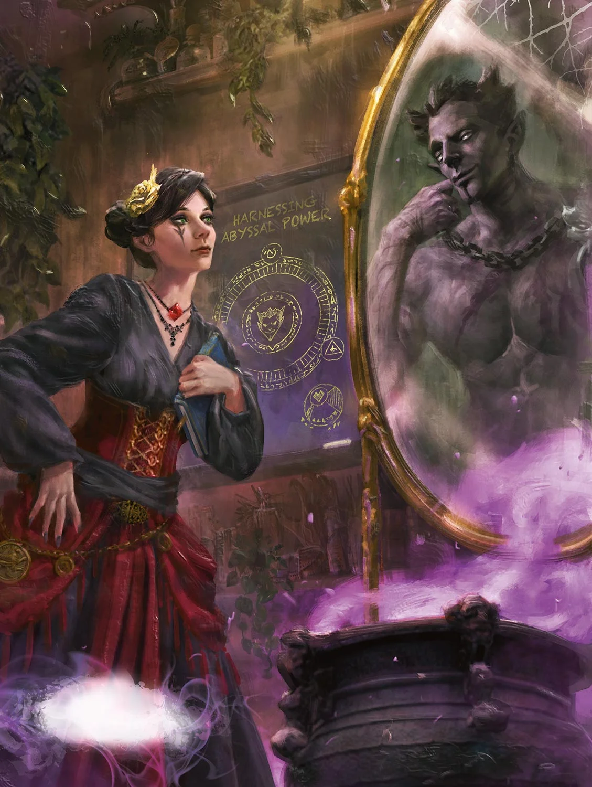
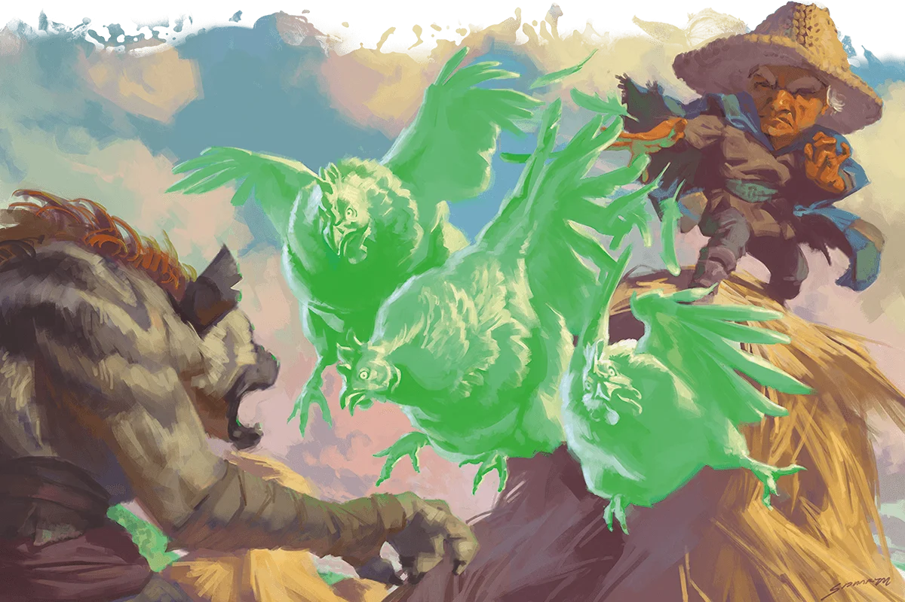
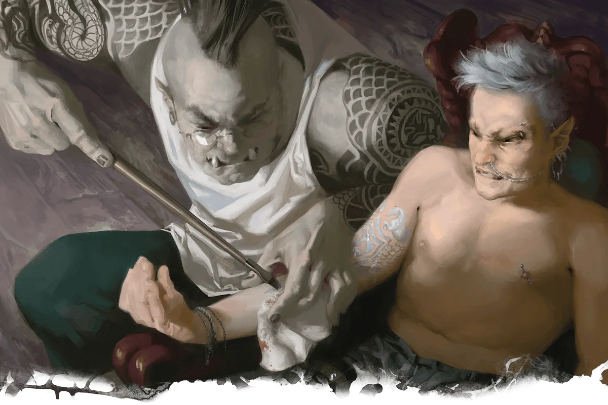

# Magical Miscellany

> 英文原文鏡像；對應《Magical Miscellany》p. 105。來源提供者：5e.tools。

# Magical Miscellany

Magic is everywhere in D&D. Many creatures in the D&D multiverse exist solely because of the influence of magic, spellcasters harness magical energy every day in the form of spells, and supernatural power thrums at the heart of the magic items sought by adventurers. This chapter is all about those last two things—spells and magic items.

The chapter first presents new spells for player characters and monsters to use. Those spells are followed by suggestions on customizing the look of your spells. The chapter then offers a selection of new magic items, including artifacts of mythic power and magic items that can be printed on one's body in the form of tattoos.

The DM decides how the options in this chapter appear in a campaign and may choose to use some, all, or none of them, so make sure to let your DM know which options you'd most like to use in play.

## Spells

Well, darn. Whatever could have happened to the spells Mordenkainen's Bountiful Back-Patting, Heward's Hot Air, and all the rest? I'm sure I submitted the spells they insisted I include herein. Seems they got lost in the shuffle. Shame.

This section contains new spells that the DM may add to a campaign, making them available to player character and monster spellcasters alike. The Spells table lists the new spells, ordering them by level. The table also notes the school of magic of a spell, whether it requires concentration, whether it bears the ritual tag, and which classes have access to it.

If you'd like to use any of these spells, talk to your DM, who may allow some, all, or none of them.

## Personalizing Spells

When I first learned magic from Baba Yaga, I couldn't help but add spectral chicken legs to all my spells. She said she wasn't a fan, but I caught her grinning a few times. So of course I still add those legs. What use is magic if you can't harness it to amuse your mom?

Just as every performer lends their art a personal flair and every warrior asserts their fighting styles through the lens of their own training, so too can a spellcaster use magic to express their individuality. Regardless of what type of spellcaster you're playing, you can customize the cosmetic effects of your character's spells. Perhaps you wish the effects of your caster's spells to appear in their favorite color, to suggest the training they received from a celestial mentor, or to exhibit their connection to a season of the year. The possibilities for how you might cosmetically customize your character's spells are endless. However, such alterations can't change the effects of a spell. They also can't make one spell seem like another—you can't, for example, make a {@spell magic missile} look like a {@spell fireball}.

When customizing your spellcaster's magic, consider developing a theme—often, the broader and more versatile the better. You may describe your caster's magic whenever you wish, particularly when it makes an interesting addition to a story. You may also use it to reinforce other choices you've made for your character, like making a bard's spells tied more closely to their favored art form or a cleric's spells themed around their deity.

For example, the {@spell fireball} of a wizard with a fondness for storms might erupt to look like burning clouds or a burst of red lightning (without affecting the spell's damage type), while the same wizard's {@spell haste} spell might limn the target in faint thunderheads.

Alternatively, a cleric who serves a moon god might radiate faint moonlight around their hands when they cast {@spell cure wounds}, or their {@spell shield of faith} might surround the target with glimmering crescent moons.

Further still, a druid could choose a cherry blossom theme for their magic, causing delicate branches and pink leaves to grow when they cast {@spell entangle} or {@spell shillelagh}, and their {@spell faerie fire} spell could appear more like wind-tossed petals than flames.

The Magic Themes table offers just a few suggestions that might inspire you while personalizing your character's spells.

## Magic Items

This section presents magic items that can be introduced into any campaign. Here you'll find items of all rarities, including artifacts. Magic spellcasting focuses for every spellcasting class are also available here. And some of the items in this section represent a new type of wondrous item: magic tattoos.

The Magic Items table lists all the magic items in this chapter and notes the rarity of each one. The table also indicates whether an item requires attunement. All the items use the magic items rules in the {@book Dungeon Master's Guide|DMG}.

Who doesn't love magic items? The desire for them is one of the few things Mordenkainen and I have in common. And magic tattoos—they're especially fun. I think tattoos are a reason robes are so popular with wizards. Robes cover the ankle and lower-back tattoos so many of us got as apprentices. Don't even ask.

### Magic Tattoos

Blending magic and artistry with ink and needles, magic tattoos imbue their bearers with wondrous abilities. Magic tattoos are initially bound to magic needles, which transfer their magic to a creature.

Once inscribed on a creature's body, damage or injury doesn't impair the tattoo's function, even if the tattoo is defaced. When applying a magic tattoo, a creature can customize the tattoo's appearance. A magic tattoo can look like a brand, scarification, a birthmark, patterns of scale, or any other cosmetic alteration.

The rarer a magic tattoo is, the more space it typically occupies on a creature's skin. The Magic Tattoo Coverage table offers guidelines for how large a given tattoo is.

### Magic Item Descriptions

The following magic items are presented in alphabetical order.

- {@item Absorbing Tattoo|TCE}

- {@item Alchemical Compendium|TCE}

- {@item +1 All-Purpose Tool|TCE|All-Purpose Tool}

- {@item +1 Amulet of the Devout|TCE|Amulet of the Devout}

- {@item +1 Arcane Grimoire|TCE|Arcane Grimoire}

- {@item Astral Shard|TCE}

- {@item Astromancy Archive|TCE}

- {@item Atlas of Endless Horizons|TCE}

- {@item Baba Yaga's Mortar and Pestle|TCE}

- {@item Baba Yaga's Pestle|TCE}

- {@item Barrier Tattoo (Small)|TCE|Barrier Tattoo}

- {@item Bell Branch|TCE}

- {@item Blood Fury Tattoo|TCE}

- {@item +1 Bloodwell Vial|TCE|Bloodwell Vial}

- {@item Cauldron of Rebirth|TCE}

- {@item Coiling Grasp Tattoo|TCE}

- {@item Crook of Rao|TCE}

- {@item Crystalline Chronicle|TCE}

- {@item Demonomicon of Iggwilv|TCE}

- {@item Devotee's Censer|TCE}

- {@item Duplicitous Manuscript|TCE}

- {@item Eldritch Claw Tattoo|TCE}

- {@item Elemental Essence Shard|TCE}

- {@item Far Realm Shard|TCE}

- {@item Feywild Shard|TCE}

- {@item Fulminating Treatise|TCE}

- {@item Ghost Step Tattoo|TCE}

- {@item Guardian Emblem|TCE}

- {@item Heart Weaver's Primer|TCE}

- {@item Illuminator's Tattoo|TCE}

- {@item Libram of Souls and Flesh|TCE}

- {@item Lifewell Tattoo|TCE}

- {@item Luba's Tarokka of Souls|TCE}

- {@item Lyre of Building|TCE}

- {@item Masquerade Tattoo|TCE}

- {@item Mighty Servant of Leuk-O|TCE}

- {@item +1 Moon Sickle|TCE|Moon Sickle}

- {@item Nature's Mantle|TCE}

- {@item Outer Essence Shard|TCE}

- {@item Planecaller's Codex|TCE}

- {@item Prosthetic Limb|TCE}

- {@item Protective Verses|TCE}

- {@item Reveler's Concertina|TCE}

- {@item +1 Rhythm-Maker's Drum|TCE|Rhythm-Maker's Drum}

- {@item Shadowfell Brand Tattoo|TCE}

- {@item Shadowfell Shard|TCE}

- {@item Spellwrought Tattoo|TCE}

- {@item Teeth of Dahlver-Nar|TCE}

#### Absorbing Tattoo

#### Alchemical Compendium

#### +1 All-Purpose Tool

#### +1 Amulet of the Devout

#### +1 Arcane Grimoire

#### Astral Shard

#### Astromancy Archive

#### Atlas of Endless Horizons

#### Baba Yaga's Mortar and Pestle

#### Baba Yaga's Pestle

#### Barrier Tattoo (Small)

#### Bell Branch

#### Blood Fury Tattoo

#### +1 Bloodwell Vial

#### Cauldron of Rebirth

#### Coiling Grasp Tattoo

#### Crook of Rao

#### Crystalline Chronicle

#### Demonomicon of Iggwilv

#### Devotee's Censer

#### Duplicitous Manuscript

#### Eldritch Claw Tattoo

#### Elemental Essence Shard

#### Far Realm Shard

#### Feywild Shard

#### Fulminating Treatise

#### Ghost Step Tattoo

#### Guardian Emblem

#### Heart Weaver's Primer

#### Illuminator's Tattoo

#### Libram of Souls and Flesh

#### Lifewell Tattoo

#### Luba's Tarokka of Souls

#### Lyre of Building

#### Masquerade Tattoo

#### Mighty Servant of Leuk-O

#### +1 Moon Sickle

#### Nature's Mantle

#### Outer Essence Shard

#### Planecaller's Codex

#### Prosthetic Limb

#### Protective Verses

#### Reveler's Concertina

#### +1 Rhythm-Maker's Drum

#### Shadowfell Brand Tattoo

#### Shadowfell Shard

#### Spellwrought Tattoo

#### Teeth of Dahlver-Nar
