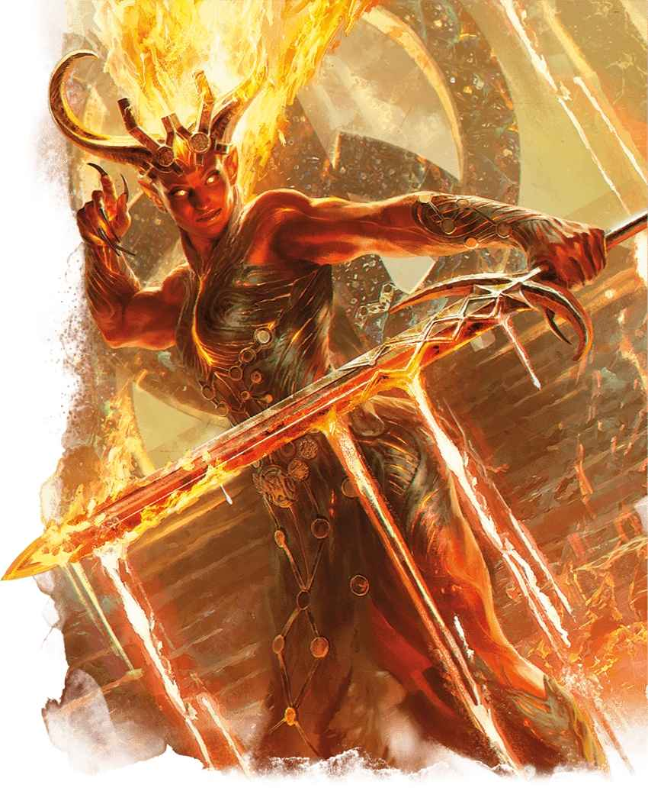

# 火巨靈 Efreeti

火之巨靈

**棲息地：** 荒漠，異界（火元素位面）；**寶藏：**武備

火巨靈四周燃燒著強烈的，無法預測的火焰。他們與生俱來的魔法能力使其能夠憑空召喚火焰，在魔法烈焰中鍛造珍寶。許多火靈聲名狼藉，其善變的本質和對災難的痴迷往往會帶來毀滅。然而，也有火靈沉醉於火焰之美——無論是燭光的精緻，還是煙花的絢爛。這些巨靈可能會以珍寶或釋放被囚禁的元素生物為條件，向凡人施以援手。
在許多世界中，火巨靈居住在酷熱的沙漠和火山地區。那些在火元素位面安家的火巨靈，在火焰和熔岩的海洋中建造了令人驚歎的城市。而其中最著名的莫過於傳說中的**黃銅之城 City of Brass** ，這座閃耀的大都市是多元宇宙中最令人歎為觀止的城市之一。這裡用魔法調和了位面的極端高溫，使得黃銅之城成為了各個位面之間的貿易樞紐。

想像一下吧，那鉑金的海洋與液態的火焰，還有赤紅之柱 Crimson Pillar 中燃燒的足以灼傷神明的烈焰，以及遍佈黃銅之城那無盡的歡愉。現在，想像一下我主人所提供的……

——維伊斯維克斯維恩，熔岩魔蝠使者

| ## 火巨靈 Efreeti *大型元素（巨靈），中立* **AC** 17　**先攻** +1（11） **HP** 212 （17d10 + 119） **速度** 40尺,飛行60尺（懸浮） \| 屬性 \| 數值 \| 調整 \| 豁免 \| \| --- \| ---: \| ---: \| ---: \| \| 力量 \| 22 \| +6 \| +6 \| \| 敏捷 \| 12 \| +1 \| +1 \| \| 體質 \| 24 \| +7 \| +7 \| \| 智力 \| 16 \| +3 \| +3 \| \| 感知 \| 15 \| +2 \| +6 \| \| 魅力 \| 19 \| +4 \| +8 \| **免疫** 火焰 **感官** 黑暗視覺120尺；被動察覺12 **語言** 原初語（火族語） **CR** 11（XP7,200；PB+4） ### 特性 Traits **元素重生 Elemental Restoration。**若火巨靈於火元素位面之外死去，其身軀會化為燃塵，並在1d4天后於火元素位面某處獲得一具新的身體，以滿生命值復活。 **魔法抗性 Magic Resistance。**火巨靈對抗法術和其他魔法效應時進行的豁免檢定具有優勢。 **祈願 Wishes。**每個火巨靈都有30%概率知曉法術_祈願術 Wish_。若知曉，則火巨靈可以但僅能在有非巨靈生物向其許願（以火巨靈能理解的方式）時為那名生物施展此法術。火巨靈為該生物施展祈願術將不會承受祈願術的負擔。一旦此火巨靈施展過三次祈願術，其在365天內無法再次施展此法術。 ### 動作 Actions **多重攻擊 Multiattack。**火巨靈使用熾熱之刃或投擲烈焰發動共計三次攻擊。 **熾熱之刃 Heated Blade。**_近戰攻擊檢定：_+10，觸及5尺。_命中：_13（2d6 + 6）揮砍傷害外加13（2d12）火焰傷害。 **投擲烈焰 Hurl Flame。**_遠程攻擊檢定：_+8，射程120尺。_命中：_24（7d6）火焰傷害。 **施法 Spellcasting。** 火巨靈施展以下一道法術，無需材料成分並使用魅力作為施法屬性（法術豁免 DC16）： **_隨意：_** _偵測魔法 Detect Magic，四象法門 Elementalism_ **_每項1/日：_**_氣化形體 Gaseous Form, 隱形術 Invisibility, 高級幻影 Major Image, 位面轉移 Plane Shift, 巧言術 Tongues, 火牆術 Wall of Fire_（七環版本） |  |  |  |  |  |  |  |  |  |  |  |  |  |
| --- | --- | --- | --- | --- | --- | --- | --- | --- | --- | --- | --- | --- | --- |
| **AC** 17 | **先攻** +1（11） |  |  |  |  |  |  |  |  |  |  |  |  |
| **HP** 212 （17d10 + 119） |  |  |  |  |  |  |  |  |  |  |  |  |  |
| **速度** 40尺,飛行60尺（懸浮） |  |  |  |  |  |  |  |  |  |  |  |  |  |
|  |  | 調整 | 豁免 |  |  |  | 調整 | 豁免 |  |  |  | 調整 | 豁免 |
| **力量** | 22 | +6 | +6 |  | **敏捷** | 12 | +1 | +1 |  | **體質** | 24 | +7 | +7 |
| **智力** | 16 | +3 | +3 |  | **感知** | 15 | +2 | +6 |  | **魅力** | 19 | +4 | +8 |
| **免疫** 火焰 |  |  |  |  |  |  |  |  |  |  |  |  |  |
| **感官** 黑暗視覺120尺；被動察覺12 |  |  |  |  |  |  |  |  |  |  |  |  |  |
| **語言** 原初語（火族語） |  |  |  |  |  |  |  |  |  |  |  |  |  |
| **CR** 11（XP7,200；PB+4） |  |  |  |  |  |  |  |  |  |  |  |  |  |
