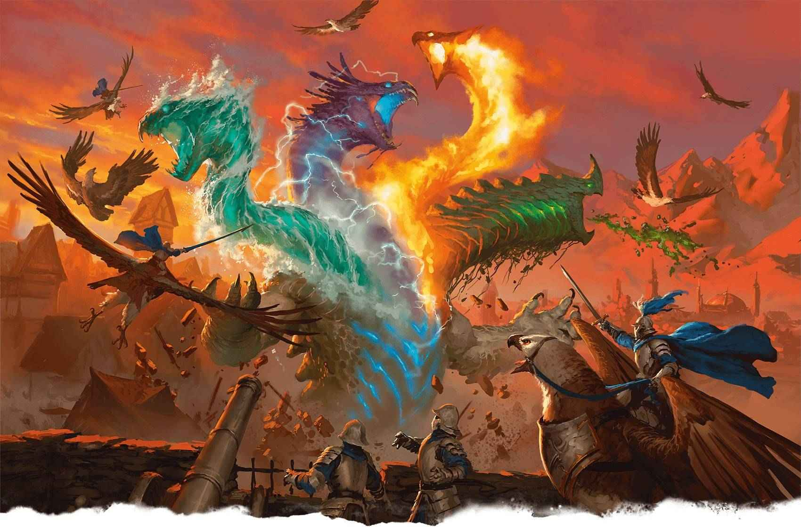
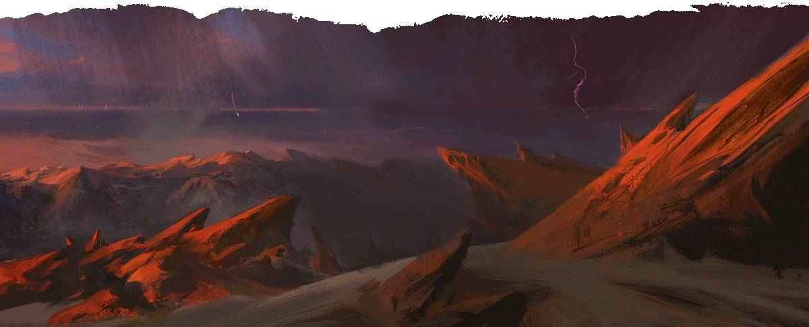

# 元初天劫 Elemental Cataclysm

# 元初天劫 Elemental Cataclysm

新世之初，舊世之終

**棲息地：** 異界（元素混沌）；**寶藏：**無

在元素位面的邊界之外的元素混沌，原初能量永無止境地衝刷，肆虐。這片無邊無際的殘虐之域正是元初天劫橫行之地——祂們誕生自多元宇宙原初原力，充斥著不相容的元素威能。
這些蘊含著原始之對立的實體會湮滅其所見的幾乎所有事物，但祂們亦會在廢墟之中留下新生的種子。
元初天劫很少逃出元素混沌。然而，當位面之間出現某種災變，又或是因虛無主義邪教的召喚，天劫便從元素混沌之中逃出，降臨物質位面。元初天劫的存在足以撼動整片界域，在物質位面的祂會毀滅途經的一切，如碾碎螻蟻般踏過城市，將整個國度拖入混亂。元初天劫的肆虐並非是隨機的，祂們憎恨一切對自然界的破壞：礦井、豐碑、要塞、城市——然而祂們最為仇視的，乃是金屬造物與機關造物。祂們呼嚎著天罰，吟唱著破滅，令萬事萬物於內層位面之言中步入毀滅。
幾乎沒有人能阻止元初天劫的腳步。膽敢面對此等浩劫大災之一者通常會去試圖中斷將祂召喚現世的儀式，或是將祂引向一道位面裂隙，甚至是咒喚另一尊泰坦，以期二者能夠同歸於盡。在恐怖的浩劫過後，祂所留下的只有灰燼、洪澇、風暴，以及崩裂的大地。然而待這些災難消退之後，這些土地亦會重獲新生，或是發生其他環境變化。擲一次元初天劫遺留轉變表或從中選擇一個結果，以此啟發在元初天劫過後會發生什麼樣的變化。

**元初天劫遺留轉變**

| **1d8** | **元初天劫所過之地出現了……** |
| --- | --- |
| 1 | 氣溫無常的升高或降低的情況。 |
| 2 | 極為巨大的珊瑚礁或真菌叢林。 |
| 3 | 永不止息的風暴或漩渦。 |
| 4 | 通往幽暗地域的通路或是通往某一元素位面的傳送門。 |
| 5 | 來自上古時期或是早已滅絕的動物種群。 |
| 6 | 急劇生長的雨林。 |
| 7 | 河流（此地原先並無河水流經）。 |
| 8 | 一系列造型引人注目的岩石結構。 |

