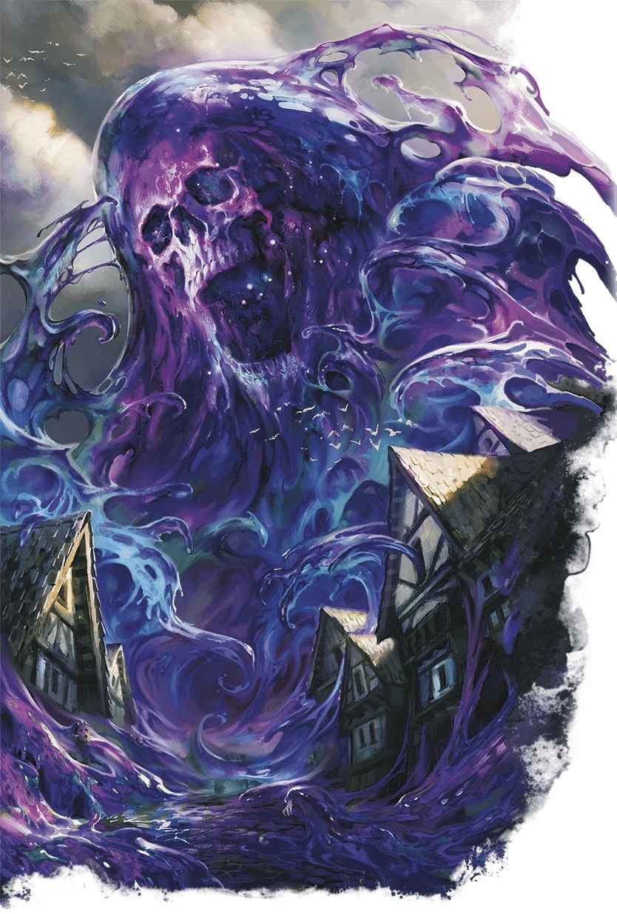

# 吞世黏漿 Blob of Annihilation

|  |  | # 吞世黏漿 Blob of Annihilation 吞淨天地的熵能末日 **棲息地：** 任意；**寶藏：**任意 吞世黏漿是宇宙中的熵能與已死之神的殘軀相結合的產物。這一惡意實體在**荒宇 Wildspace**和多元宇宙各界中漂流，逐漸成長到危害眾生的地步——好在大多數地區都很難遇到祂。 然而，當某種災難，或者信奉毀滅之道的魔法使令吞世黏漿降臨到有人居住的界域時，祂就成了這世上最嚴重的威脅。被釋放的吞世黏漿翻騰席捲著廣闊的土地，或是宇宙軌道上行進，分裂出子體吞沒目標。黏漿會吞下沿途的一切，蕩平森林，吞吃村鎮，溶解要塞，將一切都化為自身的組分。黏漿的體內是一片開闊的空無區域，沒有空氣亦沒有重力，唯有摧毀其中一切事物的熵能之力。沒有任何東西能在其體內長久存在。 只有魔法物品以及諸神與泰坦的屍體才能在吞世黏漿內部長存。因此，寶藏獵人和神學家偶爾會冒著生命危險去到黏漿內部取回某些事物。儘管進入吞世黏漿的冒險大多都以被吞噬告終，但偶爾也有探險隊能倖存並帶回足以令人後生無憂的成果。 當吞噬黏漿現世時，擲一次吞世黏漿內容物表或從中選擇一個結果，以此啟發這個黏黏玩意內部有著什麼特殊事物。 親愛的，我見過的最能把人嚇得屁滾尿流，忍不住想喝水壓驚的東西，就是吞世黏漿。如果你見到祂，跑。如果你跑不掉，那就期待自己能溶解得快一點。 ——蔚，艾伯倫的奇械師 **吞世黏漿內容物** \| **1d10** \| **這團黏漿內部裝著……** \| \| --- \| --- \| \| 1 \| 一個_位面護符 Amulet of the Planes_ 。 \| \| 2 \| 一件由 DM 選擇的神器。 \| \| 3 \| 兩具於戰鬥中糾纏的神屍，在戰鬥的過程中被黏漿吞下。 \| \| 4 \| 一個_異界之門魔方 Cubic Gate_ 。 \| \| 5 \| 一副_萬象無常牌 Deck of Many Things_ 。 \| \| 6 \| 一把開啟印記城中某扇門的鑰匙，任何其他鑰匙和任何法術都無法開啟這扇門。 \| \| 7 \| 一具刻意做足保存措施的**至高天 Empyrean** 屍體。 \| \| 8 \| 半截**克拉肯 Kraken**殘軀。 \| \| 9 \| 一枚已死之神的顱骨。 \| \| 10 \| 一隻剛死掉的**泰拉斯奎 Tarrasque**。 \| |
| --- | --- | --- |
| **1d10** | **這團黏漿內部裝著……** |  |
| 1 | 一個_位面護符 Amulet of the Planes_ 。 |  |
| 2 | 一件由 DM 選擇的神器。 |  |
| 3 | 兩具於戰鬥中糾纏的神屍，在戰鬥的過程中被黏漿吞下。 |  |
| 4 | 一個_異界之門魔方 Cubic Gate_ 。 |  |
| 5 | 一副_萬象無常牌 Deck of Many Things_ 。 |  |
| 6 | 一把開啟印記城中某扇門的鑰匙，任何其他鑰匙和任何法術都無法開啟這扇門。 |  |
| 7 | 一具刻意做足保存措施的**至高天 Empyrean** 屍體。 |  |
| 8 | 半截**克拉肯 Kraken**殘軀。 |  |
| 9 | 一枚已死之神的顱骨。 |  |
| 10 | 一隻剛死掉的**泰拉斯奎 Tarrasque**。 |  |
