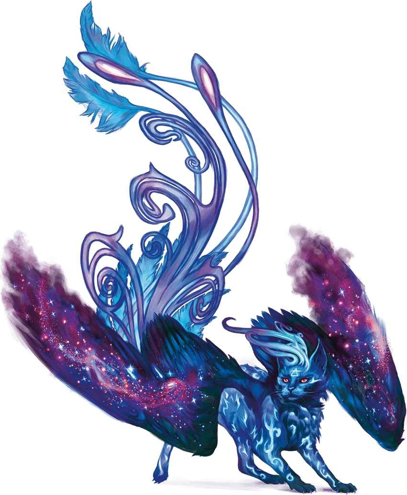

# 求索斯芬克斯 Sphinx of Wonder

求索斯芬克斯羽毛鮮豔，體型與幼獅相仿。每當物質位面出現一個獨特的想法，就會誕生一隻求索斯芬克斯。每隻求索斯芬克斯都著迷於某個特定類型的故事或是研究領域，盡其所能的學習有關該主題的知識。它額頭上的獨特印記代表著它所著迷的知識。有時，求索斯芬克斯會與凡人學者建立聯繫，幫助他們進行研究。

| ## 求索斯芬克斯 Sphinx of Wonder *微型天族，守序中立* **AC** 13　**先攻** +3（13） **HP** 24（7d4+7） **速度** 20尺，飛行40尺 \| 屬性 \| 數值 \| 調整 \| 豁免 \| \| --- \| ---: \| ---: \| ---: \| \| 力量 \| 6 \| -2 \| -2 \| \| 敏捷 \| 17 \| +3 \| +3 \| \| 體質 \| 13 \| +1 \| +1 \| \| 智力 \| 15 \| +2 \| +2 \| \| 感知 \| 12 \| +1 \| +1 \| \| 魅力 \| 11 \| +0 \| +0 \| **技能** 奧秘+4，宗教+4，隱匿+5 **抗性** 暗蝕，心靈，光耀 **感官** 黑暗視覺60尺；被動察覺11 **語言** 天界語，通用語 **CR** 1（XP200；PB+2） ### 特性 Traits **魔法抗性 Magic Resistance。** 斯芬克斯對抗法術和其他魔法效應時進行的豁免檢定具有優勢。 ### 動作 Actions **撕裂 Rend。**_近戰攻擊檢定：_+5，觸及5尺。_命中：_5（1d4+3）揮砍傷害外加7（2d6）光耀傷害。 ### 反應 Reactions **靈光乍現 Burst of Ingenuity（2/日）。**_觸發：_斯芬克斯或其30尺內另一生物進行一次屬性檢定或豁免檢定。_響應：_ 斯芬克斯令其結果+2。 |  |  |  |  |  |  |  |  |  |  |  |  |  |
| --- | --- | --- | --- | --- | --- | --- | --- | --- | --- | --- | --- | --- | --- |
| **AC** 13 | **先攻** +3（13） |  |  |  |  |  |  |  |  |  |  |  |  |
| **HP** 24（7d4+7） |  |  |  |  |  |  |  |  |  |  |  |  |  |
| **速度** 20尺，飛行40尺 |  |  |  |  |  |  |  |  |  |  |  |  |  |
|  |  | 調整 | 豁免 |  |  |  | 調整 | 豁免 |  |  |  | 調整 | 豁免 |
| **力量** | 6 | \-2 | \-2 |  | **敏捷** | 17 | +3 | +3 |  | **體質** | 13 | +1 | +1 |
| **智力** | 15 | +2 | +2 |  | **感知** | 12 | +1 | +1 |  | **魅力** | 11 | +0 | +0 |
| **技能** 奧秘+4，宗教+4，隱匿+5 |  |  |  |  |  |  |  |  |  |  |  |  |  |
| **抗性** 暗蝕，心靈，光耀 |  |  |  |  |  |  |  |  |  |  |  |  |  |
| **感官** 黑暗視覺60尺；被動察覺11 |  |  |  |  |  |  |  |  |  |  |  |  |  |
| **語言** 天界語，通用語 |  |  |  |  |  |  |  |  |  |  |  |  |  |
| **CR** 1（XP200；PB+2） |  |  |  |  |  |  |  |  |  |  |  |  |  |
