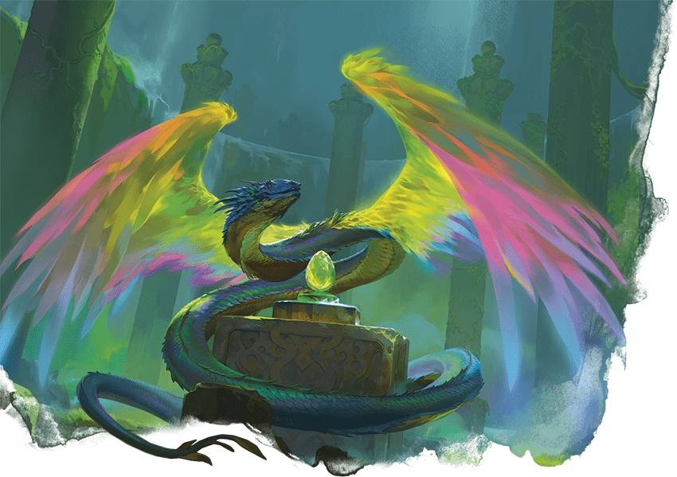

# 羽蛇 Couatl

# 羽蛇 Couatl

神明的護佑具現

**棲息地：** 荒漠，森林，草原，城市；**寶藏：**聖物

作為預言的具象和神聖秘密的守護者，羽蛇確保命運能按其既定方式發展。它們形似長有彩虹羽翼的大蛇，每一位都是神聖旨意——一種由正義神明裁定的永恆真理或命運——的具現。羽蛇常出沒於遠古力量的所在之地，在那裡它們守護隱秘的魔法，或確保預言內容的成真與否。偶爾，也有羽蛇會守護某個社群，或偽裝起來遊歷四方，解讀徵兆或操控因素以確保命運轉向正確的軌跡。
受永恆使命的驅使，羽蛇有時會表現出莫測高深或充滿敵意的行為。它們堅定不移且毫不妥協，因為它們的存在從根本上就與神聖使命緊密相連。但它們僅會在絕對必要時，才會傷害其他生物，以實現神聖目標。
每條羽蛇都會在一個時代結束時經歷一次週期性重生。在羽蛇的生命週期裡，一個時代可能對應天體曆法或某種神聖年表。在時代接近尾聲時，羽蛇會誕下一枚奇妙的、彩虹色的蛋。當時代終結時，羽蛇便會死亡。在一段時間內——可能到某一天，也可能直到某個年度太陽事件 ——羽蛇的工作會暫時無人接替。一旦這段時間過去，產下蛋的同一條羽蛇便會從蛋中孵化，完全成熟並煥然一新，繼續為下一個時代服務。
