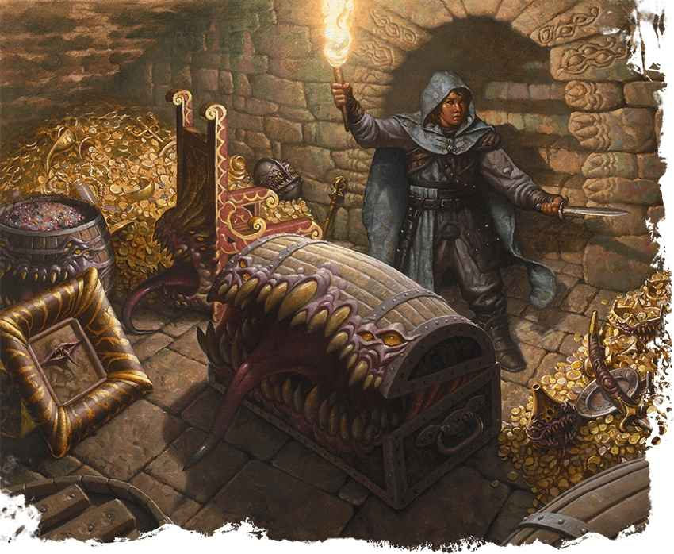

# 擬身怪 Mimic

# 擬身怪 Mimic

偽裝成不起眼物件的變形異獸

**棲息地：** 幽暗地域，城市；**寶藏：**任意

擬身怪在平常形態下如同遊蕩的胃袋，圓鼓鼓的身體上佈滿異星眼眸和牙齒。它們能夠改變顏色、紋理、尺寸，以複製與它們大小相近的靜物。擬身怪利用外形作為偽裝和誘餌。一旦受害者接近，擬身怪就會發起攻擊，用滿是粘液的偽足和利齒猛烈攻擊。吃掉獵物以後，擬身怪就會換個位置，改變形態，等待下一頓餐食。
使用以下列表作為擬身怪外形的靈感。

| 祭壇 | 地墊 | 方尖碑 | 標識 |
| --- | --- | --- | --- |
| 鍾 | 巨大寶石 | 超大蛋糕 | 石筍 |
| 巨石 | 墓碑 | 搖桿控制板 | 樹樁 |
| 大鍋 | 落葉堆 | 骨頭堆 | 桌子 |
| 椅子 | 酒桶 | 盆栽 | 掛毯 |
| 枝形吊燈 | 梯子 | 書山 | 動物標本 |
| 寶箱 | 講桌 | 石棺 | 王座 |
| 嬰兒床 | 人體模型 | 雕塑 | 修剪過的植株 |
| 門 | 鏡子 | 船舵 | 武器架 |

## 擬身怪 Mimic

*中型怪獸，中立*

**AC** 12　**先攻** +3（13）

**HP** 58 （9d8 + 18）

**速度** 20尺

| 屬性 | 數值 | 調整 | 豁免 |
| --- | ---: | ---: | ---: |
| 力量 | 17 | +3 | +3 |
| 敏捷 | 12 | +1 | +1 |
| 體質 | 15 | +2 | +2 |
| 智力 | 5 | -3 | -3 |
| 感知 | 13 | +1 | +1 |
| 魅力 | 8 | -1 | -1 |

**技能** 隱匿+5

**免疫** 強酸；倒地

**感官** 黑暗視覺60尺；被動察覺11

**語言** 無

**CR** 2（XP450；PB+2）

### 特質 Traits

**粘附 Adhesive（僅物件形態）。**擬身怪粘附在任何觸碰到其的東西上。體型不超過巨型的被粘附生物陷入受擒狀態（逃脫 DC13）。為逃脫此擒抱進行的屬性檢定具有劣勢。

### 動作 Actions

**啃咬 Bite。**_近戰攻擊檢定：_+5（若目標因該擬身怪受擒則具有優勢），觸及5尺。 _命中：_7（1d8+3）穿刺傷害（若目標因該擬身怪受擒則改為12（2d8+3）穿刺傷害）外加4（1d8）強酸傷害。****
偽足 Pseudopod。** _近戰攻擊檢定：_+5，觸及5尺。 _命中：_7（1d8+3）鈍擊傷害外加4（1d8）強酸傷害。若目標生物體型不超過大型，其陷入受擒狀態（逃脫 DC13）。為逃脫此擒抱進行的屬性檢定具有劣勢。

### 附贈動作 Bonus Actions

**變形 Shape-Shift。**擬身怪變形為如同中型或小型物件，並保留其遊戲數據；或擬身怪變回其真實斑點形態。擬身怪著裝或攜帶的任何裝備都不會隨之變化。
