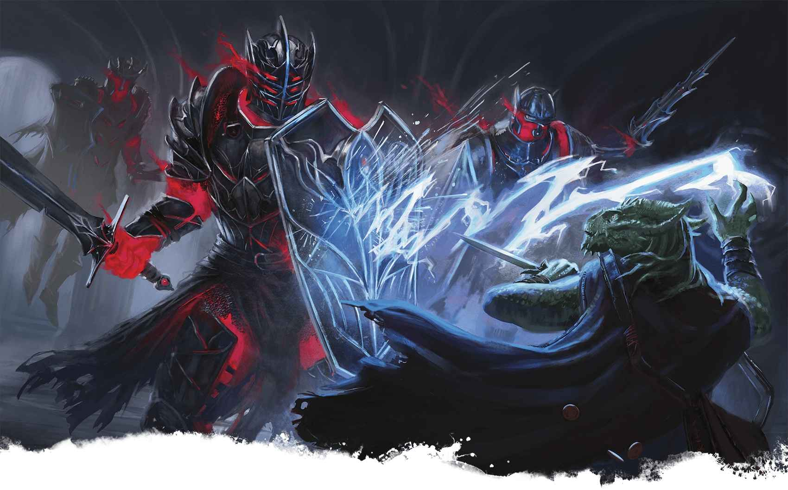

# 恐怖鎧甲 Helmed Horror

**恐怖鎧甲對魔法師的閃電束免疫**

# 恐怖鎧甲 Helmed Horror

肩負武者之職的鎧甲

**棲息地：** 任意；**寶藏：**武備

恐怖鎧甲是一套由魔法驅動的護甲。這些裝甲疙瘩並非沒有理性的自動機械，而是擁有士兵般的狡詐以及應對毀滅性魔法的抗性。儘管它們的名字暗示著邪惡的意圖，但這些生物會忠誠地為其創造者服務。恐怖鎧甲有時也被稱為末日守衛或魂靈鎧甲。它們大多數沒有表現出個性，但也不乏例外。
恐怖鎧甲可能會執行各種任務。擲一次恐怖鎧甲指令表或從中選擇一個結果，以此啟發恐怖鎧甲執行哪些任務。

**恐怖鎧甲指令**

| **1d6** | **恐怖鎧甲聽從命令，……** |
| --- | --- |
| 1 | 在空中抬著主人的輿轎穿行。 |
| 2 | 將一件非凡的寶藏或護甲的一部分融入自身，以守護該物品。 |
| 3 | 穿戴某位已故或被囚英雄的盔甲，用其武器，以模仿這位英雄的形象。 |
| 4 | 作為勞工或僕從工作。 |
| 5 | 服役於某個盔甲軍團——它們均由某地古代守護者們的盔甲組成。 |
| 6 | 在某個陳列著普通盔甲的地方站崗放哨。 |
