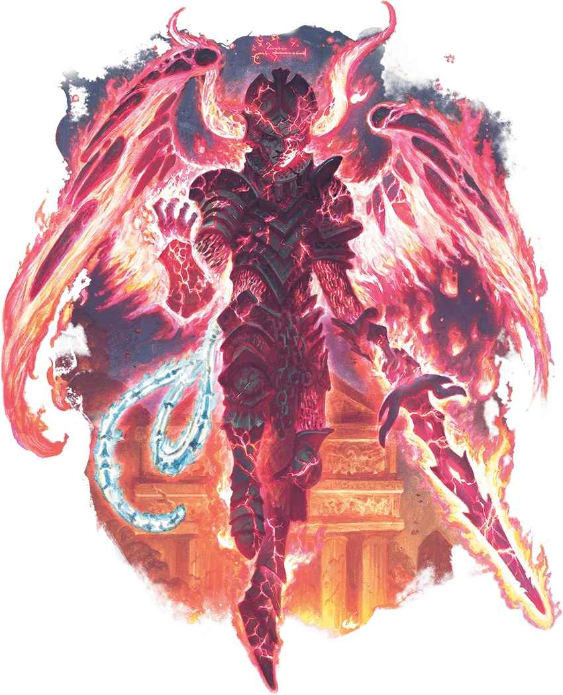

# 罪魔 Erinyes

踐行公理之怒的復仇天魔

**棲息地：** 異界（九層地獄）；**寶藏：**武備

罪魔，也就是所謂的“**復仇女神 The Furies** ”，乃是身披地獄鎧甲的有翼魔鬼。這些墮天使用另一種方式踐行著神聖的正義：獵殺打破誓言的人，用它們的魔法繩索將應下地獄之人拖入九層地獄。罪魔鐵鎧著身，頭盔覆面，極少有人能看見它們盔甲下的樣子，而罪魔會確保那些偶然看見的人永遠沒有機會說出自己所見的東西。
罪魔通常為大魔鬼服務，維護著九獄的秩序，懲戒僭越者與妄圖逃離之人。罪魔與其他魔鬼合作良好，雖然它們時常會陷入某種暴怒之中。有時，三隻罪魔會共同合作以進行狩獵，這給它們帶來了邪惡的名聲。
在並未給魔鬼大公服務時，罪魔會前去獵殺邪惡的靈魂。它們孜孜不倦地追捕自己的獵物，如有必要，罪魔的追獵可以橫跨多元宇宙，持續數年之久。罪魔也可能被邪惡的魔法使用者召喚併為其服務。此外，罪魔還會傾聽以自己的名義立下的誓言與詛咒；在極其稀有的情況下，蒙冤的凡人以純粹的憤怒發出的吶喊會被某隻罪魔聽見，而罪魔將就此出現，代表這位凡人完成復仇。以這種方式召來的罪魔必將帶走一個靈魂——要麼是那個獵物的靈魂，要麼就是召來它的凡人的靈魂。

| ## 罪魔 Erinyes *中型邪魔（魔鬼），守序邪惡* **AC** 18　**先攻** +7（17） **HP** 178（21d8+84） **速度** 30尺，飛行60尺 \| 屬性 \| 數值 \| 調整 \| 豁免 \| \| --- \| ---: \| ---: \| ---: \| \| 力量 \| 18 \| +4 \| +4 \| \| 敏捷 \| 16 \| +3 \| +7 \| \| 體質 \| 18 \| +4 \| +8 \| \| 智力 \| 14 \| +2 \| +2 \| \| 感知 \| 14 \| +2 \| +2 \| \| 魅力 \| 18 \| +4 \| +8 \| **技能** 察覺+6，遊說+8 **抗性** 寒冷 **免疫** 火焰，毒素；中毒 **感官** 真實視覺120尺；被動察覺16 **語言** 煉獄語，心靈感應120尺 **CR** 12（XP8,400；PB+4） ### 特性 Traits **魔鬼復甦 Diabolical Restoration。**若罪魔於九層地獄之外死去，其身軀會化為硫磺煙霧消失，並立即在九層地獄某處獲得一具新的身體，以滿生命值復活。 **魔法抗性 Magic Resistance。**罪魔對抗法術和其他魔法效應時進行的豁免檢定具有優勢。 **魔法繩索 Magic Rope。**罪魔持有一根魔法繩索。只要攜帶魔繩，罪魔就能夠使用其糾纏繩動作。魔繩具有 AC20，HP90，免疫毒素和心靈傷害。若魔繩生命值降至0、罪魔死亡或魔繩離開罪魔身邊5+尺超過1小時，魔繩化為塵埃。若魔繩受到傷害或被摧毀，罪魔可以在完成一次短休或長休時將其完全恢復。 ### 動作 Actions **多重攻擊 Multiattack。**罪魔發動三次凋零之刃攻擊並使用糾纏繩。 **凋零之刃 Withering Sword。**_近戰攻擊檢定：_+8，觸及5尺。_命中：_13（2d8+4）揮砍傷害外加11（2d10）暗蝕傷害。 **糾纏繩 Entangling Rope。**_力量豁免檢定：_DC16，單一120尺內罪魔可見的生物。_失敗：_14（4d6）力場傷害，且目標陷入束縛狀態，持續直至繩索被摧毀、罪魔使用附贈動作釋放該生物，或罪魔再次使用糾纏繩動作。 ### 反應 Reactions **格擋 Parry。**_觸發：_罪魔在持握武器期間因近戰攻擊檢定被命中。_響應：_罪魔令其對抗那次攻擊的 AC+4，可能令那次攻擊改為失手。 |  |  |  |  |  |  |  |  |  |  |  |  |  |
| --- | --- | --- | --- | --- | --- | --- | --- | --- | --- | --- | --- | --- | --- |
| **AC** 18 | **先攻** +7（17） |  |  |  |  |  |  |  |  |  |  |  |  |
| **HP** 178（21d8+84） |  |  |  |  |  |  |  |  |  |  |  |  |  |
| **速度** 30尺，飛行60尺 |  |  |  |  |  |  |  |  |  |  |  |  |  |
|  |  | 調整 | 豁免 |  |  |  | 調整 | 豁免 |  |  |  | 調整 | 豁免 |
| **力量** | 18 | +4 | +4 |  | **敏捷** | 16 | +3 | +7 |  | **體質** | 18 | +4 | +8 |
| **智力** | 14 | +2 | +2 |  | **感知** | 14 | +2 | +2 |  | **魅力** | 18 | +4 | +8 |
| **技能** 察覺+6，遊說+8 |  |  |  |  |  |  |  |  |  |  |  |  |  |
| **抗性** 寒冷 |  |  |  |  |  |  |  |  |  |  |  |  |  |
| **免疫** 火焰，毒素；中毒 |  |  |  |  |  |  |  |  |  |  |  |  |  |
| **感官** 真實視覺120尺；被動察覺16 |  |  |  |  |  |  |  |  |  |  |  |  |  |
| **語言** 煉獄語，心靈感應120尺 |  |  |  |  |  |  |  |  |  |  |  |  |  |
| **CR** 12（XP8,400；PB+4） |  |  |  |  |  |  |  |  |  |  |  |  |  |
