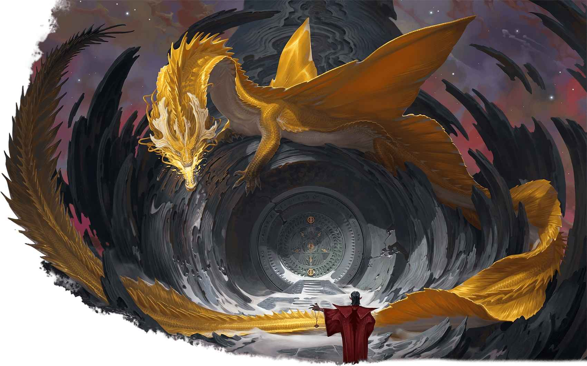

# 金龍 Gold Dragons

 

**成年金龍於某處玄秘封印外抵禦入侵者**

# 金龍 Gold Dragons

希望與威嚴之龍

**棲息地：** 森林，草原；**寶藏：**奧秘

金龍致力於讓世界變得更加美好。它們是金屬龍族中最為強大的一支，這些威嚴巨龍守護良善，並將命運引領至光明之道。儘管金龍心地善良，但在必要之時它們亦會加入戰鬥，以絢爛火炎與削弱魔法來擊潰敵人。
金龍偏愛草原與原始森林，常棲於大自然鬼斧神工造就的奇景附近；它們亦可能衛戍著古代文明的遺蹟。金龍的巢穴中囤積著錢幣與寶石，但它們亦常常將這些財物投入更大的目標中；金龍將金錢用於購入珍貴典籍，僱傭線人，以及資助志向遠大的冒險者。

## 金龍巢穴 Gold Dragon Lairs

金龍的家園通常位於絢麗奇景之中，無論其是誕生於自然偉力還是魔法之秘。
成年金龍及遠古金龍的巢穴所在區域將因其存在而轉化，產生以下效應：
**夢境信使 Dream Messenger。**若金龍身處巢穴內，其可以施展_托夢術 Dream_ ，無需材料成分並使用魅力作為施法屬性。以該方式施展此法術時，金龍可以指定6裡內的任何生物為目標。
**映照未來的霧影 Foretelling Fog。**巢穴1裡內因灰白色的雲霧處於輕度遮蔽 。霧氣中的璇流會映照出即將到來的危險，使身處區域內的生物不會被突襲。
若金龍死亡或是將其巢穴搬至別處，這些效應立即結束。
