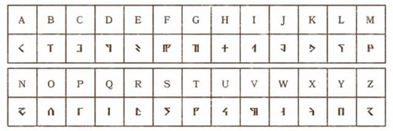
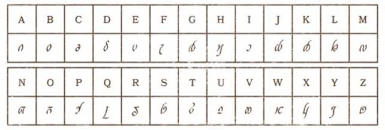
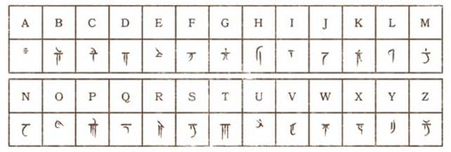

# 第四章：個性與背景

**第四章：個性與背景**Personality and Background

除種族和職業之外，一個角色還可以擁有更多作為補充的描述內容。作為獨特的個體，他們自身的故事、興趣、人脈和能力還可以用其他要素作定義。本章詳細解釋了每個角色區別於他人的各種細節，包括名字和身體特徵，背景與語言的規則，以及個性和陣營的閃光點。

## 角色細節 Character Details

你的角色首先被同桌玩家認知到的第一項信息即是其名字和生理特徵描述。因而這些信息值得你仔細在腦海中構思，並考慮如何將其個性表達出來。

**姓名****Name**

你的角色在選擇種族時，可以在相應的種族描述中找到相應的命名範例。不過就算你直接從所列舉的範例中選擇，也值得好好考慮選擇的標準。

**性別****Sex**

你可以隨意扮演男性或女性角色，並且不會因其性別差異而獲得任何特殊的增益或減益。思考一下角色在接觸各種文化時，對關於性別及與性別相關的行為和關係等內容時可能作出的反應。例如，一名男性卓爾成為了牧師，並因此違背了卓爾社會的性別歧視傳統，這也可能令他決心離開故鄉前往地表。
你不必受限於社會或自然的兩性選項。精靈神科瑞隆·拉瑞斯安 Corellon Larethian 就經常以中性性別或雌雄同體的形態出現，而多元宇宙中的一些精靈正是按科瑞隆的這種形象所創生。你同樣可以扮演一個將自己視作男人的女性角色，或是一個感到自己被困在女性身體中的男人，又或是一個恨自己錯生為男人的長鬍子女矮人。此外，你還可以隨意決定自己角色的性取向。

#### 提卡與阿提密斯：截然不同的角色
Tika and Artemis: Contrasting Characters

你可以按本章細節描述來講你的角色設定得更與眾不同。以下介紹兩名人類戰士以供參考。
在龍槍設定中活躍的提卡·維蘭 Tika Waylan 最初只是剛渡過粗野童年的傲慢年輕人。她生為盜賊的女兒卻從家中出逃，併到索拉斯鎮 Sloace 的街道上用從父親那學來的手藝過活。她在試圖搶劫最終歸宿旅店 Inn of the Last Home 的老闆時被抓，隨後便一直受老闆庇護並在店裡擔任女招待的工作。然而隨著巨龍聯軍將旅店連同索拉斯鎮一起夷為平地，提卡只能被迫與她自幼熟知的朋友們一同開始冒險生涯。她是一名熟練的戰士（最喜歡的武器是一把煎鍋），而曾經混跡街頭的經驗更是其冒險生涯的無價之寶。
阿提密斯·恩崔立 Artemis Entreri 在被遺忘的國度中卡林港 Calimport 的街道中長大。他靠著自己的強大的才智與身手在大片破棚屋街區裡闖出了自己的地盤。年輕的阿提密斯用幾年時間便成功受城中某個強大盜賊工會重用，並在其中節節高升，最終成了城中一位帕沙高官的御用刺客，並將其派遣到遙遠的冰風谷以尋回一些被盜的寶石。阿提密斯是一名老練的殺手，時刻不忘在自我挑戰中精進自己的技術。
提卡與阿提密斯同樣是人類並同樣是戰士（且都有著一些遊蕩者的經歷），且同樣擁有相對較高的力量值和敏捷值，不過他們的相似點也就只到這裡。

**身高與體重****Height and Weight**

你可以根據所選種族的描述信息，或根據表格“隨機身高體重”來決定角色的身高體重。設想一下角色的屬性值與其身高體重的關聯。一個柔弱而靈巧的角色可能會很瘦。而一個強壯堅韌的角色應該會顯得高大魁梧。
你也可以使用“隨機身高體重”表投骰決定角色的身高體重。身高調整值一欄中給出的投骰即是該角色超過基本身高的數值（以寸計）。這個骰值與體重調整值一欄給出的投骰或數量相乘，所得即是該角色超過基本體重的重量（以磅計）。

#### 隨機身高體重 Random Height and Weight

| **種族** | **基礎 身高** | **身高 調整值** | **基礎 體重** | **體重 調整值** |
| --- | --- | --- | --- | --- |
| 人類 | 4’8” | +2d10 | 110磅 | x (2d4) 磅 |
| 丘陵矮人 | 3’8” | +2d4 | 115磅 | x (2d6) 磅 |
| 山地矮人 | 4’ | +2d4 | 130磅 | x (2d6) 磅 |
| 高等精靈 | 4’6” | +2d10 | 90磅 | x (1d4) 磅 |
| 木精靈 | 4’6” | +2d10 | 100磅 | x (1d4) 磅 |
| 卓爾精靈 | 4’5” | +2d6 | 75磅 | x (1d6) 磅 |
| 半身人 | 2’7” | +2d4 | 35磅 | x 1 磅 |
| 龍裔 | 5’6” | +2d8 | 175磅 | x (2d6) 磅 |
| 侏儒 | 2’11” | +2d4 | 35磅 | x 1 磅 |
| 半精靈 | 4’9” | +2d8 | 110磅 | x (2d4) 磅 |
| 半獸人 | 4’10” | +2d10 | 140磅 | x (2d6) 磅 |
| 提夫林 | 4’9” | +2d8 | 110磅 | x (2d4) 磅 |

例如，作為一名人類，提卡身高4尺8寸加上2d10寸的身高。她的玩家投2d10得到骰值總和為12，所以提卡的直立身高為5尺8寸高。接著該玩家再使用這個骰值12乘以2d4磅。她投2d4的結果為3，所以提卡在110磅基礎上加36磅，即其體重為146磅。

**其他生理特徵****Other Physical Characteristics**

你可以隨意設定角色的年齡、髮色、瞳色和膚色。你也可以為其設定一些特別的生理特徵增強其存在感，比如一條疤痕，一條跛足或一幅刺青。

#### 提卡與阿提密斯：角色細節
Tika and Artemis: Character Details

思考提卡·維蘭與阿提密斯·恩崔立這兩個名字如何使這兩個角色顯得特別並反映其個性。提卡是一個決意證明自己不再是孩子的少女，她的名字聽起來就是個年輕的普通人。阿提密斯·恩崔立這名字則像是來自異邦，還附帶著一堆的謎團。
提卡在開啟其冒險生涯時年方十九，她長著紅褐色的頭髮，綠色的眼睛，皮膚白皙而面帶雀斑，其右臀上還長著一顆痣。阿提密斯是一個小個子男人，身材緊緻且肌肉結實。他面容瘦削且顴骨很高，總是一副需要剃鬍須的樣子。他長著烏黑濃密的頭髮，而一雙灰色的眼睛卻顯得毫無生機——透露著他生命與靈魂裡的空虛。

**陣營****Alignment**

DND 世界中任一個特定的生物都屬於與之相應的陣營，並以此大致反映該個體的品行舉止。角色的陣營由兩個因素組合而成：一個確定道德（善良、邪惡、中立），另一個則描述其對社會及秩序的態度（守序、混亂、中立）。兩個因素兩相組合，組成了九個不同的陣營。
以下關於九陣營的簡介描述了一個該陣營生物的典型行為。特定個體間的表現可能有著不小的差異，而且也很少有人能一貫完美的忠於其陣營準則。
**守序善良****lawful good**（LG）金龍和聖武士們通常是守序善良的。
**中立善良****neutral good**（NG）大部分天族都是中立善良的。
**混亂善良****chaotic good**（CG）黃銅龍和獨角獸通常是混亂善良的。
**守序中立****lawful neutral**（LN）魔冢們和大部分法師與武僧都是守序中立的。
**絕對中立****neutral**（N）德魯伊是最傳統的絕對中立者，城中的居民通常也是絕對中立的。

**混亂中立****chaotic neutral**（CN）大部分遊蕩者與詩人都是混亂中立的。
**守序邪惡****lawful evil**（LE）魔鬼和藍龍通常都是守序邪惡的。
**中立邪惡****neutral evil**（NE）尤格羅斯魔通常是中立邪惡的。
**混亂邪惡****chaotic evil**（CE）惡魔和紅龍通常都是混亂邪惡的。

#### 多元宇宙中的陣營 Alignment in the Multiverse

對於許多智慧生物而言，陣營是一種道德的選擇。人類、矮人、精靈以及其他類人種族能夠選擇遵循善良或邪惡、守序或混亂的任何道路。據神話記載，創造這些種族的善良陣營神們讓其造物們擁有自由意志以自行選擇其道德之路。
陣營是天族與邪魔本性中的一種根源本性。這兩種類型的生物都與其相關的存在位面——特別是外層位面——影響了他們的陣營。例如，大多數惡魔來自九層地獄，一個守序邪惡的位面。魔鬼不是自己選擇要成為守序邪惡或趨向於守序邪惡的，而是根源本性上是守序邪惡。如果它以某種方式變得不再守序邪惡，變成別的新陣營——那就將會是一段足夠有價值的，關於轉變的傳說。
陣營是天族與邪魔本性中的必要部分。一隻魔鬼不是由於選擇而成為守序邪惡的，而且與其說其傾向於守序邪惡，不如說守序邪惡即是其本質。如果某種情況下它不再表現守序邪惡的陣營特徵，則它也就不再是一隻魔鬼。
大部分缺乏理性思考能力的生物不屬於任何陣營（即是**無陣營****unaligned**）。這樣的生物不能作出道德或倫理的選擇，而單純依靠其野獸本能來行動。例如，鯊魚是兇猛的食肉動物，但並不邪惡，因此它們不屬於任何陣營。

**語言****Languages**

一般情況下，角色的種族同時還默認了其掌握的語言，而背景項則可讓該角色掌握更多額外的語言。這些所掌握的語言應該記錄在相應的角色卡上。
從表格“標準語言”中選出你所使用的語言，或者選擇一個你戰役中的常用語言。通過 DM 准許，你還可以從表格“特種語言”中選擇一門語言或是選擇一種秘密語言（例如盜賊黑話或德魯伊語），來代替一門自選語言。
這些語言門類中實際上包含了許多同一語種的方言。例如，原初語 Primordial 包括了氣族語 Auran、水族語 Aquan、火族語 Ignan 和土族語 Terran 幾種方言，每種方言對應了四個元素位面之一。而說同一語種不同方言的生物，依然能夠以其進行交流。

#### 標準語言 Standard Languages

| **語言** | **典型使用者** | **文字** |
| --- | --- | --- |
| 通用語 Common | 人類 | 通用語 Common |
| 矮人語 Dwarvish | 矮人 | 矮人語 Dwarvish |
| 精靈語 Elvish | 精靈 | 精靈語 Elvish |
| 巨人語 Giant | 食人魔、巨人 | 矮人語 Dwarvish |
| 侏儒語 Gnomish | 侏儒 | 矮人語 Dwarvish |
| 地精語 Goblin | 類地精 | 矮人語 Dwarvish |
| 半身人語 Halfling | 半身人 | 通用語 Common |
| 獸人語 Orc | 獸人 | 矮人語 Dwarvish |

#### 特種語言 Exotic Languages

| **語言** | **典型使用者** | **文字** |
| --- | --- | --- |
| 深淵語 | 惡魔 demon | 煉獄語 |
| 天界語 | 天族 celestial | 天界語 |
| 龍語 | 龍 dragon、龍裔 dragonborn | 龍語 |
| 深潛語 | 底棲魔魚 aboleth、斗篷怪 cloaker | — |
| 煉獄語 | 魔鬼 devil | 煉獄語 |
| 原初語 | 元素生物 elemental | 矮人語 |
| 木族語 | 妖精 fey creature | 精靈語 |
| 地底通用語 | 幽暗地域商人 | 精靈語 |

\*深淵 Abyssal、煉獄 Infernal、天界語 Celestial、龍語 Draconic、原初語 Primordial、木族語 Sylvan、地底通用語 Undercommon、深潛語 Deep Speech。

#### 提卡與阿提密斯：陣營
Tika and Artemis: Alignment

提卡·維蘭屬於中立善良陣營，她會本著一副好心腸隨時隨地竭力的幫助他人。阿提密斯則屬守序邪惡，他對於智能生物的性命漠不關心，但至少在其謀殺手法十分的專職。
作為邪惡一方的角色，阿提密斯並不是理想的冒險者。他的生涯在一開始就是一名惡棍，而他也僅會在必要時才與其他英雄合作——且只在他最感興趣時合作才成立。大多數遊戲裡，邪惡冒險者會在團隊的興趣目標與自己相左時引發問題。因此通常情況下，只有反派和怪物才會出現邪惡陣營的角色。

**人物特徵****Personal Characteristics**

賦予一系列特質、癖好、習慣、信仰和缺陷可讓你的角色形象更豐滿，且可以此在遊戲進行時讓角色更真實生動。以下列舉出人物特徵的四方面：特點、理想、牽絆和缺點。除此四點外，你還可以考慮為角色設計一些愛用的話句或短語，一些反覆性或習慣性動作，一些惡習或心病，或任何其他你想像到的特點。
囊括在本章後半部的每個背景都包括了一些可以直接使用的人物特徵建議。你也可以以之為基礎發揮自己的想像，而不必受限於這些選項本身。

#### 個性特點 Personality Traits

為你的角色賦予兩項特點。這些簡單的小描述可以讓你的角色區別於其他角色。角色的特點必須是能夠概括該角色吸引人或者娛樂人的某些方面。它們必須是該角色自述的某項令其自己更顯眼的事情。比如“我很聰明”就由於過於泛泛而不能算一項好特點。而“我讀過燭堡的每一本書”則可以為你概括出角色的一些興趣與性情。
特點可以描述該角色喜歡的事物，其過去的成就，其討厭或害怕的事物，角色的待人態度或習慣，或者是源於其屬性值的某些影響。

構思角色特點的一個可行方法是從角色最高和最低的屬性值出發，為這兩個屬性分別設置一個相關聯的特點。這兩個特點可以隨意設計成正面或是負面：比如你可能會想要努力鍛鍊克服某項低屬性，或是因某項高屬性而自大自滿。

#### 理想 Ideals

為你的角色描述一個理想。這個理想是該角色最強烈的信念，是從道德上和倫理上指引其行為的原則。角色的理想可以小到生活目標，大到核心信仰體系等任何事物。
理想可以作為某些問題的答案：什麼是你絕不會違背的原則？什麼能促使你作出犧牲？什麼驅動了你的行動並指引你的目標與追求？什麼是你最想為之努力的一件事物？
你可以隨意選擇你喜歡的理想，或者也可以從角色的陣營出發思考其理想。本章所述的每個背景都給出了六項理想範例。其中五個與某個陣營相關：守序、混亂、善良、邪惡和中立。最後一條會與相應背景項相符而不與道德或倫理相關。

#### 牽絆 Bonds

為你的角色設置一個牽絆。這個牽絆是該角色與其世界上的人物、地點和事件的聯繫。這種聯繫將你與所處的背景綁定。一旦其承受威脅，則可能令你奮起努力或是瞬間激發英雄氣概，又或是使你性情大變。某種方面來講，牽絆會以與理想相似的方式驅動角色的動機與目標。
牽絆可以作為某些問題的答案：誰是你最關心的人？哪個地方能使你感受到某種特別的聯繫？什麼是你最珍視的所有物。
角色的牽絆可以關聯其職業，背景，種族，又或者關聯該角色的過去和性格等其他方面。此外你在冒險旅途中也可能產生新的牽絆。

#### 缺點 Flaws

最後，為你的角色選擇一個缺點。角色的缺點指代某項惡行，衝動，恐懼或弱點——最好是某些能被利用來將你推進墳墓或是令你性情大變的事情。跟負面的角色特點相比，缺點可以作為某些問題的答案：什麼可以激怒你？哪些是你所懼怕的人物、想法或事件？你的惡習是什麼？

#### 提卡與阿提密斯：人物特徵
Tika and Artemis: Personal Characteristics

提卡與阿提密斯有著鮮明的人物特徵。提卡·維蘭討厭自誇，且因曾經某次作賊時失足而落下恐高的毛病。阿提密斯·恩崔立總是習慣先作最壞打算，且總是迅速而精確的把握狀況後再付諸行動。
而關於他們的理想：提卡·維蘭是個天真的人，有時候幾乎就是個孩子。她重視生命本身以及每個人的存在價值。其中立善良陣營也代表了她堅守生命與尊重至上的理想。阿提密斯·恩崔立從不會讓情緒左右自己，並且常常自我挑戰來精進自己的技術。其守序邪惡陣營也代表了他公平和渴求力量的理想。
提卡·維蘭的牽絆是最終歸宿旅店。遇到旅店老闆是她生命中的一個轉折點，而她與冒險夥伴的友誼也是建立在其旅店工作時期。旅店被巨龍聯軍的劫掠所摧毀的事實，為提卡對其強烈的憎恨提供了一個非常合理的個人理由。她的牽絆可以說成“為了讓摧毀最終歸屬旅店的巨龍聯軍受到懲罰，我願意做任何事情。”
阿提密斯·恩崔立的牽絆是與崔斯特·杜惡登間一段怪異且近乎反常的關係。當他與對手，那個劍術和信念都與其旗鼓相當的崔斯特完成他們第一場戰鬥後，阿提密斯就從其對手身上看到了自己的影子，讓他看到了自己可以過上與這位卓爾英雄相似人生的可能性。自那一刻起，阿提密斯就不再是一名單純的罪惡刺客——他被這種對崔斯特的執著驅使，成為了一名反派英雄。他的牽絆可以說成“我在證明自己比崔斯特·杜惡登更強之前絕不休息。”
這兩名角色都分別有一項嚴重的缺點。提卡·瓦維蘭天真而多愁善感，並且時常苦惱於因在同伴中年齡最小而時常被當作還是個孩子。為證明自己能夠獨當一面，她可能會受鼓動做出某些違背自己原則的事。阿提密斯·恩崔立則完全隔絕任何私人關係，獨斷獨行。

## 激勵 Inspiration

激勵是一項由 DM 視情況運用的額外獎勵規則，用以幫助角色在扮演中凸顯其個性特點、理想、牽絆以及缺點。通過使用激勵，在與乞丐王子 Beggar Prince 交涉時，你能因同情壓迫者的個性而與之針鋒相對；或是面對某個法術效應時，因你保衛家鄉的牽絆而強行避開傷害。

**獲得激勵****Gaining Inspiration**

你的 DM 可以用各種理由給予你激勵。典型的範例如：你在扮演時凸顯了角色的個性特點；由於缺點或牽絆而使角色不得不屈服；甚至是生動的詮釋你所扮演的角色時，DM 都可以酌情給予你獎勵。具體情況皆由你的 DM 對其作出解釋。
面對某件事情時，你只會是有或者沒有激勵。“激勵”無法積累起來留待後用。

**使用激勵****Using Inspiration**

你獲得的激勵，可以用於你的一次攻擊檢定，豁免檢定或屬性檢定。使用激勵可以使你的該次擲骰具有優勢。
另外，你所擁有的激勵可以使用在其他玩家身上，用以協助其更好的扮演角色，或是用於一個巧妙的時機，又或者只是用來讓遊戲顯得更有意思。當你覺得另一位玩家角色的行為讓故事發展變的更歡樂更有趣時，你可以考慮將自己的激勵給予該角色以推動故事發展。

## 背景 Backgrounds

每個故事都有一個開頭。角色的背景項解釋了其來歷，如何成為一名冒險者，以及其在世界中的地位。你的戰士可能曾經是一名勇敢的騎士或一名愛哭愛抱怨的士兵。你的法師可能曾經是一名賢者或一名工匠。你的遊蕩者可能曾經是一名公會盜賊或是一名蠱惑大眾的宮廷弄臣。
選擇一個背景為你提供了關於該角色身份的重要故事提示。該背景所述的關鍵問題是：_什麼發生了變化_？你是由於什麼原因而放棄背景所描述的生活轉而開始了冒險？你如何獲得你的起始裝備？或者，如果你曾經富有，為何你沒有更多的錢財？你如何學會現在的職業技能？又是什麼讓你與故鄉里的普通人有所區別？
以下的背景範例既提供了相應的具體增益（特性、熟練項以及語言）又提出了相應的角色扮演建議。

#### 提卡與阿提密斯：背景
Tika and Artemis: Backgrounds

提卡·瓦蘭和阿提密斯·恩崔立早年都是作為流浪兒混跡在街頭。提卡之後的女招待生涯並沒有改變其本性，因此她可能會選擇流浪兒背景，並以此獲得巧手與隱匿技能的熟練項，並且學會使用盜賊賴以謀生的工具。阿提密斯則更受其罪犯背景所影響，並因此掌握欺瞞與隱匿技能，同時還熟悉盜賊工具和製毒工具的使用。

#### 熟練項 Proficiencies

每個背景給予兩個技能的熟練項。關於技能詳見第7章。
另外，大多數背景都會給予角色一種或多種工具的熟練項。關於工具熟練項的內容詳見第5章。
如果一個角色以兩種不同的方式獲得同樣的熟練項，則該角色可以選擇以相同種類（技能或工具）一個不同的熟練項作替代。

#### 語言 Languages

某些背景還允許角色掌握其種族語言外的額外語言門類。見前文的“語言”欄目。

#### 裝備 Equipment

每個背景提供一份起始裝備。如果你選擇使用可選規則用貨幣購買裝備，則無法同時從背景項中獲得起始裝備。

#### 建議特徵 Suggested Characteristics

每個背景項的描述中包含了基於該背景的人物特徵建議。你可以在其中自選其特徵，或擲骰以隨機決定，甚至可以參考建議自創一項人物特徵。

#### 自定義背景 Customizing a Background

你可能會想要改變一些背景中的特性，以使其更好地適合角色或戰役設定。自定義背景時，你可以從範例背景出發，隨意替換其中一項特性，任選兩項技能，並任選總計兩項工具熟練項或語言項作類似的替換操作。你可以直接使用背景中給出的裝備項，或者參照第5章的內容使用貨幣進行購買，只是使用貨幣購買時不能同時獲得你的職業起始裝備。最後，你可以選擇兩個特點，一個理想，一個牽絆和一個缺點。找不到符合背景需求的特性時，你還可以跟你的 DM 商量自創一個。

**矮人語文字字母範例**

**精靈語文字字母範例**

**龍語文字字母範例**

