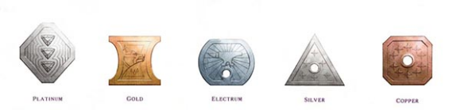

# 財富

財富在 DND 世界中的形式多種多樣。貨幣，寶石，貿易貨物，藝術品，動物和不動產，它們同時還能反映角色穩定的財富狀況。農民階級以穀物和乳酪作為商品出售或是用來以物易物，並以之滿足日常的需求或繳納稅款。貴族們則是以法定權限如採礦權，停泊權或開墾權等作為商品出售，其價值均是以磅計量的金磚而非以幣量衡量。只有商人、冒險者和那些提供專業僱傭服務的人才總是用貨幣進行交易。

**幣制****Coinage**

普通貨幣有著數個不同的幣值單位，該幣值單位基於鑄造它們所使用的金屬的相對價值。三種最常見的貨幣是金幣（gp），銀幣（sp）和銅幣（cp）。
一枚金幣可以購買一個小包，50尺的優質繩索或一頭山羊。一名純熟（但並不傑出）的工匠每日就可以掙取一枚金幣。儘管金幣並不經常直接用於交易，但卻是度量財富的常用單位。當商人們商談價值千百金幣的貨物或服務時，其交易通常並不包含個別貨幣的交換。某種程度上金幣只是衡量價值的一個標準，而實際交易中通常是使用金條，信用狀或其他值錢的商品。
一枚金幣值十枚銀幣，而銀幣則是普通人之間最流行的貨幣。一枚銀幣可以僱傭一名苦力工作半日，可以購買一罐燈油，或是讓你在一家簡陋的旅館休息一夜。
一枚銀幣值十枚銅幣，而銅幣則常在乞丐與苦力中流通。一枚銅幣能買一根蠟燭，一支火把或是一塊粉筆。
另外，用其他貴重金屬製作的貨幣偶爾也會出現在寶藏中。銀金幣（ep）和鉑金幣（pp）發行於衰亡的帝國和失落的王國，它們常常伴隨著某些疑慮，有時也會在交易引其對方的懷疑。一枚銀金幣價值五枚銀幣，而一枚鉑金幣價值十枚金幣。
一枚標準的貨幣約重三分之一盎司 ounce，所以五十枚貨幣重約一磅 pound。

#### 標準兌換率 Standard Exchange Rates

| **貨幣** | **cp** | **sp** | **ep** | **gp** | **pp** |
| --- | --- | --- | --- | --- | --- |
| 銅幣(cp) | 1 | 1/10 | 1/50 | 1/100 | 1/1000 |
| 銀幣(sp) | 10 | 1 | 1/5 | 1/10 | 1/100 |
| 銀金幣(ep) | 50 | 5 | 1 | 1/2 | 1/20 |
| 金幣(gp) | 100 | 10 | 2 | 1 | 1/10 |
| 鉑金幣(pp) | 1000 | 100 | 20 | 10 | 1 |

**出售財寶****Selling Treasure**

在你探險的地下城中有著大把的機會找到寶藏，裝備，武器，護甲等物品。一般情況下，當你回到城市或村鎮中時，可以將寶藏和小飾品售出以換取貨幣，前提是你必須可以找到對它們感興趣的買家或商人。
**_武器、護甲與其他裝備_****_Arms, Armor, and Other Equipment_**。按照慣例，未損壞的武器護甲及其他裝備物品能以市價的一半出售。而怪物們使用的武器和護甲通常狀態低劣，很難賣出好價錢。
**_魔法物品_****_Magic Items_**。魔法物品的出售存在種種問題。找一個買藥劑或卷軸的人並不太難，但是其他魔法物品則只有最有錢的貴族能消費的起。類似的情況是，你也很難買到常見魔法物品之外的魔法物品或法術。魔法的存在無法單純用金子來衡量其價值，並且理應一直保持這種情況。
**_寶石、珠寶與藝術品_****_Gems, Jewlry, and Art Objects_**。這些物品在市場中能夠以其全額價格進行交易，而且既可以將其兌換成貨幣，也可以直接用作硬通幣來進行交易。對於特別有價值的財寶，DM 可能會要求你到一座大城鎮或是大社群裡尋找買家。
**_貿易貨物_****_Trade Goods_**。在邊境地帶，許多人通過物物交換經營交易。像寶石和藝術品一樣，貿易貨物（鐵條、袋裝的鹽巴以及牲畜等）在市場中都可以以其全額價值進行交易，因此也可以直接用作交易用的通幣。

