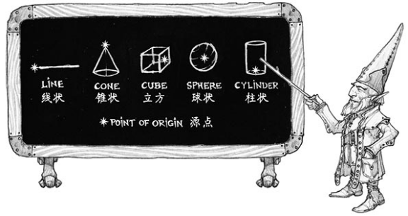

# 施展法術

任何角色施展法術時，其使用的都是同一套規則而不論角色的職業種類或法術效應如何。
在第11章裡，每項法術的描述的開頭都是一組同類的信息，其中包括法術的名稱、環階、學派、施法時間、施法距離、法術成分和持續時間。餘下的描述則具體說明該法術的相關效應。

> #### **邊欄：著甲施法****Casting in Armor**
> 
> 由於施法時需要專心致志和姿勢正確，你在著甲施法時必須具有所著裝護甲的熟練項才能成功施展法術。否則你的護甲會阻礙你的動作，並使你分心妨礙施法的進行。

**施法時間****Casting Time**

大部分法術的施展時間只算作一個動作，而有的法術則需要執行一個附贈動作，一個反應或是需要更長的施法時間。

#### 附贈動作 Bonus Action

以附贈動作施法的法術特別迅捷。你可以在自已回合內以一個附贈動作施展該法術，前提是你在本回合內必須未執行任何附贈動作。在使用附贈動作施法的同一個回合裡，你只能施展施法時間為1動作的戲法，除此之外不能施展其他法術。

#### 反應 Reaction

某些法術可以作為反應進行施展。這類法術通常只需要幾分之一秒完成，因此可以用作對事件的應對。如果一項法術可以作為反應進行施放，則法術的詳細描述會明確說明你在什麼情況下能以它作反應。

#### 長時間施展 Longer Casting Times

某些法術（包括進行儀式施法的法術）要數分鐘甚至數小時來進行施放。當你所施展法術的施法時間超過一個動作或一個反應時，則你必須在法術施展期間每個自己的回合裡都用你的動作來施展該法術，同時還必須保持專注（見下文的“專注”）。如果你失去專注，則法術失敗，不過你並不會因此消耗法術位。如果你想再次施展該法術，則必須重新開始其施法程序。

**施法距離****Range**

法術的目標必須在法術的施法距離內。對於如_魔法飛彈_ 一類的法術，其目標是一個生物。而對於_火球術_ 一類的法術，其目標則是火球爆開時所處空間的那一點。
大多數法術的施法距離以尺作度量。某些法術只能以你觸碰的生物作為目標（包括你自身）。還有些法術隻影響施術者本身（比如_護盾術__shield_），這些法術的施法距離即為自身。
以你為源點創造錐狀或線狀效應的法術其施法距離也算作自身，表示該法術效應源點必須是你。（詳見本章的“效應範圍”）

法術一旦施放，其效應的作用範圍就不再受施法距離的限制，除非法術另有說明。

**法術成分****Components**

法術的成分是施展該法術時必須滿足的物質條件。每項法術的描述中都會說明其施展時是否需要言語 verbal（V）、姿勢 somatic（S）、材料 material（M）等成分。你只有滿足一項法術所有的成分需求後才能施展相應的法術。

#### 言語 Verbal（V）

大多數法術都需要詠唱咒文。雖然這些咒文並不給法術供應魔力，但其特定音高共鳴的聲音組合卻可以牽動魔網的絃線來完成施法。因此，如果你被塞住嘴巴或者身處靜默的空間（如_沉默術__silence_的效應範圍），則你將不能施展帶言語成分的法術。

#### 姿勢 Somatic（S）

施法姿勢可能包括一記固定的手印或一整套精巧的動作。如果有法術需要姿勢成分，則施法者必須至少空出一隻手來完成這些手勢。

#### 材料 Material（M）

某些法術需要特定的物件才能施展，成分條目裡會用括號具體註明。角色們可以使用**材料包****component pouch**或**法器****spellcasting focus**（詳見第5章）取代法術所指定的材料。但如果一項法術的材料成分有指定的價格，則其每次施展時就必須備有這種特殊材料才行。
如果法術的詳述說某材料會作為該法術的耗材，則施法者每次施展該法術時都必須提供該材料。
施法者必須有一隻空手去完成姿勢和/或材料成分，但完成材料成分的手（從材料包中取出材料，或持握法器）可以是完成施法姿勢的同一隻手。

**持續時間****Duration**

法術的持續時間即是法術生效的時間長短。一個法術的持續時間可以用輪、分鐘、小時、甚至年月來度量。某些特定法術的效應甚至會一直持續至該法術被解除或被破壞。

#### 立即 Instantaneous

許多法術都是立即的。它們會以某種方式瞬間造成傷害、治療、創造、或改變某個生物或物件。由於其魔法只存在於一瞬間，因此其產生的後果無法在事後被解除。

#### 專注 Concentration

某些法術需要你保持專注才能保持其魔力的激活。如果你失去了專注，法術也將隨即終結。
需要專注的法術會在其持續時間條目中說明，同時還會指明為其保持專注情況下法術能持續時間的上限。你可以隨時終止你的專注（無需動作）。
常規的活動——例如移動或攻擊——並不會影響你的專注，可以打斷你專注的因素如下：

-   **施展另一個需要專注的法術。**當你施展另一個需要專注的法術時，你失去原來的專注。也就是說，你不能同時為兩個法術進行專注。
    
-   **受到傷害**。如果在你專注於法術期間受到了傷害，你必須通過一次體質豁免來維持自己的專注。該豁免 DC 為10或你所受傷害值的一半，以兩者中較高值為準。如果你同時從多個不同的來源處受到了傷害（例如箭矢與龍的吐息），你必須分別為每個不同來源的傷害各投一次豁免。
    
-   **失能或被殺。**當你陷入失能狀態或死亡時，也會失去當前的專注。
    

DM 也可以判定你的專注會被某些特定的情況干擾。例如你被暴風雨中掩面而來的巨浪擊退時，DM 可以要求你進行一次 DC10的體質豁免，以維持你的專注不中斷。

**目標****Targets**

大部分法術都會需要你指定一名或多名受法術魔法影響的目標。法術的相關描述會詳述其目標為生物，物件或是作為區域效應原點的空間內某一點（詳見下文）。
除非法術有可以觀察到的效應，否則作為目標的生物不會知道自己已成為法術的目標。噼啪作響的閃電打中誰是大家都看得見的，但讀心等較不顯眼的效果一般都不會被發現，除非法術另有說明。

#### 與目標間暢通無阻 Clear Path to the Target

指定目標時，其與你之間必須暢通無阻，因此目標不可以相對你處於全身掩護狀態。
如果你將法術效應範圍的目標指定在你看不見的地方，而你和該地點之間存在障礙（例如一面牆），則法術的源點改成在該障礙靠近你的一邊。

#### 以自身為目標 Targeting Yourself

如果法術的目標是由你指定的生物，則你也可以選擇自身作為目標，除非法術描述中明確說明該目標必須是敵對生物或必須不是你自身。你身處自己所施展法術的效應範圍之內時，也可以指定自身為法術目標。

> #### **邊欄：魔法學派****Schools of Magic**
> 
> 眾魔法學院將各種法術分成了八個類別，即為魔法學派。學者們，尤其是法師們，會將所有法術依此歸類，並相信所有法術本質上都以相同的方式運作，而不論其是得自慎密的研習，還是來自神的恩賜。
> 魔法學派的分類可以為法術的描述作補充。它們本身不帶任何規則，但其他的規則可能會與其相關。
> **_防護_****_Abjuration_**。防護法術的本質是守護，不過當中也有某些帶攻擊性的用途。它們可以創造屏障，抵消有害的效應，傷害入侵者，或將生物驅逐到其他存在位面。
> **_咒法_****_Conjuration_**。咒法法術牽涉到將物體和生物從一處傳送到另一處。其中某些法術會將生物或物體召喚到施術者身邊，而有些則將施法者傳到另一地方。有些咒法還可以憑空創作物件或效應。
> **_預言_****_Divination_**。預言法術揭露資訊，其形式可以是失傳的秘密，未來的映像，秘寶的藏地，幻象的真相，又或者是遠方人物或區域的異象。
> **_惑控_****_Enchantment_**。惑控法術影響他人的心智，改變或控制他們的行為。這些法術可能令敵人視施術者為朋友，或者強迫生物作出特定行為，甚至像扯線人偶一樣操縱其他生物。
> **_塑能_****_Evocation_**。塑能法術將魔法能量塑造成想要的效應。有些會喚出一陣火焰或閃電。有些則會導來正能量治療傷口。
> **_幻術_****_Illusion_**。幻術法術可以蠱他人的感官或心靈。它們令人看見不存在的事物，或者看不見存在的事物，還可以使人幻聽或記起沒有實際發生過的事。有些幻象任何人都可見，而最陰險隱秘的幻象則會直接將影像植入某生物的思想中。
> **_死靈_****_Necromancy_**。死靈法術操縱生與死的能量。這些法術可以賦予額外的生命力，或從他人身上汲取生命能量，還可以創造亡靈，甚至起死回生。
> 用死靈法術創造亡靈（如_活化死屍__animate dead_）並不是善良的行徑，只有邪惡的施法者者才會常用這些法術。
> **_變化_****_Transmutation_**。變化法術讓生物，物體，或環境的屬性發生改變。它們可能將敵人變成無害的生物，強化友方的力量，或是令物件活起來聽從施法者的指令，又或是強化生物的天生自愈能力讓其傷勢迅速復原。

**效應範圍****Areas of Effect**

_燃燒之手__burning hands_和_寒冰錐__cone of cold_等法術的效應會覆蓋一片區域，並同時影響其中的多名生物。
法術的相關描述裡會詳細說明其效應範圍，通常為以下五種形狀區域之一：錐狀、立方、柱狀、線狀、球狀。效應範圍都會有一個爆發魔法能量的**源點****point of origin**。以下每種形狀範圍的規則裡都詳述瞭如何設置相應的源點。源點通常是一個特定地點，有些法術也會要求用生物或物件作為源點。

法術的效應從源點開始以直線擴散。如果由源點到效應範圍內的某點的直線受阻，則該地點會被排除在該法術的效應範圍之外。要構成阻礙，則被阻礙物必須處於全身掩護中（詳見第9章）。

#### 線狀 Line

線狀效應範圍由源點以一條直線延伸出去，法術會說明其線長和線寬。
你可以自行決定線狀區域效應的源點是否包含在效應內，默認情況下不包括。

**錐狀****Cone**錐狀效應會從源點往你所選的方向擴散，其寬度等於該處到源點的距離。錐狀區域的效應都有一個特定的最大長度。
你可以自行決定錐狀效應範圍的源點是否包含在效應內，默認情況下不包括。

#### 立方 Cube

你自選立方體效應範圍六面上的任一點作為其源點。而立方效應範圍都會給出相應的單邊的邊長。
你可以自行決定立方區域效應的源點是否包含在效應內，默認情況下不包括。

**球狀****Sphere**

你先選擇球狀效應範圍的源點，然後魔法能量以該點為中心向外擴散構成球形。球形的半徑以尺數標示。
球狀區域效應的源點包含在效應之內。

#### 柱狀 Cylinder

柱狀效應範圍的源點是其中一個截面圓的中心，相應法術的描述中會說明其圓的半徑。而源點的截面圓必須位於地上，或位於法術效應範圍的頂部。柱狀的能量由源點直線展開到圓的周界，形成圓柱的底盤。然後，法術的效應從該截面圓由地面往上射或者從頂上往下射，直到達到柱狀的高度。
柱狀區域效應的源點包含在效應之內。

**豁免檢定****Saving Throws**

很多法術會說明目標可以進行一次豁免來回避法術部分或全部的效應。相關法術的描述中會詳細說明使用的什麼屬性來進行豁免，以及豁免成功和失敗的後果。
你的法術的豁免 DC 為8＋你的施法屬性調整值＋你的熟練加值＋其他適用的調整值。

**攻擊檢定****Attack Rolls**

某些法術會要求施法者進行攻擊檢定來決定法術是否有命中指定的目標。你進行法術攻擊的攻擊加值等於你的施法屬性調整值＋你的熟練加值。
大多數需要攻擊檢定的法術屬於遠程攻擊。其同樣要遵守你在敵對生物的5尺範圍內進行遠程攻擊時所具有的劣勢減益，前提是該生物必須能看見你且其本身不處於失能狀態（見第9章）。

**法術效應混合****Combining Magical Effects**

所有生效中的不同法術效應都會累加，而相同的法術就算進行多次施展也不會累加。不過，多次施展相同的法術時只對其中效應最強者生效，也就是當中具有最高加值或最低減值的一個法術，會在時效重疊時起效。或是在這些效應強度相同且時效重疊時，選其中最新施展的效應生效。
例如，假設兩名牧師對同一目標施展_祝福術__Bless_，則受術角色只得益一次而不會獲得投兩次附贈骰子的機會。

> #### **邊欄：魔法之網****The Weave of Magic**
> 
> DND 多元宇宙中的世界都是充滿魔法的地方，其內所有存在都浸透著魔法的力量。每一塊石頭，每一條溪流，每一個活物，甚至是空氣本身都蘊含著未開發的潛在能量。這些原生的魔法是造物的原料，也是尚且靜默的存在意識，它滲透在每一點物質中，又在多元宇宙中以各種能量的形式作表現存在。
> 凡人無法直接使用這些原生魔法，但卻可以借力於一種魔法的織造結構作為連接施法者意識與原生魔法原料的橋樑。被遺忘國度的施法者將其稱為魔網 Weave，並奉其本源為女神密斯特拉 Mystra。施法者們對這種橋樑的命名和認知各不相同，但不管如何稱呼，沒有魔網，原生魔力就被鎖定而無法觸及。最強大的大法師在魔網被阻絕的地方也休想用魔法點燃一根蠟燭。而在魔網環繞的地方，施法者就能招來閃電重擊敵人，或在一瞬間傳送到千里之外，或甚至可以逆轉死亡。
> 所有魔法都與魔網緊密相關，只是不同的法術與魔網的接觸方式各不相同。法師、魔契師、術士和詩人的法術稱為**奧術魔法****arcane magic**。這種法術必須先（通過學習或直覺）理解魔網的工作原理。這些施法者會直接牽動魔網的經緯，來創造出所需的效應。奧法騎士和詭術師也同樣使用奧術魔法。而牧師、德魯伊、聖武士和遊俠的法術則稱為**神術魔法****divine magic**。這些施法者與魔網的聯繫還要藉助各種神聖力量——眾神、大自然的神力或是聖武士誓言的神聖意義。
> 每一個被創造出的魔法效應都是魔網的經緯經過纏結、扭曲、摺疊等操作塑造出的效果。某個角色施展預言法術如_偵測魔法__detect magic_或者_鑑定術__identify_時即是瞥見魔網本身。法術如_解除魔法__dispel magic_即是撫平魔網，而法術如_反魔法場__antimagic field_則是將魔網重新修整，並讓魔法在法術範圍之外流過，而不是穿行其中。而在魔網受損或被阻斷的地方，魔法的效應將變得不可預測，甚至徹底消失。
