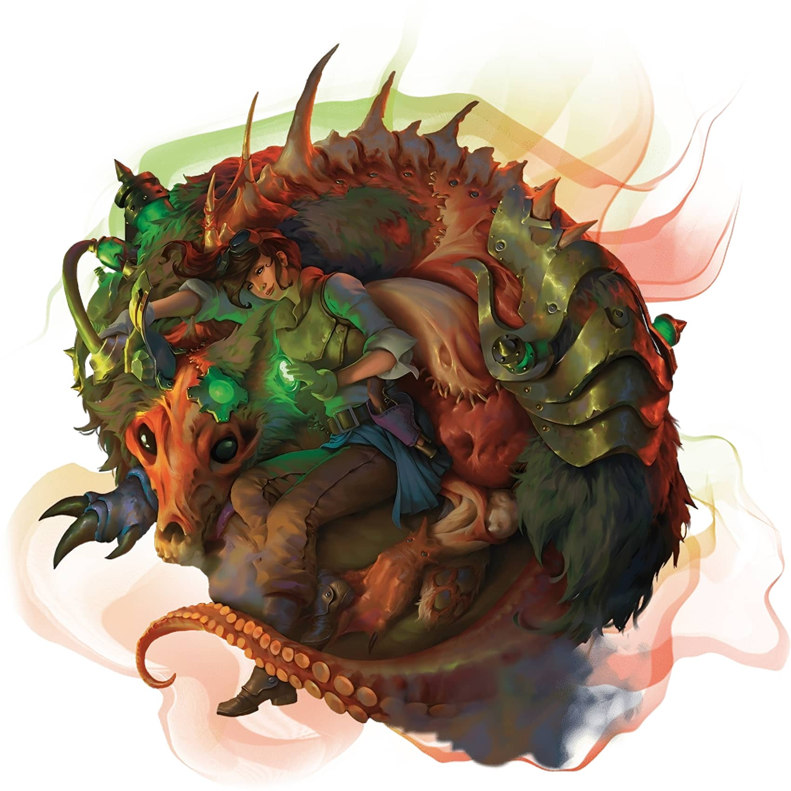

# 奇械師-蘇生師

## 蘇生師 Reanimator

復生亡者，重組屍骸

蘇生師無視自然法則，只為追求那些駭人聽聞的實驗。這些陰森的奇械師將來自不同屍體的殘骸縫合成僕從，以汙穢而禁忌的魔法強化生者，並將死靈術轉化為一種令人戰慄的科學。

**3級：蘇生師法術 Reanimator Spells**
當你到達蘇生師法術表中特定的奇械師等級時，你就始終準備著表中對應的法術。
**蘇生師法術 Reanimator Spells**

| **奇械師等級** | **法術** |
| --- | --- |
| 3 | _維生術 Spare the Dying 虛假生命 False Life、巫術箭 Witch Bolt_ |
| 5 | _目盲術/耳聾術 Blindness/Deafness、強化屬性 Enhance Ability_ |
| 9 | _活化死屍 Animate Dead、閃電束 Lightning Bolt_ |
| 13 | _枯萎術 Blight、防死結界 Death Ward_ |
| 17 | _防活物護罩 Antilife Shell、死者復活 Raise Dead_ |

**3級：蘇生師技藝 Reanimator's Skill Set**
你獲得以下增益。
**電顫復律 Jolt to Life。**你施展_維生術 Spare the Dying_ 時，可以修改此法術使其向目標發射一陣電流，令其回生。目標恢復等於你奇械師等級的生命值，且位於源自其10尺光環區域內的每名你選擇的生物必須進行一次對抗你法術豁免 DC 的敏捷豁免，豁免失敗則受到2d4閃電傷害，豁免成功則受到一半傷害。
你能夠以此法修改法術的次數等於你的智力調整值。你在完成長休時重獲所有已消耗的使用次數。此特性的閃電傷害在你的奇械師等級達到11級（3d4）和17級（4d4）時提高1d4。
**蘇生師工具 Reanimator's Tools。** 你獲得鍊金工具的熟練。若你已經擁有其熟練，則你獲得另一種你選擇的工匠工具的熟練。

**3級：蘇生伴兵 Reanimated Companion**
你能夠以一個魔法動作，使用修補工具或你具有熟練的其他種類的工匠工具，通過亡靈法術與科學的力量創造一名**蘇生伴兵 Reanimated Companion** （數據卡見下）。伴兵顯現於你5尺的未佔據空間中。伴兵的外觀由你決定，但你的選擇不會改變其遊戲數據。
伴兵對你和你的盟友態度友善並服從於你。伴兵存在持續至你完成長休，或在你執行魔法動作令其解散時提前結束。此時伴兵無害地坍塌為一堆內臟。若你死亡，則伴兵立即降至0生命值並死亡（觸發其自爆特質）。
一旦你創造了一名伴兵，你無法再次創造伴兵直至你完成長休或你消耗一個法術位來創造伴兵。你同時只能擁有一名伴兵，伴兵存在期間你無法創造伴兵。
**戰鬥中的伴兵 The Copanion in Combat。** 在戰鬥中，伴兵在你的回合內行動。其可以移動並自行執行反應，但除非你以附贈動作命令其執行動作，否則其唯一可用的動作是迴避動作。若你陷入失能狀態，則伴兵會自行行動且不再限制於迴避動作。

| ## 蘇生伴兵 Reanimated Companion *中型亡靈，中立* **AC** 10+你的智力調整值 **HP** 5+五倍你奇械師等級（伴兵具有等於你奇械師等級的生命骰\[d8\]） **速度** 30尺 \| 屬性 \| 數值 \| 調整 \| 豁免 \| \| --- \| ---: \| ---: \| ---: \| \| 力量 \| 11 \| +0 \| +0 \| \| 敏捷 \| 10 \| +0 \| +0 \| \| 體質 \| 16 \| +3 \| +3 \| \| 智力 \| 4 \| -3 \| -3 \| \| 感知 \| 10 \| +0 \| +0 \| \| 魅力 \| 6 \| -2 \| -2 \| **抗性** 暗蝕，毒素 **免疫** 閃電；魅惑，力竭，中毒 **感官** 盲視60尺；被動察覺10 **語言** 理解你知曉的語言 **CR** 無（XP 0； PB 等於你的熟練加值） ### 特性 Traits **自爆 Death Burst。**伴兵在其死亡時爆炸。_敏捷豁免檢定：_DC 等於你的法術豁免 DC，源自伴兵的10尺光環區域內的每名生物。_失敗：_2d4暗蝕傷害。_成功：_半傷。 **閃電吸收 Lightning Absorption。**每當伴兵將受閃電傷害時，其恢復等於閃電傷害數值的生命值。 ### 動作 Actions **恐怖橫掃 Dreadful Swipe。**_近戰攻擊檢定：_加值等於你的法術攻擊加值，觸及5尺。_命中：_1d4加你的智力調整值的暗蝕傷害，且目標無法執行藉機攻擊直至其下個回合開始。 |  |  |  |  |  |  |  |  |  |  |  |  |  |
| --- | --- | --- | --- | --- | --- | --- | --- | --- | --- | --- | --- | --- | --- |
| **AC** 10+你的智力調整值 |  |  |  |  |  |  |  |  |  |  |  |  |  |
| **HP** 5+五倍你奇械師等級（伴兵具有等於你奇械師等級的生命骰\[d8\]） |  |  |  |  |  |  |  |  |  |  |  |  |  |
| **速度** 30尺 |  |  |  |  |  |  |  |  |  |  |  |  |  |
|  |  | 調整 | 豁免 |  |  |  | 調整 | 豁免 |  |  |  | 調整 | 豁免 |
| **力量** | 11 | +0 | +0 |  | **敏捷** | 10 | +0 | +0 |  | **體質** | 16 | +3 | +3 |
| **智力** | 4 | \-3 | \-3 |  | **感知** | 10 | +0 | +0 |  | **魅力** | 6 | \-2 | \-2 |
| **抗性** 暗蝕，毒素 |  |  |  |  |  |  |  |  |  |  |  |  |  |
| **免疫** 閃電；魅惑，力竭，中毒 |  |  |  |  |  |  |  |  |  |  |  |  |  |
| **感官** 盲視60尺；被動察覺10 |  |  |  |  |  |  |  |  |  |  |  |  |  |
| **語言** 理解你知曉的語言 |  |  |  |  |  |  |  |  |  |  |  |  |  |
| **CR** 無（XP 0； PB 等於你的熟練加值） |  |  |  |  |  |  |  |  |  |  |  |  |  |

**5級：怪異改造 Strange Modifications**
每當你創造一名蘇生伴兵時，你選擇以下選項之一令其獲得之。你在創造伴兵時進行選擇。
**魔導 Arcana Conduit。** 你可以如同身處伴兵所在的空間一樣施展法術，但你仍需使用你自己的感官。每回合一次，每當你施展一道塑能或死靈學派的奇械師法術並造成傷害時，若伴兵位於你120尺內，則你將你的智力調整值加入該法術的其中一枚傷害骰。
**兇殘 Ferocity。**伴兵恐怖橫掃動作的傷害骰增加至1d6。

**9級：強化蘇生 Improved Reanimation**
你蘇生伴兵的自爆傷害增加至4d4。你伴兵造成的暗蝕傷害無視抗性。

**9級：駭懼改造 Macabre Modifications**
你嘗試進一步改造你的伴兵。每當你創造一名蘇生伴兵時，伴兵可以獲得兩個（而非一個）怪異改造選項。此外，你選擇怪異改造選項時也可以從以下選項中選擇。
**腫脹 Bloated。**伴兵變為大型。每當其以恐怖橫掃動作命中不超過大型的生物時，該生物被伴兵推離至多10尺。此外，你可以將你的智力調整值加入伴兵自爆造成的傷害。
**枯瘦 Gaunt。**伴兵的速度提升至45尺，且其獲得等於其速度的攀爬速度。伴兵可以在難以攀爬的表面上攀爬，包括沿著天花板移動，且無需為此進行屬性檢定。此外，每當一名你選擇的生物在源自你伴兵的10尺光環區域內開始其回合時，該生物必須成功通過一次對抗你法術豁免 DC 的感知豁免，否則陷入恐慌狀態直至其下個回合開始。
**溼滑 Moist。**伴兵獲得等於其速度的游泳速度，且其可以移動穿過最窄1寸寬的空間而無需額外消耗移動力。此外，每當伴兵被位於其10尺內生物的一次攻擊檢定命中時，攻擊者受到等於你智力調整值的強酸傷害。

**15級：精純蘇生 Refined Reanimation**
你已經徹底掌握了復活回生的科學技術，並獲得下述增益。
**便捷回生 Facilitated Revival。只**要你使用修補工具或你具有熟練的其他種類的工匠工具作為施法法器，你便可以無需材料成分且無需法術位地施展一次_死者復活 Raise Dead_ 。此特性一經使用，直到你完成長休都無法再次使用。
**性命流轉 Life Transfer。** 你可以汲取你蘇生伴兵體內的活化魔法以強化自身。當你或你的伴兵受到傷害時，你能夠以反應恢復等於你伴兵當前生命值的生命值。伴兵隨後立即降至0生命值並死亡（觸發其自爆特質）。
**卓越改造 Superior Modifications。** 每當你創造蘇生伴兵時，其現在可以獲得三個怪異改造選項。
